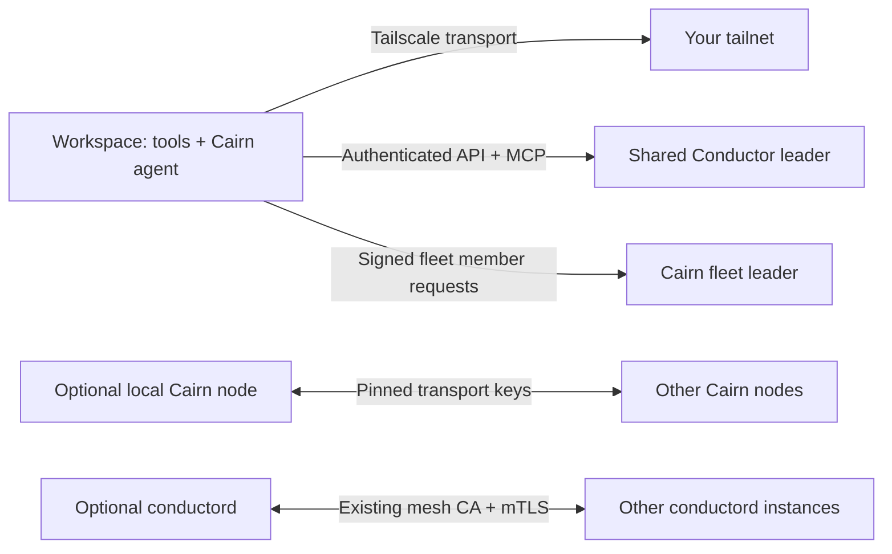

# Workmesh

One downloadable Bash script to install and launch your research tools, Cairn node/host agent, Tailscale, Conductor integration, and coding CLIs. It supports Linux amd64/arm64 and macOS Intel/Apple Silicon; Windows uses WSL2. It uses Bash 3.2+ and Python 3.9+.

This was built from the connected `aburan28/crypto`, `cryptanalysis`, `cairn`, `conductor`, `crypto-autoresearcher`, `crypto-lean`, and `ecdlp-cost-challenge` sources. The repo references identify **Cairn**, PARI/GP, and both custom F4/F5 implementations and external msolve. `dependency-inventory.json` records the evidence and limits of the review.

Download `bootstrap.sh` and keep your configuration outside the checkout. This branch exposes the standalone script at the URL below:

```bash
BOOTSTRAP_URL=https://raw.githubusercontent.com/aburan28/cryptanalysis/refs/heads/codex/workmesh-bootstrap-20261019/cloud/workmesh/bootstrap.sh
curl --fail --location --proto '=https' "$BOOTSTRAP_URL" -o bootstrap.sh
chmod +x bootstrap.sh
# Copy config.example.sh to ~/.config/workmesh.sh and edit the leader/peer settings.
bash bootstrap.sh plan --config "$HOME/.config/workmesh.sh"
bash bootstrap.sh bootstrap --config "$HOME/.config/workmesh.sh" --work-dir "$PWD"
source "$HOME/.local/share/workmesh/env.sh"
```

The branch URL follows updates during review. Replace the branch reference with a reviewed commit SHA for reproducible downloads. From a clone, run `bash cloud/workmesh/bootstrap.sh`; the script is self-contained. The companion files are documentation, platform adapters, an audit tool, and tests.

`research` installs several GB of tools. Build an image once, then use `up` or `run` on subsequent starts:

```bash
bash bootstrap.sh install --config ~/.config/workmesh.sh
bash bootstrap.sh login --config ~/.config/workmesh.sh
bash bootstrap.sh up --config ~/.config/workmesh.sh --work-dir /path/to/repo
bash bootstrap.sh run --config ~/.config/workmesh.sh --work-dir /path/to/repo -- python3 experiment.py
bash bootstrap.sh doctor --config ~/.config/workmesh.sh
bash bootstrap.sh stop --config ~/.config/workmesh.sh
```

For an entrypoint that also installs on first boot, use `run --install -- COMMAND...`. `run` preserves arguments, stdin, exit status, and forwards termination to the command's process group. On exit it stops services created by that invocation. `up` leaves services running under supervisors with private logs and a bounded restart budget. `stop` stops this installation's processes while retaining state and data. Configuration changes take effect after a stop/start; an already-running service keeps its original configuration. A failed bootstrap can be cleaned up with `stop`.

The ordinary `bootstrap` path offers vendor login when stdin is a terminal. Piped startup prints the Tailscale authentication URL if no key is provided, and tells you to run the interactive login command for coding tools. OAuth consent, account eligibility, and a repository's initial Claude trust confirmation still happen in the vendor's interface.

| Profile | Tools |
| --- | --- |
| `minimal` | C/C++, CMake/Ninja, native arithmetic build prerequisites, Rust, Go, Node, coding CLIs, cloud SDKs, node binaries, Tailscale, Docker CLI/host setup, runsc |
| `research` | Minimal plus a conda-forge Python environment, stock Sage if selected, PARI/GP, Singular, pinned msolve built from source, FLINT/NTL/fplll, lattice bindings, science/plotting packages, JupyterLab, SAT/SMT backends, ruff/mypy |
| `full` | Research plus the cryptanalysis lint/debug gates, cargo-deny, staticcheck/govulncheck, Typst, and Linux APT LaTeX/PDF packages |

Optional flags add Lean at the repo's `v4.35.0` pin, a separate JAX `0.4.35` environment, a separate NVIDIA CUDA toolkit environment, or the `crypto-autoresearcher` API-direct LangGraph stack (`INSTALL_AGENT_STACK=yes`, invoked with `api-agent-python`). CUDA drivers and NVIDIA container device support belong to the host/provider. cuPQC, Magma, proprietary FGb builds, TPU `libtpu`, and FPGA vendor toolchains require their own matching SDK/license/hardware setup. OpenCode installs its documented `opencode-ai` v1 package; a v2 migration is a separate version choice.

Existing Rust, Go 1.21+ (with automatic toolchain selection), and sufficiently recent Node installations are retained by default. Older Go installations are upgraded locally so they can load Conductor's newer module/toolchain directives. Cargo and Go resolve repo-specific dependencies from their manifests/locks when you build those repos. The installer does not build your experiments or run repository hooks. Use the repo's own locked build commands after entering its directory.

`SAGE_MODE=stock` adds general Sage without changing the repo's `./sage` launcher. For your patched elliptic-curve runtime, set `SAGE_MODE=patched` and `SAGE_LAUNCHER=/absolute/path/to/cryptanalysis/sage`; this exposes `sage-checked`. Build that runtime using the repo's pinned `scripts/sage_release.py` workflow and verify it with `./sage --runtime-info`. A general Sage installation cannot certify the custom native extensions or supply their receipts.

There are three distinct connections to configure:



For most workspaces, set `CONDUCTOR_MODE=client`, an HTTPS `CONDUCTOR_ENDPOINT`, your real `CONDUCTOR_PROJECT`, and a `CONDUCTOR_TOKEN_FILE` or existing Conductor login. Remote endpoints must use HTTPS so bearer tokens are not sent in cleartext; HTTP is accepted only for loopback endpoints. Startup verifies the connection, saves the native CLI login, then runs `conductor integrate` for Claude, Codex, Cursor, and OpenCode with global settings. The MCP launcher preserves the endpoint, CA selector and token-file reference for later tool sessions. Start tools after sourcing `env.sh`; restart an already-open IDE so it inherits the installed commands on PATH.

A host that should own a control plane can use `CONDUCTOR_MODE=local`. This delegates database creation and login to `conductor up` on **18081**, avoiding Cairn's **18080**. Supply `DATABASE_URL_FILE` for an existing PostgreSQL 16+ database, or provide a working Docker engine so Conductor can create its Postgres container. A root process inside a restricted pod cannot acquire a Docker daemon merely by installing Docker; use the existing leader there. The launcher tracks a newly started local daemon's PID/start identity before claiming it for shutdown; it leaves a reused daemon and database running.

If you actually want another Conductor peer daemon, use `CONDUCTOR_MODE=peer`, an existing database, its own mesh-issued certificate/key, and `CONDUCTOR_PEERS` or the DNS SRV discovery variables. Provision the node/project's application credentials in that database before launch. The script uses the existing CA and verifies certificates. **Conductor peer links carry connectivity/identity, not task-database replication.** Workspaces that need the same task board should connect to the same leader/database. Tailnet membership alone does not issue Conductor credentials or mesh certificates.

Cairn runs with `CAIRN_NETWORK=private` and `CAIRN_REQUIRE_SANDBOX=1`. Each installation keeps its own durable identity. Supply `CAIRN_BOOTSTRAP_FILES` or a directory of real, resolved peer JSON files to replicate with other nodes. Private mode has no public seed discovery, multicast, or router port mapping. Without peer files, the node is isolated and `doctor` reports peering as pending.

To share this node's **public** transport key, run `export-peer`. The key and printed seed entry are under `state/public-peer`; set the advertised address to this node's reachable tailnet hostname and P2P port. Assemble these entries into the seed-list format documented by Cairn, then resolve the list on each node:

```bash
cairn seeds resolve --list /run/config/seeds.json --keys /run/config/public-keys --out /run/config/peers
# In config: CAIRN_BOOTSTRAP_DIR=/run/config/peers
```

Check actual handshakes with `curl -fsS http://127.0.0.1:18080/sessions`. `peers[].status == "reached"` is evidence of a connection; an auth key, configured address, or running process is not. For a GPU box that only executes work, use `CAIRN_MODE=worker`, `CAIRN_NODE_URL`, and optionally the per-machine `CAIRN_FLEET_FILE` produced by `cairn fleet join`. Keep the leader's signing identity on the leader. The host agent registers hardware and runs its local spool; it does not automatically distribute experiments.

| Environment | Recommended setup |
| --- | --- |
| EC2/ordinary Linux VM | Ubuntu/Debian or Amazon Linux 2023/Fedora; native packages; system/owned kernel Tailscale; Docker host if needed |
| RunPod | Prebuild the research image; persist `WB_ROOT` on the network volume; reuse provider CUDA; connect as a Conductor client and Cairn worker/node |
| Modal / restricted coding containers | Build tools into the image; use Tailscale userspace mode; existing Conductor leader; Cairn worker with a loopback TCP forward |
| Claude Code / Codex / Cursor / OpenCode workspace | Run in the workspace terminal; source `env.sh` before starting subsequent tool sessions; integration is through Conductor MCP/hooks |
| macOS | Homebrew and a running authenticated system Tailscale app/daemon; Docker Desktop/Colima or a remote engine; no native Linux gVisor/Kata |

`platforms/` contains a Dockerfile, a Modal Sandbox launcher and a RunPod entrypoint. They are examples to adapt to your image and volume names. They do not create billable resources unless you run the provider launcher yourself. Distro package installation requires root or passwordless sudo; use `SYSTEM_PACKAGES=off` in a prepared image without those rights. Alpine and older Amazon Linux 2 are not native installer targets.

Tailscale userspace mode needs neither `/dev/net/tun` nor `NET_ADMIN`. It does not create kernel routes for arbitrary programs. New kernel nodes accept MagicDNS by default; set `TS_ACCEPT_DNS=false` if you provide your own name resolution. Existing authenticated daemons retain their preferences. For Conductor, set `CONDUCTOR_HTTP_PROXY=tailnet`; startup and the MCP gateway use the local Tailscale HTTP proxy while preserving the leader's HTTPS hostname and CA verification. This proxy is scoped to Conductor calls. For an ad hoc CLI check, use `HTTPS_PROXY=http://127.0.0.1:1056 conductor status` in that command's environment.

For Cairn's plain HTTP transport or P2P, configure `TAILNET_FORWARDS=("28080=leader.example.ts.net:18080")` and use `CAIRN_NODE_URL=http://127.0.0.1:28080`. The forward uses `tailscale nc` and listens only on loopback. Additional P2P forwards can be referenced as loopback addresses in your local bootstrap files, keeping the real transport public keys. Other nodes need a reachable listener for inbound connections; an operator can publish the local P2P port with Tailscale Serve's tailnet-only TCP forwarding. Userspace mode alone does not advertise that service. Do not replace an HTTPS hostname with `127.0.0.1` to get around certificate errors; use the scoped proxy.

The default isolation install is gVisor's checked `runsc` binary. It can be used by Cairn for root-filesystem jobs when namespaces are available. Image jobs require the runtime registered with their OCI engine; an administrator can run `sudo /absolute/path/to/runsc install` and reload that engine at an appropriate time. This installer does not rewrite an existing Docker daemon configuration or restart it to add runtimes. `ISOLATION=kata` validates an already-provisioned Kata runtime and `/dev/kvm`; provision the host-specific Kata guest/kernel/containerd configuration first. `cairn agent probe` reports what can actually run. `auto` never silently chooses unconfined jobs. `CAIRN_AGENT_SANDBOX=none` is an explicit operator choice for a provider-isolated container, and the job itself must request compatible isolation.

Authentication uses provider secret managers, ordinary CLI login files, or the supported `*_FILE` selectors in `config.example.sh`. Tailscale auth keys are passed through a temporary owner-only file, not command arguments. Generated environment files contain paths and non-secret selectors, with file references for API keys. Logs and service state are private to the installation. Keep `WB_ROOT` on persistent storage for the same node; do not bake an authenticated node's state into a shared image.

`login` uses Claude's native authentication and Codex device authentication. `remote` requests Claude Remote Control in the chosen working directory and starts Codex's guarded `remote-control` subcommand when the installed CLI supports it. Claude requires an eligible claude.ai login and may need one interactive `claude` launch to accept directory trust. The Claude session link is in `state/logs/claude-rc.log`. Codex Remote Control uses its vendor-managed shared app server; the launcher leaves that shared daemon running on stop so other Codex sessions retain their connection. Use `codex remote-control stop` explicitly when you want to stop it.

The scientific environment's resolved conda and pip inventories are exported to `state/research-explicit.txt` and `state/research-pip.txt`. Most CLI versions default to upstream latest; pin them in configuration or distribute a built image. Pinned msolve's digest is embedded. Cairn/Conductor release archives and Go/Node/rustup/Tailscale/micromamba/runsc downloads are checked against the indicated upstream hashes. Hashes served by the same upstream establish download integrity, not an independent release signature. Claude, Cursor and optional elan use their official HTTPS installers.

Conductor's checked `v0.1.5` release has no binary assets, so `CONDUCTOR_INSTALL=auto` falls back to the reviewed source commit in the configuration. Its `go.mod` currently selects Go **1.26.9**, newer than the README's stated minimum; Go toolchain downloads must be allowed. Set `CONDUCTOR_INSTALL=release` to require assets, or `source` to skip release discovery and use `CONDUCTOR_REF` directly.

To extend the dependency inventory over your actual local checkouts:

```bash
python3 audit-deps.py ~/src/crypto ~/src/cryptanalysis ~/src/crypto-autoresearcher --output dependencies.local.json
```

The audit reads manifests and Python ASTs and records tool references with file/line evidence. It does not import code, run setup hooks, or automatically install every mentioned package. Vendored/build trees and files over 2 MB are excluded. Python 3.11+ enables TOML parsing. This is an evidence inventory, not a complete transitive or dynamic dependency resolver.

Validation runs with temporary state, fake vendor CLIs, and real local processes/loopback HTTP:

```bash
bash -n bootstrap.sh
shellcheck -S warning bootstrap.sh config.example.sh platforms/*.sh
python3 -m unittest discover -s tests -v
```

Live OAuth, membership in your tailnet, peer certificates, provider GPU access, complete image provisioning, and every distro/architecture combination need validation on those targets. The bootstrap does not claim those from a successful local test.

Primary interface references: [Cairn](https://github.com/aburan28/cairn), [Conductor](https://github.com/aburan28/conductor), [patched Sage workflow](https://github.com/aburan28/cryptanalysis/blob/claude/cryptanalysis-repo-setup-p59kek/docs/SAGE_RELEASE.md), [msolve install](https://github.com/algebraic-solving/msolve/blob/master/INSTALL), [Tailscale userspace mode](https://tailscale.com/docs/concepts/userspace-networking), [Claude Remote Control](https://code.claude.com/docs/en/remote-control), [Codex CLI](https://developers.openai.com/codex/cli), [gVisor](https://gvisor.dev/docs/user_guide/install/), [Modal Tailscale example](https://modal.com/docs/examples/modal_tailscale).
