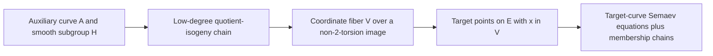

# PKM auxiliary-isogeny membership on M31

This implements the prime-field auxiliary-isogeny construction of
[Petit–Kosters–Messeng, sections 3.1–3.4](https://people.maths.ox.ac.uk/petit/files/16PKC_primeECDLP.pdf)
in the existing `suite/examples/pkm_tower_pilot.rs` instrument. It is a
construction and correctness change, not a performance comparison.

The target curve `E` and the auxiliary curve `A` have different roles:



No isogeny from `A` to the target curve `E` is required. The auxiliary
curve's supersingularity is not a property or weakness attributed to `E`.

## Implemented change

`--aux-supersingular` selects `A: y²=x³+x` at a prime `p=3 mod 4`, using
its known order `p+1`. It supports degree-2 chains and requires
`--kinds isogeny`. The original random auxiliary-curve search remains the
default. In particular, the default path still uses its historical point
counter; this change does not alter that algorithm or prior measurements.

For `p=2147483647`, a ten-level chain uses a subgroup of order `1024`.
The builder checks exact kernel-generator order, the image of every kernel
and coset representative on each codomain, distinct coset abscissae, and
the membership equations. Metadata includes the auxiliary equation/order,
construction choice, kernel generator, coset representative, and `V`.

At each level, with kernel `(xi,0)`, the rational map is

    next = x + tau/(x-xi),

and the low-degree constraint is

    next*(x-xi) - (x²-xi*x+tau) = 0.

The last `next` is the terminal image coordinate. The rational membership
check rejects every pole before division; it does not consult the list `V`.
Invalid field congruence, unavailable 2-power torsion, and an order-two
quotient that cannot supply the chosen kind of coset are rejected.

## Correctness checks

The example's unit tests include:

- Exhaustive membership checks over `F_31`, `F_127`, and `F_1019`, including
  pole rejection and small-field confirmation of the auxiliary order.
- Independent backward quadratic reconstruction of the entire M31 fiber;
  its abscissae must equal the explicitly enumerated 1024-element coset.
- M31 membership equations of degree two and target summation systems for
  every `m=2..9`. The fixed target is `y²=x³+x+4`; its point count differs
  from the auxiliary curve's, so these fixtures do not use an isogeny
  between the two curves. All planted polynomial assignments are checked,
  then the corresponding signed point relations are reconstructed by
  group addition.
- A small-field F4 solve whose complete returned abscissa-pair set is
  compared against direct signed point additions on the target curve.
- Existing odd/mixed-degree and F_61 guide fixtures remain in the suite.

These are known-answer correctness fixtures. The M31 `m=2..9` checks do
not run F4 at ten levels or discover unknown decompositions at that size.
They do not recover a target discrete logarithm or resolve the cofactor
accounting required by a complete subgroup DLP pipeline.

Run from the repository root:

```sh
cargo test --release --manifest-path suite/Cargo.toml --example pkm_tower_pilot
```

Local producer observation: the nine example tests passed with Rust
1.100.0 on the Linux workspace. This is unsigned unit-test evidence,
not an independently signed execution claim. [pcc:unverified]

The initial build resolved the base branch's stale `sha2 0.11.0` lock entry
to the manifest-required `0.11.1`. That unrelated dependency update is
excluded from this change. No frozen benchmark registry was modified.

## Sources checked and next step

- Primary paper above: the auxiliary curve supplies coordinate constraints;
  it need not be isogenous to the target curve.
- Workspace `docs/ic-thesaurus/prime-field.md`, especially the PKM and
  auxiliary-torus entries: reuse existing instruments rather than claim a
  new construction.
- Workspace `docs/notes/pkm-aux-curve-isogeny-20261123.md`: earlier degree
  and solver comparisons are prior observations, not comparison numbers
  imported into this change.
- `suite/examples/pkm_tower_pilot.rs`: reuse its Vélu maps, independent target
  selection, Semaev chains, F4 solver, and system exporter.
- KB unavailable: no research-kb MCP was loaded, and
  `scripts/research-kb status` reported no executable. The repository notes
  and primary paper supplied the fallback review.

The next experiment is a guarded solver run on the exported systems, with
actual returned roots lifted to target-curve relations. Comparative lead
work must use the workspace's frozen lead-sweep protocol. M31 construction
tests are not a replacement for those registry comparisons, whose primes
do not satisfy this opt-in constructor's `p=3 mod 4` precondition.

No solver benchmark or lead sweep was launched here. The checkpoint gate
requires an uploaded S3 resume checkpoint before such a run. The code and
correctness tests can be reviewed independently of that experiment step.
