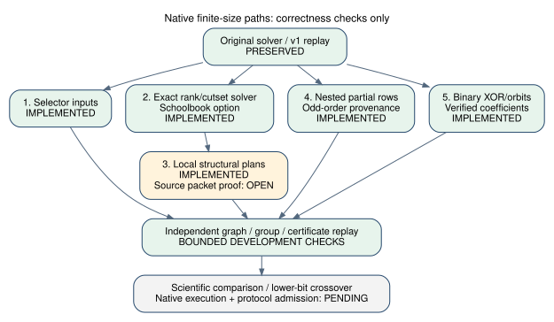

# Native finite-size extensions

This mirrors the opt-in finite-size implementation in
[crypto PR #2930](https://github.com/isogeny-labs/crypto/pull/2930).
The complete source-linked receipt at immutable crypto commit
[`e2c36e34c404907821a1e013d4b4dee49f09a0c3`](https://github.com/isogeny-labs/crypto/tree/e2c36e34c404907821a1e013d4b4dee49f09a0c3/research/hashed_ecdl_finite_size_20261030/implementation)
contains the prior literature/negative results, requirement table, raw local
logs and both source manifests. Later main integration is recorded on that PR.



Delivered: selector-domain witnesses and selector-input tensor graphs;
optional schoolbook/ripple encoding; bounded exact rank planning,
conditioning/elimination and witness propagation; nested partial-relation
collection with odd-order provenance/replay; checked odd-degree Koblitz
fields/groups, invertible XOR hashing and coefficient-carrying Frobenius
orbits. See the mirrored [public contract](../../bindings/rust/hashed-ecdl-tensor/FINITE_SIZE.md).

The runner adds `solve-selectors` and `solve-width` without replacing `solve`.
Oracle witnesses enter the original source-v1 reduction only after independent
point/hash/group replay; the original `verify` command checks selector CLI
receipts. Partial relations have a separate library certificate/verifier.
The existing strict JSON, bounded reader, canonical point, hash-proof,
functional pruning and scalar-companion changes are preserved.

Item 3 is partial: local exact cutset plans are checked on the actual graph,
but a smaller-parameter Appendix D packet schedule/proof is not implemented.
The original recursion guard and the independent full audit remain open.
Binary validation includes the official degree-131 reduction polynomial,
not full official challenge setup or scalar recovery. Changed hash/orbit
distributions have no inherited coverage theorem. No performance, sub-rho,
novelty or challenge-solve claim follows.

Final local release package checks pass **81 tests**: 51 library, 5 runner,
3 panel, 6 checked-hash, 9 new finite/CLI, 3 strict-JSON and 4 width controls.
All-target strict clippy, Rust1.78 and formatting pass. Exact commands:

```sh
cargo test --locked --release --manifest-path bindings/rust/Cargo.toml -p hashed-ecdl-tensor
cargo clippy --locked --all-targets --manifest-path bindings/rust/Cargo.toml -p hashed-ecdl-tensor -- -D warnings
cargo +1.78.0 check --locked --all-targets --manifest-path bindings/rust/Cargo.toml -p hashed-ecdl-tensor
cargo fmt --manifest-path bindings/rust/Cargo.toml -p hashed-ecdl-tensor --check
sha256sum -c docs/hashed-ecdl-finite-size-sources.sha256
```

Raw [tests](tests.txt.gz), [clippy](clippy.txt), [MSRV](msrv.txt) and
[source readback](source-check.txt) are retained here. The deterministic gzip
preserves the test log's exact bytes including its final blank line.
`raw-transcripts.sha256` binds the decompressed bytes. The four new modules,
lib/encoding additions, two new integration suites and FINITE_SIZE.md match
their crypto counterparts byte for byte; independent existing core differences
were preserved with a patched integration. No frozen evidence was rewritten.

The [current PDF](report.pdf), its [source](report.tex) and editable diagram
are copied from the paired implementation receipt; both PDF pages were rendered
and visually inspected. No new quantitative result or curve transport edge
changes canonical graphs or scoreboards. No scientific profile, lower-bit
panel or original frozen A/B comparison ran. Earlier S3 upload/readback passed;
native execution/image/admission and current execution-host checkpoint remain
separate prerequisites. Both challenge scalars remain unresolved.

Conductor is unavailable, so its documented development fallback applies;
no reservation is claimed. Integration started from main
`82eb1eacf4130ef35ccc9cda4792a6017ab0fa08` and keeps all prior work.
Remote checks, reviews and merge verification are additional gates.
