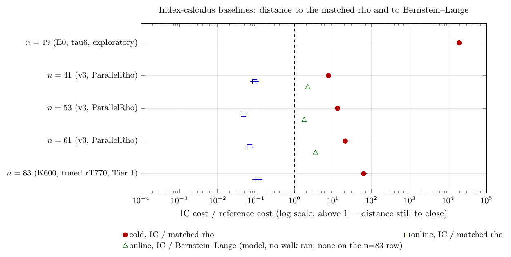

# Index-calculus baselines: the ratchet

**Status (2026-10-15).** This is the first edition of the ledger, with the tuned-rho
rows added from run 38777903922. It takes no new measurement: every number is
copied from a committed experiment, and each row cites that experiment. Figure 1
was checked and stays current: no baseline row's numbers changed. The n=83 rows for lift_scan, the Feistel order and their (not promoted)
combination were added on 2026-10-15; Figure 1 was checked and stays
current, because no baseline row's numbers changed. The n=83 row for the probe pipeline was added on 2026-10-16, the two-level root table and the state fold the same day, each with the same Figure 1 check. On 2026-10-16 the stacked producer (`koblitz-n83-stacked-20261016`, run 38862448935) replaced B's n=83 baseline row, and Figure 1 was re-rendered. Also on 2026-10-16, an accounting correction (sheriff case SHF-20261016-3caa6f, K3 and K4): the n=83 row's `s_ic_setup` was 0.8856, which is setup without the rank stage plus online, while every other row's (B's 32.848 included) is cold minus online with the rank stage in it. It is now 9.6673 on that one meaning, and the B → stack ratchet entry records the paired within-run delta. No measurement changed, and Figure 1 (gaps only) is unchanged. Also on 2026-10-16, disclosures from the same case (K1, K2, R1; no number changed): the n=83 row's headline and `S` are wall time on one host class, with the host-independent operation-count ratio (rank-stage probes and root calls 1.4773x) beside it; factor-base construction is charged to neither arm, so the row's ratio is an upper bound and its cold `S` a lower bound; the §5a GAE band is not computable from that run; and the run was not replayed on another host class. On 2026-10-17, corrections from re-audit SHF-20261017-e4d7f6 (K-N1, K-N2, K-N4; no measurement changed): the setup convention now names what each row leaves out (both n=83 rows leave out factor-base construction; B's row also leaves out 51.3 ms of linear algebra and 32.3 ms of input control, now listed in its JSON `uncharged_phases`); the B → stack history entry's standard gap fields now hold the paired within-run gaps, with B's cross-run figures under `cross_run_context_*`; the n=83 rank stage rounds to 8.7949 (8.79486), not 8.7948; and 2.2837 is per-probe wall time, not a host-speed factor. A replay of rank block K1 with one timed base construction is preregistered (`experiments/koblitz-n83-replay-20261017/PROTOCOL.md`). Figure 1 (gaps only) is unchanged. On 2026-10-17 that replay was archived (`experiments/koblitz-n83-replay-20261017/RESULTS.md`, [run 39007026856](https://github.com/aburan28/cryptanalysis/actions/runs/39007026856)): `replay_pass` on another host class (Intel Xeon Platinum 8573C), rank-stage work identical, per-probe wall ratio 2.6583 there against 2.2905 on the EPYC; construction time X = 427.5 ms is now measured. The n=83 row's replication and uncharged-phase notes record it; no figure of the row changed, and Figure 1 is unchanged. On 2026-10-19 the rank-cut producer (`koblitz-n83-rankcut-20261016`, run 38891404048) replaced the stacked producer's n=83 baseline row (end-to-end cold 1.3336 [1.3300, 1.3377] over the stack, wall time on one host class, probes and root calls unchanged), and Figure 1 was re-rendered. Also on 2026-10-19 the rank-probe producer (`koblitz-n83-rankprobe-20261019`, run 39214027289) replaced the rank-cut producer's n=83 baseline row (end-to-end cold 1.1033 [1.1010, 1.1056] over the rank-cut producer, wall time on one host class, probes and root calls unchanged), and Figure 1 was re-rendered. Also on 2026-10-19 the index-lift producer (`koblitz-n83-indexlift-20261019`, run 39290913632) replaced the rank-probe producer's n=83 baseline row (end-to-end cold 1.0344 [1.0324, 1.0364] over the rank-probe producer with a shared rank stage, wall time on one host class, stored states and table slots byte-identical, probes and root calls unchanged), and Figure 1 was re-rendered. Also on 2026-10-19 the nested 899-column factor base under the rank-probe producer (`koblitz-n83-k899-20261019`, run 39306394645) was recorded as promoted over the rank-probe producer at K600 (end-to-end cold 1.1873 [1.1247, 1.2523], wall time on one host class); the n=83 baseline row names the index-lift producer, not the rank-probe producer, so the row was not replaced (record in Other verified records and the history), and Figure 1 is unchanged. Also on 2026-10-19 the closure producer (`koblitz-n83-closure-20261019`, run 39305259093) was recorded as a promoted improvement over the rank-probe producer (end-to-end cold 6.4444 [6.0993, 6.7853], wall time on one host class); it compared against the rank-probe producer, not the index-lift row, so no baseline row changed (baseline row not replaced: paired run against the index-lift row pending) and Figure 1 was not re-rendered. Also on 2026-10-19 the rotation-key producer (`koblitz-n83-rotkey-20261019`, run 39299176306) was recorded as not promoted (frozen primary not_separated against the rank-probe producer, 0.9983 [0.9701, 1.0227]); no baseline row changed and Figure 1 was not re-rendered. Also on 2026-10-20 the closure + index-lift producer (`koblitz-n83-closure-indexlift-20261019`, run 39335956567) replaced the index-lift producer's n=83 baseline row (end-to-end cold 7.6558 [7.2192, 8.1103] over the index-lift row, wall time on one host class, rank stage 143.7 s -> 4.01 s, factor-base construction charged to no arm); it also supersedes the closure's earlier comparison against the rank-probe producer (run 39305259093), and Figure 1 was re-rendered. Also on 2026-10-19 a separately labelled reference row was added for the known-log base (`koblitz-n83-knownlog-20261019`, run 39307634508: end-to-end cold 2.19 [1.86, 2.59] over rT770, above rho); it has no relations, is not an IC improvement, does not replace the n=83 baseline, and Figure 1 (baseline rows only) is unchanged. Also on 2026-10-19 the online-frame experiment (`koblitz-n83-onlineframe-20261019`, run 39303742695) was recorded as a stage improvement over the rank-probe producer (online cS / cF 1.5733 [1.5714, 1.5753], 64 points, wall time on one host class, probes and root calls unchanged) in Other verified records and the ratchet history; the n=83 baseline row was not changed (it stacks with the index lift and the closure, combined run pending), and Figure 1 is unchanged. Also on 2026-10-20 the index-build producer (`koblitz-n83-indexbuild-20261020`, run 39383739494, Tier 1 repeated alternating pairs) replaced the closure + index-lift producer's n=83 baseline row (end-to-end cold 1.7406 [1.7129, 1.7676] over 36 alternating pairs, wall time on one host class, root-index build 17,084.8 -> 7,247.2 ms, rank stage and online unchanged, factor-base construction charged to no arm); the superseded row, with its Tier 1 qualification from run 39359922687, moved to Other verified records, and Figure 1 was re-rendered. Also on 2026-10-20 the round-2 index-build producer (`koblitz-n83-indexbuild2-20261020`, run\ 39464544962, Tier 1 repeated alternating pairs) replaced the index-build producer's n=83 baseline row (end-to-end cold 1.1169 [1.1110, 1.1231] over 36 alternating pairs, wall time on one host class, root-index build 6,501.9 -> 5,170.8 ms, rank stage and online running the same source, factor-base construction charged to no arm); the superseded row, with its Tier 1 qualification from its own promoting run\ 39383739494, moved to Other verified records, and Figure 1 was re-rendered. The machine-readable twin is
[`baselines.json`](baselines.json); update both files in the same change. On 2026-10-20 the native-solve producer (run\ 39387473809, cold CPU B / N 141.02 [136.75, 144.95]) replaced the n=19 row, the old row moved to Other verified records, and Figure 1 was re-rendered.

## The rule this file serves

AGENTS.md, "Success criterion: iterative improvement of the index-calculus
baseline" (owner, 2026-10-15; cryptanalysis#919, crypto#1908):

- **The baseline** for a curve and size is the best current verified IC
  pipeline. It is frozen with its protocol, receipts and end-to-end cold `S`.
- **A success** is any verified, measured improvement over that baseline on
  the same instances, under a protocol frozen before timing. Advance and
  engineering both count. Relabelling and accounting are recorded and do not
  count.
- **The ratchet.** A landed improvement replaces the row here, and the old
  row moves to [the history](#ratchet-history) with its delta.
- **The gap** to the matched rho, and to Bernstein–Lange (BL) where it was
  measured, is the distance remaining. It is not a pass/fail gate. A claim
  to *beat* rho still needs every reference rule: a cold `S` below the
  matched rho's, robust at growing `n`, independently replayed.

**How to read the numbers.**

- **One row, one experiment.** No row combines numbers from two experiments.
  Where an experiment did not measure a quantity, the cell says so.
- **Every gap is IC cost over the reference's cost.** Above 1 is distance
  still to close; below 1 means the IC is cheaper on that boundary. The
  sources quote the online figure the other way up (rho over IC). That
  figure is kept in each JSON row's `source_figure`.
- **`S` = cost / √r**, in the row's own unit. The unit differs between
  experiments, so compare `S` inside a row only. The gaps carry no unit.
- **Setup `S` has one meaning on every row:** `s_ic_setup` =
  `s_ic_cold` - `s_ic_online`: the reusable work for the first target that
  the row's experiment charged, the relation-collection / rank stage and the
  linear algebra (or the verified load of its cached table) included, less
  every phase the JSON row names in `uncharged_phases`. Only n=41–61 (rule
  v3, which builds the factor base inside setup) charge all reusable work.
  Both n=83 rows leave out factor-base construction (the K600 base is loaded
  from a file); B's row also leaves out its linear algebra (51.3 ms) and
  setup input control (32.3 ms), 0.015% of its P_IC. n=19 has no setup `S`. Where the rank stage is timed on its
  own (n=83), the JSON row also splits it into `s_ic_rank_stage` +
  `s_ic_setup_without_rank_stage`. "Cold without the rank stage" is a
  different quantity and is never written into `s_ic_setup`.
- **Tuned rho** means rT770: A's tuned `StrongRhoG` (Fold field kernel, 64
  lanes, DP 6, escape off). `koblitz-n83-reconcile-20261014` found it to be
  the fastest correct n=83 reference. At n=41–61 it has been run as rT770's
  configuration on the one-word kernel (`koblitz-s23-tuned-rho-20261015`).
  ParallelRho, inside crypto's `ic price`, is crypto's own signed-Frobenius
  walk (64 lanes in lockstep). It is the matched rho at n=41–61, but it is
  not rT770.

## The baselines

| n | curve | current best verified IC pipeline (commit; protocol) | targets | `S` cold / online (IC) | `S` cold / online (rho) | cold gap, IC / rho [95%] | online gap, IC / rho [95%] | gap to tuned rho (rT770) | gap to BL (online, IC / BL) | evidence tier | next improvement to try |
|--:|:------|:----------------|:------|-------:|-------:|-------:|-------:|:----------|:-------|:------|:------------|
| 19 | E0 / GF(2^19), a=1 | volcano-ic tau-orbit dim-6 base with the per-shift Groebner solve in native code (arm N: `tauDlp` with `tauRelationNative`; base, shifts, relations and linear algebra are the tau6 arm's; candidate `IC1N19Ckb0fb1064PDP2nativeenumRCsampleLAkernelTDpdpISO0h6952f30ce00e`); cryptanalysis `4ef371544` (workflow-only fix over the frozen `92d85f14`); `volcano-n19-native-tau6-v3-20261020/protocol.json` (sha256 `db9089bb...`); run\ 39387473809 | 20 new held-out scalars, 60 alternating B/N pairs (3 per point), +60 N/Naa and 20 NX/N pairs, 20 rho processes | 31.42 / 21.40 (CPU in this run's rho group operation, 3.0095e-5 s; setup 10.02) | 0.2661 / not separable | **117.9** [113.4, 122.6] (CPU, geometric mean of 60 pairs; the previous row read 1.94e4 in another run, host and unit) | not computed: online S 21.40 against the rho's 0.2661 cold is about 80 (point estimates, no interval) | none; the matched rho is a signed-Frobenius walk at 0.997x the floor in steps, run in Python/Sage, not tuned for wall time | none | Tier 1 (one GitHub-hosted Hyper-V runner, AMD EPYC 9V74, one pinned vCPU, CPU only; cold B/N 141.02 [136.75, 144.95], A/A 1.0003, planted 140.8 [136.6, 144.6], 24/24 gates; not replayed) | The Groebner solve is 15.4% of N's cold CPU; setup is 31.9% and the rest of the online stage 52.7%. Move those out of Sage and re-run against the same rho arm. Run\ 39526183111 (N2, the whole tau6 IC in native code, against this row's arm N) was INVALID: its Sage smoke gate failed (8 of 24 gates false; the planted arm crashed on `--lib` option parsing) and the timed job was skipped, so there is no result and this row is unchanged. Re-freeze with the planted arm and the profile script fixed, then re-run N2 against N. |
| 41 | K_0 / GF(2^41) | `ic price --single-target` at IC programme baseline v3: 6,560 points, 80 columns, aimed m=3 collection, m=2 pair-table descent; crypto `995ea207`; rule v3 | 64 public points, 1 process each, +4 A/A | 11.17 / 0.121 | 1.459 / 1.318 | **7.66** [6.90, 8.61] | 0.092 [0.071, 0.116] | **measured in a separate experiment, not combined**: see the 41 row of Other verified records (run 38777903922: online IC/tuned 0.09, cold 6.6); the matched rho in this row is ParallelRho (0.56× the strong walk's ns/step) | model only: 2.21 | crypto isolated_bench container | Setup is 98.9% of cold `S`: cut the reusable setup at fixed recipe, as a new IC programme round against v3 |
| 53 | K_0 / GF(2^53) | same pipeline, 27,984 points, 264 columns; crypto `995ea207`; rule v3 | 64 + 4 A/A | 16.98 / 0.058 | 1.282 / 1.236 | **13.2** [11.8, 15.0] | 0.047 [0.036, 0.059] | **measured in a separate experiment, not combined**: see the 53 row below (online 0.0423, cold 10.6); ParallelRho here is 0.53× strong | model only: 1.77 | crypto isolated_bench container | Setup is 99.7% of cold `S`: cut it at fixed recipe; then price the n=53 representative-plus-Frobenius orbit domain as its replacement |
| 61 | K_0 / GF(2^61) | same pipeline, 39,040 points, 320 columns; crypto `995ea207`; rule v3 | 64 + 4 A/A | 24.93 / 0.079 | 1.189 / 1.168 | **21.0** [18.6, 23.8] | 0.067 [0.051, 0.088] | **measured in a separate experiment, not combined**: see the 61 row below (online 0.0687, cold 18.9); ParallelRho here is 0.50× strong | model only: 3.52 | crypto isolated_bench container | Setup is 99.7% of cold `S`, and the cold gap grows as r^0.18: cut the setup; price the compact-orbit K=500 producer on these 64 points |
| 83 | K_1 / GF(2^83) | the round-2 index-build producer (arms cM38IC / kM38IC; secondary cM10IC): the index-build producer (arms cM38IB / kM38IB, the previous row) with the same root index built from fewer field products and a linear key finder, both exact: each state's roots from the three inverses 1/l, 1/r and 1/(l+r) (one inversion of a lane-wise sum of products, 7 field products per state instead of 11) and each root's index key and shift from the linear run finder, eight roots in lock step (equal to lift_scan on every stored root, 0 mismatches on K600, M38 and M10); the prefetched look-ahead insert loop and the full scan self-test are the previous row's; every stored state, table slot and layout digest equals the previous row's (gated per process on K600, M38 and M10), so the relations, probes, rank stage and online scan are the previous row's code over the same index (7 counted, invertible edits of the derived source `bc6a31c7...`; candidate ID below is the previous row's: same base and recipe, no new IC1 manifest); crypto `770f6a69`; `koblitz-n83-indexbuild2-20261020/protocol.json` (sha256 `5cee1a72...`) at cryptanalysis `d2d633088`; run\ 39464544962 | 12 new public points (3 alternating primary pairs each, 36 pairs; 2 A/A pairs and 1 planted pair per point), rank blocks 36 of kM38IB and 60 of kM38IC (16 attempts, seeds 1501-1536; 24 A/A), Q0 | 0.4531 / 0.01305 (wall time in rT770 steps, 275.04 ns, one host class; setup 0.4401, of which rank stage 0.1656; factor-base construction not charged, so cold is a lower bound; measured X = 0.43 s gives 0.470, illustrative) | 0.1026 / 0.0918 | **4.416** (end-to-end cold: rank stage + setup + online; point estimate, no interval computed in this run; the previous row's arms in the same run read 4.933, but the previous row as landed read 4.158 in its own run: a cross-run artifact of host class and rT770 step, see the notes; wall time, one host; section 5a band not computable) | 0.1422 (point estimate; the previous row's arms in the same run read 0.1434: online code unchanged) | **measured on this row**: end-to-end cold 4.416, online 0.1422 (point estimates, one run) | not measured on this row (B's 235 [61, 645] is in Other verified records) | Tier 1 (GitHub runner, one pinned CPU, CPU-only), **qualified in the promoting run** (repeated alternating pairs, run\ 39464544962): 1.1169 [1.1110, 1.1231] over 36 alternating pairs, A/A 0.9996 and 0.9993, planted 2.5856 [2.5830, 2.5883], 282/282 rows valid; instance scope, no host-wide exclusivity; not replayed on another host class | The cold path is still 7.32 s of the 11.54 s end-to-end cold cost (63.5%): setup 6.99 s, of which the root-index build is 5.17 s and the self-test 1.44 s; the rank stage is 4.22 s (36.5%). Cut the remaining index build (insert loop, state loop), the self-test, then the probes per relation; K899 and the closure are not combined yet; re-run the BL arm on this producer |



*Figure 1. The baseline rows' gaps on a log scale: cold and online to the
matched rho, and online to Bernstein–Lange (a model; the one measured n=83
BL gap is in B's row, now under Other verified records). Each row is one experiment. Bars are 95% intervals where the
source gives one (the n=83 gaps are point estimates: the promoting run computed no interval for them) ([source](figures/baselines_gap.tex),
[vector](figures/baselines_gap.pdf)).*

**Curves and candidates.**

| n | curve ID | ICV1 slug | r | IC1 candidate of the baseline |
|--:|:----------|:-------------|---------:|:---------------------------------|
| 19 | `EC1N19Ckb1h01617b86df6c` | (volcano-ic surface curve E0) | 130,873 | none recorded |
| 41 | `EC1N41Ce0he09550ab560a` | `icv1-f2m41-tm2308219-7f48b14a` | 549,756,390,943 | `IC1N41Ckb0fb6560PDP3pairtableRCaimedLAsparseTDwalkISO0h5b25909970b3` |
| 53 | `EC1N53Ce0hb097de99be9a` | `icv1-f2m53-tm56619371-dac20a85` | 21,044,858,204,113 | `IC1N53Ckb0fb27984PDP3pairtableRCaimedLAsparseTDwalkISO0h715dd7692112` |
| 61 | `EC1N61Ce0hd8c15448081e` | `icv1-f2m61-t158598901-ab42b6c5` | 162,888,033,982,417 | `IC1N61Ckb0fb39040PDP3pairtableRCaimedLAsparseTDwalkISO0he9352435e473` |
| 83 | `EC1N83Ce1h35c7ced6b497` | `icv1-f2m83-t6151469093347-9eba6cd5` | 8,569,786,107,849,059 | `IC1N83Ckb1fb99600PDP4s3rootindexRCguidedLAdenseTDsingleISO0hc0ecc1fffbd7` |

**Notes on the rows.**

- **n=19.** The `S` unit is one rho group operation of CPU time in the
  promoting run (3.0095e-5 s on its AMD EPYC 9V74 host; the previous row's
  2.17e-5 s was another host, so the two `S` are not compared). The IC's
  cold `S` is the native-solve arm's CPU per ECDLP in that unit, with setup
  (10.02) and online (21.40) timed apart. The same run measured the
  previous pipeline (arm B) at cold 4,429.3, which is 141.02 [136.75,
  144.95] times N's CPU in the 60 alternating pairs. The rho is Python/Sage
  and not wall-time tuned, so the gap of 117.9 is a native IC against a
  non-native rho.
- **n=41–61.** The unit is one batched affine addition, measured in each
  row's own process. v3's unit is 2.3–3.2× cheaper than §23's, so `S` is
  not compared across the two (rule v3 README). Every row passes
  `validate_claim` at `vs_rho` (68/68 per size). Both certificates were
  replayed outside the process, and the logarithms equal §23's.
- **n=83.** `S` is derived inside the one run (39464544962): wall ms divided
  by that run's measured rT770 step (275.04 ns) and by sqrt(r), so one unit is
  25,460.9 ms. End-to-end cold is the mean rank stage (kM38IC, 4,216.1 ms
  over the 36 primary blocks of 16 attempts, 0.1656) plus the mean cold (setup
  6,989.0 ms including the verified load of the cached factor-log table,
  0.2745, plus online 332.4 ms, 0.01305) over the 12 points: 0.4531. Setup,
  rank stage included, is 0.4401 (0.16559 + 0.27450 = 0.44009); cold without
  the rank stage is 0.2876. The same run's previous-row arms (kM38IB + cM38IB,
  the former row) read 0.5061 (rank stage 0.1664, cold without rank 0.3398).
  BL was not run on this producer.
  - *Wall time, one host class.* The headline 1.1169 and every `S` are wall
    time from one run on one GitHub runner, not operation counts. The index is
    unchanged (one layout-digest set per base, equal to the frozen values), and
    per rank seed every relation, probe vector, root call and counter is equal
    across kM38IB, kM38IC and kM38ICaa. The saving is the root-index build,
    6,501.9 -> 5,170.8 ms (1.2574 [1.2563, 1.2586]; 98.7% of the 1,348.8 ms
    end-to-end saving), setup 1.1898 [1.1844, 1.1954], cold 1.1816 [1.1746,
    1.1891]. The self-test is unchanged (0.9979 [0.9750, 1.0214]). The rank
    stage (1.0046 [1.0033, 1.0059]; 148.59 and 147.95 ns per probe) and online
    (1.0082 [1.0068, 1.0098]) run the same source in both arms: their
    intervals exclude 1 by under 1%, an offset this run does not explain and
    that is not a gate; with both set to 1 the ratio would be 1.1148. The probe
    law is the same for both arms (1.0479, gate band 0.80-1.20, pass).
    Controls: A/A end to end 0.9996 [0.9968, 1.0024], A/A cold 0.9993 [0.9953,
    1.0036], planted index build cM38ICX / cM38IC 2.5856 [2.5830, 2.5883]
    (30,682,720 roots checked, frozen layout kept).
  - *Uncharged phase.* Factor-base construction is charged to no arm (the K600
    base and each closure header are loaded from file; common to the arms, so
    R > 1 holds for any X; 1.1169 is an upper bound and cold `S` 0.4531 a lower
    bound). At the X measured on another host class (427.5 ms, K600 base) the
    every-phase figures are R 1.1127 and cold `S` 0.4699: illustrative, mixing
    two hosts.
  - *Section 5a band.* Not computable: the IC arms emit no group additions,
    scalar multiplications, canonicalizations, fold rotations or index
    inserts.
  - *Replication.* The run is itself a Tier 1 repeated-alternating-pair
    measurement (36 pairs, instance scope; isolation gaps in the experiment's
    README). Not replayed on another host class (`verify_receipt.py`
    reproduces `result.json` and `result_table.md` byte for byte on a copy of
    the whole receipt directory).
  - *Not comparable across runs (cross-run rho-gap artifact).* This run's
    rT770 step (275.04 ns), runner (an Intel Xeon Platinum 8370C with AVX-512
    exposed) and online mean (332.4 ms) differ from run\ 39383739494's
    (317.40 ns, an AMD EPYC 9V74 without AVX-512, 586.7 ms), so the row's `S`
    and gaps are not a delta of the index-build row. The previous row as
    landed read gap 4.158 and online 0.1845; its arms read 4.933 and 0.1434 in
    this run. The new row's 4.416 is therefore numerically larger than the
    old row's landed 4.158 although it is the faster producer: only the paired
    ratio and the paired within-run gaps (the former arms 4.933 [point
    estimate] to 4.416, online 0.1434 to 0.1422) are a delta.
- **n=83, the index-build producer (Other verified records).** `S` is derived inside the one run (39383739494): wall ms divided
  by that run's measured rT770 step (317.40 ns) and by sqrt(r), so one unit is
  29,382.9 ms. End-to-end cold is the mean rank stage (kM38IB, 4,429.9 ms
  over 36 blocks of 16 attempts, 0.1508) plus the mean cold (setup 9,195.0 ms
  including the verified load of the cached factor-log table, 0.3129, plus
  online 586.7 ms, 0.01997) over the 12 points: 0.4837. Setup, rank stage
  included, is 0.4637 (0.15076 + 0.31294 = 0.46370); cold without the rank
  stage is 0.3329. The same run's previous-row arms (kM38I + cM38I, the former
  row) read 0.8419 (rank stage 0.1509, cold without rank 0.6910). BL was not
  run on this producer.
  - *Wall time, one host class.* The headline 1.7406 and every `S` are wall
    time from one run on one GitHub runner, not operation counts. The index is
    unchanged (one layout-digest set per base, equal to the frozen values), and
    per rank seed every relation, probe vector, root call and counter is equal
    across kM38I, kM38IB and kM38IBaa. The saving is the cold path: root-index
    build 17,084.8 -> 7,247.2 ms (2.3574 [2.3539, 2.3611]), self-test 2,233.6
    -> 1,531.6 ms (1.4583 [1.4480, 1.4708]), setup 2.1446 [2.1404, 2.1493],
    cold 2.0756 [2.0299, 2.1139]. The rank stage is unchanged (1.0008 [0.9982,
    1.0032]; 164.02 and 163.94 ns per probe) with the same probe law (0.9937
    for both arms, gate band 0.80-1.20, pass), and online is unchanged (0.9947
    [0.9888, 1.0006]). Controls: A/A end to end 0.9998 [0.9984, 1.0011], A/A
    cold 0.9994 [0.9977, 1.0010], planted index build cM38IBX / cM38IB 2.0847
    [2.0812, 2.0876] (30,682,720 roots checked, frozen layout kept).
  - *Uncharged phase.* Factor-base construction is charged to no arm (the K600
    base and each closure header are loaded from file; common to the arms, so
    R > 1 holds for any X; 1.7406 is an upper bound and cold `S` 0.4837 a lower
    bound). At the X measured on another host class (427.5 ms, K600 base) the
    every-phase figures are R 1.7190 and cold `S` 0.4982: illustrative, mixing
    two hosts.
  - *Section 5a band.* Not computable: the IC arms emit no group additions,
    scalar multiplications, canonicalizations, fold rotations or index inserts.
  - *Replication.* The run is itself a Tier 1 repeated-alternating-pair
    measurement (36 pairs, instance scope; isolation gaps in the experiment's
    README). Not replayed on another host class (`verify_receipt.py`
    reproduces `result.json` byte for byte on a copy of the whole receipt
    directory).
  - *Not comparable across runs.* This run's rT770 step (317.40 ns), runner
    (no AVX-512 exposed, transparent hugepages `always`) and online mean
    (586.7 ms) differ from run 39335956567's (281.09 ns, 257.9 ms) and from
    run 39359922687's (246.64 ns), so the row's `S` and gaps, including the
    online gap 0.1845 against the former row's 0.0925, are not a delta of the
    closure + index-lift row. The paired ratio and the paired within-run gaps
    (the former arms 7.238 [point estimate] to 4.158, online 0.1836 to 0.1845)
    are.
- **n=83, the closure + index-lift producer (Other verified records).** `S` is derived inside the one run (39335956567): wall ms divided
  by that run's measured rT770 step (281.09 ns) and by sqrt(r), so one unit is
  26,021.1 ms. End-to-end cold is the mean rank stage (kM38I, 4,010.5 ms over
  16 blocks of 16 attempts, 0.1541) plus the mean cold (setup 16,698.9 ms
  including the verified load of the cached factor-log table, 0.6417, plus
  online 257.9 ms, 0.0099) over the 20 points: 0.8058. Setup, rank stage
  included, is 0.7959 (0.15413 + 0.64175 = 0.79587); cold without the rank
  stage is 0.6517. The same run's baseline arm (kPI + cPI, the former row) reads
  6.1689 (rank stage 5.5217). BL was not run on this producer.
  - *Wall time, one host class.* The headline 7.6558 and every `S` are wall
    time from one run on one GitHub runner, not operation counts. The index is
    unchanged (one layout-digest pair per base, equal to the frozen values;
    for K600 index-lift's `d8cfe443...` / `5f53764e...`); the saving is the
    rank stage, 600 attempts -> 16 (143,681.3 ms -> 4,010.5 ms, 35.83x), at
    the same per-probe wall time (142.55 ns kPI, 143.08 ns kM38I) and the same
    probe law (kM38I 1.0304 [0.8728, 1.1825], gate band 0.80-1.20, pass). The
    cold path is not improved: cPI / cM38I cold without rank 0.9931 [0.9837,
    1.0035], setup 0.9830, index build 0.9753, online 1.6445 [1.0217, 2.7261].
    Controls: A/A end to end 1.0001 [0.9979, 1.0023], A/A cold 1.0006
    [0.9979, 1.0032], planted kM38IX / kM38I per attempt 1.9607 [1.9470,
    1.9747]. Secondary M10I (60 columns): kPI+cPI / kM10I+cM10I 4.9504
    [4.5846, 5.3402]; kM10I+cM10I / kM38I+cM38I 1.5465 [1.4482, 1.6520].
  - *Uncharged phase.* Factor-base construction is charged to no arm (the
    closure header's images alpha(R_c) included; common to the arms, so R > 1
    holds for any X; 7.6558 is an upper bound and cold `S` 0.8058 a lower
    bound). At the X measured on another host class (427.5 ms, K600 base) the
    every-phase figures are R 7.5226 and cold `S` 0.8222: illustrative,
    mixing two hosts.
  - *Section 5a band.* Not computable: the IC arms emit no group additions, scalar
    multiplications, canonicalizations, fold rotations or index inserts.
  - *Replication.* Not replayed on another host class (`verify_receipt.py`
    reproduces `result.json` byte for byte on a copy of the whole receipt
    directory).
  - *Not comparable across runs.* This run's rT770 step (281.09 ns), kPI rank
    stage (143.7 s) and online mean differ from run 39290913632's (280.33 ns,
    148.4 s, 392.3 ms), so the row's `S` and gap are not a delta of the
    index-lift row; the paired ratio and the paired within-run gaps (kPI + cPI
    52.5 [44.0, 63.5] to kM38I + cM38I 6.86 [5.80, 8.19]) are.
- **n=83, the index-lift producer (Other verified records).** `S` is derived inside the one run (39290913632): wall ms divided
  by that run's measured rT770 step (280.33 ns) and by sqrt(r), so one unit is
  25,950.6 ms. End-to-end cold is the shared rank stage K (148,384.4 ms, the
  mean over three rank blocks of the mean of kP and kPI; 5.718, 5.71795
  unrounded) plus the mean cold (setup 16,420.2 ms including the verified
  load of the cached factor-log table, 0.6327, plus online 392.3 ms, 0.0151)
  over the 20 points: 6.366. Setup, rank stage included, is 6.351 (5.71795 +
  0.63275 = 6.35069); cold without the rank stage is 0.6479. BL was not run
  on this producer.
  - *Wall time, one host class.* The headline 1.0344 and every `S` are wall
    time from one run on one GitHub runner, not operation counts. The
    stored states and the table slot array are byte-identical (stored-state
    blake3 `d8cfe443...` and table-slot blake3 `5f53764e...` in all 110 IC
    processes, equal to the frozen values), and every relation, per-attempt
    probe count (mean 1,746,508), root-call total and point-addition counter
    is equal across kP and kPI, so the operation counts did not change. The
    saving is index-build wall time (19,778.4 ms against 14,106.3 ms, 1.4021
    [1.4004, 1.4036]); the planted control cPIX (every root keyed by lift_scan
    and checked against the selected canonicalizer, 29,880,600 roots, no
    difference) costs 1,184.6 ms more than cP. The rank stage is shared, not
    a treatment: kPI / kP per attempt 0.9981 [0.9966, 0.9994].
  - *Uncharged phase.* Factor-base construction is charged to neither arm
    (common to both, so R > 1 holds for any X; 1.0344 is an upper bound and
    cold `S` 6.366 a lower bound). At the X measured on another host class
    (427.5 ms) the every-phase figures are R 1.0343 and cold `S` 6.382:
    illustrative, mixing two hosts.
  - *§5a band.* Not computable: the IC arms emit no group additions, scalar
    multiplications, canonicalizations, fold rotations or index inserts.
  - *Replication.* Not replayed on another host class. The stacked row's
    replay found the per-probe wall ratio host-dependent, and index-build
    wall time has not been replayed either, so the same caution applies to
    1.0344.
  - *Not comparable across runs.* This run's rT770 step (280.33 ns), shared
    rank stage (148.4 s) and online mean (392.3 ms) differ from run
    39214027289's (280.64 ns, 143.7 s, 303.8 ms), so the row's `S` and gap
    are not a delta of the rank-probe row; the paired ratio and the paired
    within-run gaps (cP 65.1 [53.9, 81.0] to cPI 62.9 [52.5, 78.5]) are.
- **n=83, the rank-probe producer (Other verified records).** `S` is derived inside the one run (39214027289): wall ms divided
  by that run's measured rT770 step (280.64 ns) and by √r, so one unit is
  25,980.1 ms. End-to-end cold is the mean rank stage (143,706.7 ms over four
  rank blocks, 5.531; 5.53141 unrounded) plus the mean cold (setup 21,995.0 ms
  including the verified load of the cached factor-log table, 0.8466, plus
  online 303.8 ms, 0.0117) over the 20 points: 6.390. Setup, rank stage
  included, is 6.378 (5.53141 + 0.84661 = 6.37802); cold without the rank
  stage is 0.8583. BL was not run on this producer.
  - *Wall time, one host class.* The headline 1.1033 and every `S` are wall
    time from one run on one GitHub runner, not operation counts. The
    operation counts did not change: the gates make every relation,
    per-attempt probe count (mean 1,690,645), root-call total and
    point-addition counter equal across kR, kP, kPaa and kPX, so the
    operation-count ratio is 1.0000. The rank-stage wall ratio 1.1193 is
    entirely per-probe wall time (158.45 ns against 141.54 on this host): the
    conjugate root's candidates computed in the target's Frobenius frame
    instead of mapped between the normal and polynomial bases twice. The
    planted control (278.82 ns per probe) prices the removed work at about
    137 ns per probe.
  - *Uncharged phase.* Factor-base construction is charged to neither arm
    (common to both, so R > 1 holds for any X; 1.1033 is an upper bound and
    cold `S` 6.390 a lower bound). At the X measured on another host class
    (427.5 ms) the every-phase figures are R 1.1030 and cold `S` 6.406:
    illustrative, mixing two hosts.
  - *§5a band.* Not computable: the IC arms emit no group additions, scalar
    multiplications, canonicalizations, fold rotations or index inserts.
  - *Replication.* Not replayed on another host class. The stacked row's
    replay found the per-probe wall ratio host-dependent, and the same caution
    applies to 1.1033.
- **n=83, the rank-cut producer (Other verified records).** `S` is derived inside the one run (38891404048): wall ms divided
  by that run's measured rT770 step (281.01 ns) and by √r, so one unit is
  26,013.6 ms. End-to-end cold is the mean rank stage (173,150.9 ms over four
  rank blocks, 6.656; 6.65617 unrounded) plus the mean cold (setup 22,245.8 ms
  including the verified load of the cached factor-log table, 0.8552, plus
  online 297.9 ms, 0.0115) over the 20 points: 7.523. Setup, rank stage
  included, is 7.511 (6.65617 + 0.85516 = 7.51133); cold without the rank
  stage is 0.8666. BL was not run on this producer.
  - *Wall time, one host class.* The headline 1.3336 and every `S` are wall
    time from one run on one GitHub runner, not operation counts. The
    operation counts did not change: the gates make every relation,
    per-attempt probe count (mean 1,790,030) and root-call total equal across
    kS, kR, kRaa and kRX, so the operation-count ratio is 1.0000. The
    rank-stage wall ratio 1.3768 is entirely per-probe wall time (221.85 ns
    against 161.10 on this host): the batched S3 root solve replaced by point
    addition. The planted control (302.05 ns per probe) prices the removed
    work at about 141 ns per probe.
  - *Uncharged phase.* Factor-base construction is charged to neither arm
    (common to both, so R > 1 holds for any X; 1.3336 is an upper bound and
    cold `S` 7.523 a lower bound). At the X measured on another host class
    (427.5 ms) the every-phase figures are R 1.3328 and cold `S` 7.539:
    illustrative, mixing two hosts.
  - *§5a band.* Not computable: the IC arms emit no group additions, scalar
    multiplications, canonicalizations, fold rotations or index inserts.
  - *Replication.* Not replayed on another host class. The stacked row's
    replay found the per-probe wall ratio host-dependent, and the same caution
    applies to 1.3336.
- **n=83, the stacked producer (Other verified records).** `S` is derived inside the one run (38862448935): wall ms divided
  by that run's measured rT770 step (316.66 ns) and by √r, so one unit is
  29,314.2 ms. End-to-end cold is the mean rank stage (257,814.3 ms over two
  rank processes, 8.795; 8.79486 unrounded) plus the mean cold (setup 25,575.2 ms including the
  verified load of the cached factor-log table, 0.8725, plus online 385.1 ms,
  0.0131) over the 20 points: 9.680. Setup, rank stage included, is 9.667
  (8.79486 + 0.87245 = 9.66731; each `S` is rounded once from its unrounded
  quotient, so rounded parts need not add up exactly);
  cold without the rank stage is 0.8856. The row first landed with
  `s_ic_setup` 0.8856, the cold-without-rank figure; read against B's 32.848
  (rank stage included) that looked like a 37× setup drop, which was
  accounting (corrected 2026-10-16, `corrections` in the JSON). BL was not
  run on the stack.
  - *Wall time, one host class.* The headline 3.2391 and every `S` are
    wall time from one run on one GitHub runner (AMD EPYC 9V74, one pinned
    CPU, CPU-only), not operation counts. The host-independent part is
    the rank stage's operation counts: probes 2,976,293,514 (kP) against
    2,014,683,345 (kS) and root calls 1,488,248,100 against 1,007,441,716,
    both 1.4773x fewer. The rank-stage wall ratio 3.3737 is that 1.4773
    times 2.2837 in wall ns per probe (584.48 against 255.94), measured on
    this host only. That factor is per-probe wall time, not host speed: a
    kP probe (full canonicalization) and a kS probe (lift_scan, compact
    table, prefetch loop) are not the same work, so it mixes cheaper
    per-probe work with host and memory-system effects. Stored
    index states halve (29,880,000 to 14,940,300); online probes are equal
    (cP / cS 1.000133). Setup and index build emit no comparable count, so
    there is no single end-to-end operation-count ratio.
  - *Uncharged phase.* Factor-base construction is charged to neither arm:
    every process loads the K600 base from a file. It is common to both
    arms, so the ratio stays above 1 for any construction cost X, but
    3.2391 is an upper bound and cold `S` 9.680 a lower bound on the
    every-phase figures (X = 1 s: 3.231 and 9.715; 10 s: 3.163 and 10.02;
    60 s: 2.848 and 11.73). **X measured (2026-10-17):** one cold in-process
    construction (`construct:83:1:600`, base hash equal to the retained
    file's) took X = 427.524 ms in the replay below, 65.541 ms more than
    loading the retained file on the same host (361.984 ms). At that X the
    every-phase figures are R 3.2357 and cold `S` 9.6950 (gap 94.56):
    illustrative, since X is from the Intel replay host and the rest from the
    EPYC run. The bounds 3.2391 and 9.680 are within 0.11% and 0.15%.
  - *§5a band.* Not computable from this run: the IC arms emit no group
    additions, scalar multiplications, canonicalizations, fold rotations or
    index inserts, so the gap 94.4 has no 0 / 0.1 / 1 GAE band and holds
    as a wall-time figure on this host only.
  - *Replication.* Rank block K1 was replayed on another host class on
    2026-10-17: [run 39007026856](https://github.com/aburan28/cryptanalysis/actions/runs/39007026856) on an
    INTEL(R) XEON(R) PLATINUM 8573C (the original: AMD EPYC 9V74; same
    image, kernel, toolchain and binary sha256), under the protocol frozen
    at `863f6090` (`experiments/koblitz-n83-replay-20261017/PROTOCOL.md`;
    archived in `RESULTS.md` there). Verdict `replay_pass`: all six runs
    valid; kS, kP, kP, kS reproduce every per-attempt probe count (first
    100 and all 600) and the relation digest of the archived K1 records;
    the constructed base equals the retained one. Not gated: the per-probe
    wall ratio kP / kS is 2.6583 there (first 100 attempts 2.7013) against
    2.2905 for K1 on the EPYC (2.2837 both blocks), so the 3.24x wall-time
    headline is host-dependent, while the operation-count ratio 1.4773
    stands. The replay did not re-measure the cold arms, so it gives no new
    R or `S`; one replay, one other host class, two processes per arm. It
    emits no group-operation counts, so the §5a band stays uncomputable
    (Open).
- **n=83, B (Other verified records).** `S` in B's run is wall ms over that
  run's rT770 step (180.8 ns) and √r. Cold is the matched precomputation
  P_IC (520,825 ms rank stage + 29,022 ms per-process setup; `s_ic_setup`
  32.848 = 31.114 + 1.734) plus the mean online time. P_IC leaves out
  factor-base construction (the base is loaded from a file), the linear
  algebra (51.3 ms) and setup input control (32.3 ms); the JSON row names
  them in `uncharged_phases`. BL's precomputation
  was matched to P_IC in wall time on the same CPU, so the cold IC/BL ratio
  is 0.987 by construction. If PR #918 changes, that row changes with it.

## Other verified records

These rows are kept for context and as the history behind the baselines.
None is combined with another row.


The rank-probe Bernstein-Lange record preserves its frozen point-paired estimate
and reading. It is not a qualified Tier 1 speedup: the primary has one cP/BL
observation per point rather than repeated alternating primary pairs. Its receipt
records `child_peak_rss_kb_cumulative`, a cumulative child high-water mark, not
per-process peak RSS; cgroup counters are group-level. These reporting limits do
not alter the archived timing estimate.

| n | role | experiment | reference | cold gap, IC / ref [95%] | online gap, IC / ref [95%] | BL | tier |
|--:|:-------|:----------------|:---------|-------:|-------:|:-----|:-------|
| 19 | previous baseline (the tau6 arm, Sage Groebner per-shift solve), superseded by the native-solve producer | `volcano-ic/rho-arm-20261014`, run\ 38520305068 (cryptanalysis `3f722e2e`); the same pipeline's B arm was measured in run\ 39387473809: S cold 4,429.3 in that run's unit | matched signed-Frobenius rho, same scalars (S 0.2603 as landed; unit 2.17e-5 s) | 1.94e4 [1.69e4, 2.23e4] (CPU, geometric mean; S 5,154 as landed) | not measured | none | exploratory (GitHub VM, unpinned) |
| 41 | previous baseline (v0) | ledger §23, crypto `0bf67f16` | ParallelRho, same process | 8.04 [7.26, 9.01] | 0.107 [0.082, 0.135] | model 2.50 | crypto isolated_bench container |
| 53 | previous baseline (v0) | ledger §23 | ParallelRho | 14.7 [13.1, 16.7] | 0.057 [0.044, 0.073] | model 2.02 | same |
| 61 | previous baseline (v0) | ledger §23 | ParallelRho | 31.6 [28.2, 35.7] | 0.113 [0.084, 0.148] | model 8.04 | same |
| 41 | other pipeline, complete cold CPU | crypto `disjoint_cold_v2_outcome_20261001` (run 36803331080), compact-orbit K85 | 32-walk signed-Frobenius normal-basis rho (not rT770) | 13.4 [9.37, 18.5] | not measured | none | hosted, A/A and quiet-host gates, second-host replay |
| 53 | other pipeline, complete cold CPU | same, compact-orbit K220 | same | 22.7 [17.9, 31.6] | not measured | none | same |
| 61 | other pipeline | crypto autolab run `20261012T202048Z-5521627904`, compact-orbit K=500 | strong rho rung 3 (not rT770) | 83.4 (median of rows) | 0.072 [0.052, 0.102] (inverse of median 13.94) | none | taskset-pinned container with a CPU-isolation receipt |
| 41 | gap to the tuned rho (this experiment only; cf. the baseline row) | `koblitz-s23-tuned-rho-20261015`, run 38777903922 (PR #923) | tuned = rT770 configuration on the one-word kernel; same run: ParallelRho cold 7.83, strong 6.43, rA770 2.54 | **6.6** [5.91, 7.4] | **0.09** [0.0715, 0.111] | model 0.53 | Tier 1 |
| 53 | gap to the tuned rho (this experiment only; cf. the baseline row) | `koblitz-s23-tuned-rho-20261015`, run 38777903922 (PR #923) | tuned = rT770 configuration on the one-word kernel; same run: ParallelRho cold 11.8, strong 9.2, rA770 3.01 | **10.6** [9.45, 12] | **0.0423** [0.0325, 0.0534] | model 0.322 | Tier 1 |
| 61 | gap to the tuned rho (this experiment only; cf. the baseline row) | `koblitz-s23-tuned-rho-20261015`, run 38777903922 (PR #923) | tuned = rT770 configuration on the one-word kernel; same run: ParallelRho cold 19.4, strong 13.7, rA770 4.42 | **18.9** [16.7, 21.5] | **0.0687** [0.051, 0.0903] | model 0.759 | Tier 1 |
| 83 | previous baseline (B, the BL-arm row), superseded by the stacked producer | `koblitz-n83-bl-arm-20261014`, run 38689817618 (PR #918, not merged yet) | rT770, B's 16 fresh points + Q0 x4 | 360 (no interval; S 32.93 / 0.083 in that run's rT770 steps) | 1.01 [0.30, 2.12], not separated | **measured: 235** [61, 645], 16/16 points BL faster; cold IC/BL 0.987 by construction | Tier 1 |
| 83 | previous baseline (the stacked producer, arms cS / kS), superseded by the rank-cut producer | `koblitz-n83-stacked-20261016`, run 38862448935 (PR #938) | rT770, 20 new points, two rank blocks, Q0 | 94.4 [73.5, 125.3] (end-to-end cold; S 9.680 / 0.01314 in that run's rT770 steps, 316.66 ns) | 0.139 [0.077, 0.237] | none on this row | Tier 1 |
| 83 | previous baseline (the rank-cut producer, arms cR / kR), superseded by the rank-probe producer | `koblitz-n83-rankcut-20261016`, run 38891404048 (PR #970) | rT770, 20 new points, four rank blocks, Q0 | 65.7 [55.4, 80.2] (end-to-end cold; S 7.523 / 0.01145 in that run's rT770 steps, 281.01 ns) | 0.110 [0.059, 0.174] | none on this row | Tier 1 |
| 83 | **REFERENCE ROW, not the IC baseline and not an IC improvement**: known-log base, K220 seeded scalar orbits, no relations (LAnone) = BSGS on the Frobenius quotient. The cited DKM result is an asymptotic non-adaptive generic-DLOG time-space lower bound; it does not prove finite-instance runtime dominance over rho. One primary cL220/rT770 observation per point; not a qualified Tier 1 speedup. See [`PR #986 qualification`](../../reviews/pr-986-knownlog-qualification-20261020/QUALIFICATION.md). The owner's decision whether it may hold the IC row remains pending. | `koblitz-n83-knownlog-20261019`, run 39307634508 | rT770, 40 new points, Q0, four rank blocks for the baseline pair | **2.19** [1.86, 2.59] (end-to-end cold, known-log K220 / rT770; S 0.2303 [0.2059, 0.2577] in that run's rT770 steps; reading above rho); reference, not an IC improvement: baseline pair kP+cP / K220 27.99 [24.78, 31.53], kP+cP / K600 7.18 [6.89, 7.49] | online K220 / rT770 1.12 [0.85, 1.45] | none on this row | one-run reference; no Tier 1 speedup |
| 83 | previous baseline (the rank-probe producer, arms cP / kP), superseded by the index-lift producer | `koblitz-n83-rankprobe-20261019`, run 39214027289 (PR #980) | rT770, 20 new points, four rank blocks, Q0 | 64.0 [53.7, 78.0] (end-to-end cold; S 6.390 / 0.01169 in that run's rT770 steps, 280.64 ns) | 0.129 [0.085, 0.183] | measured later on this producer: online cP / BL 22.55 [16.23, 31.44], `bl_online_faster_than_ic`; cold IC/BL 0.985 by construction (run 39307708909). Historical instance-scoped estimate, not Tier 1 speedup-qualified | Tier 1 instance; not speedup-qualified |
| 83 | previous baseline (the index-lift producer, arms cPI / kPI), superseded by the closure + index-lift producer | `koblitz-n83-indexlift-20261019`, run 39290913632 (PR #981) | rT770, 20 new points, three rank blocks, Q0 | 62.9 [52.5, 78.5] (end-to-end cold; S 6.366 / 0.01512 in that run's rT770 steps, 280.33 ns) | 0.167 [0.091, 0.283] | none on this row | Tier 1 |
| 83 | previous baseline (the closure + index-lift producer, arms cM38I / kM38I; secondary cM10I / kM10I), superseded by the index-build producer | `koblitz-n83-closure-indexlift-20261019`, run 39335956567 (PR #997); Tier 1 qualified by run\ 39359922687 (PR #1002) | rT770, 20 new points, 4 and 16 rank blocks, Q0 | 6.86 [5.80, 8.19] (end-to-end cold; S 0.8058 / 0.009909 in that run's rT770 steps, 281.09 ns) | 0.0925 [0.0594, 0.1352] | none on this row | Tier 1, qualified by replication: 7.4133 [7.1999, 7.6362] over 30 alternating pairs (run\ 39359922687); the same arms were also the A side of run\ 39383739494 (7.238 over rT770 there) |
| 83 | previous baseline (the index-build producer, arms cM38IB / kM38IB; secondary cM10IB), superseded by the round-2 index-build producer | `koblitz-n83-indexbuild-20261020`, run\ 39383739494 (PR #1006) | rT770, 12 new points, 36 and 60 rank blocks, Q0 | 4.158 (end-to-end cold, point estimate; S 0.4837 / 0.01997 in that run's rT770 steps, 317.40 ns); the same arms read 4.933 as the A side of run\ 39464544962 (275.04 ns step, another host class) | 0.1845 | none on this row | Tier 1, qualified in its own promoting run (repeated alternating pairs): 1.7406 [1.7129, 1.7676] over 36 alternating pairs (run\ 39383739494) |
| 83 | promoted over the rank-probe producer at K600, on the rank-probe producer's code (K899 base, arms kP899 / cP899); **baseline row not replaced** (the row names the index-lift producer; this run never ran it as a primary) | `koblitz-n83-k899-20261019`, run 39306394645 (PR pending) | rT770, 20 new points, four rank blocks (seeds 401-404), Q0 | 54.5 [45.3, 68.2] (end-to-end cold; S 5.639 / 0.008104 in that run's rT770 steps, 280.43 ns); the K600 arm in the same run reads 64.7 [53.8, 81.3] (S 6.694) | 0.087 [0.058, 0.126] (K600 arm 0.180 [0.098, 0.312]) | none on this row | Tier 1 |
| 83 | same pipeline as the baseline (merged) | `koblitz-n83-reconcile-20261014`, run 38617911080 | rT770, two seeds per point | 313 (fresh-rank setup) | 0.92 [0.28, 1.78], not separated | none | Tier 1 |
| 83 | same pipeline, first Tier 1 run | `koblitz-single-target-n83-tier1-20261014`, run 38523707244 | rung 3, slower per step than StrongRhoG, so not the matched tuned rho | 134 | 0.36 [0.11, 0.66] | model 33.5 (measured later: 235) | Tier 1 |
| 83 | promoted single improvement over B: two-limb `lift_scan` canonicalizer (this experiment only) | `koblitz-n83-liftscan-20261015`, run 38776966036 (PR #926) | rT770, B's 16 fresh points | cold not measured | IC/rho 0.67 [0.19, 1.38] (inverse of 1.4914 [0.7270, 5.1445]); online full / lift_scan 1.5152 [1.5061, 1.5247] | none | Tier 1 |
| 83 | promoted single improvement over B: Feistel scan order (this experiment only) | `koblitz-n83-scanorder-20261015`, run 38786433493 (PR #927) | rT770, B's 16 fresh points | cold not measured | IC/rho 0.291 [0.163, 0.481] (inverse of 3.4370 [2.0774, 6.1418]); online left-major / Feistel 3.4287 [1.0090, 7.4215]; held-out 384: 1.4507 [1.2023, 1.7424] | none | Tier 1 |
| 83 | **not promoted**: lift_scan x Feistel order combined (this experiment only) | `koblitz-n83-combined-20261015`, run 38803625711 | rT770, 576 new points | cold not measured | IC/rho 0.2145 [0.1949, 0.2353] (inverse of 4.6628 [4.2501, 5.1308], means); frozen primary R_m 1.2363 [1.0671, 1.4276], R_g 1.0611 [0.9083, 1.2430]: `not_separated`; combined vs B 1.9992 [1.7285, 2.3090] | none | Tier 1 |
| 83 | promoted improvement over the combined producer: software-pipelined, prefetched root-table probes (this experiment only) | `koblitz-n83-probepipe-20261015`, run 38822490448 | rT770, 384 new points | cold not measured | IC/rho 0.1462 [0.1307, 0.1626] (inverse of 6.8396 [6.1494, 7.6526]); combined producer 0.2047; online combined / pipeline 1.4001 [1.3971, 1.4032], probes identical | none | Tier 1 |
| 83 | promoted improvement over the probe-pipeline producer: two-level root table, 32 MiB filter + 16-byte slots (this experiment only) | `koblitz-n83-tablefilter-20261015`, run 38829449594 | rT770, 384 new points | cold not measured against rho; cold pP / pT 1.0101 [1.0090, 1.0113] | IC/rho 0.1523 [0.1358, 0.1709] (inverse of 6.5642 [5.8533, 7.3649]); pipeline 0.1620; online pP / pT 1.0633 [1.0589, 1.0679], probes identical, mostly from the 16-byte slot | none | Tier 1 |
| 83 | promoted improvement over the combined producer: folded S3 root index, cold (this experiment only) | `koblitz-n83-state-fold-20261015`, run 38819494806 | rT770, 16 new points | 6.95 [5.53, 9.01] (cB 12.77; setup + online, rank stage excluded; with the rank stage 109.6, was 243.3) | IC/rho 0.163 [0.090, 0.241]; online 5% slower; cold cB / cF 1.8372 [1.8216, 1.8528], setup 1.86×, peak RSS 1.97× | none | Tier 1 |
| 83 | promoted improvement over the rank-probe producer: Z[tau]-multiplier closure of the K600 base, M38 primary (16 columns) and M10 secondary (60 columns) (this experiment only; the comparison against the current row is superseded by the paired closure + index-lift result, run 39335956567) | `koblitz-n83-closure-20261019`, run 39305259093 | rT770, 20 new points, 16 / 4 / 8 rank blocks (kM38 / kP / kM10), Q0 | 10.5 [8.8, 12.7] (end-to-end cold kM38 + cM38; the rank-probe arm kP + cP in the same run 67.5 [56.4, 82.4]; M10 14.9 [12.2, 18.1]; S 1.115 against 7.188, rT770 step 186.55 ns; rank stage 108.0 s -> 2.75 s, 39.28x; cold without rank cP / cM38 0.9760 [0.9608, 0.9888]) | online 0.215 [0.129, 0.312] (cP 0.169; cM38 online not separated from cP, 0.7860 [0.3828, 1.4402]); primary R = E2E(kP + cP) / E2E(kM38 + cM38) 6.4444 [6.0993, 6.7853]; M10 4.5318 [4.1827, 4.8771]; factor-base construction charged to no arm | none | Tier 1 |
| 83 | **not promoted**: rotation-key probe (the rank-stage table key rotkey(v) = v^83 in F2[X]/(X^83+1) in place of lift_scan; this experiment only; baseline row not replaced) | `koblitz-n83-rotkey-20261019`, run 39299176306 | rT770, 20 new points, four rank blocks (kP, kK, kKaa, kKX), Q0 | 69.40 [52.51, 93.51] (end-to-end cold kP + cP, the rank-probe producer) against 69.51 [52.43, 93.02] (kK + cK) in the same run; S 7.453 against 7.465, rT770 step 247.87 ns; rank stage 147.4 s against 147.6 s; cold without rank cP / cK 0.9988 [0.9900, 1.0070] | online 0.1658 [0.1041, 0.2628] (cP) against 0.1701 [0.1045, 0.2720] (cK); frozen primary R = E2E(kP + cP) / E2E(kK + cK) 0.9983 [0.9701, 1.0227]: `not_separated`; A/A and planted controls pass; every gate passes (0 collisions on 29,878,182 keys); rotation-key table build 2.52 s per rank process charged to kK; factor-base construction charged to no arm | none | Tier 1 |
| 83 | promoted improvement over the rank-probe producer: the one-target online scan on the rank stage's frame loop, `KIC_ONLINE_SOLVE=frame` (this experiment only) | `koblitz-n83-onlineframe-20261019`, run 39303742695 | rT770, 64 new points, one shared rank stage | end-to-end cold with the shared rank stage 66.47 [58.24, 76.58] (S 6.5776; cS 66.52, S 6.5827; E2E cS / cF 1.0008 [1.0006, 1.0010]) | online 0.109 [0.079, 0.145] (cS 0.171 [0.125, 0.227]); online `S` 0.00977 (cS 0.01537); online cS / cF 1.5733 [1.5714, 1.5753], probes identical | none | Tier 1 |

## Ratchet history

| n | from | to | cold gap | online gap | class |
|--:|:--|:--|:--|:--|:--|
| 41 | §23 (v0, `0bf67f16`) | rule v3 (`995ea207`) | 8.04 → 7.66 | 0.107 → 0.092 | engineering (IC programme rounds R03, R05, R07) |
| 53 | §23 (v0) | rule v3 | 14.7 → 13.2 | 0.057 → 0.047 | engineering |
| 61 | §23 (v0) | rule v3 | 31.6 → 21.0 | 0.113 → 0.067 | engineering |
| 83 | B | lift_scan canonicalizer (PR #926, run 38776966036) | not measured | not measured (online 1.5152 faster, fresh 16) | engineering; promoted by its own frozen rule; baseline row not replaced (no cold `S`) |
| 83 | B | Feistel scan order (PR #927, run 38786433493) | not measured | not measured (online 1.4507 faster, held-out 384) | advance (probe count); promoted; baseline row not replaced (no cold `S`) |
| 83 | better single arm (lift_scan) | lift_scan x Feistel (run 38803625711) | not measured | R_m 1.2363 [1.0671, 1.4276]; R_g 1.0611 [0.9083, 1.2430] | **not promoted**: frozen primary `not_separated` |
| 83 | lift_scan x Feistel combined producer | software-pipelined, prefetched probes (run 38822490448) | not measured | 0.2047 → 0.1462 (online, tuned rho; 1.4001 faster) | engineering; promoted by its own frozen rule; baseline row not replaced (no cold `S`) |
| 83 | probe-pipeline producer | two-level root table (run 38829449594) | not measured | 0.1620 → 0.1523 (online, tuned rho; 1.0633 faster) | engineering; promoted by its own frozen rule; baseline row not replaced (no cold `S` against rho) |
| 83 | lift_scan x Feistel combined producer | folded S3 root index (run 38819494806) | 12.77 → 6.95 (rank stage excluded) | not improved (online 5% slower) | engineering; promoted by its own frozen rule; baseline row not replaced (rank stage still dominates cold cost) |
| 83 | pP, the probe-pipeline producer with B's rank stage (same run; this replaced B's baseline row, run 38689817618) | stacked producer: probe pipeline + 16-byte slots + folded index + rank stage (run 38862448935) | **paired, this run:** 305.8 [237.5, 403.8] → 94.4 [73.5, 125.3] (end-to-end cold, from pP with B's rank stage; 3.24× closer). Context only: B's own run read 360 (a different run, instances and step time) | **paired, this run:** 0.133 [0.072, 0.229] → 0.139 [0.077, 0.237]: online 4.6% slower in this step. Context only: B's run read 1.01 | engineering; promoted by its own frozen primary (end-to-end cold cP / cS 3.2391 [2.9809, 3.5240] in wall time on one host class, factor-base construction excluded; rank-stage probes and root calls 1.4773x fewer; 20 points, two rank blocks, against the probe-pipeline producer); **baseline row replaced**: the first measured n=83 end-to-end cold `S` after B (9.68; was 32.93 in B's run, a different step time) |
| 83 | the stacked producer (arms kS + cS), same run 38891404048, points and rT770 (this replaced the stacked baseline row, run 38862448935) | rank-cut producer: partner roots by point addition in the rank stage (run 38891404048) | **paired, this run:** 87.6 [74.1, 107.2] → 65.7 [55.4, 80.2] (end-to-end cold; 1.33× closer). Context only: the stacked row as landed read 94.4 (a different run, instances and step time) | **paired, this run:** 0.1107 [0.0602, 0.1752] → 0.1101 [0.0590, 0.1744]: online unchanged (same code) | engineering; promoted by its own frozen primary (end-to-end cold kS+cS / kR+cR 1.3336 [1.3300, 1.3377] in wall time on one host class, factor-base construction excluded; probes and root calls unchanged, the saving is per-probe wall time 221.85 → 161.10 ns, rank stage per attempt 1.3770 [1.3735, 1.3813]; 20 points, four rank blocks, against the stacked producer); **baseline row replaced** |
| 83 | the rank-cut producer (arms kR + cR), same run 39214027289, points and rT770 (this replaced the rank-cut baseline row, run 38891404048) | rank-probe producer: the rank-cut loop in the target's Frobenius frame (run 39214027289) | **paired, this run:** 70.6 [59.3, 86.3] → 64.0 [53.7, 78.0] (end-to-end cold; 1.10× closer). Context only: the rank-cut row as landed read 65.7 (a different run, instances and step time) | **paired, this run:** 0.1288 [0.0836, 0.1816] → 0.1291 [0.0847, 0.1830]: online unchanged (same code) | engineering; promoted by its own frozen primary (end-to-end cold kR+cR / kP+cP 1.1033 [1.1010, 1.1056] in wall time on one host class, factor-base construction excluded; probes, root calls and point-addition counters unchanged, the saving is per-probe wall time 158.45 → 141.54 ns, rank stage per attempt 1.1194 [1.1175, 1.1214]; 20 points, four rank blocks, against the rank-cut producer); **baseline row replaced** |
| 83 | the rank-probe producer (arms kP + cP, shared rank stage), same run 39290913632, points and rT770 (this replaced the rank-probe baseline row, run 39214027289) | index-lift producer: lift_scan in the root-index build (run 39290913632) | **paired, this run:** 65.1 [53.9, 81.0] -> 62.9 [52.5, 78.5] (end-to-end cold; 1.03x closer). Context only: the rank-probe row as landed read 64.0 (a different run, instances, rank seeds and step time) | **paired, this run:** 0.1667 [0.0926, 0.2808] -> 0.1666 [0.0914, 0.2830]: online unchanged (same online code) | engineering; promoted by its own frozen primary (end-to-end cold cP / cPI 1.0344 [1.0324, 1.0364] with a shared rank stage, in wall time on one host class, factor-base construction excluded; stored states and table slots byte-identical, probes, root calls and counters unchanged, the saving is index-build wall time 19,778 -> 14,106 ms, cold without rank 1.3376 [1.3340, 1.3406]; 20 points, three rank blocks, against the rank-probe producer); **baseline row replaced** |
| 83 | the rank-probe producer (arms kP + cP), same run 39305259093, points and rT770 (the baseline row was NOT replaced) | closure producer (arms kM38 + cM38): Z[tau]-multiplier closure of the K600 base, 16 columns (run 39305259093) | **paired, this run:** 67.5 [56.4, 82.4] -> 10.5 [8.8, 12.7] (end-to-end cold; 6.44x closer) | **paired, this run:** 0.1689 [0.0929, 0.2612] -> 0.2149 [0.1290, 0.3123]: online not separated (cP / cM38 0.7860 [0.3828, 1.4402]) | engineering; promoted by its own frozen primary (end-to-end cold kP+cP / kM38+cM38 6.4444 [6.0993, 6.7853] in wall time on one host class, factor-base construction charged to no arm; the saving is the rank stage 108.0 s -> 2.75 s, cold without rank 0.9760 [0.9608, 0.9888]; 20 points, 16 and 4 rank blocks, against the rank-probe producer); baseline row not replaced by this run (superseded by the paired closure + index-lift result below, which replaced the row) |
| 83 | the rank-probe producer at K600 (arms kP600 + cP600), same run 39306394645, points and rT770 | the rank-probe producer at K899, the nested 899-column base (arms kP899 + cP899; run 39306394645) | **paired, this run:** 64.7 [53.8, 81.3] -> 54.5 [45.3, 68.2] (end-to-end cold; 1.19x closer). Context only: the rank-probe row as landed read 64.0 (a different run, instances, rank seeds and step time) | **paired, this run:** 0.1803 [0.0978, 0.3116] -> 0.0870 [0.0583, 0.1265] (online; cP899 / cP600 online time 0.4825 [0.2688, 0.8733], fewer probes with more columns) | advance (a change of K; the code is unchanged); promoted by its own frozen primary (end-to-end cold kP600+cP600 / kP899+cP899 1.1873 [1.1247, 1.2523] in wall time on one host class, factor-base construction excluded; the rank stage 1.5176 [1.4149, 1.6235] faster from 2.35x fewer probes per attempt (law r / (166 E), ratios 1.026 and 0.980) at 3% more ns per probe, cold without rank 2.0766x slower, peak RSS 2.07x; 20 points, four rank blocks, power 0.16 at the diagnostic's R of 1.036 and 0.91 at 1.10, the effect was larger; A/A and planted controls pass); **baseline row not replaced**: the row on main names the index-lift producer, not the rank-probe producer, so the ratchet's condition fails and the result is recorded as promoted over the rank-probe producer. The two changes were not run together as a primary; the cPI secondary pair (K899 with lift_scan in the index build) reads kP600+cPI600 / kP899+cPI899 1.2586 [1.1888, 1.3330] and gap 49.7 [41.5, 62.1], which never decides and is not a promoted pipeline |
| 83 | the index-lift producer (arms kPI + cPI), same run 39335956567, points and rT770 (this replaced the index-lift baseline row, run 39290913632) | closure + index-lift producer: Z[tau]-multiplier closure of the K600 base, 16 columns, on the index-lift producer (arms kM38I + cM38I; run 39335956567) | **paired, this run:** 52.5 [44.0, 63.5] -> 6.86 [5.80, 8.19] (end-to-end cold; 7.66x closer). Context only: the index-lift row as landed read 62.9 (a different run, instances, rank seeds and step time) | **paired, this run:** 0.1521 [0.0980, 0.2158] -> 0.0925 [0.0594, 0.1352] (online; cPI / cM38I online time 1.6445 [1.0217, 2.7261]) | engineering; promoted by its own frozen primary (end-to-end cold kPI+cPI / kM38I+cM38I 7.6558 [7.2192, 8.1103] in wall time on one host class, factor-base construction charged to no arm; the saving is the rank stage 143.7 s -> 4.01 s, cold without rank 0.9931 [0.9837, 1.0035]; 20 points, 4 and 16 rank blocks, against the index-lift row; supersedes the closure's comparison against the rank-probe producer, run 39305259093); **baseline row replaced** |
| 83 | the rank-probe producer (arms kP + cP), same run 39299176306, points and rT770 (the baseline row was NOT replaced) | rotation-key producer (arms kK + cK): rank-stage table keyed by v^83 in F2[X]/(X^83+1), lift_scan only at a hit (run 39299176306) | 69.40 [52.51, 93.51] -> 69.51 [52.43, 93.02] (end-to-end cold, paired within run) | 0.1658 [0.1041, 0.2628] -> 0.1701 [0.1045, 0.2720] (online, not separated) | **not promoted**: frozen primary `not_separated` (end-to-end cold kP+cP / kK+cK 0.9983 [0.9701, 1.0227] in wall time on one host class; rank per attempt kP / kK 1.0156 [0.9820, 1.0450]; 20 points, four rank blocks; every gate and both controls pass); baseline row not replaced |
| 83 | the index-lift producer (arms kPI + cPI), same run\ 39359922687 | closure + index-lift producer: Tier 1 replication of #997 (run\ 39359922687, repeated alternating pairs) | 62.53 -> 8.43 (point estimates, same run) | 0.1488 -> 0.1475 (not separated) | replication; baseline row not replaced, row gains its Tier 1 qualification: 7.4133 [7.1999, 7.6362] over 30 alternating pairs |
| 83 | the closure + index-lift producer (arms kM38I + cM38I), same run\ 39383739494, points and rT770 (this replaced the closure + index-lift baseline row, run 39335956567) | index-build producer: batched-inverse state loop, prefetched insert loop, lane-wise self-test, on the closure + index-lift producer (arms kM38IB + cM38IB; run\ 39383739494) | **paired, this run:** 7.238 -> 4.158 (point estimates, end-to-end cold; 1.74x closer). Context only: the closure + index-lift row as landed read 6.86 (a different run, instances, rank seeds and step time) | **paired, this run:** 0.1836 -> 0.1845 (point estimates; online unchanged, same online code, A / B 0.9947 [0.9888, 1.0006]) | engineering; promoted by its own frozen primary (end-to-end cold kM38I+cM38I / kM38IB+cM38IB 1.7406 [1.7129, 1.7676] over 36 alternating pairs in wall time on one host class, factor-base construction charged to no arm; stored states and table slots byte-identical, relations, probes, root calls and counters unchanged, the saving is the root-index build 17,084.8 -> 7,247.2 ms and the self-test 2,233.6 -> 1,531.6 ms, cold 2.0756 [2.0299, 2.1139], rank stage 1.0008 [0.9982, 1.0032]; 12 points, 36 rank blocks, against the closure + index-lift row; Tier 1 repeated alternating pairs in the promoting run, so the new row is qualified by its own run); **baseline row replaced** |
| 83 | the index-build producer (arms kM38IB + cM38IB), same run\ 39464544962, points and rT770 (this replaced the index-build baseline row, run\ 39383739494) | round-2 index-build producer: state roots from the inverses of l, r and l+r (7 field products per state instead of 11) and the linear run finder for the index keys (8 roots in lock step), on the index-build producer (arms kM38IC + cM38IC; run\ 39464544962) | **paired, this run:** 4.933 -> 4.416 (point estimates, end-to-end cold; 1.12x closer). Context only, and a cross-run rho-gap artifact: the index-build row as landed read 4.158 (a different run, host class, instances, rank seeds and step time), lower than the new row's 4.416 although the new producer is paired-faster | **paired, this run:** 0.1434 -> 0.1422 (point estimates; online code unchanged, A / B 1.0082 [1.0068, 1.0098]) | engineering; promoted by its own frozen primary (end-to-end cold kM38IB+cM38IB / kM38IC+cM38IC 1.1169 [1.1110, 1.1231] over 36 alternating pairs in wall time on one host class, factor-base construction charged to no arm; stored states and table slots byte-identical, relations, probes, root calls and counters unchanged, the saving is the root-index build 6,501.9 -> 5,170.8 ms (1.2574 [1.2563, 1.2586]), setup 1.1898 [1.1844, 1.1954], cold 1.1816 [1.1746, 1.1891], self-test 0.9979 [0.9750, 1.0214], rank stage 1.0046 and online 1.0082 on unchanged code; 12 points, 36 rank blocks, against the index-build row; Tier 1 repeated alternating pairs in the promoting run, so the new row is qualified by its own run); **baseline row replaced** |
| 83 | the rank-probe producer's one-target online scan on the batched S3 loop (arm cS), same run\ 39303742695, points and rT770 | online frame: the one-target online scan on the rank stage's frame loop (arm cF, `KIC_ONLINE_SOLVE=frame`; run 39303742695) | **paired, this run:** 66.5 [58.3, 76.5] -> 66.5 [58.2, 76.6] (end-to-end cold with the shared rank stage; unchanged to 0.08%) | **paired, this run:** 0.1714 [0.1249, 0.2273] -> 0.1089 [0.0791, 0.1449] (1.57x smaller) | stage improvement (online) over the rank-probe producer; promoted by its own frozen primary (online cS / cF 1.5733 [1.5714, 1.5753] in wall time on one host class, 222.76 -> 141.58 ns per probe, probes, root calls and relations unchanged; A/A 0.9986 and 0.9999, planted 2.7052 [2.6979, 2.7127]; 64 points); end-to-end secondary with the shared rank stage 1.0008 [1.0006, 1.0010], no regression, lower bound above 1 (a pipeline improvement of 0.08% by the frozen reading); **baseline row not changed: stacks with index-lift and the closure; combined run pending** |
| 19 | tau6, Sage Groebner per-shift solve (arm B in the promoting run; the row as landed was run\ 38520305068) | native per-shift solve (arm N), run\ 39387473809 | **paired, this run:** 16,647 (B, the ratio of mean cold S, no interval) -> 117.9 [113.4, 122.6] (N; CPU, 141x closer). Context only: the row as landed read 1.94e4 [1.69e4, 2.23e4] (another run, host and unit) | not computed (online S now measured: N 21.40) | engineering (the per-shift Groebner solve moved from Sage to native code); promoted by its own frozen primary (cold CPU B / N 141.02 [136.75, 144.95] over 60 alternating pairs, CPU time on one host class, not replayed); online B/N 206.7 [203.3, 209.8], setup B/N 1.29 [1.279, 1.297], A/A 1.0003 [0.9964, 1.0035], planted NX/N 140.8 [136.6, 144.6]; 24 of 24 gates |

The paired cold-time ratios between baselines, each in its own runs, are in
crypto `research/notes/index-calculus/IC_TOOL_PROGRAM.md` §7. The gaps above
are each against that comparison's own rho, and that rho also changed
between §23 and v3. So the gap delta is the distance remaining, not the IC's
own speedup.

## Stage results: canonicalization

Stage improvements are recorded here. One becomes a pipeline improvement
only once it moves an end-to-end `S` above.

| stage | n | experiment | result | tier | pipeline effect |
|:--|--:|:--|:--|:--|:--|
| normal-basis least rotation, isolated | 131 | `canon-n131-20261014` | Five exact canonicalizers on `[u64; 3]`. Ir per uniform word: lift_scan 514, gap_scan 1,435, exhaustive 1,850, exhaustive_bf 3,664, refine_bf 4,510. 0 mismatches. | deterministic Ir; wall times exploratory | none yet |
| the same, inside a decomposition-style loop | 131 | `canon-n131-loop-20261014`, run 38607684318 | lift_scan is fastest on all four workloads: 16/16 contrasts at Bonferroni, ratios 1.83–3.81. In-loop Ir over the loop floor: lift_scan 519, gap_scan 1,760, exhaustive 2,883. | Tier 1 for the timing | none yet. No n=131 pipeline exists, and at n=53 the isolated ranking did not survive the loop (`papers/frobenius-orbits` §4/§7) |

## Open

- **n=41, 53, 61:** the gap to the tuned rho is measured by
  `experiments/koblitz-s23-tuned-rho-20261015` (run 38777903922, PR #923;
  rows above, one per size, each from that experiment alone; n=47, 57 and 59
  are in its README). It ran rT770's configuration on the one-word `Gf2`
  kernel, because `Gf2_128` exists only for n > 64, and it measures about the
  same cost as ParallelRho. It is accounting: no IC change, so no baseline
  row moves. A rho tuned on the one-word kernel is not measured.
- **n=19 and n=41–61:** no Bernstein–Lange walk has run, so the BL figures
  are models or absent.
- **n=83:** the baseline row is the round-2 index-build producer
  (`koblitz-n83-indexbuild2-20261020`, run\ 39464544962): the index-build
  producer with the same root index built from fewer field products (each
  state's roots from the inverses of l, r and l+r, 7 products instead of 11)
  and a linear run finder for the index keys, 8 roots in lock step (same
  index, byte-identical layout digests, same self-test), promoted end to end
  over the index-build row at Tier 1 (1.1169 [1.1110, 1.1231] over 36
  alternating pairs and 12 points, in wall time on one host class;
  root-index build 1.2574, setup 1.1898, cold 1.1816; the self-test is
  unchanged, 0.9979; the rank stage and the online phase run the same source,
  1.0046 and 1.0082, small offsets this run does not explain; layout digests,
  probes per relation and scalars verified, probe law pass, A/A 0.9996 and
  0.9993, planted 2.5856). Its end-to-end cold `S` is 0.453 against the tuned
  rho's 0.1026 (gap 4.416, a point estimate); the cold path is still 63.5% of
  the end-to-end cold cost (setup 6.99 s, the root-index build 5.17 s of it;
  the rank stage 4.22 s). Factor-base construction is charged to no arm.
  Cross-run rho-gap artifact: the previous row read gap 4.158 in its own run
  (317.40 ns rT770 step, AMD EPYC 9V74) and 4.933 as the A side of this run
  (275.04 ns step, Intel Xeon Platinum 8370C), so the new row's 4.416 is
  numerically above the old row's landed figure while being paired-faster;
  only the paired within-run gap is a delta. The index-build producer (1.7406
  [1.7129, 1.7676] over the closure + index-lift row, run\ 39383739494, its
  own Tier 1 run) is in Other verified records.
  The closure + index-lift producer (7.6558 [7.2192, 8.1103] over the
  index-lift row, run 39335956567; Tier 1 qualified, 7.4133 [7.1999, 7.6362],
  run 39359922687), the index-lift producer (1.0344 [1.0324, 1.0364] over the
  rank-probe producer, run 39290913632), the rank-probe producer (1.1033
  [1.1010, 1.1056] over the rank-cut producer, run 39214027289), the rank-cut
  producer (1.3336 [1.3300, 1.3377] over the stack, run 38891404048), the
  stacked producer (3.2391 [2.9809, 3.5240] over the probe-pipeline producer,
  run 38862448935) and B's row (experiment on PR #918, not merged yet) are in
  Other verified records.
  The run was not replayed on another host class, and the BL gap was not
  re-measured on this producer. The closure's earlier comparison
  (`koblitz-n83-closure-20261019`, run 39305259093: 6.4444 [6.0993, 6.7853]
  over the rank-probe producer) is superseded by the paired closure + index-lift result (run 39335956567). The
  nested 899-column base is promoted over the rank-probe producer at K600
  (`koblitz-n83-k899-20261019`, run 39306394645: 1.1873 [1.1247, 1.2523]) but
  has not been combined with this producer; the next step is a frozen
  protocol for K899, or for the remaining root-index build, self-test and
  setup, on the round-2 index-build producer against the current row, with the K899
  index build (44.3 s) and the slot cliff at K900 in view.
  The rotation-key producer (`koblitz-n83-rotkey-20261019`, run 39299176306:
  the rank-stage table keyed by v^83 in F2[X]/(X^83+1), lift_scan only at a
  hit) is not promoted against the rank-probe producer: end-to-end cold ratio
  0.9983 [0.9701, 1.0227], not separated, with every gate and both controls
  passing. It is not an improvement, so there is no stack on index-lift or the
  multiplier closure.
  The online-frame experiment (`koblitz-n83-onlineframe-20261019`,
  run 39303742695) is a stage improvement over the rank-probe producer: its
  one-target online scan on the rank stage's frame loop, online cS / cF 1.5733
  [1.5714, 1.5753] over 64 points, probes and root calls unchanged, end to end
  1.0008 [1.0006, 1.0010]. It is a different stage from the index lift and
  from the closure, so it stacks with them; it is recorded in Other verified
  records and not in this row until a combined run is made.
- **n=19:** online `S` is now measured, by the v3 run
  ([39387473809](https://github.com/aburan28/cryptanalysis/actions/runs/39387473809),
  repeated alternating pairs, Sage smoke gate): the native-solve producer's
  cold `S` is 31.42, with setup 10.02 and online 21.40, against the matched
  rho's 0.2661; the cold gap is 117.9 [113.4, 122.6]. No interval was
  computed for an online gap, and there is no BL measure. IC1 candidate
  manifests exist for the baseline and the native-solve candidate
  (`IC1N19Ckb0fb1064PDP2polyboriRCsampleLAkernelTDpdpISO0hb41aed7ef80a` and
  `IC1N19Ckb0fb1064PDP2nativeenumRCsampleLAkernelTDpdpISO0h6952f30ce00e`, in
  `experiments/volcano-n19-native-tau6-20261019/inputs/ic1_manifests.json`).
  The earlier runs were invalid: v1
  ([39307409409](https://github.com/aburan28/cryptanalysis/actions/runs/39307409409),
  S0 failed), v2
  ([39376405326](https://github.com/aburan28/cryptanalysis/actions/runs/39376405326),
  every timed IC row crashed in the relation digest with a `TypeError`: the
  v3 smoke job reproduced it in Sage, a Sage `Integer` that `json.dumps`
  refuses) and the first v3 run
  ([39384735073](https://github.com/aburan28/cryptanalysis/actions/runs/39384735073),
  a workflow defect, `KeyError: 'N19_RD'`, nothing timed). Gaps that remain:
  one hosted runner and one host class, not replayed on another machine;
  CPU only; the smoke and timed jobs ran on different hosts (EPYC 9V45 and
  9V74); microcode unreadable; the rho is not wall-time tuned.
- **n=83, §5a band:** the 0 / 0.1 / 1 GAE band for the IC / rho gap is
  uncomputable on both n=83 rows, because the frozen producer emits no
  group-operation counts. The K1 replay (archived 2026-10-17) timed
  factor-base construction but used the same producer, so the band stays
  open until a producer that emits the counts runs under a new protocol.
- **n=83, construction time X (resolved 2026-10-17):** measured in
  `koblitz-n83-replay-20261017` ([run 39007026856](https://github.com/aburan28/cryptanalysis/actions/runs/39007026856)): X = 427.5 ms,
  65.5 ms over the retained-file load. Every-phase stacked R 3.2357 and cold
  `S` 9.6950 (illustrative, two hosts) against the row's 3.2391 and 9.680;
  the row's figures are unchanged. B's row uses the same base; its cold `S`
  was not recomputed.

## Updating this file

1. Freeze a protocol for the candidate improvement against the row's
   pipeline, on the same instances, before timing.
2. When the improvement lands, replace the row in `baselines.json` and in the
   table above. Add a history row with the before and after figures and the
   class (advance, engineering, relabelling, accounting). Relabelling and
   accounting do not replace a baseline.
   Give `s_ic_setup` its one meaning (`s_ic_cold` - `s_ic_online`, rank
   stage included), and record the history delta paired within the
   promoting run; figures from an earlier run go in as context only.
   Say whether the headline is wall time (and on which host class) or
   operation counts, give the operation-count ratio beside a wall-time
   one, name any phase the experiment did not charge, and say whether the
   §5a band was computable and whether the run was replayed elsewhere.
3. Name the next improvement to try in the new row.
4. Re-render Figure 1 and this file's PDF:

   ```sh
   cd docs/ic/figures && pdflatex baselines_gap.tex && pdftoppm -png -r 160 -singlefile baselines_gap.pdf baselines_gap
   cd .. && pandoc BASELINES.md -o BASELINES.pdf --pdf-engine=pdflatex -H pdf-header.tex -V geometry:landscape,margin=1.2cm -V fontsize=9pt
   python3 -m json.tool baselines.json > /dev/null
   ```

## Sources

- crypto `docs/ic/BOUNDARY_TARGETS.md` and `docs/ic/boundary_targets.json`
  (Regime B `vs_rho`; complete cold compact-orbit panel).
- crypto `research/notes/index-calculus/RESEARCH_IC_BOUNDARY_LEDGER.md` §23;
  `research/ic_single_target_20260930/` (PROTOCOL, analysis.json).
- crypto `research/ic_tool_program/rule/v3/` (README, PROTOCOL,
  analysis.json); `research/notes/index-calculus/IC_TOOL_PROGRAM.md` §7.
- crypto `research/notes/ecc2k130/disjoint_cold_v2_outcome_20261001/RESULT.md`.
- cryptanalysis `experiments/koblitz-n83-bl-arm-20261014/` (branch
  `claude/n83-bl-arm`, PR #918): README, `run_github_38689817618/result.json`.
- cryptanalysis `experiments/koblitz-s23-tuned-rho-20261015/`: README,
  `run_github_38777903922/panel/result.json` (PR #923).
- cryptanalysis `experiments/koblitz-n83-reconcile-20261014/`: README,
  `run_github_38617911080/panel/result.json`.
- cryptanalysis `experiments/koblitz-single-target-n83-tier1-20261014/`:
  README, `tier1_github_38523707244/`.
- cryptanalysis `experiments/volcano-ic/rho-arm-20261014/`: README,
  `results/summary.json`.
- cryptanalysis `experiments/canon-n131-20261014/` and
  `experiments/canon-n131-loop-20261014/`.
