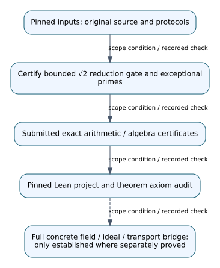

# Review addendum: PR #1165

Date: 2026-10-29. Certify bounded √2 reduction gate and exceptional primes.

Original author head: `6a21b61d182e5b2f6c9fa95a11dc7acc924a4e53`. The original study and every frozen source, protocol, result, failed attempt and timing cap are preserved. This addendum takes precedence over unqualified experimental-status language in the archived report.

## Recorded finding and its scope

The source-`j=1728` level-432 C–E resolvent has no rational C–E pair at 275 of the 283 primes `7 ≤ p < 20000` with `p ≡ 11 (mod 24)`. An exact denominator-and-norm gate certifies these 275 cells. Exhaustive finite-field checks classify the eight exceptional primes `11, 131, 179, 227, 251, 419, 491, 1523`: rational C–E pairs occur at `11, 131, 227, 1523`, and the frozen inverse B-branch formula yields four valid C–E–B triples at `p=131`. An independent replay verifies all four triples on their curves and in the branch equation.

The paragraph above describes the retained certificate record, not a new experiment. Source: [experiments/hecke-432-j1728-sqrt2-resultants-20261026/RESULT.md](../../experiments/hecke-432-j1728-sqrt2-resultants-20261026/RESULT.md). This review treats publication of protocol and results together as retrospective/exploratory unless an independent earlier publication witness is supplied. An archived PASS_PROSPECTIVE status is a literal historical label, not evidence of pre-observation registration. In particular, PR #1164's six-row holdout and PR #1190's 62/62 correctness checks retain their numerical results with this qualification.

## Evidence-linked explanation

Evidence and proof boundaries for this study. Symbols C, B, E and K denote the frozen coordinate models or coefficient field, not newly registered subgroup instances. This diagram records algebra/certificate dependencies; it does not introduce a verified isogeny edge, EC1 identity, ISO1 route, or ECDLP transport claim.

Editable source: [1165.dot](1165.dot). Report and visual: [1165.pdf](1165.pdf).

## Replay and proof map

The exact manifest binds 21 files in this study. The shared project pins Lean leanprover/lean4:v4.35.0-rc4 and Mathlib `021c46bdd042f67b538b9f9871d556a93713a9a9`. All 37 original modules, 113 requested declaration reports and 142 noninternal theorems passed the integrated proof replay; this does not formalize every concrete Sage/PARI field or ideal interpretation. The source manifest and proof map are [tools/ci/quartic_certificates.json](../../tools/ci/quartic_certificates.json) and [the original integration report](../ci-repair-quartic-20261027.md).

This study's original modules: `experiments/hecke-432-j1728-sqrt2-resultants-20261026/formal/BoundedGate.lean`.

A new portable replay ran all 42 original integer auditors successfully in a disposable canonical-layout container. The checkout was read-only and all 1,404 original input hashes were verified before and after replay. See [portable replay evidence](portable-replay/results.json). The separate field-index successor runner uses new output directories, unchanged source/protocol bytes, original timeout limits and the checked Sage launcher. Preparation and I/O controls are not a new Sage experiment.

## Remaining obligations and graph review

Arithmetic table certificates and universal ring/permutation identities retain their precise hypotheses. Concrete number-field encodings, integral bases, ideals, Hensel lifting and Frobenius interpretation require their own bridges. No security, speedup, prospective-validation or general impossibility claim is added.

The candidate catalog, volcano-IC figure set and paper figures were checked for affected links. This is a review and portability correction with no new surviving graphable mathematical fact; canonical graphs remain unchanged. The precise checked-path inventory is [graph-review.json](graph-review.json).
