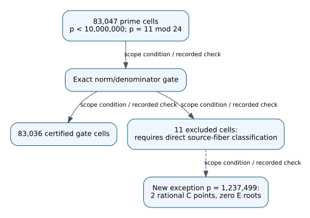
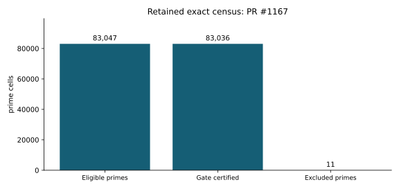

# Review addendum: PR #1167

Date: 2026-10-29. Audit source-fiber exception below ten million.

Original author head: `13cda2b5f82f06969aa58ca55f6f0d0c19aebb58`. The original study and every frozen source, protocol, result, failed attempt and timing cap are preserved. This addendum takes precedence over unqualified experimental-status language in the archived report.

## Recorded finding and its scope

The exact √2 reduction gate certifies absence of rational C–E pairs at **83,036 of 83,047** primes `7 ≤ p < 10,000,000` with `p ≡ 11 (mod 24)`. The eleven exceptions have now been directly classified: six primes have rational C–E pairs, and the frozen inverse B branch gives four valid C–E–B triples, all at `p=131`. The new `1,000,000 ≤ p < 10,000,000` interval contains 73,238 prime cells, 73,237 of which pass the exact gate. Its sole exception is `p=1,237,499`; direct source-fiber and resolvent calculations give two rational C points and zero rational E roots.

The paragraph above describes the retained certificate record, not a new experiment. Source: [experiments/hecke-432-j1728-octic-collision-holdout-20261026/RESULT.md](../../experiments/hecke-432-j1728-octic-collision-holdout-20261026/RESULT.md). This review treats publication of protocol and results together as retrospective/exploratory unless an independent earlier publication witness is supplied. An archived PASS_PROSPECTIVE status is a literal historical label, not evidence of pre-observation registration. In particular, PR #1164's six-row holdout and PR #1190's 62/62 correctness checks retain their numerical results with this qualification.

## Evidence-linked explanation

A denominator exclusion is not a rational point. Symbols C, B, E and K denote the frozen coordinate models or coefficient field, not newly registered subgroup instances. This diagram records algebra/certificate dependencies; it does not introduce a verified isogeny edge, EC1 identity, ISO1 route, or ECDLP transport claim.

Editable source: [1167.dot](1167.dot). Report and visual: [1167.pdf](1167.pdf).

## Replay and proof map

The exact manifest binds 15 files in this study. The shared project pins Lean leanprover/lean4:v4.35.0-rc4 and Mathlib `021c46bdd042f67b538b9f9871d556a93713a9a9`. All 37 original modules, 113 requested declaration reports and 142 noninternal theorems passed the integrated proof replay; this does not formalize every concrete Sage/PARI field or ideal interpretation. The source manifest and proof map are [tools/ci/quartic_certificates.json](../../tools/ci/quartic_certificates.json) and [the original integration report](../ci-repair-quartic-20261027.md).

This study's original modules: `experiments/hecke-432-j1728-octic-collision-holdout-20261026/formal/SourceDiscriminant.lean`.

A new portable replay ran all 42 original integer auditors successfully in a disposable canonical-layout container. The checkout was read-only and all 1,404 original input hashes were verified before and after replay. See [portable replay evidence](portable-replay/results.json). The separate field-index successor runner uses new output directories, unchanged source/protocol bytes, original timeout limits and the checked Sage launcher. Preparation and I/O controls are not a new Sage experiment.

## Remaining obligations and graph review

Arithmetic table certificates and universal ring/permutation identities retain their precise hypotheses. Concrete number-field encodings, integral bases, ideals, Hensel lifting and Frobenius interpretation require their own bridges. No security, speedup, prospective-validation or general impossibility claim is added.

The candidate catalog, volcano-IC figure set and paper figures were checked for affected links. This is a review and portability correction with no new surviving graphable mathematical fact; canonical graphs remain unchanged. The precise checked-path inventory is [graph-review.json](graph-review.json).

## Retained exact counts

7 <= p < 10,000,000; p congruent 11 mod 24. Excluded does not imply a rational pair. Units: prime cells. These are exact finite-census counts with no statistical error bars; extrapolation beyond the saved domain is not established. No new timings were collected. Data: [experiments/hecke-432-j1728-octic-collision-holdout-20261026/scan_result.json](../../experiments/hecke-432-j1728-octic-collision-holdout-20261026/scan_result.json), SHA-256 `c07fd68502d15999ab5383038cff708f52ce49e4a5f51e46c7a765e9cc474fa9`; [plotted values](quantitative-sources.json).

