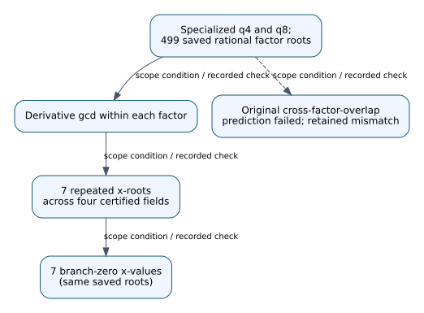
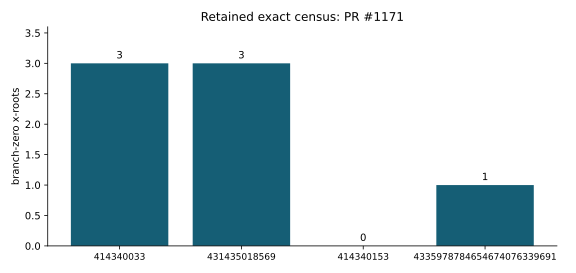

# Review addendum: PR #1171

Date: 2026-10-29. Identify repeated-root branch zeros and source Frobenius gate.

Original author head: `d9891b0161b44a00885cae8281b0b0b8a911c277`. The original study and every frozen source, protocol, result, failed attempt and timing cap are preserved. This addendum takes precedence over unqualified experimental-status language in the archived report.

## Recorded finding and its scope

Across four certified finite fields, the inverse B-branch numerator and denominator vanish **exactly at the rational repeated roots** of the specialized quartic or octic resolvent factor. This was checked for all **499 rational factor roots** on the saved source-`j=1728` C points, then independently replayed with modular polynomial arithmetic, derivatives, and Frobenius gcds. Seven repeated x-roots account for the seven branch-zero x-values: three octic roots at each of the two octic-norm primes and one quartic root at the earlier 83-bit quartic-norm prime. The nearby control has none.

The paragraph above describes the retained certificate record, not a new experiment. Source: [experiments/hecke-432-j1728-fiber-overlap-20261026/RESULT.md](../../experiments/hecke-432-j1728-fiber-overlap-20261026/RESULT.md). This review treats publication of protocol and results together as retrospective/exploratory unless an independent earlier publication witness is supplied. An archived PASS_PROSPECTIVE status is a literal historical label, not evidence of pre-observation registration. In particular, PR #1164's six-row holdout and PR #1190's 62/62 correctness checks retain their numerical results with this qualification.

## Evidence-linked explanation

Repeated roots locate branch-zero values. Symbols C, B, E and K denote the frozen coordinate models or coefficient field, not newly registered subgroup instances. This diagram records algebra/certificate dependencies; it does not introduce a verified isogeny edge, EC1 identity, ISO1 route, or ECDLP transport claim.

Editable source: [1171.dot](1171.dot). Report and visual: [1171.pdf](1171.pdf).

## Replay and proof map

The exact manifest binds 26 files in this study. The shared project pins Lean leanprover/lean4:v4.35.0-rc4 and Mathlib `021c46bdd042f67b538b9f9871d556a93713a9a9`. All 37 original modules, 113 requested declaration reports and 142 noninternal theorems passed the integrated proof replay; this does not formalize every concrete Sage/PARI field or ideal interpretation. The source manifest and proof map are [tools/ci/quartic_certificates.json](../../tools/ci/quartic_certificates.json) and [the original integration report](../ci-repair-quartic-20261027.md).

This study's original modules: `experiments/hecke-432-j1728-fiber-overlap-20261026/formal/RepeatedRoot.lean`.

A new portable replay ran all 42 original integer auditors successfully in a disposable canonical-layout container. The checkout was read-only and all 1,404 original input hashes were verified before and after replay. See [portable replay evidence](portable-replay/results.json). The separate field-index successor runner uses new output directories, unchanged source/protocol bytes, original timeout limits and the checked Sage launcher. Preparation and I/O controls are not a new Sage experiment.

## Remaining obligations and graph review

Arithmetic table certificates and universal ring/permutation identities retain their precise hypotheses. Concrete number-field encodings, integral bases, ideals, Hensel lifting and Frobenius interpretation require their own bridges. No security, speedup, prospective-validation or general impossibility claim is added.

The candidate catalog, volcano-IC figure set and paper figures were checked for affected links. This is a review and portability correction with no new surviving graphable mathematical fact; canonical graphs remain unchanged. The precise checked-path inventory is [graph-review.json](graph-review.json).

## Retained exact counts

Four saved finite fields; seven total branch-zero x-roots among 499 rational roots. Units: branch-zero x-roots. These are exact finite-census counts with no statistical error bars; extrapolation beyond the saved domain is not established. No new timings were collected. Data: [experiments/hecke-432-j1728-fiber-overlap-20261026/audit_result.json](../../experiments/hecke-432-j1728-fiber-overlap-20261026/audit_result.json), SHA-256 `792c12fdd3037bff1ea4d36d798997ad729c28e3b64f2d262f7da08adc6fba2d`; [plotted values](quantitative-sources.json).

