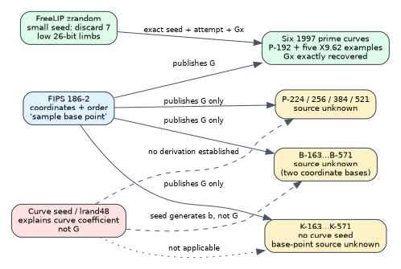
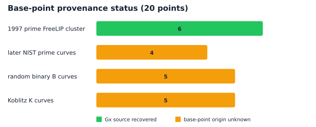

# Result

The source is recoverable for the **x-coordinate of six older prime-field base
points**, but not for the later NIST prime, binary, or Koblitz base points.
The six recovered coordinates came from the pseudorandom generator in Arjen
Lenstra's FreeLIP package (also shipped in early NTL), seeded with small
integers. The published reconstruction discards seven outputs, builds
candidate x-coordinates from low 26-bit limbs, reduces modulo the prime, and
takes the first candidate lying on the curve. [Published reproducible;
pcc:PCC-20261118-edcdea; standing: unverified]

NIST's own standard does not state a generator for the supplied points. FIPS
186-2 Appendix 6 §1.5 says: “Any point of order r can serve as the base point.
Each curve is supplied with a sample base point ... Users may want to generate
their own base points.” It gives coordinates, not a provenance algorithm.
[Independently checked documentary fact; pcc:PCC-20261118-9f025b; standing:
unverified]

The curve-generation seeds are therefore not base-point seeds. In particular,
Koblitz curves have no random curve seed from which their `G` could be derived.
The source of the sample points for P-224, P-256, P-384, P-521, B-163 through
B-571, and K-163 through K-571 remains unestablished. [Unresolved]

{width=95%}

# Requirement-to-evidence status

| Requested item | Status | Evidence or exact gap |
|---|---|---|
| Find the source of the base points | Partial | Six `Gx` values reproduce from FreeLIP; 14 later/random-binary/Koblitz points remain unexplained. |
| Test an RNG/seed-increment explanation | Implemented, run blocked | `search.py` and `PROTOCOL.md` freeze same-stream `lrand48` and seed-derived SHA-1 searches. The mandatory S3 checkpoint failed because no upload token or configured profile is available. |
| Recover complete `G=(Gx,Gy)` provenance | Partial | The cited recovery identifies candidate `x`; the historical rule selecting one of the two possible `y` roots is not established by the cited FreeLIP reconstruction. |
| Distinguish evidence from speculation | Complete | All negative-search claims are withheld; unresolved points are not called random or impossible. |

# Recovered coordinates

The table is the exact output reported with Anthropic's public-domain
reproduction code. P-192 is `prime192v1` in that code.

| Curve | FreeLIP seed | Accepted candidate | Exact published `Gx` matched |
|---|---:|---:|---|
| P-192 / prime192v1 | 20000 | 2 | yes |
| prime239v1 | 20420 | 3 | yes |
| prime239v2 | 20507 | 2 | yes |
| prime239v3 | 20509 | 1 | yes |
| prime192v2 | 20512 | 5 | yes |
| prime192v3 | 20517 | 1 | yes |

The published algorithm uses state
`s <- s * 3^121 mod (2^107 - 1)` and exposes the low 26 bits of each new
state. It discards seven limbs, then forms each x candidate from
`ceil(bitlen(p)/26)+1` limbs in most-significant-limb-first order, reduces it
modulo `p`, and accepts when `x^3 - 3x + b` is a quadratic residue.
[Published reproducible]

This reconstruction is strong evidence for the source of each `Gx`: it gives
an exact generator, six small seeds, exact attempt counts, and exact coordinate
matches. It is not by itself a complete provenance for `Gy`; the published
code stops after the quadratic-residue test and does not encode a root-choice
rule. [Evidence boundary; pcc:PCC-20261118-edcdea; standing: unverified]

# What is not explained

{width=78%}

The count above covers the six 1997 NIST/X9.62 prime curves in the recovered
FreeLIP cluster, the four later NIST prime curves, five random binary curves,
and five Koblitz curves. “Unknown” means no source algorithm has been
established in the cited material; it does not mean that no such algorithm
exists.

- **P-224, P-256, P-384, P-521:** Anthropic reports that their points do not
  fit the recovered FreeLIP recipe and that their selection is unexplained.
- **B-163, B-233, B-283, B-409, B-571:** FIPS publishes curve seeds for the
  pseudo-random coefficients and publishes point coordinates in polynomial and
  normal bases, but supplies no point-generation procedure. A curve seed is not
  evidence of a base-point derivation.
- **K-163, K-233, K-283, K-409, K-571:** the coefficients are structurally
  fixed Koblitz parameters. There is no random curve seed. FIPS again provides
  sample point coordinates without a source rule.

This matters directly to ECC2K-130-style provenance questions: a Koblitz curve's
special Frobenius structure explains its curve family, not the historical
choice of the published base point.

# Bounded search prepared, not promoted

`search.py` contains exact published coordinates, six FreeLIP positive
controls, and two frozen hypothesis families:

1. Scan the recovered `lrand48` streams from initialization through each
   documented curve-seed endpoint and 50,000 additional updates. Test five
   state/output slices, two limb orders, and two limb counts. Test each binary
   stream against both its B-curve and corresponding K-curve polynomial-basis
   `Gx`.
2. Starting from each published prime or random-binary curve seed, test 65,536
   counters of a concatenated SHA-1 chain in both byte orders.

The exact command and acceptance boundary are frozen in `PROTOCOL.md`. A run
cannot be retained in this session because `scripts/checkpoint.sh gate` reports
no `CHECKPOINT_UPLOAD_TOKEN` and no AWS profile `ecc-challenges-new`. An earlier
uncheckpointed exploratory output is deliberately not cited as evidence.
[Blocked]

Even a retained miss would exclude only these encodings and bounds. Important
untested alternatives include normal-basis coordinates, timestamp reseeding,
other output-discard rules, other PRNGs, library-specific point constructors,
and manual selection.

# Conclusions

1. The standard itself is provenance-neutral: `G` is a supplied sample point.
2. Six older prime-curve `Gx` values have a precise FreeLIP origin.
3. The complete six points still need a documented or reproduced `Gy`
   root-choice convention.
4. The 14 later prime/binary/Koblitz base-point origins remain open.
5. No scalar can be inferred from this evidence: these are standardized
   public generators, and knowing an RNG source for `G` does not reveal a
   discrete logarithm of an unrelated challenge point.

# Sources

1. NIST, *Digital Signature Standard (DSS)*, FIPS 186-2 (2000), Appendix 6
   §1.5 and §§2–3. <https://csrc.nist.gov/pubs/fips/186-2/final>
2. Anthropic Frontier Red Team, “The origins of ECDSA's elliptic curves,”
   especially “Claude found some base points too” and its reproduction code
   (2026). <https://www.anthropic.com/research/ecdsa-curve-origins>
3. User-supplied *NIST/ANSI curve seeds and base points: status report*,
   17 November 2026. Used as a lead and cross-check; primary claims above were
   checked against FIPS and Anthropic's published code/text.

# Artifacts

- `PROTOCOL.md`: frozen hypotheses, bounds, and retained command.
- `search.py`: reproducible implementation and embedded constants.
- `provenance.dot` / `provenance.svg`: editable provenance diagram.
- `status-counts.csv`, `render_status_chart.py`, `status-chart.svg`: editable
  quantitative summary.
- `problems/nist-base-point-generation-provenance.md`: unresolved research and
  execution blockers.
