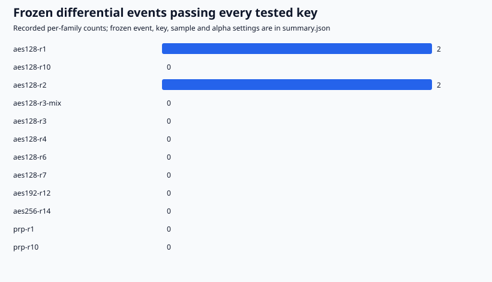
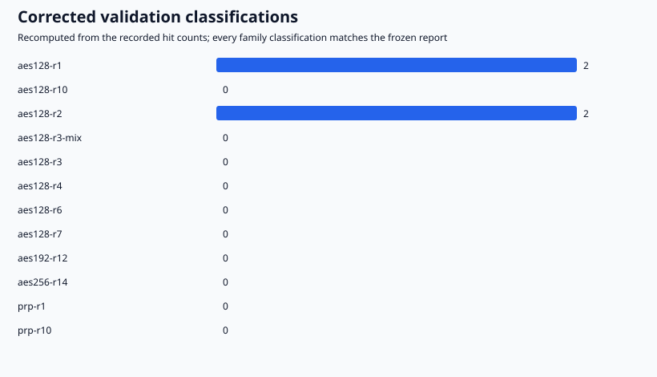
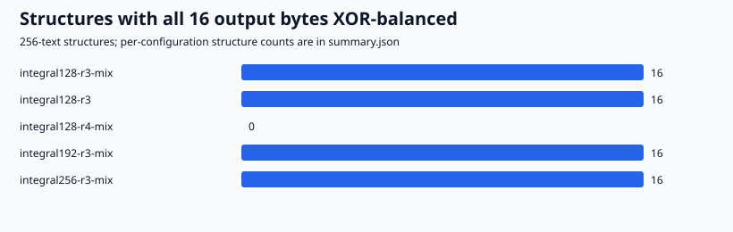
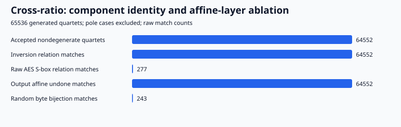

# Native AES laboratory: recorded suite

Status: 41/41 recorded commands exited successfully. Raw directory: `experiments/aes-distinguisher-lab-20261017/runs/20261017-first-suite`.

## Differential endpoints

| Family | Keys | Pairs/event/key | Validated events | PRP control passed |
| --- | ---: | ---: | ---: | --- |
| aes128-r1 | 8 | 4096 | 2 | true |
| aes128-r10 | 8 | 4096 | 0 | true |
| aes128-r2 | 8 | 4096 | 2 | true |
| aes128-r3-mix | 8 | 4096 | 0 | true |
| aes128-r3 | 8 | 4096 | 0 | true |
| aes128-r4 | 8 | 4096 | 0 | true |
| aes128-r6 | 8 | 4096 | 0 | true |
| aes128-r7 | 8 | 4096 | 0 | true |
| aes192-r12 | 8 | 4096 | 0 | true |
| aes256-r14 | 8 | 4096 | 0 | true |
| prp-r1 | 8 | 4096 | 0 | true |
| prp-r10 | 8 | 4096 | 0 | true |

12 recorded differential families; 2 families contain an event passing every tested key. Families with validated events: aes128-r1, aes128-r2. All matched controls passed: true. The sum of recorded per-family alpha allocations is 0.006000. This allocation is meaningful only when frozen before execution; retrospective collection does not create a campaign error guarantee.

These observations establish neither security nor a novel attack. Per-family frozen event counts, discovery-key counts, input-difference counts and validation plans are in `summary.json`. Raw reports preserve every key/event and the bound values calculated by the recorded source revision; consult that implementation before interpreting them as current conservative bounds. A failed control withholds the affected family's candidates.

## Corrected statistical interpretation

The archived primary/control bound fields retain the original two-sided shortcut and are not conservative bounds. The count-only reanalysis in [`../../statistical-recheck.json`](../../statistical-recheck.json) is bound by SHA-256 in `summary.json`; it recomputes separate lower/upper Chernoff tails from archived hit counts, without new cipher calls or samples. Every family classification is unchanged. The corrected classifications are shown below; raw trial records are preserved.

## Component controls

Of 64552 accepted nondegenerate quartets, inversion matches: 64552; raw AES S-box matches: 277; affine-undone matches: 64552; random byte-bijection matches: 243. These are local component observations, not an invariant through an AES round or a reproduction of a complete published attack.

## Provenance and limits

The recorded source revision is `8a3ee1d85cbb32b0fb78aa8b92cc363e3e0caffd`. The raw directory retains executable/source/protocol hashes, source dirty state, exact argv, seeds, timestamps, stdout/stderr and statuses. `summary.json` binds the summarized JSON, discovery artifacts, environment and statuses by SHA-256. This renderer derives descriptive observations only; it does not verify that every recorded claim or receipt is truthful. Deterministic replay is not independent scientific review.

No key recovery, hardware performance comparison, solver certificate, universal key-independence, security proof or accepted scientific-goal status follows. Source for the component experiment: https://eprint.iacr.org/2026/1549 . Its complete attack is not reproduced.
