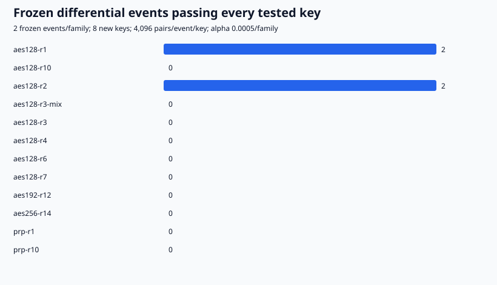
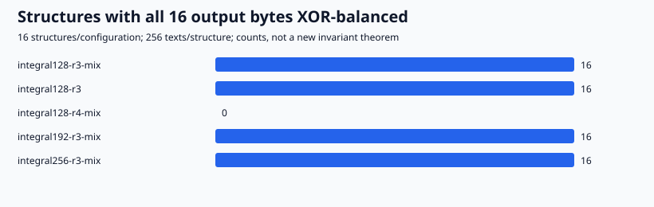
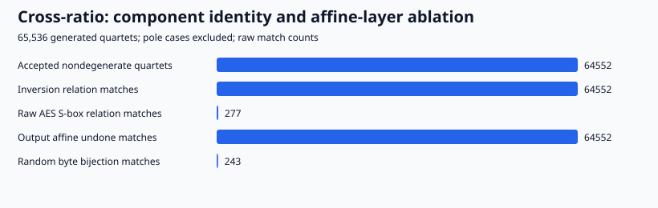

# Native AES laboratory: first recorded suite

Status: 41/41 recorded commands exited successfully. Raw directory: `experiments/aes-distinguisher-lab-20261017/runs/20261017-first-suite`.

## Differential endpoints

| Family | Keys | Pairs/event/key | Validated events | PRP control passed |
| --- | ---: | ---: | ---: | --- |
| aes128-r1 | 8 | 4096 | 2 | true |
| aes128-r10 | 8 | 4096 | 0 | true |
| aes128-r2 | 8 | 4096 | 2 | true |
| aes128-r3-mix | 8 | 4096 | 0 | true |
| aes128-r3 | 8 | 4096 | 0 | true |
| aes128-r4 | 8 | 4096 | 0 | true |
| aes128-r6 | 8 | 4096 | 0 | true |
| aes128-r7 | 8 | 4096 | 0 | true |
| aes192-r12 | 8 | 4096 | 0 | true |
| aes256-r14 | 8 | 4096 | 0 | true |
| prp-r1 | 8 | 4096 | 0 | true |
| prp-r10 | 8 | 4096 | 0 | true |

Two simple events validate at one and two rounds. This finite event family found no validated event in the other tested configurations. All matched controls passed. These observations establish neither security nor a novel attack. Each family used 16 input differences, 2 discovery keys, 256 discovery pairs/key/difference and 2 frozen events. Twelve families allocate alpha at most 0.006 overall; raw reports retain every key/event and the conservative Chernoff/PRP-coupling/Bonferroni bounds.

## Component controls

Cross-ratio values agree in all 64552 accepted inversion fixtures. The raw AES S-box agrees in 277 fixtures and the random byte-bijection control in 243. Undoing the AES output linear affine layer restores all 64552 matches. These are local observations, not an invariant through an AES round or a reproduction of a complete published attack.

## Provenance and limits

The executable/source/protocol hashes, source revision and dirty state, exact argv, seeds, timestamps, stdout/stderr and statuses are in the raw directory. `summary.json` binds each summarized JSON by SHA-256. The source implementation was frozen at commit `8a3ee1d85cbb32b0fb78aa8b92cc363e3e0caffd` before the run. A preliminary launch failed because the output parent directory did not yet exist; no trial ran in that attempt. The parent was created and the unchanged card ran once. Replay is deterministic re-execution, not independent scientific review.

FIPS vectors, 24 OpenSSL fixtures, component definitions, fresh-key positive/null controls and Rust 1.87 compatibility are software verification. No key recovery, hardware performance comparison, solver certificate, universal key-independence, or accepted scientific-goal status follows. Existing official AES campaign arms were not run. The cross-ratio source was read at abstract level only: https://eprint.iacr.org/2026/1549 .

Canonical ECDLP scoreboards, curve graphs and performance leaderboards were checked for relevance and remain unchanged: this study adds no curve result, IC measurement, timing gain or accepted frontier update.
