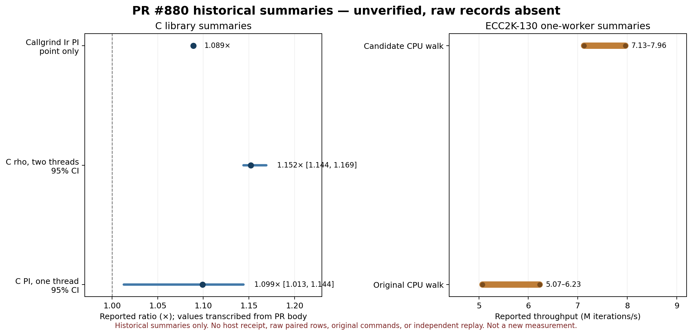
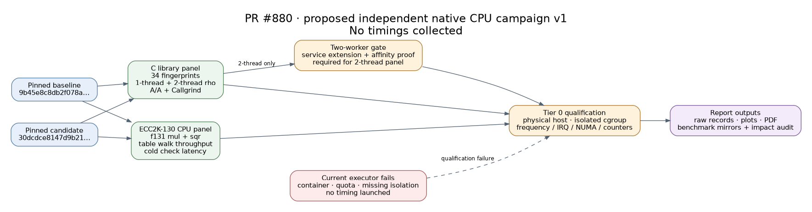

# PR #880 performance evidence gap and replay plan

**Date:** 2026-10-19 
**Status:** historical exploratory evidence preserved; independent v1 campaign frozen; no new timings.

## Scope and source

This review covers the C library and ECC2K-130 CPU changes in PR [#880](https://github.com/aburan28/cryptanalysis/pull/880), currently at candidate commit `30dcdce8147d9b217760e07122e1a839486a0175`. The PR describes its C changes as engineering: fingerprints and work counts are unchanged. It separately describes x86 `f131` multiplication/reduction and the ECC2K table-walk CPU startup as optimized. The original description labels its wall timings exploratory, from an unidentified 2-vCPU cloud-agent VM without an isolation receipt.

The new replay is pinned in [`PROTOCOL.md`](PROTOCOL.md). It is not the lost original run, and any future result will be a new, independently versioned observation. The historical numeric values are retained in [`historical-claims.csv`](historical-claims.csv); they are not accepted as reproduced evidence.

## Historical observations and missing provenance

The PR body reports a C-library single-thread performance index of 1.099× (95% interval 1.013–1.144, five paired rounds), a two-thread rho kernel ratio of 1.152× (95% interval 1.144–1.169), and Callgrind instruction index of 1.089×. It also reports intermediate and final ECC2K field timings, then an `ec2k-cpu bench` one-worker throughput range of 5.07–6.23 M it/s before and 7.13–7.96 M it/s after, and cold startup/check summaries of 1.41→0.10 s and 1.48→0.19 s. These remain exact claims copied from the PR description; they are not inferred from code or reconstructed.

The PR body includes summary tables, but the archived payload does not contain the original `compare.json`, per-kernel A/A or A/B raw records, raw timing samples, callgrind raw record, host identity/allocation/isolation receipt, exact f131 microbenchmark program and invocation, exact cold-start/check commands, or full ECC2K round logs. The values therefore remain unqualified historical observations.

| Historical claim | What the PR body preserves | Missing evidence that blocks exact replay/qualification |
| --- | --- | --- |
| C library one-thread PI | Base/candidate labels (`9b45e8c` → `b753b14`), five-round summary, 34-kernel summary table, Intel Xeon @ 2.10 GHz/AVX512IFMA, two logical cores, Linux 6.18, GCC 13.3, `-O3`, `CA_NATIVE=off`, and a report of A/A spread | Raw per-sample A/A/A-B outputs, exact host identity, auditable CPU/NUMA/IRQ/frequency/quota/isolation receipt, compiler/build receipts and original output files |
| C `rho_ec44_mt` | Reported 1.152× ratio and 95% interval 1.144–1.169 | Exact taskset/worker affinity, raw paired samples, A/A rows and worker/cgroup receipt proving two-worker placement |
| Callgrind instruction PI | 1.089× aggregate and a per-kernel summary table | Raw Callgrind records, exact build/invocations and output files |
| ECC2K `f131` multiply/square | Commit labels and claimed ns/op before/after | Original harness source, exact command, operands/sample count, timer boundary and raw samples |
| ECC2K walk throughput | One worker, three interleaved rounds and reported before/after throughput ranges | Exact launch/workload flags, all paired rows/stdout, binary/build hashes and a host receipt |
| ECC2K start-up/check | Two before/after time pairs | Exact commands, timer boundaries, raw runs, build hashes and paired ordering |

The old C timing labels a candidate `b753b14`; the final PR head is `30dcdce`. A source diff of `src/`, `include/`, `tools/ca_perfbench.c`, and the performance-index file between those commits is empty, so this report's new C panel uses the same C source result at the final PR head. The chart below visualizes selected stated summaries, with an explicit provenance warning.

## Proposed independent campaign

The frozen v1 plan covers all 34 C perfbench kernels, their deterministic fingerprints and A/A controls, the `--threads 2` rho workload, f131 multiply and square, ECC2K table-walk throughput, and cold `ec2k-cpu check` process latency. Its pinned source pair is baseline `9b45e8c8db2f078a2419ad604ab427856391bd79` and candidate `30dcdce8147d9b217760e07122e1a839486a0175`. The protocol specifies eight alternating A/B pairs, fixed workloads, correctness gates, output retention, report contents, and stop conditions.

The current benchmark service supports only one measured logical CPU. It must gain and pass a multi-CPU affinity/preflight test before any two-thread result. The current executor also fails the frozen Tier 0 host gates. [`BLOCKED.md`](BLOCKED.md) records the exact reasons and retained probe output. No timed command was launched.

## Source-linked diagram and graph audit

The editable campaign diagram is [`campaign-flow.dot`](campaign-flow.dot), rendered as [`campaign-flow.svg`](campaign-flow.svg). It shows the exact baseline/candidate source pair, the independent campaign arms, and the missing qualification gates. It claims no timing result.

The graph impact audit found no `experiments/volcano-ic/figures/` directory in this checkout. It checked the committed ECC2K-130 research figures under `ecc2k130/research/volcano-m83/outputs/figures/`, the general benchmark dashboard `docs/BENCHMARKS.md`, and the index `docs/perf/PERFORMANCE_INDEX.md`. No qualified metric, curve, isogeny, ECDLP answer, relation yield, or library fingerprint changed in this review. The PR's code changes are engineering work and do not add a verified scientific measurement; existing scientific graphs and dashboards therefore remain current. The historical chart is separate and explicitly exploratory. New campaign graphs, PDF results, benchmark mirrors, and index rows must wait for a complete qualifying run.

## Evidence status

- **Observed:** PR description lists engineering changes and exploratory summary numbers. The available PR patch changes C/ECC2K source and appends five historical entries to `docs/perf/PERFORMANCE_INDEX.md`; the original comparison records and host receipt are absent.
- **Derived or independently verified:** the proposed `f131_microbench.cpp` compiles on this executor with both the packed baseline and candidate paths. No benchmark binary was executed for timing. Existing PR review validation reports Release CTest 15/15, equal 34/34 C library fingerprints, ECC2K `make test`, table-mode tests, and 300/300 report replays; the v1 campaign still requires its own exact-head CI and native correctness rerun.
- **Unknown:** whether the old timing ratios survive a qualified replay; whether the claimed start-up boundary isolated table generation; whether the original two-thread panel had worker affinity or A/A coverage.
- **What this record does not establish:** a Tier 0 speedup, a new ECC2K throughput result, an ECDLP method improvement, or a recovery of the missing raw evidence.

## Open checks

1. A physical Tier 0 executor must pass all strict host checks and have an auditable multi-CPU worker-affinity extension for the two-thread row.
2. Run and archive every applicable v1 arm, including failures and A/A controls; rerun all required correctness checks on exact source hashes.
3. Generate the campaign graphs, PDF report, `benchmarks/` mirror, C benchmark index row, ECC2K benchmark index row, and final canonical-impact audit only from retained qualified outputs.

PDF source: this Markdown report, [`campaign-flow.dot`](campaign-flow.dot), and [`historical-claims.svg`](historical-claims.svg). The PDF is a review copy of this report and does not add evidence.

Generated review copy: [`REPORT.pdf`](REPORT.pdf).
