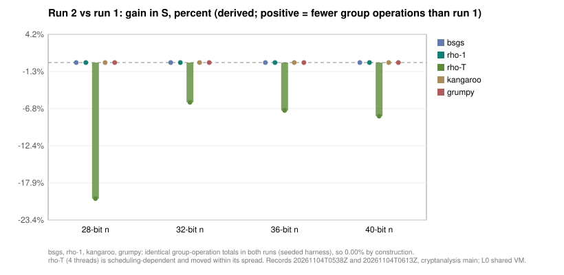

# ca_bench generic on prime-order EC groups, run 2: the first gain-vs-previous point

**Date.** 2026-11-04. **Status.** Measured `[pcc:unverified]`. **Class.**
Engineering measurement, no research claim: the same command as
[run 1](../ca-bench-generic-ec-20261104/REPORT.md), rerun at the current
`main` head (`e87c5a70`) so every series in the progress report has a second
point and the derived gain-vs-previous column is populated.
**Record.** [`benchmarks/records/20261104T0613Z-ca-bench-generic-ec-run2.json`](../../benchmarks/records/20261104T0613Z-ca-bench-generic-ec-run2.json)
(baseline per metric: run 1's value; reference: this run's rho-1 arm).
**Host.** Shared 4 vCPU cloud VM, no pinning: L0. Wall time is descriptive only.

## Method

Identical to run 1: `build/ca_bench generic --group ec --bits 28,32,36,40
--reps 5 --threads 4 --json ...`, rebuilt in Release at `e87c5a70` (binary
SHA-256 `072613efa74144481ecb365ddf9d875d7df1e6b48db9c0c14cb7ab57eab2f53f`). No change to `ca_bench` or the
library between the two commits touched this path. Raw rows:
[`raw.jsonl`](raw.jsonl), [`stdout.txt`](stdout.txt),
[`summary.json`](summary.json), each in the content-addressed store.

## Result (measured): run 1 against run 2, S mean of 5 instances

| bits | algorithm | run 1 | run 2 | gain (derived) | identical op totals |
|---:|:--|--:|--:|--:|:--|
| 28 | bsgs | 1.621 | 1.621 | +0.00% | yes |
| 28 | rho-1 | 1.866 | 1.866 | +0.00% | yes |
| 28 | rho-T | 1.305 | 1.568 | -20.19% | no |
| 28 | kangaroo | 1.690 | 1.690 | +0.00% | yes |
| 28 | grumpy | 1.485 | 1.485 | +0.00% | yes |
| 32 | bsgs | 1.575 | 1.575 | +0.00% | yes |
| 32 | rho-1 | 0.791 | 0.791 | +0.00% | yes |
| 32 | rho-T | 1.118 | 1.184 | -5.90% | no |
| 32 | kangaroo | 2.174 | 2.174 | +0.00% | yes |
| 32 | grumpy | 1.514 | 1.514 | +0.00% | yes |
| 36 | bsgs | 1.441 | 1.441 | +0.00% | yes |
| 36 | rho-1 | 1.517 | 1.517 | +0.00% | yes |
| 36 | rho-T | 0.913 | 0.978 | -7.11% | no |
| 36 | kangaroo | 1.768 | 1.768 | +0.00% | yes |
| 36 | grumpy | 1.413 | 1.413 | +0.00% | yes |
| 40 | bsgs | 1.573 | 1.573 | +0.00% | yes |
| 40 | rho-1 | 1.713 | 1.713 | +0.00% | yes |
| 40 | rho-T | 1.241 | 1.340 | -7.95% | no |
| 40 | kangaroo | 1.220 | 1.220 | +0.00% | yes |
| 40 | grumpy | 1.251 | 1.251 | +0.00% | yes |

Four arms (`bsgs`, `rho-1`, `kangaroo`, `grumpy`) return the same
group-operation totals in both runs: the harness derives its instances and
walk seeds deterministically, so for those arms a rerun without a code change
is an exact replay and the gain is 0.00% by construction `[pcc:unverified]`.
The one arm that moved, `rho-T` (four threads), depends on thread scheduling
and its 40-bit mean went from 1.241 to 1.340, inside its own run-1 spread
`[pcc:unverified]`.

## What this does and does not establish

- The progress report's gain-vs-previous column now has a value for every
  series in `S`: 0.00% for the deterministic arms, a scheduling-noise entry for
  `rho-T`. That is the honest second point, not an improvement
  `[pcc:unverified]`.
- A future change to the rho walk, the batched inversion or the kangaroo jump
  table shows up here as a nonzero gain on a deterministic arm; `rho-T` needs
  more than five instances before a change in its mean means anything.
- No speedup, ranking or baseline claim `[pcc:unverified]`.
