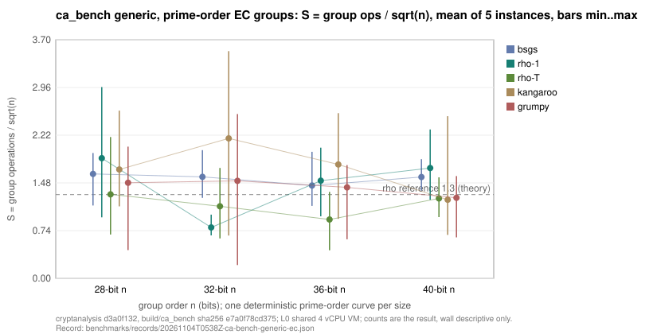

# ca_bench generic on prime-order EC groups: the first benchmark record

**Date.** 2026-11-04. **Status.** Measured `[pcc:unverified]`: counts are
read from the harness's own `ca_stats` and no independent verifier has
checked them. **Class.** Engineering measurement, no research claim: this
run seeds the benchmark progress report
([`docs/benchmark-records.md`](../../docs/benchmark-records.md)) with its
first `bench.record/v1` point in the headline unit `S`.
**Record.** [`benchmarks/records/20261104T0538Z-ca-bench-generic-ec.json`](../../benchmarks/records/20261104T0538Z-ca-bench-generic-ec.json).
**Host.** Shared 4 vCPU cloud VM, no CPU pinning, no hardware counters:
**L0 in this repository's tiers**. Wall time is descriptive only; the
reported quantity is the group-operation count, which the solver counts
itself.

## Question

What does the native generic-DLP suite (`build/ca_bench generic`) cost today
on prime-order elliptic-curve groups at 28, 32, 36 and 40 bits, in
`S = group operations / sqrt(n)`, so that a later run of the same command
has a recorded first point to be compared with?

## Method

- Commit `d3a0f1320886` (main), `cmake -DCMAKE_BUILD_TYPE=Release`, target
  `ca_bench`; binary SHA-256 `e7a0f78cd3754cd524a4e89ca5bc9148ec37192dfeb957d33d60c0c38ab9bebf`.
- Command, run under the record with `tools/benchrec.py run`:
  `build/ca_bench generic --group ec --bits 28,32,36,40 --reps 5 --threads 4 --json experiments/ca-bench-generic-ec-20261104/raw.jsonl`
- Instances: `ca_bench`'s deterministic curve per bit size (`y^2 = x^3 + x + b`
  over the first prime above `2^(bits-1)|5`, smallest `b` giving prime order),
  5 random targets each, every one solved (`ok` 5/5 in every cell).
- Arms: `bsgs`, `rho-1` (one thread), `rho-T` (4 threads), `kangaroo`,
  `grumpy`. The matched reference for the record's `value/ref` column is this
  run's own `rho-1` arm on the same 40-bit curve, so the reference shares
  instance, build and host. It is not the frozen rho reference of the IC
  leaderboard and does not enter the §5a band.
- Raw: [`raw.jsonl`](raw.jsonl) (JSON Lines: header, then one row per solved
  instance with the `ca_stats` counters), [`stdout.txt`](stdout.txt),
  [`summary.json`](summary.json) (per-cell means, min, max). Each is in the
  content-addressed store by SHA-256; the record names the S3 URIs.

| bits | p | a | b | n |
|---:|---:|---:|---:|---:|
| 28 | 134217757 | 1 | 70 | 134234689 |
| 32 | 2147483659 | 1 | 230 | 2147540641 |
| 36 | 34359738421 | 1 | 77 | 34359573251 |
| 40 | 549755813911 | 1 | 91 | 549756147371 |

## Results (measured)

`S` per cell: mean over 5 instances, with the minimum and maximum instance.

| bits | algorithm | S mean | S min | S max | ok | wall s (5 instances) |
|---:|:--|--:|--:|--:|--:|--:|
| 28 | bsgs | 1.621 | 1.131 | 1.946 | 5/5 | 0.0054 |
| 28 | rho-1 | 1.866 | 0.947 | 2.970 | 5/5 | 0.0074 |
| 28 | rho-T | 1.305 | 0.680 | 2.194 | 5/5 | 0.0067 |
| 28 | kangaroo | 1.690 | 1.118 | 2.604 | 5/5 | 0.0063 |
| 28 | grumpy | 1.485 | 0.438 | 2.046 | 5/5 | 0.0164 |
| 32 | bsgs | 1.575 | 1.249 | 1.990 | 5/5 | 0.0247 |
| 32 | rho-1 | 0.791 | 0.667 | 0.990 | 5/5 | 0.0123 |
| 32 | rho-T | 1.118 | 0.619 | 1.714 | 5/5 | 0.0163 |
| 32 | kangaroo | 2.174 | 0.664 | 3.528 | 5/5 | 0.0194 |
| 32 | grumpy | 1.514 | 0.206 | 2.552 | 5/5 | 0.0884 |
| 36 | bsgs | 1.441 | 1.125 | 1.964 | 5/5 | 0.0991 |
| 36 | rho-1 | 1.517 | 0.963 | 2.029 | 5/5 | 0.0945 |
| 36 | rho-T | 0.913 | 0.435 | 1.342 | 5/5 | 0.0505 |
| 36 | kangaroo | 1.768 | 0.924 | 2.565 | 5/5 | 0.0650 |
| 36 | grumpy | 1.413 | 0.606 | 1.758 | 5/5 | 0.3485 |
| 40 | bsgs | 1.573 | 1.361 | 1.850 | 5/5 | 0.5717 |
| 40 | rho-1 | 1.713 | 1.220 | 2.312 | 5/5 | 0.3594 |
| 40 | rho-T | 1.241 | 0.951 | 1.568 | 5/5 | 0.2857 |
| 40 | kangaroo | 1.220 | 0.674 | 2.518 | 5/5 | 0.1413 |
| 40 | grumpy | 1.251 | 0.636 | 1.588 | 5/5 | 1.7549 |

Fitted exponents over the four sizes (from the harness): bsgs 0.493, rho-1
0.514, rho-T 0.487, kangaroo 0.457, grumpy 0.479 against the theoretical 0.5;
R² 0.96 to 0.9994. Five instances per cell is too few for a rho constant to
mean much: rho-1 at 32 bits came in at 0.79 and at 36 bits at 1.52, which is
the spread of five random walks, not a change in the algorithm.

Distance to the matched reference at 40 bits (derived: value / rho-1 mean S =
1.713):

| algorithm | S mean | value / reference |
|:--|--:|--:|
| bsgs | 1.573 | 0.918 |
| rho-T | 1.241 | 0.725 |
| kangaroo | 1.220 | 0.712 |
| grumpy | 1.251 | 0.731 |

## What this does and does not establish

- It establishes a recorded first point per arm at 40 bits in `S`, with raw
  rows in S3 and the command, build and host in Git. The next run of the same
  command yields the progress report's first gain-vs-previous entry.
- It does not establish a speedup, a ranking between arms, or anything about
  the index-calculus baseline: no code changed, n = 5 per cell, L0 host.
- Limits: wall time on a shared VM; the reference is the run's own rho arm,
  not a frozen external reference; no replay certificate.

## Evidence

- Record: `benchmarks/records/20261104T0538Z-ca-bench-generic-ec.json`
- Progress report regenerated: `benchmarks/progress/` (`PROGRESS.md`,
  `progress.svg`, `progress.pdf`, `progress.json`)
- Benchmark entry: [`benchmarks/20261104-ca-bench-generic-ec/`](../../benchmarks/20261104-ca-bench-generic-ec/)
- Graph source: this report's generator is the inline Python in the session
  that produced [`figures/s_by_bits.svg`](figures/s_by_bits.svg) from
  `summary.json`; `summary.json` is the editable data.
