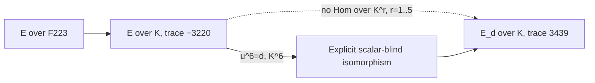

# CT168 — complete cubic census and minimum algebraic transfer field [pcc:unverified]

**2026-11-16.** This is a finished producer-level mathematical/correctness experiment, **not** independent signed PCC and **not** a complete ECDLP performance improvement.

## New complete computation

This continues merged [CT167 #1683](https://github.com/isogeny-labs/cryptanalysis/pull/1683) on its exact published models
\[
k=\mathbf F_{223},\quad K=k[z]/(z^3+3),\quad
E/k:y^2=x^3+9,\quad E_d/K:y^2=x^3+9(2+z).
\]
CT167 conditioned the target cubic trace on one point-order filter and six possible unit twists. CT168 **directly counts every cubic-field x** instead.

| Exact enumerated model | Points over K | \(T=q+1-\#E(K)\) | Nonzero-square RHS x | Zero RHS x | Nonsquare RHS x |
|---|---:|---:|---:|---:|---:|
| Base-change of E | 11,092,788 | −3,220 | 5,546,392 | 3 | 5,543,172 |
| Exact E_d, d=2+z | 11,086,129 | 3,439 | 5,543,064 | 0 | 5,546,503 |
| Mutant y²=x³+18+9z+z² | 11,086,348 | control only | 5,543,172 | 3 | 5,546,392 |

Here \(q=223^3=11,089,567\), and every row satisfies \(\#E(K)=1+N_0+2N_{\mathrm{sq}}\). Both standalone C++17 implementations enumerate **all q squares by y** and **all q x-coordinates per model**. The optimized closed-form cubic arithmetic and the slower generic polynomial-convolution reference agree on every aggregate component. C++ compilation and execution in a local non-EKS container returned exit zero: optimized direct 1.23 s/2,944 KiB maximum RSS; generic 4.39 s/12,416 KiB. These are *development run properties*, not cold ECDLP timings.

For both programs, `z³=-3`, the cube/square operation and square-indicator bitmap are separate implementations. The direct evaluator checks \(d^{(q-1)/6}=40\) with order six, the published target point, the original prime-field \(\#E(k)=219\), and deliberately altered target coefficients. JSON and original source files are in this directory. The independent Python integer audit verifies their agreement, partition identities, canonical values, subgroup order divisibility, and trace recurrence. It now keeps its checks active even under `python -O`.

## Strict obstruction to shorter *algebraic* transport

Let \(S_r(T)\) be defined by \(S_0=2,S_1=T,S_r=TS_{r-1}-qS_{r-2}\). The Frobenius trace after base change to \(K_r=\mathbf F_{q^r}\) is \(S_r(T)\).

| r | trace of E over K_r | trace of E_d over K_r | Isogenous over K_r? |
|---:|---:|---:|---|
| 1 | −3,220 | 3,439 | No |
| 2 | −11,810,734 | −10,352,413 | No |
| 3 | 73,738,969,220 | −73,738,969,220 | No |
| 4 | −106,463,554,876,222 | −138,784,537,572,409 | No |
| 5 | −474,920,592,974,692,900 | 340,453,214,964,613,189 | No |
| 6 | 2,709,879,034,236,551,713,874 | 2,709,879,034,236,551,713,874 | **Yes, explicitly isomorphic** |

**Theorem (specific to CT167).** There is no nonzero algebraic homomorphism \(E_{K_r}\to(E_d)_{K_r}\) for \(1\le r<6\), because such a homomorphism of elliptic curves is an isogeny, which forces matching finite-field point counts by Tate's isogeny theorem. The separately supplied CT167 formula \((x,y)\mapsto(u^2x,u^3y)\), with \(u^6=d\), is a scalar-blind isomorphism over \(K_6\), since \(d\) has sixth-power character of order six. Thus **the minimal field for an algebraic elliptic-curve homomorphism between these exact models is \(\mathbf F_{223^{18}}\)**. There may be other computational, group-theoretic or higher-dimensional encodings; this proof does not rule them out.

A particularly important trap: \(73\mid \#E_d(K_2)\) but \(73\nmid \#E_d(K)\). Presence of rational 73-torsion over \(K_2\) **does not imply** an efficiently computable homomorphism from the original E subgroup; the mismatched K_2 traces rule out any nonzero algebraic elliptic-to-elliptic homomorphism there.



## Actual timed-solver integrity repair

The previously merged CT167 script supplied `--k` (the harness's known answer) to each *timed subprocess*, and the target subprocess executed `assert mul(T,k,FL)==V` inside its timed region. This was a test-oracle contamination of the cost path, even though the BSGS function itself took G and Q only; it charged an additional full degree-18 scalar multiplication not required to solve a public instance. Its earlier producer-level 1.099× slower paired timing cannot be treated as a clean public-input algorithm comparison, nor can it be revised by subtracting guessed time.

The CT168 branch changes the existing CT167 script:
- The parent harness alone knows k, constructs the public point \(Q=[k]G\), excludes harness-only construction from the cold process wall, and launches each subprocess with only `--qx` and `--qy`; `--k` is no longer an accepted CLI flag.
- Each timed subprocess validates the public point and its order-73 membership, computes from (G,Q), and returns only the recovered scalar for the **parent** to compare against its known answer.
- The target includes tower setup, map and public verification in its cost. No secret multiplication or expected-answer assertion remains inside the timed arm. The branch CI runs all 16 cold toy solves, source-only arithmetic checks, malformed-Q and forbidden-`--k` controls.

This changes the *meaning of the timed protocol*, so CT167 historical results stay frozen. No new measured CT168 speed ratio is promoted; local counters above are field census timings only. Correct cold benchmarking would additionally require matched optimized Rust rho/BSGS/IC, isolated host, same-source A/A, memory accounting, cold paired confidence intervals, complete correction/transport/setup/LA costs, and signed independent PCC.

## Reproduction from repository root

```sh
D=experiments/chained-transfer-public-target/ct168-cubic-census
g++ -O3 -std=c++17 -Wall -Wextra -Werror -pedantic "$D/ct168_cubic_census.cpp" -o /tmp/ct168-direct
g++ -O2 -std=c++17 -Wall -Wextra -Werror -pedantic "$D/ct168_generic_crosscheck.cpp" -o /tmp/ct168-generic
/tmp/ct168-direct >/tmp/ct168-direct.json
/tmp/ct168-generic >/tmp/ct168-generic.json
python3 "$D/ct168_trace_audit.py" /tmp/ct168-direct.json /tmp/ct168-generic.json
python3 -O "$D/ct168_trace_audit.py" /tmp/ct168-direct.json /tmp/ct168-generic.json
P=experiments/chained-transfer-public-target/ct167-sextic-control/ct167_sextic_control.py
python3 -B "$P" --self-test
python3 -B "$P" --paired >/tmp/ct168-publicQ.json
```

The three frozen JSON records and the CI workflow bind these source paths; a green source job is **not** an independent signed scientific claim. Normal/optimized Python audit, direct/generic source agreement and negative inputs are the specified source-only gates.

## Coordination and current ECDLP benchmark status

Sources and prior work: [CT167 report](../ct167-sextic-control/CT167_REPORT.md); CT160/161/166 endpoint arithmetic; crypto [root #3877](https://github.com/isogeny-labs/crypto/pull/3877), [queue #3904](https://github.com/isogeny-labs/crypto/issues/3904), [producer native norm reuse](../reports/norm-point-reuse-result-01/REPORT.md); Sage finite-field elliptic [twist/trace docs](https://doc.sagemath.org/html/en/reference/arithmetic_curves/sage/schemes/elliptic_curves/ell_finite_field.html); standard Tate finite-field isogeny criterion. Shared KB MCP unavailable and crypto-autoresearcher encrypted vault not read. No novelty or global absence inference.

The full **producer** 695-record norm-point replay already exists. Independent raw whole-corpus replay/custody and qualified paired \(C_{169},C_{13a},C_{13b},D\) pricing are still absent. Original EKS paid budget STOP and storage failure conditions in queue #3904 were respected; no paid experiment, protected merge, original ledger rewrite or complete solver advantage is asserted. [pcc:unverified]

## CT169 — fail-closed evidence hardening (follow-up, 2026-11-16)

**[pcc:unverified].** Re-reading the CT168 auditor revealed that `zip()` silently
ignored an extra fourth independent census row, and that Python equality admitted
numerically equal but type-incompatible JSON values (notably `False == 0`,
`0.0 == 0`, and floating field sizes). These allowed noncanonical evidence
records to reach a successful result even though the intended input contract
was exactly three integer-valued independent census rows.

The updated `ct168_trace_audit.py` is fail-closed on exact primary and secondary
schemas, exactly three secondary rows, exact keys, genuine JSON integers at
all count positions, matching partitions and the original Frobenius conditions.
The original CT168 census outputs and mathematical trace conclusions were **not**
changed. A new `ct169_audit_mutation_test.py` applies 13 actual mutations to
the source-derived JSON. Locally, normal Python and `python -O` both rejected
13/13; the canonical outcome still gives extension degree 6 over K / 18 over
F223. This is **producer-level testing**; exact-head hosted source CI and signed
independent PCC must still be checked after publication.

```sh
D=experiments/chained-transfer-public-target/ct168-cubic-census
python3 "$D/ct168_trace_audit.py" "$D/census.json" "$D/generic-crosscheck.json"
python3 "$D/ct169_audit_mutation_test.py" "$D/census.json" "$D/generic-crosscheck.json"
python3 -O "$D/ct169_audit_mutation_test.py" "$D/census.json" "$D/generic-crosscheck.json"
```

The CT168 workflow now uses a read-only GITHUB_TOKEN and executes both negative
control suites on freshly recounted output. This is an evidence-integrity fix,
**not** a new ECDLP performance improvement. Producer full-695 norm reuse already
exists; independent original whole-corpus custody/replay and owner-admitted
same-host C169/C13a/C13b/D and complete cold matched rho/BSGS/IC are still
outstanding. No EKS/Spot/GPU resource was started.
