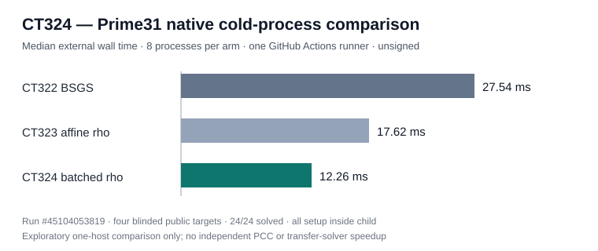

# CT324 — First three-arm native Prime31 cold control

**Standing:** [pcc:unverified]. This is **unsigned producer-run exploratory evidence** from one GitHub Actions host, not a signed result or a complete transfer attack. The prior CT323 control, the new CT324 batched-affine rho, and unchanged CT322 BSGS used the same ordinary prime-field source curve and four blinded public challenges.

## Reproducible execution
- Exact-code GitHub Actions run: https://github.com/isogeny-labs/cryptanalysis/actions/runs/45104053819 (completed success).
- Complete 24-child public records: https://github.com/isogeny-labs/cryptanalysis/actions/runs/45104053819/artifacts/14786980671; public challenge SHA-256: 6b381ca3600137351b45f77f204a8e08c94ef2ab69d7c308d246cae7e69c8147.
- Source SHA-256: CT322 BSGS 3f6415cbf7213eafba14faf8907096610251f0f9774ec47446197671c8fa32ce; CT323 rho 72f6098bab5272eca93703e9b685e05dd9c644f238d084c131391895dd7e589b; CT324 rho 4e184bb2cd3b0fbc9a12ab3cb6609fdbab3d2debf6a0b1208347b85bc85766e0.
- Four public targets, six subprocesses per target; two executions per arm; even blocks BSGS/old/new/new/old/BSGS and odd blocks reversed. All 24 logs were recovered and checked against the independent source-group law and the private reveal after all processes exited. No per-target secret scalar appears in the published panel summary.
- One host, min-allowed pinned CPU per child, actual Linux wait4 peak RSS and monotonic external wall; exact stdout/argv/binary SHA-256 retained per child. Uncharged independent escrow, second host and full native 695/701 model remain open.

## Observed medians (eight cold children per arm)

| Arm | External child wall (ms) | Peak RSS (KiB) | Sum of affine additions | Sum of field inversions |
|---|---:|---:|---:|---:|
| CT322 BSGS | 27.539010 | 19140 | 602214 | 602198 |
| CT323 scalar-affine rho | 17.6181735 | 19140 | 327580 | 327564 |
| CT324 16-lane batched-affine rho | 12.261483 | 19140 | 606612 | 70766 |

**Derived ratios (descriptive, not confidence intervals):** CT323/CT324 median wall ~1.437; BSGS/CT324 ~2.246; total inversions old/new ~4.63. CT324 performs *more* total additions than CT323 (606612 vs 327580), so the gain is not from fewer group additions. The dramatic reduction in expensive inversions makes the additional walk work worthwhile on this single host under the sampled configuration. Source and executable hashes, no paid EKS, and real subprocess RSS are accounted; this does not prove an asymptotic or field-size improvement.

The registered native correctness workflow https://github.com/isogeny-labs/cryptanalysis/actions/runs/45104053745 also completed success for four exact group-law tests at O0/O3 and two known-answer solves (toy F97 and the original Fp31). An earlier failed workflow https://github.com/isogeny-labs/cryptanalysis/actions/runs/45103638141 exposed a missing Hash derive; it is preserved rather than rewritten.

## Boundaries and next discrimination
- CT324 is an optimized *generic rho control*, not an index-calculus relation solver, genus-two Jacobian model, or chained E-to-J transfer.
- These are eight warm-host randomized public challenges per arm but **cold child processes**, all setup included; not a second independent host or strong reference suite. Per-target paired ratios and uncertainty need independent analysis of the archived 24 rows.
- The candidate must next face the strongest optimized batch/SIMD/negation rho reference, CT323 and CT322 under at least two hosts and growing orders, with A/A and negative controls.
- Owner's original 695/701 fixture still requires approved historical artifact-tool/configuration reconciliation, STS/S3 six-object custody, actual norm reuse C169/C13a/C13b/D/N2_actual pricing, complete retained-lift/IC/rho/BSGS solve, memory and independent signed PCC.
- Do not claim a prime-field ECDLP transfer improvement, a non-generic index-calculus improvement or a complete target advantage from this experiment.

