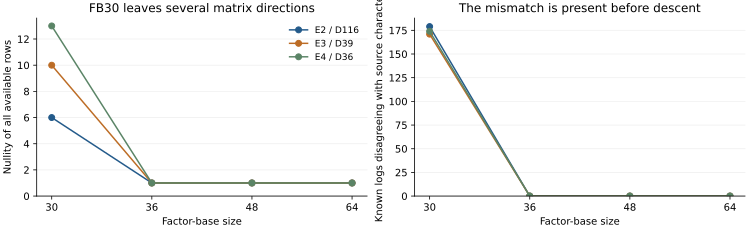

# The FB30 functional disagrees before descent

Unsigned finite resultsc0479c/19c467/3a7d56: all fifteen FB30 calls retain several matrix directions and disagree with the independently checked source character before geometric descent. Every one of the180canonical Picard and source-character split/walk decompositions holds. The forty-five FB36/48/64 calls agree on every candidate column, known log and computed descent value. No production solver or accepted population was changed. [pcc:unverified]

The plot displays all twelve model/setting groups. Rust checks that each shown rank, nullity and known-log disagreement count agrees across all five public targets; all sixty original records remain retained. The lines connect only these measured finite settings. Source diagram: evidence-flow.svg; original transfer graph and all 343 producer source hashes remain unchanged. [pcc:unverified]

| Fixed original model | FB30 rank / columns / nullity | FB30 disagreeing known logs | FB36 / FB48 / FB64 nullities |
|---|---|---|---|
| E2, case (2,0), D116/root89, P0(1:0:28) | 24 / 30 / 6 | 179 | 1 / 1 / 1 |
| E3, case(0,1), D39/root40, P0(1:0:90) | 20 / 30 / 10 | 171 | 1 / 1 / 1 |
| E4, case (2,0), D36/root6, P0(1:1:165) | 17 / 30 / 13 | 174 | 1 / 1 / 1 |

Each matrix result holds for training, training plus every holdout, and all available rows, with both full and active columns, for all five targets. Every FB30 candidate disagrees on 29active columns under the checked nonzero common multiplier. All available FB30 rows are already training rows; adding the recorded unused-row population supplies no separator here. [pcc:unverified]

## What was independently checked

Protocol 8e7e1c was normally publishedCBC before all instrumentation and rank/character code. Keep q=223, K=F223[z]/(z^3-3), ell=2773073, source order 11092292, the three fixed masks/origins, all five public targets, FB30/36/48/64, seeds 102–105 and original solver settings. Whole passive native d118b9 at 6d823770 preserves100native records/60calls/660journal events and every input/scalar/check/non-time report/counter under elapsed-only b5e431. Seven reversible insertions change no solver, RNG or selection body. [pcc:unverified]

Rank c0479c at d06ab02f retains360full sparse/dense matrices, complete RREF/pivots/nullspace bases and 1,440,470 elementary operations. Separate Rust replay checks each operation, inverse, canonical basis and source binding. Conditional Lean19c467 passes both unchanged4.34.1/4.35 gates:27declarations, nine named mathematical roots and eighteen generated declarations, zero trusted; all nine exact local statement bindings pass. Two failed development sources and full diagnostics remain preserved. Numeric matrices are Rust certificates, without a concrete Lean specialization. [pcc:unverified]

Character 3a7d56 at 5408b9db computes13,200post-solver class witnesses satisfying [w]B=[4]nu(D), with all three full integer-bound BSGS tables. A separate auditor re-evaluates the actual original NormNew, cofactor projection and direct source scalar equation for each witness. It reconstructs eta from the geometric full relation, independently of the producer's matrix reconstruction. All 15,125 available relation occurrences have zero character residual; scalar residuals are crosschecked in the actual source point group. All sixty post-solver ratios pass direct actual target-group checks; these are diagnostic BSGS-assisted answers, never inputs to the original solver. [pcc:unverified]

The entire known-log table is compared with the source character up to one nonzero multiplier. All 45 FB30 computed descent values disagree; their45canonical and character decompositions still hold. The 135 larger-FB descent values agree. This locates an observed functional mismatch before descent and distinguishes it from a finite failure of those geometric decompositions. Rank excess remains an association; the study does not prove a causal or global class-group theorem. [pcc:unverified]

## Controls, execution and remaining requirements

Four whole capture-stage omissions, a modified matrix coefficient, a constrained kernel coordinate and a source scalar witness all return 101 without accepted output. The scalar mutation fails the auditor's direct source equation. Every positive/negative whole input, raw output, failed source, source/build/runtime/full prepared copy and exact original checkpoint receipt is retained. Observer native28phases, ranknative22phases and characternative22phases meet their recorded expected exits. Compiler phases120seconds; complete diagnostics900seconds and2GiBvirtual memory. Exact original field-engine closure/fullRLIB-RMETA/freshreuse holds; there is no second unreported preparation. [pcc:unverified]

The full raw roots are scratch/ct101-original-relation-kernel-native-01, scratch/ct102-original-relation-rank-native-01 and scratch/ct103-original-relation-character-native-01. Complete Rust reporting data and source are scratch/ct103-character-summary-native-01; byte inventories and whole immutable evidence are in experiments/chained-transfer-public-target/evidence/original-relation-{kernel,rank,character}-*. GenuineNEW27 is pending for every post26source/raw/runtime/prepared/failure/control/CI-artifact-log/report root. Frozen producer source3d49af7 remains unchanged; producer mirror4cea0760 currently covers accepted CI/capture/rank/proofs, with character mirror next. [pcc:unverified]

Actual model/field/Frobenius/Picard/order/program interpretation, a global character extension, concrete numeric Lean specialization, calibrated live budget/capacity/isolation/image admission, complete primitive/setup accounting and strongest matched references remain explicit requirements. This finite diagnosis makes no calibrated speed, asymptotic, novelty or signed claim. Preserve the negative result and review a prospective unassisted relation-completion experiment before any production-solver change. [pcc:unverified]

Primary source: Claus Diem, JTNB24(3),2012,639–667, especially line-section/large-prime and linear-algebra discussions, primary URL http://jtnb.cedram.org/item?id=JTNB_2012__24_3_639_0; primary PDF/text and KB status/four-query/theorem-query127 receipts at scratch/ct90-prime-descent-primary-review-01 and scratch/ct101-relation-kernel-primary-review-01. No KB or atlas availability gap supports an absence or novelty inference. Original primary solver, PicClass representation, NormNew and NewTargetIC hypotheses were read. See original-relation-rank-01/PROOF_MAP_01.md for exact hypotheses and binding identifiers. [pcc:unverified]
