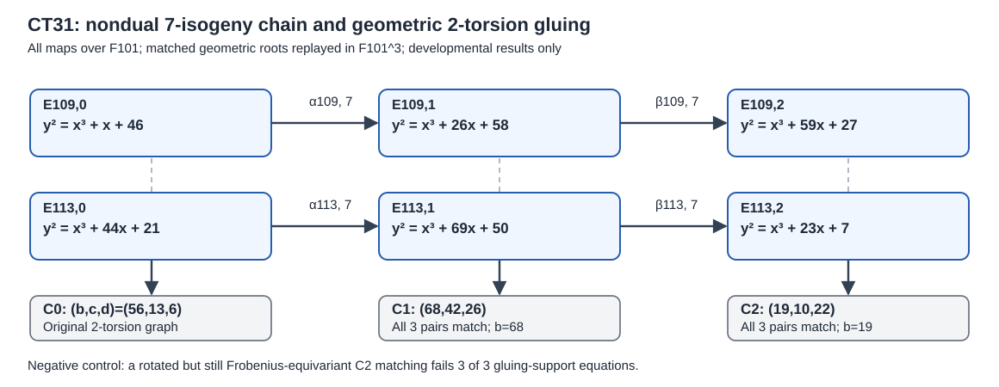

# CT31 — independent transported 2-torsion matching on two nondual seven hops

**Standing:** [pcc:unverified]. This is an independent stdlib-only arithmetic implementation and local producer-run test, **not** an independently signed PCC verdict, a complete Jacobian map, or a DLP-cost measurement. It does not import the producer's FpR, Kohel, genus-2, Cantor, or HLP implementation.



## Exact scope and new witness

For the specific ordinary trace -7 and -11 elliptic chains over F101,

| factor | stage 0 | stage 1 after alpha | stage 2 after nondual beta |
| --- | --- | --- | --- |
| order 109 | y²=x³+x+46 | y²=x³+26x+58 | y²=x³+59x+27 |
| order 113 | y²=x³+44x+21 | y²=x³+69x+50 | y²=x³+23x+7 |
| genus-2 model | C0=(b,c,d)=(56,13,6) | C1=(68,42,26) | C2=(19,10,22) |

Each genus-2 model means `y²=x⁶+d x⁴+c x²+b`. The fixed normalized monic cubic kernels (coefficients low to high) are

- alpha109 = [72,100,35,1]; alpha113 = [59,46,8,1].
- beta109 = [99,94,75,1]; beta113 = [53,19,40,1].

The independently implemented field is `F101[T]/(T³+6T²+13T+56)`. Its generator `z=T` gives all three original geometric two-torsion roots `z,z^101,z^(101²)`. The original elliptic matched roots are `z+2` and `56/z+38`. All denominators are nonzero in the field.

### Independent x-only map

Let `E:y²=f(x)=x³+a x+b`, let `h(x)=x³+h2*x²+h1*x+h0` be the three kernel x-coordinate pairs of a degree-7 normalized Vélu isogeny, and let `t` be a root of `f`. On `P=(t,0)`, its x-coordinate image is exactly

```
X(P) = 7*t + 2*h2 - 2*(3*t*t+a)*h'(t)/h(t).
```

This follows directly from Vélu's point-pair sum: for each distinct root `r` of `h`, the contribution from `Q=(r,s)` and `-Q` is `2*f(r)/(t-r)^2 - 2*t - 4*r`. Since `f(t)=0`, `sum(r)=-h2` and `sum(1/(t-r))=h'(t)/h(t)`, the displayed identity follows. It is valid when `h(t) != 0`, automatically true for disjoint 2- and 7-primary kernels. No y-coordinates, quadratic square roots, F101^6 kernel points, point-label tables, or discrete logs enter this evaluator.

The oracle transports all three matched roots via alpha, then via beta. It independently discovers quotient charts from each genus-2 cubic (the even and reciprocal quotients), rather than accepting a claimed chart list.

| stage | even quotient chart (destination, shift, x-scale) | reciprocal chart (destination, shift, x-scale) |
| --- | --- | --- |
| C1 | (E113,76,37) | (E109,14,37) |
| C2 | (E113,41,21) | (E109,37,21) |

Here `x_short = x_scale*(u+shift)`; the scale is `k²` for a valid Weierstrass scaling `(x,y)->(k²*x,k³*y)`. The C2 chart uses `k=18`, hence `k²=21`, agreeing with the independent polynomial equations.

**Local observed results:** For both C1 and C2, each transported nonzero two-torsion x-coordinate is a root of the exact destination short-Weierstrass cubic; each ordered triple has three distinct elements and closes under the 101-Frobenius three-cycle. Under the independently derived quotient charts, the paired internal roots satisfy `u_even * u_reciprocal = b` for **all three** matches at each stage. The stage-2 negative control rotates the second Frobenius orbit by one index: all individual target roots and their Frobenius stability remain valid, but **3/3 support-product equations fail**. This explicitly distinguishes Galois-stable arbitrary graph matchings from the *actual transported* graph. [pcc:unverified]

## Reproduce and limits

```sh
python3 -B experiments/chained-transfer-reference/ct29/audit_transported_two_torsion_stdlib.py
python3 -O -B experiments/chained-transfer-reference/ct29/audit_transported_two_torsion_stdlib.py
python3 -m py_compile experiments/chained-transfer-reference/ct29/audit_transported_two_torsion_stdlib.py
```

The first two commands passed in local Python 3.13 development execution with identical acceptance outputs (optimizations do not disable the negative-control assertion). The exact-head CI workflow now includes both runs; check the actual Actions conclusion rather than inferring a pass from source publication. The new source is independent of the root producer, but this is **not** a second implementation of arbitrary genus-2 Jacobian addition, a full balanced-divisor map, a trusted execution attestation, or a signed independent PCC check.

This verifies an explicit finite piece of the existing HLP hypotheses: the two degree-seven chains correctly carry the original graph's geometric 2-torsion pairs into the chosen C1 and C2 charts. The global quotient/isogeny and polarizations are mathematical bridges already written in crypto PR #3877; they are not proved by this cubic root replay alone. No full 12,317-class Phi2, its dual, 49-class second kernel, 64 lifts, index-calculus cost comparison, or ECDLP speedup is asserted here.

**Next acceptance step:** independently replay the *concurrently implemented* `Phi2` and `Psi2` maps from crypto root #3877 (current root head `ecf190bedaf12fadbe3743136920d464721cd7f2`) on Mumford classes using arithmetic that does not share the producer's Cantor reduction. The producer reports both 12,317-class domains and 109/113 source controls for Phi2/R2/Psi2 at component level, but its final changed-source guard and independent signed PCC were still pending at inspection. Independent replay must include all 12,317 rational classes, 109 source scalars, degree-one/repeated/split/nonsplit/ramified cases, incorrect-chart and flipped-ordinate controls, and the polarized dual identities; no already-passing producer test needs to be duplicated merely for a new report. Afterward price the entire cold chain against optimized rho and the matched index-calculus baseline. An independently written Cantor oracle and independent signatures remain missing.

## Source and provenance

- Crypto root [PR #3877](https://github.com/isogeny-labs/crypto/pull/3877), `SUCCESSOR_GLOBAL_PROOF.md`, `SUCCESSOR_CHECKPOINT.md`, and `successor-preflight/src/successor.rs` at `ae9fb898090c6727cdfa2487adbf7d3cf0ff9d51`.
- Cryptanalysis [PR #1492](https://github.com/isogeny-labs/cryptanalysis/pull/1492), `CT30_GEOMETRIC.md` and `audit_rational_maps_stdlib.py` at `c52a168905e4ca7192b8e4639441fef4d46b0020`.
- CT23 closed-fibre [PR #1493](https://github.com/isogeny-labs/cryptanalysis/pull/1493), checked to avoid reimplementing a Jacobian evaluator.
- HLP 2-torsion gluing and Vélu elliptic-isogeny formulas are standard prior mathematics; no priority/novelty claim. The connected research-KB and encrypted atlas were not available for independent retrieval in this environment; absence of a hit is not asserted.
- No EKS Spot usage, S3 admission request, paid allocation, or benchmark claim.
