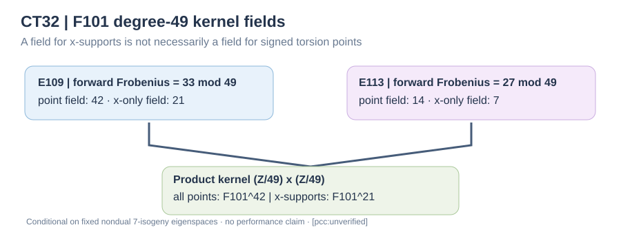

# CT32 — exact Frobenius certificate for the two-hop cyclic-49 kernels

**Scientific standing: [pcc:unverified].** Independent elementary modular arithmetic with Python and Go local producer-run checks, not a signed PCC verdict. The **geometric interpretation is conditional** on CT29–31's fixed nondual 7-isogeny eigenspace selections and the composite kernels being cyclic of order 49. This note does not implement the native genus-2 isogenies or solve a new DLP.

## Mathematical result

For the two initial elliptic factors over F101, \(E_{109}:y^2=x^3+x+46\) and \(E_{113}:y^2=x^3+44x+21\), independent point counts give 109 and 113 respectively. Thus their Frobenius traces are \(-7,-11\). On \(E[49]\), the characteristic polynomial of Frobenius is \(X^2-tX+101\) modulo 49. The two distinct roots modulo 7 lift uniquely by Hensel's lemma.

| Component | trace | roots mod 7 | roots mod 49 | selected forward lift | other lift | exact point field | exact x-support field |
|---|---:|---|---|---:|---:|---:|---:|
| E109 | -7 | 2, 5 | 9, 33 | **33** | 9 | **F101^42** | **F101^21** |
| E113 | -11 | 4, 6 | 11, 27 | **27** | 11 | **F101^14** | **F101^7** |

The 7-isogeny directions in CT30/31 select Frobenius eigenvalues 5 and 6 mod 7, so their **unique** lifts to the 49-torsion are 33 and 27. In both cases the determinant and trace identities hold modulo 49. The eigenvalue difference is a unit modulo 7; the diagonal Frobenius action therefore has precisely **two stable primitive cyclic order-49 lines**, checked by explicit enumeration of all 49 finite slopes and the vertical direction.

If \(Q\) generates the selected cyclic order-49 subgroup, \(F(Q)=\lambda Q\). Thus the minimal extension containing all signed geometric kernel points has degree \(\operatorname{ord}_{49}(\lambda)\), namely 42 and 14. Since an odd-order point has \(x(Q)=x(-Q)\), the smallest extension containing all kernel **x-coordinates** has degree the smallest \(d\) with \(\lambda^d=\pm1\pmod{49}\). Exact computations give \(33^{21}=-1\pmod{49}\) and \(27^7=-1\pmod{49}\), and no earlier exponent is \(\pm1\).

**Product consequence:** the full \((\mathbb Z/49)^2\) kernel of the two nondual chains has 2,401 geometric points and needs **F101^42** for signed point coordinates, while both coordinate-wise **x-supports lie in F101^21**. The degree-42 claim was already recognized in crypto #3877; this note independently checks it and makes the useful 21-degree x-only distinction explicit.

Over **F101^6**, exactly \(\gcd(49,\lambda^6-1)=7\) elements of **each** forward cyclic-49 kernel are rational, hence only **49/2401** product kernel elements. An F101^6 complete 49-torsion point table is impossible under the fixed eigenline hypotheses. This does **not** prevent the corresponding separable maps themselves from being defined over F101. Working x-only in F101^21 might lower field arithmetic for particular kernel-polynomial tasks; no reduction in full evaluation cost is yet established.

## Commands, controls and acceptance boundaries

\`\`\`sh
python3 -B experiments/chained-transfer-reference/ct32/ct32_frobenius49.py
python3 -O -B experiments/chained-transfer-reference/ct32/ct32_frobenius49.py
go run experiments/chained-transfer-reference/ct32/ct32_frobenius49_independent.go
\`\`\`

The first oracle counts points directly, enumerates every root of Frobenius's characteristic polynomial modulo 7 and 49, independently computes linear Hensel lifts, checks trace/determinant, enumerates stable primitive lines and calculates field degrees/fixed-point counts. Its negative controls reject false roots, repeated-root Hensel assumptions, wrong eigendirections and a spurious full-kernel claim over F101^6. The separate Go oracle recounts both curves using nested x/y loops, enumerates the modular roots again, and independently computes orders and fixed-point counts. Both are stdlib-only and ran locally without paid compute. Producer execution is **not** independent signed PCC verification.

**Sources checked:** crypto [#3877](https://github.com/isogeny-labs/crypto/pull/3877) and its CT24/CT25 concurrent work; cryptanalysis [#1492](https://github.com/isogeny-labs/cryptanalysis/pull/1492) CT30 and CT31 geometric forward eigenspaces; existing two-hop Jacobian [#1493](https://github.com/isogeny-labs/cryptanalysis/pull/1493) and [#1494](https://github.com/isogeny-labs/cryptanalysis/pull/1494). Established theory: Kohel, *Endomorphism Rings of Elliptic Curves over Finite Fields*, 1996, https://www.i2m.univ-amu.fr/perso/david.kohel/pub/thesis.pdf; Sutherland, MIT 18.783 Lecture 22 (2025), https://ocw.mit.edu/courses/18-783-elliptic-curves-fall-2025/resources/mit18_783_f25_lec22_pdf/. Shared research-KB server is unavailable to this runtime; no absent-prior-work claim is made.

**Next exact acceptance:** construct an F101^21 x-only composite-kernel certificate, independently verify Frobenius on the 24 x-pairs per cyclic line, and use an F101^42 signed-point oracle only if divisor/ordinate evaluation requires it. Test all additions, kernels, Frobenius and dual identities with independently implemented Cantor arithmetic before any complete-attack claim. Full-cost solving comparisons still require S3 admission/live budget. No merge, EKS job or fee incurred.
