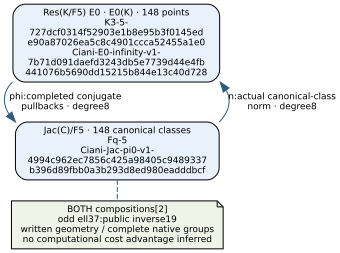
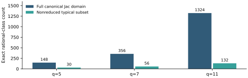

# Independent canonical-class genus-three norm

Four unfiltered native tests pass for each fixed q=5,7,11 instance:all148/356/1324 independently counted Jacobian classes and all148/356/1324 source points. Both actual compositions are[2]. Every740/2492/14564 generating edge,negation/doubling and every37/89/331 odd scalar image/recovery pass. Unit02 75275f has original0/finalguard0/all359 hashes unchanged,zero failed/ignored/filtered tests. Whole0e2cd4 preserves373 files in one617,016-byte standard tar/XZ. All observations are unsigned local evidence. [pcc:unverified]

Independent counts C(q),C(q²),C(q³) are(6,26,192),(8,50,380),(12,122,1308). Riemann–Roch and a separate Newton calculation both give148/356/1324;BFS reaches exactly these orders using5/7/11 rational-point generators. Observed norm kernel2 in every case;image sizes74/178/662. These complete finite groups do not establish a general solver or large-field advantage. [pcc:unverified]

Runtime norm accepts a canonical divisor class,not a scalar. Its three conics produce the actual rank-three R2/R4 quotient algebra through original homogeneous multiplication and kernel solves. An invertible L² chart and monogenic T yield a degree-three polynomial. Exact repeated division retains root multiplicities over Fq6;completed Ciani images are summed with those multiplicities. All conics and the quartic are checked in the possibly nilpotent algebra. Original field/poly/elliptic/Picard engines are reused without arithmetic changes. [pcc:unverified]

The origin is geometric:each of the q+1 plane lines through P0 gives a quartic section minus one copy of P0,representing Dinf~K-P0. Every line offset agrees. A typical norm subtracts that image sum;an exceptional class[P0-P] maps to pi(P0)-pi(P). The actual u0=0 chart and both quartic infinities complete the quotient cover. Explicit field embeddings and q³-Frobenius projection retain the frozen cubic basis. No fitted shift or tetragonal-infinity substitution is used. [pcc:unverified]

The written derivation identifies cycle pushforward with Picard norm using the function-field norm of principal divisors. V4 characters give off-diagonal zero and diagonal[2]. The product pullback has finite kernel and is geometrically surjective,which derives the reverse[2] identity. Descent gives both rational-group compositions. Bezout2u+ell v=1 proves odd-subgroup injection and two-way recovery,with public u19/45/166. It gives no global inverse on the even parts. [pcc:unverified]

Formal scope c88b36:13 SAME declarations compile/audit with original producerLean4.35 and original consumerLean4.34.1,zero trusted. All13 exact original-consumer PCC declaration bindings locally pass. They prove quotient/section/additivity consequences,origin and multiplicity/monogenic identities,reverse2 from geometric surjectivity and odd recovery. Actual divisors/Picard/function-field norm/R2R4 scheme identification/completed covers/reducer/geometric surjectivity remain written/native bridges. Formalization is partial. [pcc:unverified]

Every admissible affine/monogenic presentation gives the same divisor cycle by the written quotient-algebra argument. Native alternate-chart controls cover eight typical classes per field;they do not enumerate every pair of choices. Preserve that distinction. The full-group homomorphism and both compositions are exhaustive on the fixed native domains. [pcc:unverified]

Explicit controls per field:four completed infinities and four geometric u0=0 branch points;wrong infinity sign gives a different valid elliptic image. Triple roots retain multiplicity3. Actual omitted-origin and wrong pi(P0)-origin outputs differ in all three cases. Nonreduced typical counts30/56/132 include26/50/120 cases where reduced support gives a different valid answer. Field/model/canonical/rank/tag/offcurve controls reject. All original fixtures remain. [pcc:unverified]

Bounded CLI af3d78/wholef459a6:three literal requests,nine canonical classes zero/typical/exceptional,original0/all372 guards unchanged. Twelve actual process controls reject2:no rejected output and overwrite bytes unchanged. This is CLI transport/serialization acceptance,not a separate exhaustive-domain or independent arithmetic proof. Fresh debug cache is outside the whole420-file617,988-byte raw archive. [pcc:unverified]

Preserved failures:static01 E0425 on the nonexistent curve::pneg API,wholee1f736;frozen4710c0 precedes the original curve::neg correction. Strict static02 and expanded static03 pass. Lean01 a5ecd7 fails a final symbolic-smul grind;frozen2b2a5e precedes a proof-body-only rewrite with all statements unchanged. Lean02 bdbc4f compiles13 but the old consumer auditor fails removed APIs under4.35;frozen e14270 precedes the two compatible original gates. No verifier,trust or warning/test criterion changes. [pcc:unverified]

Frozen protocolac58df was actually published c3b8d74c/readyPR1521 before code,424a30. Six complete native trees are handed to the existing trusted publisher,4ea88c/source5fff3767;actual migration43398333803 is discovered success,canonical manifests/whole-job retention are separate. Every original boundary has member/raw/archive digests and exact standard tar/XZ roundtrip;no pruning or splitting. Original six CI jobs remain whole;new integration planb4cd92 appends a seventh. Full independent replay and exact-head CI are still pending at this report snapshot. [pcc:unverified]

The broader root regression remains NOTgreen:two original timeouts plus an exact missing original ecbench fixture diagnostic. Original AWSCLI installation exposes missing credentials;anonymous exact-object read returns403,add561. No fixture is fabricated. Next:complete source publication and independent norm replay/CI,then reuse the destination index-calculus pipeline. Charge support roots,all setup/transfer/solve/recovery/verification and matched references under actual admission. No measured computational advantage or novelty is claimed. [pcc:unverified]

[Written derivation](../../G3_NORM_DERIVATION.md) · [Proof map](../../G3_NORM_PROOF_MAP.md) · [Frozen protocol](../../G3_NORM_REPLAY_PROTOCOL.md) · [Native records](records.json) · [Exact model identities](identities.json).

[PDF](report.pdf);editable DOT,recorded JSON,renderer and Typst are adjacent. Every final page must be visually inspected before the report claim and commit. Existing C0/T20 and producer proposal graphs remain immutable historical reports.
