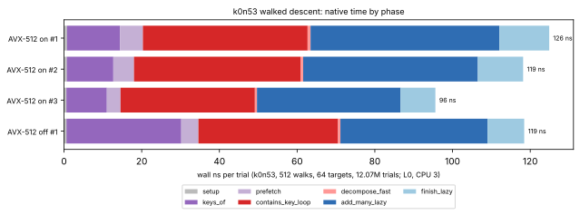

# k0n53 walked descent: where native time goes

**Date.** 2026-11-04. **Class.** Diagnostic: a profile, with no change to the
solver and no gain claimed. **Code:** `main` fe79ec13a, with 512 walks
(#1389) and the per-orbit projection (#1393).

## Why a native profile

- **Callgrind** counts instructions on the scalar paths only, because
  Valgrind does not emulate AVX-512.
- **`perf`** is not available: the session VM has no PMU and no `perf`
  binary.
- **What was built instead:** `suite/examples/descent_phases.rs` mirrors
  `IndividualLogSolver::solve_by_walking` round for round through the same
  calls and times each phase with `Instant`. A target stops at its first
  decomposition; the one modular inverse that follows is left out.
- **Visibility:** `PairSumTable::keys_of` is made `#[doc(hidden)] pub` for
  this, like `prefetch_key` and `contains_key` already are.

## Result

64 held-out k0n53 targets (seeds 9000–9063), 512 walks, 12.07M trials,
3 runs plus one with the AVX-512 kernels off. Single thread on CPU 3, L0.

| phase | share (AVX-512 on, 3 runs) | ns per trial |
|---|---|---|
| `add_many_lazy` (slopes, batched inversion) | 38–39% | 37–49 |
| `contains_key` loop (presence filter, bucket lookup) | 34–36% | 35–43 |
| `keys_of` (Frobenius canonical key) | 10–11% | 10–14 |
| `finish_lazy` (ordinates) | 9–10% | 9–13 |
| prefetch | 4–5% | 4–6 |
| setup and decompositions | about 1% | about 1 |

The total is 96–126 ns per trial; untimed work is 0.6%. [pcc:unverified]

**Findings:**

1. **The AVX-512 kernels.**
   - Turning them off (`KIC_SCAN_SIMD=0`) leaves `add_many_lazy`
     unchanged, at 37.9 ns per trial.
   - Only `keys_of` slows without them: 29.5 ns per trial, against
     10–14 ns with them.
   - The batched add does not benefit from its vector kernel here.
2. **The presence filter.** [pcc:unverified]
   - The filter is 1 MiB: 2^23 bits for 1,106,640 stored sums, one hash
     bit at 4 bits per sum.
   - It admits **12.3%** of the keys a descent probes, which is the
     expected false-positive rate (`1 − e^{−1/8}`).
   - Every admitted key pays a bucket lookup in a 4.2 MiB array. In
     isolation that measured 58–112 ns per admitted key, against 2–5 ns
     for a key that stays in cache.
   - So most of the probe loop's time is false positives.
3. **Prefetch distance.**
   - A rolling prefetch (16, 32 or 64 keys ahead) instead of prefetching
     the whole round first gave no gain (`data/prefetch-distance.jsonl`).
   - The loop is not waiting on the filter word itself.

## Next lever (needs a format decision)

- **The proposal.** Two filter bits per key in the same 64-bit word, at
  the same 1 MiB, would cut admits from 12.3% to about 5%. The lookup
  stays a single load, and false positives are still rejected by the
  bucket check, so no output changes.
- **Why it needs a decision.** The filter is a serialized
  cross-implementation format: `folded_storage`,
  `examples/dump_fold_vectors.rs` and `examples/load_fold_table.rs` write
  and read it, and a device implementation must probe it identically. The
  change therefore needs a format version and every reader updated
  together.
- **Not done here.**

## Limits

- **Noise.** Wall times on this shared 4-vCPU VM moved by up to 4× between
  repeats of the same microbenchmark (`data/probe-bench.txt`). The shares
  above are stable across runs; absolute nanoseconds are not.
- **Scope.** This is a phase profile, not a speed claim, and no
  matched-rho row is stated.

## Data

- `data/phases-simd.jsonl`: 3 runs.
- `data/phases-scalar.jsonl`: 1 run.
- `data/prefetch-distance.jsonl`.
- `data/probe-bench.txt`.
- `plot.py`.
