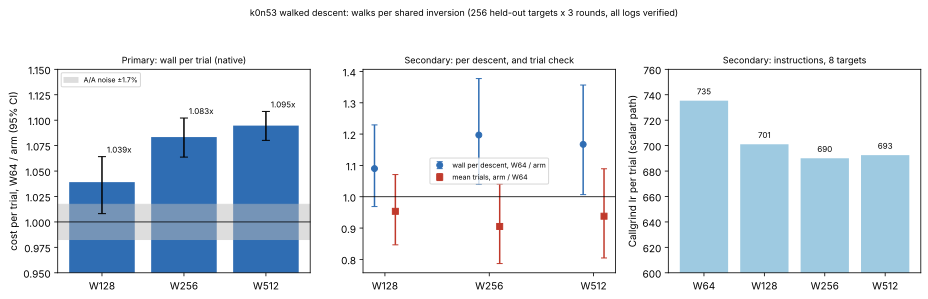

# k0n53 walked descent: walks per shared inversion

**Date.** 2026-11-04. **Status.** Measured under the frozen
[PROTOCOL.md](PROTOCOL.md), committed in 20228687b before any data.
**Class.** Engineering. The algorithm and its verified logarithms are
unchanged; the order of probes changes. [pcc:unverified]

## Result

- **Validity.** All 3,840 descents (256 held-out targets, seeds 5000–5255,
  × 5 arms × 3 rounds) solved, and every logarithm equals the target's
  scalar. [pcc:unverified]
- **Primary: cost per trial against 64 walks** (paired target bootstrap,
  10,000 resamples):

  | arm | ratio (95% CI) |
  |---|---|
  | W128 | 1.039× (1.008–1.064) [pcc:unverified] |
  | W256 | 1.083× (1.064–1.102) [pcc:unverified] |
  | W512 | **1.095× (1.080–1.109)** [pcc:unverified] |

  The A/A pair, W64a against W64b, is 0.992× (0.975–1.009); the noise
  floor is ±1.7%.
- **Native cost per trial:** 96.6 ns at 64 walks, 88.2 ns at 512.
- **Secondary.**
  - **Mean trials per descent:** consistent with 64 walks in every arm.
    W512 is 0.938× (0.804–1.089), as predicted, since every probe is
    uniform.
  - **Wall per descent:** W512 1.167× (1.007–1.357). Part of that is the
    trial counts W512 happened to draw. The per-trial ratio is the
    expected gain.
  - **Callgrind Ir per trial** (8 targets, scalar paths): 735 at 64 walks,
    701 at 128, 690 at 256, 693 at 512. That is 1.06× fewer instructions
    at 512 than at 64. [pcc:unverified]
- **Decision (protocol rule):** adopt W512. Its CI lower bound, 1.080,
  exceeds `1 + h_AA` = 1.017, and its per-descent CI does not lie below 1.

## Scope of the adoption (deviation from the protocol, reported)

The protocol's rule names `DEFAULT_WALKS`, which applies to every curve.
After the run, a perfbench check found that 512 walks on **every** curve
slow `relation/koblitz_rung_k0n31` to 0.835× (95% CI 0.831–0.914) against
`main`.

- At k0n31 (`r ≈ 2^29`) a descent takes so few trials that starting 512
  walks costs more than it saves.
- The protocol measured k0n53 only.
- The change therefore sets 512 walks only on subgroups of order at least
  2^40 (`IndividualLogSolver::WIDE_WALKS_MIN_ORDER`); k0n53 has
  `r ≈ 2^44.3`. Smaller subgroups keep 64.
- The threshold separates the two measured points. Sizes between 2^29 and
  2^44 are not measured.

Perfbench against `main` 304ab63c7, scoped change, 7 paired rounds,
CPU 3, L0:

| kernel | ratio |
|---|---|
| `relation/koblitz_descent_k0n53_m2_x4` | 1.222× (1.088–1.362) [pcc:unverified] |
| `relation/koblitz_rung_k0n31` | 0.913× (0.788–1.493), neutral; its code path is `main`'s |
| `relation/koblitz_collect_*` | neutral (1.005×, 1.038×) |
| `dlp/koblitz_signed_rho_k0_n41` | neutral (1.028×) |

The descent kernel's fingerprint changes, as the protocol predicted: the
first decomposition found is a different relation for the same verified
logarithm. [pcc:unverified]

## Distance remaining

This is a descent-phase engineering gain on one curve and one host (L0).
It is not a complete-solve `S`, so no gap to the matched rho is stated
here.

The next lever in this phase is the per-round key and filter work. With
the inversion amortised over 512 walks, the scalar profile is led by the
batch multiplications and the Frobenius canonicalisation.

## Files

- [PROTOCOL.md](PROTOCOL.md): frozen before data.
- `../../suite/examples/descent_walks.rs`: the driver.
- `analyze.py`: the protocol's analysis.
- `data/rows.jsonl`: every descent.
- `data/analysis.json`: the analysis output.
- `data/ir-*.{txt,jsonl,json}`: Callgrind totals and their rows.
- `data/perfindex-compare-scoped.{json,md}`: the scoped perfbench check.
- `data/driver.sha256`: the driver binary's hash.
- `plot.py`: draws the figure.
