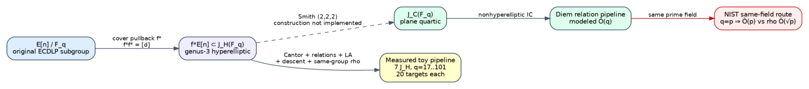
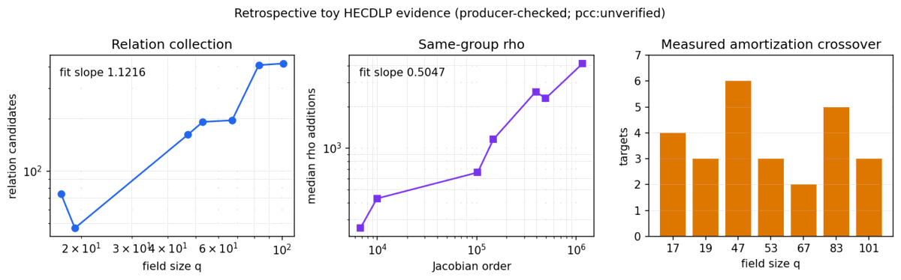

# Assessment: a drastic HECDLP reduction for genus-3 covers

## Result

The strongest established exponent-changing route I found is Benjamin
Smith's rational `(2,2,2)`-isogeny from an eligible genus-3 hyperelliptic
Jacobian `J_H/F_q` to the Jacobian `J_C/F_q` of a non-hyperelliptic genus-3
plane quartic.  Once on `J_C`, Diem's plane-curve index calculus has published
soft-O cost `q`, rather than the direct genus-3 hyperelliptic soft-O cost
`q^(4/3)`.

This is a real, published exponent reduction for the **HECDLP stage**.  It is
not evidence of a new NIST break, nor is it novel to this work.  The primary
source is:

- Benjamin Smith, *Isogenies and the Discrete Logarithm Problem in Jacobians
  of Genus 3 Hyperelliptic Curves*, 2008,
  <https://arxiv.org/abs/0806.2995>.

## Typed reduction



Editable source: `figures/hecdlp-transfer.dot`; vector rendering:
`figures/hecdlp-transfer.svg`.

```text
ECDLP subgroup G (odd order n)
   | verified cover/descent embedding
   v
G_H <= J_H(F_q)[n],  H: y^2=f(x), deg f=7 or 8
   | rational (2,2,2)-isogeny phi, ker(phi)=(Z/2Z)^3
   v
G_C <= J_C(F_q)[n],  C a non-hyperelliptic plane quartic
   | Diem index calculus
   v
discrete logarithm
```

The first arrow is an independent obligation.  Smith's isogeny improves a [pcc:unverified]
HECDLP that has already been obtained; it does not manufacture or validate the
cover of the original elliptic curve.

## Exact retraction for cover-lifted DLPs

There is an even stronger dimension reduction when the HECDLP points are known
to come from an actual degree-`d` curve cover `f:H -> E`.  The induced maps on
Jacobians satisfy

```text
E --f^*--> J_H --f_*--> E,       f_* o f^* = [d].
```

On an order-`n` subgroup with `gcd(d,n)=1`, `f^*` is injective and
`[d^(-1) mod n] o f_*` is an explicit retraction.  Consequently, a DLP in the
specific image `f^*E[n]` reduces exactly to the original ECDLP.  This is a
drastic genus/dimension reduction, but not a faster attack than the original [pcc:unverified]
ECDLP.

The identity composes cleanly with the Smith isogeny.  If
`phi^dagger o phi=[2]`, then

```text
f_* o phi^dagger o phi o f^* = [2d],
```

and the recovery map is `[(2d)^(-1) mod n] o f_* o phi^dagger` whenever
`gcd(2d,n)=1`.  For the NIST diagonal `(3,3,3)` path, summation after the
polarized dual gives multiplier nine, so the composed recovery is
`[9^(-1) mod n] o Sum o pi^dagger` on P-224 and P-256.

This certificate is deliberately restricted to the transported elliptic
subgroup.  It says nothing about arbitrary divisor classes in `J_H`, including
classes with a Prym component.

## Why the logarithm survives

Let `G_H` have odd prime order `n`.  Smith's kernel has order eight.  Therefore
`|G_H intersect ker(phi)|` divides both `n` and `8`, so the intersection is
trivial and `phi` is injective on `G_H`.  If `Q=[k]P`, then
`phi(Q)=[k]phi(P)` with the same `k mod n`.

For the polarized dual, `phi^dagger o phi=[2]`.  Since `n` is odd, an image can
be recovered on the subgroup with `[2^(-1) mod n] o phi^dagger`.  This is an
explicit preservation certificate, not merely an order comparison.

## Cost comparison

| Representation | Published soft-O scale | Log2 scale when `q` is 85 bits |
|---|---:|---:|
| Pollard rho on a group of order about `q^3` | `q^(3/2)` | 127.5 |
| Direct genus-3 hyperelliptic index calculus | `q^(4/3)` | 113.3 |
| Non-hyperelliptic plane-quartic index calculus | `q` | 85.0 |

Thus the Smith transfer saves `q^(1/3)` against direct genus-3 hyperelliptic
index calculus, or `q^(1/2)` against rho on an order-`q^3` group.  At the
illustrative 85-bit base-field size those exponent gaps are about 28.3 and
42.5 bits respectively.  Constants, logarithmic factors, isogeny construction,
relation collection, and sparse linear algebra are not measured here.

There is a decisive caveat for the NIST curves.  If the elliptic curve and the
cover both remain over the same prime field `F_p`, plane-quartic soft-O `p` is
*worse* than elliptic Pollard rho `p^(1/2)`.  A drastic reduction of the
original ECDLP requires the cover/descent to represent an order-about-`q^3`
problem over a much smaller `F_q`.  The Smith step alone does not provide that.

## Exact NIST complexity gate

`artifacts/complexity_gate.json` turns that caveat into a structural filter.
The subfields of `F_(p^m)` are `F_(p^d)` for divisors `d` of `m`; for a native
prime field `m=1`, there is no proper same-characteristic subfield. In
particular, Tian's cubic setting would require `p=q^3`, impossible for prime
`p` and nontrivial `q`.

Another same-field cover or isogeny is therefore not a complexity-changing
lead by itself. Further searches pass the gate only if they provide a
genuinely smaller field, a rigorously analyzed destination exponent below
`1/2` in `p`, or a separately exploitable order/endomorphism weakness with
full subgroup accounting.

## Toy empirical benchmark

`artifacts/empirical_benchmark.json` now measures real computations at small
sizes. The rho side solves producer-checked logarithms in safe-prime multiplicative [pcc:unverified]
subgroups. The plane-quartic side factors restrictions of the smooth Klein
quartic

```text
X^3 Y + Y^3 Z + Z^3 X = 0
```

to random affine lines and retains actual principal-divisor relations whose
four intersection points are rational. Each reported intersection point is
substituted back into the curve equation.

| Primitive | Sizes | Measured operation-count slope | Modeled slope |
|---|---|---:|---:|
| Pollard rho | subgroup orders from about `2^13` to `2^29` | 0.5128 | 0.5 |
| Split-line quartic relations | `q=101,211,401,809`; `ceil(q/4)` relations | 0.9990 | 1.0 |

The rho wall-time slope was 0.4787 and the relation-collection wall-time slope
was 1.1558 on this machine. Those wall-clock values are not directly
comparable because the implementations use different arithmetic primitives.
The operation-count fits are the meaningful comparison.

This is empirical support for the scaling distinction, not an end-to-end
attack measurement. The quartic run stops before relation-rank filtering,
sparse linear algebra, and individual-log descent; it is not a NIST-size run.
No cryptographic conclusion is extrapolated from the small wall times.

## Complete toy HECDLP solves

`artifacts/end_to_end_hecdlp.json` closes those omitted stages on seven small [pcc:unverified]
prime-order genus-3 **hyperelliptic** Jacobians. The implementation uses exact
Cantor arithmetic in Mumford representation, collects relations from random
multiples whose `u` polynomial splits, performs online sparse elimination,
cross-checks its solution against dense Gaussian elimination, performs
random-offset individual descent, and solves the same targets with Pollard rho
on the same Jacobian.

| q | #J | Base | Candidates | Input density | Precomp. (s) | Individual (s) | Rho (s) | Measured crossover |
|---:|---:|---:|---:|---:|---:|---:|---:|---:|
| 17 | 6,763 | 11 | 74 | 0.245 | 0.135 | 0.0043 | 0.0315 | 4 targets |
| 19 | 9,923 | 13 | 47 | 0.212 | 0.090 | 0.0036 | 0.0464 | 3 targets |
| 47 | 102,259 | 23 | 162 | 0.119 | 0.412 | 0.0191 | 0.0745 | 6 targets |
| 53 | 147,031 | 26 | 192 | 0.106 | 0.488 | 0.0098 | 0.1187 | 3 targets |
| 67 | 393,203 | 42 | 196 | 0.067 | 0.558 | 0.0099 | 0.2870 | 2 targets |
| 83 | 493,403 | 35 | 407 | 0.081 | 1.224 | 0.0131 | 0.2392 | 5 targets |
| 101 | 1,163,011 | 56 | 416 | 0.051 | 1.299 | 0.0134 | 0.4375 | 3 targets |



Editable plotting source: `figures/plot_evidence.py`; vector rendering:
`figures/hecdlp-evidence.svg`. The plot reads the retained JSON and does not
re-run the benchmark.

Every factor-base logarithm and every target logarithm is checked by scalar [pcc:unverified]
multiplication. The measured relation-candidate slope versus `q` is `1.1216`;
the measured rho-addition slope versus `#J` is `0.5047`. Twenty targets were
solved per curve. Index-calculus precomputation loses for the first target but
the cumulative measured runtime crosses rho after 2–6 targets on every curve. [pcc:unverified]
That is a measured toy amortization result, not a cryptographic crossover
claim.

This still does not measure the unresolved P-224 signed transfer or dual map:
these experiments use native hyperelliptic Jacobian points. Production-scale
sparse linear algebra and the NIST plane-quartic representation remain absent,
although the toy relation solver is now genuinely sparse and rank-aware.

## Signed transfer and dual control

`artifacts/signed_transfer_benchmark.json` measures the missing workflow on a [pcc:unverified]
dimension-one control where every formula is available: explicit rational
2-isogenies on six toy prime fields. For each curve it verifies that the image [pcc:unverified]
is on the quotient curve, the DLP scalar is preserved, the polarized dual
satisfies `phi^dagger(phi(P))=[2]P`, and `[2^(-1) mod r] phi^dagger` recovers
the signed source point on an odd prime-order subgroup.

Across 2,000 repetitions per field, median transfer times range from 741 to
911 nanoseconds; median dual-and-recovery times range from 8.68 to 15.62
microseconds. These are real signed-map measurements, but only an elliptic
analogue. The P-224 Kummer implementation was separately evaluated at `P` and
`-P`; both exact 64-coordinate images have SHA-256 digest
`b2920c811eb77e9e5a1eb5acc355ebaae894e35ce067e42f1e58c414b5365705`.
That reproduced collision explains why the genus-3 signed transfer and dual
cannot yet be timed from the current representation.

## Applicability screen

For `H: y^2=f(x)`, the eight Weierstrass points inherit a Frobenius permutation
from the irreducible-factor degrees of the homogenized degree-eight
polynomial.  A Frobenius-stable perfect matching gives a rational maximal
isotropic subgroup of `J_H[2]`, hence a candidate rational `(2,2,2)` kernel.

The included screen:

- enumerates all 105 perfect matchings;
- reproduces Smith's full factorization-type table;
- lists every rational candidate kernel for a supplied type or polynomial;
- recomputes Smith's modeled random-curve success rate as
  **18.57381419453889%** under the paper's hypotheses.

That percentage is a population model, not the probability that an already
fixed curve works.  A positive combinatorial screen must still be followed by
explicit isogeny construction and verification that the codomain is
nonsingular and non-hyperelliptic.

The route requires characteristic greater than three.  It does not supply the
desired non-hyperelliptic target in characteristic two, and Smith's
construction is unavailable in characteristic three.

## Reproducible validation

Eighteen tests pass: seven Smith-screen tests, four cover-retraction tests,
two prime-field complexity-gate tests, two scaling-benchmark tests, and two
complete-toy-HECDLP tests, plus one signed-transfer control test.
They cover the 105 matching count, the complete published
factorization table, normalized cycle-type weights, the 18.57% aggregate, the
cost exponents, rejection of unsupported characteristics, and Smith's explicit
`F_37` positive control:

```text
H: y^2 = x^7 + 28x^6 + 15x^5 + 20x^4
         + 33x^3 + 12x^2 + 29x + 2.
```

Its affine polynomial factors with degrees `6+1`; the rational point at
infinity gives homogeneous type `(6,1,1)`, for which the screen finds one
tractable kernel.

## Status and next gate

| Gate | Status |
|---|---|
| Published exponent-changing mechanism | Complete |
| Independent rational-kernel screener | Complete |
| Published table and aggregate validation | Complete; 7/7 screen tests |
| Cover-lifted subgroup retraction | Theorem and certificate complete; 4/4 tests |
| NIST prime-field complexity gate | Complete; 2/2 tests |
| Toy empirical scaling benchmark | Complete; 2/2 tests plus preserved raw rows |
| Complete toy HECDLP and same-group rho | Complete on seven prime-order genus-3 Jacobians with 20 targets each; 2/2 tests |
| Signed transfer and dual recovery | Complete on six elliptic controls; actual P-224 map remains sign-blocked |
| Odd-order subgroup preservation | Complete |
| User cover equation and cover map | Not supplied |
| User-specific isogeny and quartic | Not constructed |
| NIST-scale end-to-end benchmark | Not run |

For the earlier genus-3 `(3,3,3)` lead, the corrected P-224 reconstruction now
does produce a producer-checked nonsingular plane quartic over `F_p`; the Smith [pcc:unverified]
`(2,2,2)` detour is therefore unnecessary for that destination.  Its
source-to-Jacobian point map and composition certificate remain open.  Even
after those are supplied, the same-field Diem cost is soft-`O(p)`, worse than
elliptic rho's `O(sqrt(p))`, so this construction is not by itself a drastic
NIST ECDLP reduction.

The next concrete input is the actual genus-3 hyperelliptic cover equation,
its base field, and the map carrying the ECDLP subgroup.  The screen can then
return a curve-specific yes/no result and enumerate the rational kernels that
must be constructed.
