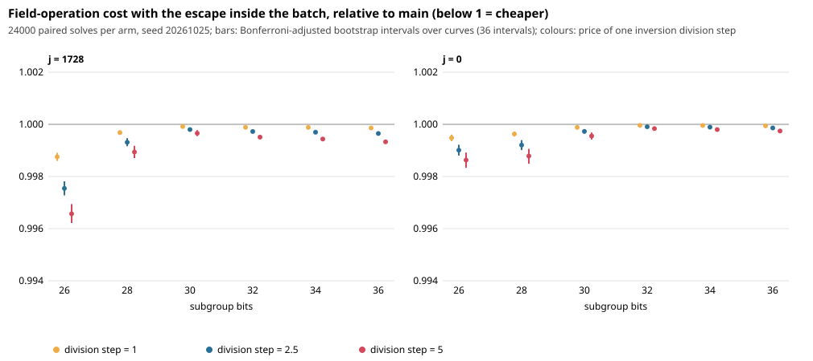

# The GLV cycle escape: what it costs, and the same escape inside the batched inversion

Branch `glv-batch-escape-20261024`, PR #1091. Protocol: `PROTOCOL.md` (frozen and pushed, PR opened, before
`rows_*.jsonl.gz` existed; `PROTOCOL.sha256`). Data: seed 20261025, 24000 paired solves per arm.
No wall time was measured.

## 1. What an escape costs (exploratory, then re-read on the confirmatory main arm)

Observation. Counters (`CA_GLV_FIELD_COUNT`, compiled out by default; fingerprint of
group operations equal to main's on 1200 solves) show:

* One escape is exactly **1 field inversion + 6 (j = 1728) or 8 (j = 0) multiplications + 2 squarings.**
* A batched step costs 1/W inversions + about 9 multiplications + 2 squarings, where W, the number of
  walks per batch, is 4 at 26 bits and 124 at 36 bits (`W = sqrt(n/m)/(24 lg n)`).
* The field inversion is `ca_invmod`, a 64-bit extended Euclid with one hardware division per step;
  17 steps at 26 bits, 23 at 36 bits.

Assumptions (the library has no measured inversion/multiplication ratio; none was measured here):
squaring 0.8 M, additions free, one Euclid division step = d multiplications with d = 1, 2.5, 5, so an
inversion is about 20 to 115 M. Under these, **an escape costs 2.4x to 7.1x a batched step at d = 2.5
(1.8x to 12x over the band)**: the hypothesis that it is far dearer than the one group operation it is
booked as holds per event.

But escapes are rare on main's rule: 14.7 per 10^4 steps at 26 bits j = 1728, 0.3 to 0.65 at 32 to 36.
They are **0.007% to 0.48% of the walk's field cost** (table in `summary.md`) against 0.002% to 0.12% of
group operations. Interpretation: the 2.2-point gap in #1083 is a difference between two tables, so only the change in
escape cost between them can explain it. On main's rule the escapes cost at most 0.48% of the walk in
total (26 bits, j = 1728, d = 5). With the old table 8 (about 18 escapes per 10^4 steps) they would have
cost about 0.7 points more (extrapolation from the per-event price, not measured). So escapes are
at most a third of the gap and probably less; the rest is elsewhere (hypotheses, untested: the 128-bit
`% n` scalar updates and the 6-way class reduction in the post-step, which the counters price at 15% to
40% of the walk's field cost, and table-size cache effects).

## 2. The change

`-DCA_GLV_BATCH_ESCAPE=ON` (default off): on detecting the cycle, the walk records the same cycle member
and exponents as before, and its slot in the next batched operation computes P + P (the batch already
does a == b as a doubling). The next iteration finishes with the same state the inline doubling left.
Deterministic, so walks entering a cycle still leave to the same point. The doubling stays one counted
group operation (one of the W of the iteration).

## 3. Paired comparison (confirmatory)

Per cell, ratio of sums batch / main, bootstrap over 200 curves, Bonferroni level 0.05/36.

| | result |
|---|---|
| Correctness | 24000/24000 right in each arm |
| Group operations | every cell within 1 +/- 0.00003 (largest interval [0.99997, 1.00009]); inside the 1 +/- 0.001 criterion |
| Field cost, d = 1 / 2.5 / 5 | all 12 cells below 1 at all three prices: 0.99875 to 0.99996 / 0.99755 to 0.99991 / 0.99657 to 0.99984 |
| Largest effect | j = 1728, 26 bits: 0.99875 [0.99860, 0.99891] at d = 1, 0.99657 [0.99622, 0.99694] at d = 5 |
| Smallest effect | j = 0, 32 to 34 bits: 0.99996 at d = 1 |
| Inversions | 0.994 to 0.9993 of main's; the saved inversions are exactly the escapes' |
| Wins / regressions | 12 of 12 / 0: the protocol's rule says propose the change |

Why group operations differ at all: the escaped walk's data-point test happens one iteration later, so a
collision can be reported by a different walk or one iteration later; the difference has mean 0 and is
below 0.003%.

Per-cell numbers: `summary.md`, `results.json`. Gap to the matched rho: unchanged by this work, not re-stated.

## 4. Limits

* Field cost is a model: the three inversion prices are assumptions and the counters do not see addition,
  subtraction, memory traffic, or the scalar `% n` arithmetic (identical in both arms).
* The gain is 0.004% to 0.34% of field cost; any wall-time effect will be of that order or smaller. The
  walk-step cost, not the escape, dominates (section 1).
* One machine class and one compile (gcc, Release); counters are single-threaded.

## 5. Is a Tier 1 wall-time run warranted?

Judgement for the PR reader: **no, not for this change alone.** The expected effect (at most about 0.3% at
26 bits, about 0.02% to 0.07% at 32 to 36 bits) is below what Tier 1 can resolve at its usual repeat
counts, and it does not explain the #1083 gap. If a Tier 1 run is spent, it should price the post-step
(`ca_mulmod` by `% n`, class reduction) instead.
