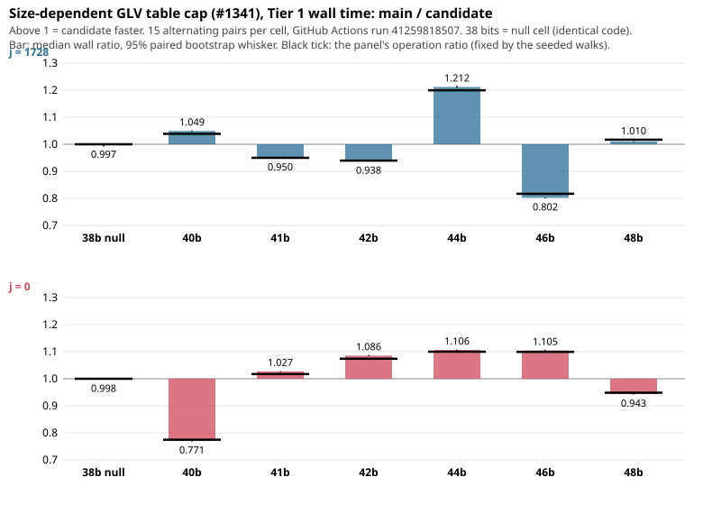

# Size-dependent GLV table cap (#1341) on the Tier 1 path: wall time follows operations at 38-48 bits

**Result.** On a GitHub Actions `ubuntu-24.04` runner under the Tier 1 gate
([run 41259818507](https://github.com/aburan28/cryptanalysis/actions/runs/41259818507), 15/15 valid pairs in
all 14 cells, nothing skipped by the time guard), the candidate (cap 128 from 40 bits) is **resolved faster
than main on 7 of the 12 cells at 40-48 bits and resolved slower on 5**, and in every cell the wall ratio
matches the panel's operation ratio to within 1.8%. The cost per group operation moved by at most
1.8% (j1728 46 bits, candidate dearer); it did not rise at 48 bits beyond 0.7%. The **38-bit null cell**
(identical code in both arms) read 0.997 [0.992, 1.000] (j1728) and 0.998 [0.997, 1.000] (j0): the
instrument's noise-plus-layout floor is about 0.3%. Which sign a cell shows is decided by its panel's seeded
walks (operation ratios 0.775 to 1.200), not by the cap, so **these panels support no wall-time claim about
the population**; they say the cap does not make an operation cost more or less in time. Tier 1,
instance-scoped, one runner, one run.

| cell | wall ratio main / cand | 95% paired bootstrap | resolved | valid pairs | CPU ratio | ops ratio (this panel) | ns per op, main -> cand | ns-per-op ratio main / cand | projection cand / main wall: 0.9849 x (cand / main ns per op), 40-42 bits |
|---|---|---|---|---|---|---|---|---|---|
| j1728 38 (null) | **0.997** | [0.992, 1.000] | not resolved | 15/15 | 0.996 | 1.000 | 95.5 -> 95.9 | 0.997 [0.992, 1.000] |  |
| j1728 40 | **1.049** | [1.047, 1.051] | faster | 15/15 | 1.048 | 1.039 | 97.3 -> 96.4 | 1.010 [1.009, 1.012] | 0.975 |
| j1728 41 | **0.950** | [0.949, 0.951] | slower | 15/15 | 0.950 | 0.950 | 98.2 -> 98.2 | 1.000 [0.999, 1.000] | 0.985 |
| j1728 42 | **0.938** | [0.937, 0.939] | slower | 15/15 | 0.937 | 0.940 | 97.2 -> 97.5 | 0.998 [0.997, 0.999] | 0.987 |
| j1728 44 | **1.212** | [1.210, 1.216] | faster | 15/15 | 1.211 | 1.200 | 99.1 -> 98.2 | 1.010 [1.008, 1.013] |  |
| j1728 46 | **0.802** | [0.800, 0.803] | slower | 15/15 | 0.802 | 0.817 | 97.7 -> 99.5 | 0.982 [0.980, 0.983] |  |
| j1728 48 | **1.010** | [1.009, 1.012] | faster | 15/15 | 1.010 | 1.017 | 101.3 -> 101.9 | 0.993 [0.992, 0.995] |  |
| j0 38 (null) | **0.998** | [0.997, 1.000] | not resolved | 15/15 | 0.998 | 1.000 | 127.5 -> 127.7 | 0.998 [0.997, 1.000] |  |
| j0 40 | **0.771** | [0.768, 0.771] | slower | 15/15 | 0.770 | 0.775 | 127.4 -> 128.2 | 0.995 [0.991, 0.995] | 0.990 |
| j0 41 | **1.027** | [1.024, 1.028] | faster | 15/15 | 1.027 | 1.017 | 129.4 -> 128.1 | 1.010 [1.007, 1.010] | 0.975 |
| j0 42 | **1.086** | [1.084, 1.088] | faster | 15/15 | 1.086 | 1.074 | 129.1 -> 127.7 | 1.011 [1.009, 1.013] | 0.974 |
| j0 44 | **1.106** | [1.104, 1.108] | faster | 15/15 | 1.106 | 1.100 | 130.0 -> 129.2 | 1.006 [1.004, 1.007] |  |
| j0 46 | **1.105** | [1.103, 1.107] | faster | 15/15 | 1.105 | 1.099 | 130.3 -> 129.6 | 1.005 [1.004, 1.007] |  |
| j0 48 | **0.943** | [0.942, 0.944] | slower | 15/15 | 0.943 | 0.948 | 133.0 -> 133.8 | 0.994 [0.993, 0.995] |  |

Wall ratio above 1 means the candidate is faster. Targets per cell: 20 at 38, 44, 46, 48 bits and 30 at
40-42. The runner filled `paired_speedup` exactly in the "faster" cells and not at 38 bits. The ns-per-op
ratio is the wall ratio divided by the ops ratio (the operation counts are identical in every pair), with
the interval scaled the same way. The projection column is descriptive only: #1340's pooled operation ratio 0.9849
(candidate / main, other curves) times this cell's candidate / main cost ratio, quoted for 40-42 bits as the protocol states; it is not a claim.

- **Host:** GitHub Actions standard `ubuntu-24.04` (image 20261026.354.1, kernel 7.0.0-1017-azure, 4 CPUs
  visible, cgroup v2, no CPU quota, virtualization "microsoft"), both arms pinned to CPU 0. The probe does
  not give the CPU model. Per-operation costs here (96-134 ns) are lower than the predecessor's runner
  (118 / 151 ns): a different instance, so absolute ns are not comparable across runs.
- **Gate:** `binaries_stable`, `artifacts_stable`, `runner_stable` true in all 14 cells;
  `host_exclusivity_proved` false, as always for Tier 1. Every run printed `verified=1` and the frozen
  scalar hash; all 14 preflights `ok`.
- **Binaries:** the runner's builds hash `4b5036ec...` (ref) and `46ec2439...` (cand), byte-identical to the
  authoring-VM builds; compiler gcc 13.3.0. The 14 panels' operation counts disclosed in PROTOCOL.md
  equal the runner's (`ops_ref`, `ops_cand` in `results.json`).
- **Receipts:** `tier1-github-41259818507/` holds run summaries, preflights, allocation, host probe, compiler,
  `binaries.sha256`; `results.json` holds every figure. Raw `runs.jsonl`, `pairs.jsonl`, stdout/stderr are in
  the workflow artifact `glv-walltime-tier1-41259818507-1` (30 days, zip sha256
  `07d3b18f56b07dcd3826e6932529235791ae7f49b821fa638380b2130d607450`) and not in Git (docs/artifacts.md; no
  store credentials in this session).

## Predictions, scored (written before the run)

| | prediction | outcome |
|---|---|---|
| P0 | 38 bits: wall ratio within +/-1% of 1.000, both families | **held** (0.997 and 0.998; upper bounds 1.000) |
| P1 | 40-48 bits: ns-per-op ratio in [0.97, 1.03] in every cell | **held** (0.982 to 1.011) |
| P1 direction | candidate slightly cheaper per op at j0 | **partly**: j0 cheaper by 0.5-1.1% at 41, 42, 44, 46; dearer by 0.5-0.6% at 40 and 48 |
| P2 | wall ratio within 3% of ops ratio in every cell at 40-48; faster where ops ratio >= 1.04 (j1728 44; j0 42, 44, 46), slower where <= 0.96 (j1728 41, 42, 46; j0 40, 48) | **held** (largest gap j1728 46: 0.802 vs 0.817, 1.8%; all 9 signed cells had the predicted sign). Unsigned cells: j1728 40, j1728 48 and j0 41 came out faster |
| P3 | no resolved per-op increase above 3% | **held** (largest: j1728 46, 1.8%; 48 bits: 0.7% j1728, 0.6% j0, no worse than 46) |
| P4 | intervals under 1% wide, no population statement | **held** (widest 0.8%, at the 38-bit j1728 null) |

## Observations and interpretation

- **Observation:** at 40-48 bits the per-op ratio is within +/-1.1% of 1 in 11 cells, and 0.982 in one.
  In 11 of the 12 cells the ns-per-op interval excludes 1 (j1728 41 touches 1.000), but every difference is
  under 2% and in both directions (candidate cheaper per op in 6 cells, dearer in 5).
  The 38-bit null reads 0.997 / 0.998, so differences below about 0.5% are indistinguishable from noise and
  layout; the 1.0-1.1% cells are about three times that floor, the 1.8% cell (j1728 46) about six times.
- **Observation:** both arms cost 3-4% more per operation at 48 bits than at 46 (j1728 about 98 -> 102 ns,
  j0 about 130 -> 134 ns): a size effect common to both arms, not a cap effect.
- **Interpretation, not measured:** the walk length per panel is the whole story: 128 entries do not make an
  operation dearer, so wall time follows operations, and the sign of a panel is the sign of its seeded
  walks. Escape and cycle counts were not measured here.
- **Realization scatter:** the panels' operation ratios (0.775-1.200) scatter much more widely than the
  population saving #1340 estimated (pooled 0.9849 [0.9725, 0.9978] at 40-43 bits), as 9-11% per-arm noise
  at 20-30 targets predicts. Combined with a cost ratio within 1% of 1 at 40-42 bits, the projection column
  gives a descriptive candidate / main wall ratio of 0.974 to 0.990 at 40-42 bits, i.e. a candidate wall
  saving of about 1% to 2.6%. That is a hypothesis built from two samples, not a result.
- **Not a pass/fail on rho:** no matched-rho distance is reported; this round measured only the cost of
  the cap against main.

## Limits

- **Scope:** two families, 38-48 bits, single thread, one runner instance, one run, Tier 1 (instance-scoped).
- **Each cell is one 20 or 30-target panel.** Intervals describe timing noise on that panel, not variation
  across curves or walks; the walks are seeded, so each panel's operation ratio is one realization. A
  population wall claim needs more targets or repeated panels (seeds), which this round does not provide.
  Only the ns-per-op ratio is panel-independent, and only for this runner and these builds.
- **Not measured:** sizes above 48 bits (the cap stays 128 and nothing is timed), 34-37 and 39 bits
  (identical to main; only 38 was run), multi-thread, cache behavior, escapes and cycles, other families.
