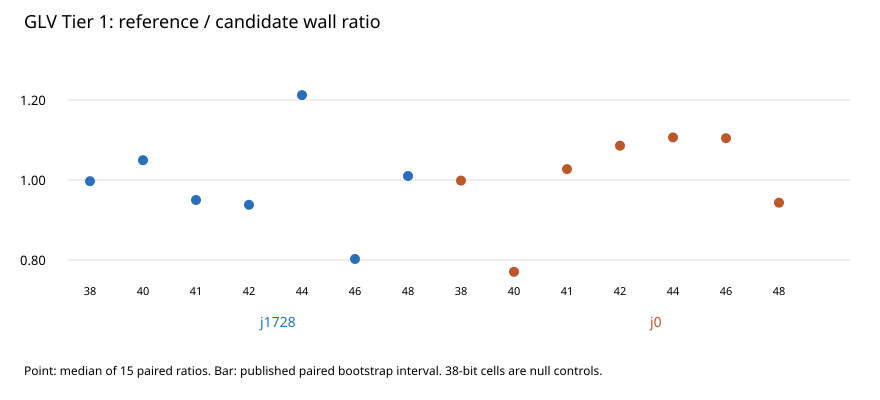

# Independent raw-row audit: GLV cap wall time, Tier 1

**Verdict: supports the reported instance-scoped measurements.** The archived GitHub Actions artifact has SHA256 `07d3b18f56b07dcd3826e6932529235791ae7f49b821fa638380b2130d607450` and 960 members. The independent script replayed all 14 cell summaries from 210 paired rows and 420 run rows, verified the case inputs, expected result, binary stability, pair-to-run links, operation counts, and exact published median wall ratios. All rows were valid; no run timed out or failed. The classification is 7 resolved faster, 5 resolved slower, and 2 null cells unresolved.

| Cell | Ref/candidate wall ratio | Published 95% interval | Independent bootstrap interval | Result |
|---|---:|---:|---:|---|
| j1728 38 | 0.997 | [0.992, 1.000] | [0.995, 1.000] | not resolved |
| j1728 40 | 1.049 | [1.047, 1.051] | [1.047, 1.051] | faster |
| j1728 41 | 0.950 | [0.949, 0.951] | [0.948, 0.952] | slower |
| j1728 42 | 0.938 | [0.937, 0.939] | [0.937, 0.938] | slower |
| j1728 44 | 1.212 | [1.210, 1.216] | [1.210, 1.216] | faster |
| j1728 46 | 0.802 | [0.800, 0.803] | [0.800, 0.804] | slower |
| j1728 48 | 1.010 | [1.009, 1.012] | [1.009, 1.012] | faster |
| j0 38 | 0.998 | [0.997, 1.000] | [0.997, 1.000] | not resolved |
| j0 40 | 0.771 | [0.768, 0.771] | [0.769, 0.772] | slower |
| j0 41 | 1.027 | [1.024, 1.028] | [1.024, 1.028] | faster |
| j0 42 | 1.086 | [1.084, 1.088] | [1.084, 1.088] | faster |
| j0 44 | 1.106 | [1.104, 1.108] | [1.104, 1.107] | faster |
| j0 46 | 1.105 | [1.103, 1.107] | [1.103, 1.108] | faster |
| j0 48 | 0.943 | [0.942, 0.944] | [0.941, 0.943] | slower |

The independent intervals use 10,000 paired bootstrap resamples with a new seed. All endpoints are within 0.008 of the published intervals. This checks the conclusion and scale, not an exact reconstruction of the producer seed or quantile convention. The 38-bit null cells cross 1.000 in both the published and independent intervals.

## Custody and checks

- Source: GitHub Actions run `41259818507`, artifact `13065564273`, 8,014,606 bytes, 30-day retention stated by the producer. The exact zip is now in the repository artifact store at `s3://setec-astronomy-artifacts/store/sha256/07/07d3b18f56b07dcd3826e6932529235791ae7f49b821fa638380b2130d607450`; `.artifacts.json` is the tracked pointer. Remote verification passed.
- The archived 14 summaries equal the `summary` payloads of the committed `run-summary_*.json` receipts. All 14 archived and committed preflights report `ok`, with matching stable host, compiler, allocation, CPU and memory-cap fields. Dynamic preflight counters and timestamps differ, as expected, so those files are not byte-identical. The archived panel summaries report stable binaries, artifacts, and runner state. `host_exclusivity_proved=false` throughout.
- Recompute with `python3 audit_archive.py --archive tier1-raw-41259818507.zip --results ../../results.json --receipts ../../tier1-github-41259818507 --output audit.json` from this directory after `python3 tools/artifacts/artifacts.py pull experiments/glv-cap-by-size-walltime-20261107/reviews/independent-20261107` from the repository root.
- The runner source is `ubuntu-24.04`; its archived preflights name `AMD EPYC 9V74 80-Core Processor`. The source report described the top-level host probe, which omits a CPU model.

## Claim scope

This validates the specific seeded Tier 1 panels and their 14 published cell ratios. It does not establish a population wall-time saving, a cross-runner absolute latency comparison, host exclusivity, or a matched-rho result. The source report already bounds the principal inference to one runner and one panel per cell. No new benchmark, cloud job, or Lean theorem was run for this audit.

## Audit limits

The producer did not supply an `experiment.export/v1` bundle, so the generic `review-run` schema and its nonce-sampled replay cannot be applied literally. The audit instead checks the frozen raw artifact and all available row/summary relations. The benchmark binary was not re-executed; the independent check is of custody, row validity, arithmetic, and claim scope.
