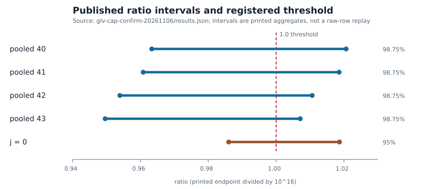

# Independent technical review: GLV cap no-worse logic

Review of PCC-20261108-5903ae at cryptanalysis PR #1445 source head
`8e8c49b6e50463988710f21c5253172176610fbf`. This is a technical
theorem review, not an official experiment decision or PCC promotion.

| Dimension | Finding | Evidence |
| --- | --- | --- |
| Machine status | `passed` locally for seven named Lean declarations with no axioms; ten total declarations audited, zero failures or trusted native evaluation. One generated structure declaration uses `propext`. | Lean 4.34.1, `tools/lean/proof-gate.sh`, T-1912 |
| Semantic fidelity | `faithful_scoped` for the frozen no-worse predicate and printed decimal endpoints | T-1912 source review; T-1911 blind arithmetic |
| Review outcome | `validated_scoped` for the interval-order counterexample only | Both independent attestations, controls, and source binding |
| PCC standing | `unverified` at review time | `pcc standing PCC-20261108-5903ae` |

## Observation

The frozen analysis rejects a pooled size only when its interval lower endpoint
is greater than one. All four published pooled lower endpoints are below one,
so the registered pooled check passes. The separately printed `j = 0` 95%
interval is `[0.9860137324692078, 1.0186699532206690]`; it crosses one.
The `j = 0` point estimate is `1.0019840110118106`. The source report uses
98.75% pooled intervals and a separate 95% family interval; the plot labels
these distinct coverages.

## Comparison and inference

The blind reviewer derived the pooled passage and family upper-bound
counterexample from the minimal input card only (T-1911). The source reviewer
compared the Lean definitions, exact scaled decimals, frozen analysis branch,
results JSON and PCC claim at the pushed head (T-1912). Their independent
findings agree: passage of a predicate that reads pooled lower endpoints does
not imply that a separate family interval has upper endpoint at most one.
The published, well-formed intervals provide a nonvacuous witness.

`check_binding.py` passed normally and with Python `-O`. Scratch changes to
the source comparison, JSON value, blind card value or Lean endpoint failed
binding. Scratch changes to a pooled lower endpoint or the `j = 0` upper
endpoint made the corresponding Lean theorems fail. The source review notes
that the binding script's textual checks are weak in isolation; exact hashes
of the frozen source and results, direct branch inspection and the pinned PR
head supply the relevant binding for this reviewed version.

## Boundaries and next action

This verdict covers the printed endpoint order and the decision rule. It does
not verify bootstrap coverage, raw rows, the executed historical binary,
actual family harm, or solver correctness. `lean4checker --fresh` was not
available; the pinned Lean build and the repository axiom gate were run.
The original erratum's PCC claim remains unverified. Keep the published
historical chart unchanged; this SVG is a new, source-linked explanation of
the logical distinction. No official EV/DEC record is created by this review.

The next step is to archive these attestations, inspect the rendered PDF,
rerun the source binding and Lean gate on the publication head, and wait for
all applicable current-head PR checks before merging.

## Review custody

The pre-review plan was committed before dispatch. T-1911 read only
`BLIND_INPUT.json` (SHA-256 `11c13dfb48e6de04ea7102122c5331a7710087b2dcaa9ea886fdcdf1c19c50ec`)
and did not inspect producer or sibling files. T-1912 read the pinned source,
Lean, result, claim, binding and plan files and did not inspect T-1911's
report before filing. The review files are `reviews/blind.md` (SHA-256
`8f92fb94d0304233192b0b193c4d9cfe8bce8e0183bc9a53f3acfd732e8d0093`)
and `reviews/source-fidelity.md` (SHA-256
`c5076de056650365dc130cdb9797483f1e1caff83c0f79912ecf7ba5d0150451`).
These are session attestations; no automated independence checker was present
in this repository, so source isolation cannot be established mechanically.
