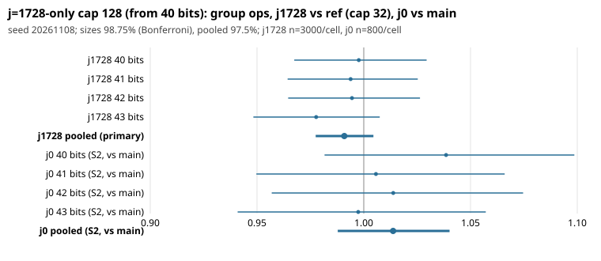

# j = 1728-only 128-entry GLV table cap: held-out test (seed 20261108)

Protocol frozen before data: `PROTOCOL.md` (PR #1370, commit 75f5eddb). Candidate: PR #1373, commit 461f34d0
(`rcap = (c.m == 4 && lg >= 40) ? 128 : 32`). Raw `curve_solve` group operations only: no wall time, no pricing of
native work (AGENTS.md 5a not applied, so no ranking of methods).

## Observation

**Primary (registered).** j = 1728, 40-43 bits, 3000 curves per size, candidate over the pre-#1341 rule (ref, commit
1ee4f47, cap 32): geometric mean of the four size ratios **0.9909, 97.5% interval [0.9775, 1.0045]** (half-width 1.36%,
95% interval [0.9791, 1.0029]). The upper bound is above 1, so **the primary is NOT confirmed** by the frozen rule.

| bits | cand/ref, 95% | 98.75% (per size) | ref S | cand S |
|---|---|---|---|---|
| 40 | 0.9977 [0.9740, 1.0216] | [0.9674, 1.0294] | 1.475 | 1.470 |
| 41 | 0.9939 [0.9703, 1.0182] | [0.9643, 1.0253] | 1.446 | 1.436 |
| 42 | 0.9945 [0.9711, 1.0187] | [0.9646, 1.0263] | 1.447 | 1.438 |
| 43 | 0.9777 [0.9551, 1.0004] | [0.9483, 1.0075] | 1.452 | 1.422 |

No-worse check passes (no size wholly above 1). No size is wholly below 1 (secondary S1).

**Secondary S2 (registered).** j = 0, candidate (cap 32) over current main (cap 128), 800 curves per size:
pooled **1.0138 [0.9878, 1.0402]** (97.5%); per size 1.039, 1.006, 1.014, 0.997. The interval contains 1: neutral
(half-width 2.9%, so differences below that cannot be seen). Returning j = 0 to cap 32 is **not** an operation-count
improvement over merged main.

**Identity (exact).** Candidate equals ref on all 600 rows (j = 0 at 40-43, j = 1728 at 38-39); candidate equals current main
on all 400 j = 1728 rows at 40-43 (first 100 curves per size). Nothing else between 1ee4f47 and 318b27bf changed `curve_solve`
operation counts on these rows.

**Positive control.** Forced r = 8 over ref, j = 1728, 42 bits, 200 curves: 1.229 [1.113, 1.352]; the detector sees a 20% change.

**Distance to matched rho (descriptive, raw group operations, not priced).** On curves 0-59 (j = 1728) the candidate used
0.77, 0.76, 0.74, 0.78 of rho's operations at 40-43 bits (ref 0.70, 0.89, 0.71, 0.72); mean S = ops / sqrt(n/m) is about
1.42-1.47, rho S about 0.89-0.99 per cell on 60 curves. On j = 0 (40 curves) candidate/rho 0.56-0.70. These are small samples.

## Disclosures

- #1341 was merged before this round, so current main already has cap 128 from 40 bits for both families. The candidate
  equals main on j = 1728 (identity check above) and differs only on j = 0.
- **Truncated first run, rerun.** The first run was killed before the j = 0 cells at 43 bits finished: `candj0` had 464 of 800
  rows and `mainj0` 633 of 800 at 43 bits (40-42 bits complete). Only those partial 43-bit rows were discarded (kept as
  `rows_*.truncated-original.txt`, outside Git); the 43-bit j = 0 cell was rerun for both arms with the identical frozen command
  (same seed, curves 0-799, `rows_candj0_p1b`, `rows_mainj0_p2b`). Solves are deterministic given curve and target, so the
  rerun reproduces the same targets. `analyze.py` was run once, unchanged, after the rerun.
- Looks at earlier data before the freeze, and one seed-7 dry run, are listed in `PROTOCOL.md`.

## Interpretation and hypothesis (separate from the observation)

The point estimate (0.991) is a 0.9% saving on j = 1728, far smaller than the 3.2% seen in #1340's descriptive split
(0.968), consistent with the earlier shrinkage on re-test; the interval [0.978, 1.005] does not exclude no effect, and
only the 43-bit cell is close to excluding it. This round does not search a different threshold. A possible effect of a few
tenths of a percent to one percent at 40-43 bits would need about 4x the curves to confirm.

## Verdict: NOT_CONFIRMED (primary); S2 neutral. The candidate is not an operation-count improvement over merged main.
