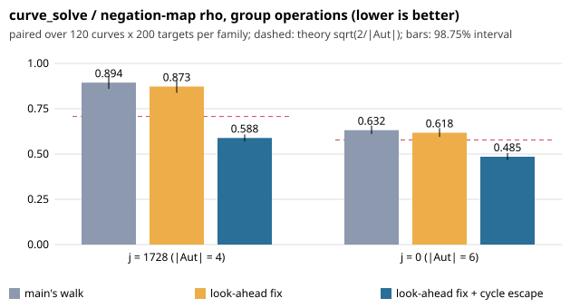

# Fixing `glv_rho_solve`'s fruitless cycles: controlled result

## Question

`experiments/glv-walk-trace-20261018` found two problems on `main`:

- **Lost operations.** 17.3% of j = 1728 `curve_solve` operations, and 12.5% of j = 0 ones, are steps inside fruitless 2-, 4- and 6-cycles. They are lost while the walk waits 24 · 2^dp steps to abandon.
- **A look-ahead bug.** Every 2-cycle came straight after a look-ahead retry onto the multiplier just used.

This report asks: do two changes to the walk reduce `curve_solve`'s group operations on the same curves, targets and seeds?

1. **Look-ahead fix.** The look-ahead also rejects a candidate whose next point would select Y's own natural multiplier. Both tests depend on Y alone, so walks still merge.
2. **Cycle escape.** When the new point equals the one 2 or 4 committed steps back, the walk doubles the cycle member with the smallest hash. Every walk that enters a cycle leaves it the same way.

## Protocol

`PROTOCOL-v2.md` was frozen and pushed before the main run, as aburan28/ml-cryptanalysis commit `76b2007`, sha256 `dc8b0981…`. Version 1 of the experiment (the 0.894 finding) is in aburan28/ml-cryptanalysis#29.

- **Library:** `main` `3ce4c29` with this branch's `src/curve.c`, in three builds:
  - legacy: `-DCA_GLV_LOOKAHEAD_LEGACY=ON -DCA_GLV_CYCLE_ESCAPE=OFF`, which equals `main` on 80 checked solves.
  - look-ahead: `-DCA_GLV_CYCLE_ESCAPE=OFF`.
  - escape: the new defaults.
- **Instrument:** `run.py` pairs the negation-map `rho` and `curve_solve` on the same target and seed.
- **Families:** j = 1728, j = 0, and random curves as the negative control. 120 curves per family at r = 24, 28 and 32 bits, 200 targets each, for 144,000 solves per arm.
- **Statistic:** the per-curve log ratio, averaged over curves, with a two-stage bootstrap. Intervals are 98.75%, Bonferroni over 4 tests.

## Invariants (all hold)

- **Every answer is correct.** No wrong answers in 432,000 solves.
- **rho is untouched.** The rho arm is identical across the three builds.
- **Non-GLV curves are untouched.** Random-curve `curve_solve` is identical across the three builds.
- **The legacy arm reproduces v1.** Its j = 1728 ratio against rho is 0.894, the value v1 measured on an older revision.

## Result

Against the legacy walk, on the same targets:

| variant | family | ratio | 98.75% CI | verdict |
|---|---|---|---|---|
| look-ahead fix | j = 1728 | 0.976 | [0.960, 0.991] | fewer operations than legacy |
| look-ahead fix | j = 0 | 0.978 | [0.961, 0.995] | fewer operations than legacy |
| look-ahead fix + cycle escape | j = 1728 | **0.658** | [0.630, 0.688] | fewer operations than legacy |
| look-ahead fix + cycle escape | j = 0 | **0.768** | [0.753, 0.784] | fewer operations than legacy |

Against the negation-map rho, pooled over sizes (descriptive; per-size rows are in `results_v2.json`):

| family | legacy | look-ahead fix | + cycle escape | theory sqrt(2/|Aut|) |
|---|---|---|---|---|
| j = 1728 | 0.894 [0.859, 0.929] | 0.873 [0.838, 0.906] | **0.588** [0.570, 0.608] | 0.707 |
| j = 0 | 0.632 [0.610, 0.657] | 0.618 [0.594, 0.643] | **0.485** [0.467, 0.506] | 0.577 |

- **Below theory.** With the escape, both families come in below the theory ratio. The theory ratio assumes both solvers waste the same share of their steps. The plain rho keeps its own fruitless cycles, and these changes do not touch it.
- **Near theory at 32 bits.** At 32 bits the escape variant is 0.699 for j = 1728 and 0.596 for j = 0.

## Change in this PR

- **`src/curve.c`:** both changes in `glv_rho_solve`, on by default. The walk struct gains four history slots, about 4 points per walk.
- **`CMakeLists.txt`:** `CA_GLV_LOOKAHEAD_LEGACY` (OFF) and `CA_GLV_CYCLE_ESCAPE` (ON) select the walk.
- **Trace:** with `-DCA_GLV_TRACE` the escapes are counted (`escape2`, `escape4`) and booked with restarts.

## Checks

- **Tests:** `ctest`, 17 of 17, passes on the default build.
- **Build equivalence:** the default build equals the escape arm, and the legacy options equal the legacy arm, on 80 solves.
- **Formatting:** changed lines formatted with `clang-format-diff`.

## Raw evidence

- **Raw rows:** `rows_v2_{legacy,patched,escape}.jsonl.gz`, with sha256 values in `SHA256SUMS`.
- **Reproduction:** `analyze_v2.py` recomputes `results_v2.json`. The same files are in aburan28/ml-cryptanalysis, `experiments/glv-j1728-controlled/`.
- **Runner provenance:** `run.py` is the runner from that repository, and imports its `csd.bulk.paths` loader. It is included to record the exact instrument.
- **Host:** a 4-core cloud VM, no isolation. Every number is an operation count, not a time.

## Claim classes and limits

- **Comparative, established:**
  - At 24 to 32 bits, the look-ahead fix plus cycle escape makes `curve_solve` use 34% fewer group operations on j = 1728 and 23% fewer on j = 0 than `main`'s walk.
  - The look-ahead fix alone gives about 2%.
- **Not established:**
  - Wall time. The escape's doubling is an affine operation outside the batched inversion.
  - Sizes above 32 bits.
  - The covariant j = 0 walk (`glv_covariant_rho_solve`), which these changes do not touch.
  - The plain rho's own fruitless cycles.
- **No security claim.** This recovers the automorphism speedup the solver was meant to deliver; it says nothing new about ECDLP hardness.
