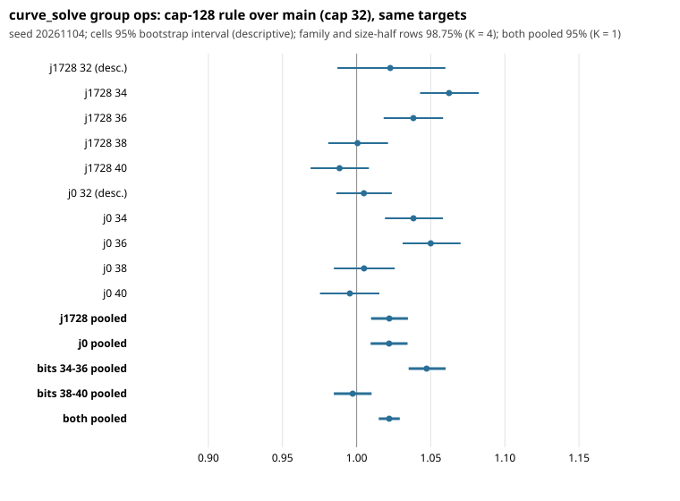

# Held-out confirmation of the cap-128 GLV table rule at 34-40 bits (seed 20261104)

Protocol frozen and pushed in PR #1338 (commit `da5fee6`) before any row existed;
`PROTOCOL.sha256` covers the frozen files and `analyze.py` ran unchanged (the
`A6_DRY` switch in it was not set). Arms: main `1ee4f47` (cap 32) and cand
`a50f66e` (#1335, cap 128). Raw `curve_solve` group operations only: **no wall
time, no pricing, no method ranking** (AGENTS.md section 5a not invoked).
Grid: 4000 curves per family at 34, 36, 38, 40 bits plus 1000 at 32 bits
(descriptive), one target per curve, 70,200 rows over all arms, about 1.3
CPU-hours (two processes, 39 minutes each; under the 3-hour allowance).

## Observation (all numbers from `results.json`)

All invariants held: every answer correct, identical grids, curves and targets,
identity control (`capid`, cand with the cap forced to 32) identical to main on
all 1000 of its rows, the 995 thirty-two-bit rows where both rules choose the
same table identical between cand and main. Positive control r8 / main at 40
bits: **1.250 [1.183, 1.321]**, passed (34 bits, descriptive: 1.138 [1.079,
1.199]); #1332 had 1.221 at 42 bits.

**Primary (K = 1, 95%): the rule does not save group operations at 34-40 bits; it costs them.**
Geometric mean of the eight cell ratios cand / main:

| statistic | ratio | interval | half-width | reading |
|---|---|---|---|---|
| pooled, 8 cells (primary) | **1.0220** | [1.0149, 1.0291] (95%) | 0.69% | H1 **not confirmed**; lower bound above 1 (cand uses about 2.2% more operations) |

Secondary (labelled secondary, K = 4, 98.75% intervals):

| subset | ratio | interval | reading |
|---|---|---|---|
| j = 1728 (4 cells) | 1.0220 | [1.0098, 1.0346] | lower bound above 1 |
| j = 0 (4 cells) | 1.0219 | [1.0095, 1.0344] | lower bound above 1 |
| sizes 34-36 (both families) | **1.0472** | [1.0351, 1.0600] | lower bound above 1 |
| sizes 38-40 (both families) | **0.9974** | [0.9847, 1.0101] | interval contains 1 |

Descriptive: 34-36 over 38-40 = 1.0499 [1.0358, 1.0647] (95%). Per size, both
families (95%): 34 bits 1.0503 [1.0362, 1.0644]; 36 bits 1.0441 [1.0304,
1.0583]; 38 bits 1.0028 [0.9884, 1.0175]; 40 bits 0.9920 [0.9780, 1.0062]; 32
bits (descriptive cell) 1.0138 [0.9938, 1.0342].

Per cell cand / main (95%, descriptive; curves per table size in `results.md`):

| bits | j = 1728 | j = 0 |
|---|---|---|
| 32 | 1.023 [0.987, 1.060] | 1.005 [0.986, 1.024] |
| 34 | 1.062 [1.043, 1.082] | 1.038 [1.019, 1.058] |
| 36 | 1.038 [1.018, 1.058] | 1.050 [1.031, 1.070] |
| 38 | 1.001 [0.981, 1.021] | 1.005 [0.985, 1.026] |
| 40 | 0.989 [0.969, 1.008] | 0.995 [0.975, 1.015] |

Distance remaining to matched rho (descriptive, raw group operations, same
targets, curves 0-149 of each cell): main uses 0.52 to 0.79 of rho's
operations per cell, cand 0.53 to 0.87 (cand/rho at 40 bits: j1728 0.873
against main 0.786; j0 0.586 against 0.575). Both arms use fewer operations than rho in every
cell; at 34-36 bits cand is 3-6% further from rho than main is.

Post-hoc power check: the delta-method variance of log(cand/main) per target
was 0.385-0.445 per cell (mean 0.419) against the 0.45 planned, and the
pooled half-width was 0.69% against the predicted 0.74%.

**Exploratory (not registered, post hoc)**, cand / main by the table the rule
actually chose, 95% bootstrap: r = 64 at 32-33 bits 1.026 [0.986, 1.065]
(n = 1005); r = 64 at 34-36 bits 1.029 [1.012, 1.046] (n = 5369); r = 128 at
34-36 bits 1.051 [1.038, 1.064] (n = 10631); r = 128 at 38-40 bits 0.995
[0.985, 1.006] (n = 16000).

## Interpretation

H1 is **not confirmed, and the registered "worse" outcome occurred**: with the
rule as shipped in #1335, `curve_solve` uses about 2.2% more group operations
than main over the eight cells (0.69% half-width, both families alike). The
loss is concentrated at 34-36 bits (about 4.7% more, 98.75% interval above 1),
where the rule jumps the table from 32 to 64 or 128 as soon as `rbudget`
allows; at 38-40 bits the rule is neutral at the registered power (0.997, the
interval contains 1, and the half-width is 1.3%). The 128 table that #1332
found to save 2.0% at 42-46 bits therefore does not pay below about 38 bits in
operations, and the trend by size (1.050, 1.044, 1.003, 0.992 at 34 to 40, then
0.989 / 0.984 / 0.968 for a forced r128 at 42-44-46 in #1332) is monotone
across the two rounds. That cross-round ordering is descriptive: different
seeds, a forced rather than rule-chosen table above 40 bits, no test. The
exploratory split shows r = 128 at 34-36 bits costs more than r = 64 there
(1.051 against 1.029), which fits a mechanism of a larger table's setup and
slower walk mixing taking a larger share of a short solve, but this round
measured no mechanism and the split was not registered.

## Hypothesis / next step (not a result)

A size-dependent cap, for example the cap 32 up to about 38 bits and 128 from
about 40 or 42 bits, would keep #1332's 42-46 bit saving and drop the 34-36 bit
loss. The data here suggest 38-40 bits is a boundary region (neutral); where
exactly it flips is not resolved. That is a new rule and needs its own frozen
round, plus a Tier 1 wall-time run for any speed claim. Above 46 bits the
rule also picks 128 and nothing is measured. No change to `src/curve.c` is
made here.

## Deviations and disclosures

- Dry runs on seeds 1 and 7 as disclosed in the protocol, including that their
  small-sample ratios were seen before freezing. They hinted at no saving; the
  hypothesis and rules were not changed.
- Bit length 41 (named in the PR title and the branch) was not run; the grid is 32 and 34-40
  as frozen, and the size split is 34-36 against 38-40.
- No Tier 1 or wall-time measurement was made; operation counts only.
- Raw rows (`rows_main_p*.jsonl.gz`, `rows_cand_p*.jsonl.gz`, 0.76 MB each), `REPORT.pdf` and the PNG are
  not in Git (no artifact-store credentials in this session); sha256 values are in `SHA256SUMS` and the PR body.
  The control rows (`rows_capid_*`, `rows_r8_*`, under 30 KB each) are committed.

