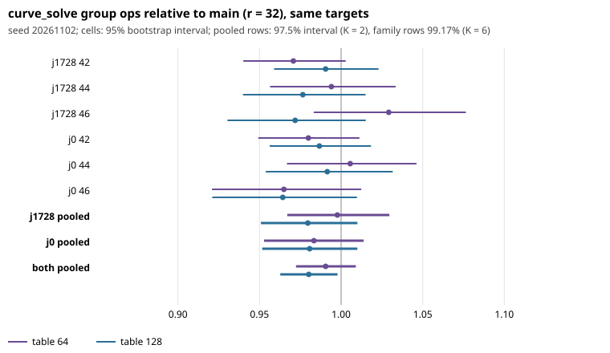

# Held-out confirmation: 64- or 128-entry GLV table at 42-46 bits (seed 20261102)

Protocol frozen and pushed in PR #1332 (commit 707a1bf) before any row existed;
`PROTOCOL.sha256` covers the frozen files, and `analyze.py` ran unchanged.
Main `ae86c73` plus `force-r.patch`. Raw `curve_solve` group operations only:
**no wall time, no pricing, no method ranking** (AGENTS.md section 5a not
invoked). Grid 1600 / 1130 / 800 curves per family at 42 / 44 / 46 bits, one
target per curve, 21,677 rows over all arms.

## Observation (all intervals from `results.json`)

Invariants held: all answers correct, identical grids and targets, main picks
r = 32 everywhere, identity control r32 gave identical group_ops on all 200 of
its rows, escape on in every arm. Positive control r8 / main at 42 bits:
**1.221 [1.145, 1.305]**, passed.

Primary test (geometric mean of the six cell ratios, 97.5% interval, K = 2):

| arm | pooled ratio to main | 97.5% interval | half-width | verdict |
|---|---|---|---|---|
| r64 | 0.9905 | [0.9723, 1.0090] | 1.85% | **not confirmed** |
| r128 | 0.9802 | [0.9627, 0.9978] | 1.79% | **confirmed** (upper bound 0.9978 < 1) |

Secondary, one family alone (99.17% interval, K = 6): none confirmed
(r64 j1728 0.998 [0.967, 1.030], j0 0.983 [0.953, 1.014]; r128 j1728 0.980
[0.951, 1.010], j0 0.981 [0.952, 1.010]); half-widths about 3.0%, as the
protocol predicted. Per-size, both families (95%, descriptive): r128 0.989 /
0.984 / 0.968 at 42 / 44 / 46 bits; r64 0.975 / 1.000 / 0.997. Every per-cell 95% interval contains 1 (nearest: r128 j0 46 [0.921, 1.010], r64 j1728 42 [0.940, 1.003]). Distance to matched rho (descriptive, raw group ops):
main uses 0.54-0.74 of rho's operations per cell, r128 within 1-3% of main.

## Interpretation

The r128 hint of #1090 is confirmed on held-out curves in group operations,
but only just: the estimated saving is about 2.0% (0.2% to 3.7% at 97.5%), and
the upper bound 0.9978 is within 0.3% of 1. It is smaller than #1090's 3.8%
point estimate (winner's-curse shrinkage is plausible; not tested). The r64
hint is not confirmed (point estimate 1% saving, interval contains 1). r64 and
r128 were not compared with each other; their intervals overlap heavily, so
nothing here says 128 beats 64. The effect grows with size only descriptively
(0.989 to 0.968 for r128), not tested. Scope: 42-46 bits, group operations.

## Hypothesis / next step (not a result)

A cap of 128 instead of 32 for n large enough might save about 2% of group
operations at 42-46 bits. Bigger tables cost cache and batching work, so wall
time may erase it; that needs a Tier 1 run (the user's decision). No change to
`src/curve.c` is made here.

## Deviations and disclosures

- CPU used about 3.4 CPU-hours (two processes, about 1.7 h each), 13% above the
  "about 3" plan, because the VM ran at less than the planned 5.2 M ops/s once
  the rho reference was included. The grid was not changed.
- The first r8 control run was cut off before finishing (179 and 118 of 200
  rows; the session was interrupted). It was rerun with the identical frozen
  command; the rerun is complete and is the only r8 data analysed. The
  interrupted partial files are not used.
- Dry runs on seeds 1 and 7 as disclosed in the protocol.
- Raw rows (`rows_*.jsonl.gz`), `REPORT.pdf` and PNG are not in Git (no
  artifact-store credentials in this session); see the PR body for sha256.

