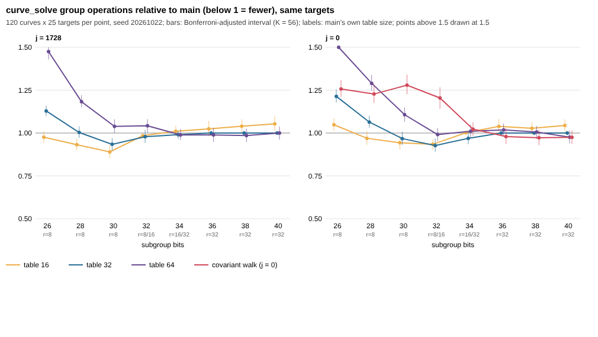

# GLV table size and j = 0 walk: selection round (26–40 bits)

The protocol is `PROTOCOL.md`, frozen in commit 329454c before any data on
seed 20261022 existed. `sha256sum -c PROTOCOL.sha256` passes on the committed
files. This round **selects**. Its pick goes to a held-out confirmation round
before any claim about `src/curve.c`.

## Run

- **Arms:** main (`7cb3dce`), the multiplier table forced to 16, 32 and 64,
  and the covariant j = 0 walk (`measure-arms.patch`, measurement-only flags).
- **Sample:** j = 1728 and j = 0, r at 26–40 bits, 120 curves × 25 targets
  per family and size.
- **Rho reference:** run on every target.
- **Total:** 216,000 `curve_solve` rows plus 48,000 rho rows. The five arms
  ran concurrently on one 4-core host and took 29 minutes.
- **Raw rows:** `rows_<arm>.jsonl.gz`.

## Invariants (all pass; `analyze.py` writes nothing otherwise)

- **Correctness:** every answer is correct in every arm and in the rho reference.
- **Grid:** every arm has main's exact grid of curves and targets, with no
  duplicates.
- **Identity control:** wherever main's own rule picks the forced arm's table
  size, the counts are identical. r16 matches on 7,250 rows and r32 on 19,875
  rows, with 0 differing.

## Results (`results.md`, `results.json`)

The table gives each arm's `curve_solve` group operations over main's, on the
same targets. Intervals are 99.911% (Bonferroni over 56 comparisons).

- ✓ marks fewer operations than main, ✗ more.
- *main r* is the table size main's own rule picks.

| family | bits | main r | main/rho | r16/main | r32/main | r64/main | cov/main |
|---|---|---|---|---|---|---|---|
| j1728 | 26 | 8 | 0.538 | 0.976 [0.942, 1.010] | 1.129 ✗ | 1.475 ✗ | – |
| j1728 | 28 | 8 | 0.523 | **0.932 [0.900, 0.967] ✓** | 1.003 | 1.183 ✗ | – |
| j1728 | 30 | 8 | 0.714 | **0.890 [0.855, 0.929] ✓** | **0.934 [0.898, 0.971] ✓** | 1.039 ✗ | – |
| j1728 | 32 | 8/16 | 0.689 | **0.984 [0.969, 0.997] ✓** | 0.979 [0.942, 1.019] | 1.042 ✗ | – |
| j1728 | 34 | 16/32 | 0.700 | 1.010 | 0.991 | 0.989 | – |
| j1728 | 36 | 32 | 0.685 | 1.025 | 1.000 | 0.989 | – |
| j1728 | 38 | 32 | 0.722 | 1.040 ✗ | 1.000 | 0.985 | – |
| j1728 | 40 | 32 | 0.731 | 1.054 ✗ | 1.000 | 1.000 | – |
| j0 | 26 | 8 | 0.421 | 1.048 ✗ | 1.214 ✗ | 1.670 ✗ | 1.257 ✗ |
| j0 | 28 | 8 | 0.409 | 0.969 [0.930, 1.011] | 1.064 ✗ | 1.290 ✗ | 1.227 ✗ |
| j0 | 30 | 8 | 0.577 | **0.943 [0.903, 0.986] ✓** | 0.968 | 1.107 ✗ | 1.279 ✗ |
| j0 | 32 | 8/16 | 0.601 | **0.934 [0.903, 0.964] ✓** | **0.927 [0.891, 0.969] ✓** | 0.991 | 1.205 ✗ |
| j0 | 34 | 16/32 | 0.585 | 1.002 | 0.969 [0.935, 1.010] | 1.010 | 1.023 |
| j0 | 36 | 32 | 0.560 | 1.039 | 1.000 | 1.018 | 0.980 [0.935, 1.028] |
| j0 | 38 | 32 | 0.588 | 1.028 | 1.000 | 1.006 | 0.973 [0.929, 1.018] |
| j0 | 40 | 32 | 0.624 | 1.044 ✗ | 1.000 | 0.976 | 0.975 [0.936, 1.016] |



### Question 1: table size

- **Main grows its table too late.** At 28–32 bits, main still uses 8
  multipliers (16 on some 32-bit curves). There, a 16- or 32-entry table uses
  2–11% fewer operations, resolved at the adjusted level in 7 cells.
- **Where main's choice holds:**
  - At 26 bits the small table is right: r16 is resolved worse on j = 0
    (1.048).
  - From 34 bits up, main already uses 32 and nothing is resolved better.
  - A 64-entry table is never resolved better than main.

### Question 2: j = 0 walk

The covariant walk is resolved **worse** at 26–32 bits (1.21–1.28). At 34–40
bits it is **not resolved** (0.97–1.02). This round gives no support for
restoring the covariant dispatch. The 36–40-bit edge seen on the bulk data
(#1059: main/covariant 1.028) points the same way, but here it is within the
adjusted intervals.

## Post-hoc rule search (not in the frozen analysis; it selects, it does not confirm)

Main's rule doubles r while 2r ≤ sqrt(n/m) / (c · log2 n), with c = 48 and a
cap of 32. `rule_search.py` prices other constants on this round's rows. For
each target it reads the cost of the table size a rule would pick from the arm
that ran that size (`rule_search.json`). The geometric mean of the 16 per-cell
ratios against main:

| c (cap 32) | 8 | 12 | 16 | 20 | 24 | 32 | 48 (main) |
|---|---|---|---|---|---|---|---|
| geometric mean | 0.979 | **0.978** | 0.980 | 0.981 | 0.984 | 0.992 | 1.000 |

A cap of 64 is no better at any c.

**c = 12, cap 32** gives these per-cell ratios:

| bits | j = 1728 | j = 0 |
|---|---|---|
| 28 | 0.932 | 0.983 |
| 30 | 0.934 | 0.939 |
| 32 | 0.979 | 0.927 |
| 34 | 0.991 | 0.969 |

It is unchanged at 26 bits and from 36 bits up. Because c was chosen on these
rows, these figures are optimistic. **Confirming c = 12 on held-out curves is
the next round.**

## Limits

- **Measure:** operation counts, not wall time. A larger table costs more
  setup, and the count includes that.
- **Sizes:** 26–40 bits only. One implementation.

## Reproduce

See `PROTOCOL.md` for the builds and commands. Then:

```sh
python3 analyze.py       # results.json, results.md (frozen)
python3 rule_search.py   # rule_search.json (post-hoc)
python3 chart.py         # ratios.svg
```
