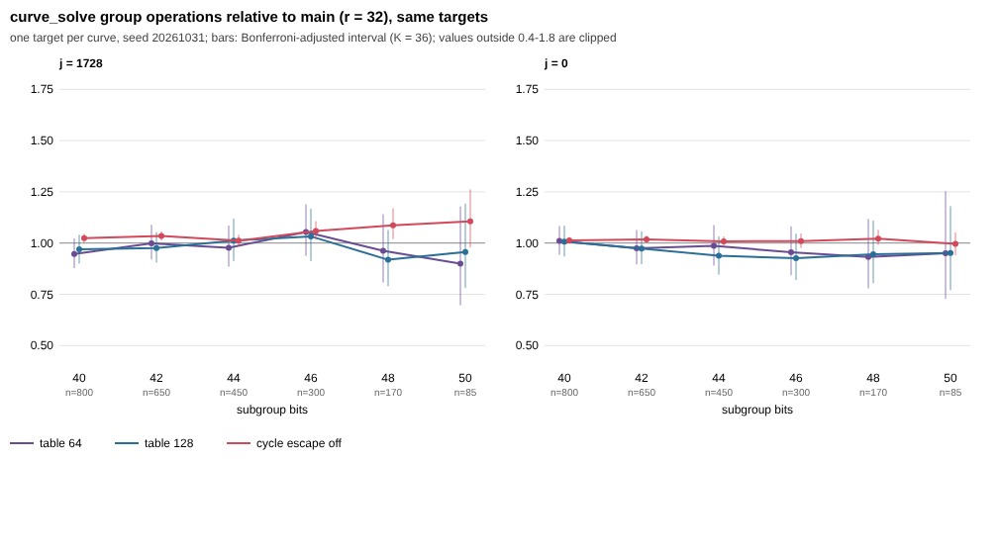

# GLV table rule and cycle escape above 40 bits (42-50)

Protocol: `PROTOCOL.md`, frozen in commit dbf722c (PR #1090) before any data on seed 20261031 existed;
`sha256sum -c PROTOCOL.sha256` passes. Library: main `fb70171` plus `force-r.patch` (measurement flag only).
Chart and analysis (`chart.py`) were written after the freeze; `analyze.py` is the frozen file. Counts of `group_ops` only; **no wall time**.

## Run

- Arms: main (r = 32 at every size here), table 64, table 128, cycle escape off; controls r32 (identity) and r8 (positive) at 40 and 42 bits.
- Grid: one target per curve; curves per family 800/650/450/300/170/85 at 40/42/44/46/48/50 bits. 2 processes, `nice -n 10`, about 1.5 h each.
- Raw rows: `rows_<arm>_<part>.jsonl.gz`.

## Invariants (all pass)

All answers correct in every arm and in the rho reference; every arm has the frozen grid with main's curves and targets;
main's rule picks r = 32 for every curve; identity control: forced r = 32 gives identical `group_ops` on all 2,900 rows
with 0 differing. Positive control passes: table 8 costs **1.203 [1.171, 1.235]** times main's operations at 40-42 bits.

## Results

Ratios of curve_solve group operations to main on the same targets; intervals are 99.861% (Bonferroni over 36); ✓ fewer ops than main, ✗ more, unmarked not resolved.

| family | bits | main S | rho S | main/rho | r64/main | r128/main | no-escape/main |
|---|---|---|---|---|---|---|---|
| j1728 | 40 | 1.500 | 0.975 | 0.770 | 0.947 [0.878, 1.022] | 0.969 [0.900, 1.041] | 1.024 [1.002, 1.045] ✗ |
| j1728 | 42 | 1.434 | 0.939 | 0.764 | 0.998 [0.920, 1.090] | 0.975 [0.905, 1.053] | 1.035 [1.013, 1.057] ✗ |
| j1728 | 44 | 1.451 | 0.948 | 0.765 | 0.977 [0.885, 1.086] | 1.012 [0.912, 1.119] | 1.011 [0.984, 1.041] |
| j1728 | 46 | 1.397 | 0.924 | 0.756 | 1.054 [0.937, 1.189] | 1.033 [0.912, 1.167] | 1.059 [1.016, 1.107] ✗ |
| j1728 | 48 | 1.419 | 0.933 | 0.762 | 0.962 [0.808, 1.141] | 0.918 [0.789, 1.063] | 1.087 [1.020, 1.170] ✗ |
| j1728 | 50 | 1.486 | 1.024 | 0.722 | 0.900 [0.696, 1.179] | 0.957 [0.782, 1.193] | 1.106 [0.979, 1.262] |
| j0 | 40 | 1.475 | 0.987 | 0.611 | 1.011 [0.943, 1.083] | 1.008 [0.934, 1.084] | 1.012 [0.998, 1.029] |
| j0 | 42 | 1.452 | 0.968 | 0.610 | 0.975 [0.896, 1.064] | 0.974 [0.897, 1.057] | 1.018 [1.003, 1.036] ✗ |
| j0 | 44 | 1.492 | 0.917 | 0.666 | 0.987 [0.890, 1.088] | 0.938 [0.846, 1.033] | 1.009 [0.987, 1.032] |
| j0 | 46 | 1.472 | 0.941 | 0.640 | 0.955 [0.843, 1.082] | 0.926 [0.820, 1.046] | 1.009 [0.976, 1.047] |
| j0 | 48 | 1.423 | 0.917 | 0.636 | 0.932 [0.780, 1.118] | 0.946 [0.803, 1.110] | 1.022 [0.992, 1.065] |
| j0 | 50 | 1.363 | 0.934 | 0.599 | 0.950 [0.728, 1.253] | 0.952 [0.771, 1.180] | 0.996 [0.942, 1.052] |

Positive control (table 8 vs main, 40 and 42 bits, 95% intervals):

- r8_vs_main_pooled_40_42: 1.203 [1.171, 1.235] pass=True
- r8:j1728:40: 1.180 [1.125, 1.239]
- r8:j1728:42: 1.281 [1.217, 1.349]
- r8:j0:40: 1.138 [1.087, 1.191]
- r8:j0:42: 1.166 [1.109, 1.228]

Descriptive pooled geometric mean of cell ratios, 42-50 bits (95%):

- r64:j1728: 0.977 [0.934, 1.022]
- r64:j0: 0.959 [0.917, 1.004]
- r64:both: 0.968 [0.936, 0.999]
- r128:j1728: 0.978 [0.939, 1.017]
- r128:j0: 0.947 [0.912, 0.986]
- r128:both: 0.962 [0.937, 0.991]
- noesc:j1728: 1.059 [1.039, 1.081]
- noesc:j0: 1.011 [1.001, 1.020]
- noesc:both: 1.035 [1.023, 1.046]

## Observations

- **No larger table is resolved as better in any of the 12 cells.** All r64 and r128 adjusted intervals contain 1. Cell point ratios run 0.90-1.05 for r64 and 0.92-1.03 for r128, mostly below 1 at 46-50 bits, but the intervals are wide (power limit stated in the protocol: about +-12% at 42 bits, +-35% at 50 bits).
- **Descriptive, not a decision:** the pooled geometric mean over 42-50 bits is 0.968 [0.936, 0.999] (r64) and 0.962 [0.937, 0.991] (r128) for both families; j = 0 alone 0.959 / 0.947. This is a hint of a few percent, outside the Bonferroni decision rule, with intervals touching 1. It is a hypothesis for a held-out round, not a finding.
- **The escape still earns operations above 40 bits.** Switching it off costs 1.035 [1.023, 1.046] pooled over 42-50 bits; for j = 1728 it is resolved as more ops at 40, 42, 46 and 48 bits (up to 1.087 at 48), for j = 0 only at 42 bits (1.018). The earlier "gain vanishes above about 36 bits" does not hold for j = 1728 up to 48 bits in group operations. Caveat: the escape's doubling is an affine operation outside the batched inversion and is not priced here; whether the net wall effect is positive needs a Tier 1 run and the field-op accounting of the escape.
- **Distance to matched rho (group operations, unpriced):** curve_solve/rho is 0.72-0.77 for j = 1728 and 0.60-0.67 for j = 0 at every size, with no trend in the gap from 40 to 50 bits. S for curve_solve is about 1.36-1.50 (per sqrt(n/m)); rho S about 0.92-1.02 (per sqrt(n)). No method ranking is claimed (AGENTS.md 5a band not applied).

## Limits

Single seed, one target per curve, 85 targets at 50 bits. Effects under roughly 5-10% per cell are not excluded. Operation counts, not time.

## Proposed next step

A held-out confirmation round on a new seed, frozen first, comparing r = 64 or 128 with r = 32 pooled over 42-46 bits, with the sample size set from a power calculation for a 3% effect. Any wall-time claim needs a Tier 1 run, which is the user's decision. No code-change PR is opened.
