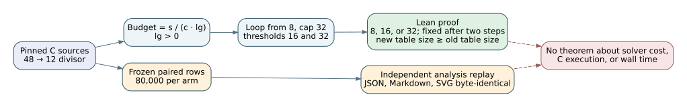

# GLV table selector: source-bound Lean proof and archived result replay



*The figure shows the original 48-to-12 scope; the size-dependent cap is described in the text and tables below.*

## Question and exact scope

The [held-out experiment](REPORT.md) changed the `glv_rho_solve` table-budget
divisor from 48 to 12. This addendum proves a deterministic selector property:
for the same `sqrt_nm` and positive `lg`, the new rule cannot choose a smaller
table. It checks that the pure Lean selector matches the pinned C loop. It does
not turn the measured operation-count gain into a theorem.

**Update for the size-dependent cap.** The selector in `src/curve.c` now uses
`rcap = lg >= 40 ? 128 : 32` in place of the fixed cap of 32 (the divisor stays
12). The live binding below moves to that selector, and nineteen additional
theorems (the second table of the proof map) describe it: the C-style loop equals the threshold
cases for each cap, the selector is monotone in `sqrt_nm`, it equals the
previous selector below 40 bits, and it never picks a smaller table than the
previous selector (or than the divisor-48 baseline) for the same `sqrt_nm` and
`lg`. The 48-to-12 theorems and both historical pins are unchanged and remain
true. This is again a deterministic property of the selector. That the larger
cap saves group operations at 42-46 bits is a measurement, reported in the
experiment that introduced it; no theorem here says a larger table is faster.

| Input or artifact | Pinned evidence |
| --- | --- |
| Baseline `src/curve.c` | commit `7cb3dce4cac9176d74afb6403048b5fabbaab834`, SHA-256 `e504bb18f0e80134c9ccf9abc1b7a825097286a759075090d2693ef82b406975` |
| Current `src/curve.c` | commit `42761f85b06242cb54f2a5fa405c723451897503`, SHA-256 `3f3a100d635d814bdfa0f6624a40b9d77c9c564f65db2bbc568dcd4b55285efe` |
| Previous live source (divisor 12, cap 32) | commit `8bf648dcbefe7b8131e5fb26909c77e68778332a`, SHA-256 `60796724ef7d7c5b3b7dfd89c29db85d5e188deb247b5d9d0bd69b84551afe20`; its exact selector is re-checked by `--live` |
| Live source (size-dependent cap) | commit `e71ebecaf3a076590ddd3affa4878b4c80d85095`, SHA-256 `e1d624e58c54f25f9225be97481b50c0ed406cedcfdffa8ba66f01a5fbed7f63`; [live receipt](live-source-binding.json) |
| Formal source | [TableBudget.lean](TableBudget.lean), Lean `v4.34.1` from the repository root `lean-toolchain` |
| Source check | [check_lean_source_binding.py](check_lean_source_binding.py), [receipt](lean-source-binding.json): exact C selector in both historical pinned sources; two changed-selector controls rejected. `--live` ([receipt](live-source-binding.json)): exact size-dependent selector in the working tree and in the prior live pin; five changed-selector controls rejected (divisor 48, threshold 41, large cap 64, small cap 64, cap variable replaced by 32) |
| Kernel and axiom check | [lean-receipt.json](lean-receipt.json): build exit 0; all 27 public theorem axiom sets contain only `propext` and `Quot.sound` (`tableSize_cases`, `capFor_below40` and `tableSize128_cases` only `propext`) |
| Archived measurement replay | [lean-analysis-replay.json](lean-analysis-replay.json): both 80,000-row arm files, result JSON, result Markdown, and SVG checked |

The `source-and-proof` workflow's theorem-count check was raised from 8 to 27
(the eight historical theorems plus nineteen new ones); it still requires that
every declared theorem has a printed axiom set equal to the receipt's.

The earlier six-print receipt omitted the axiom sets of `tableSize_cases` and
`table48_le_table12`. The corrected eight-print receipt and CI declaration
check cover every public theorem in `TableBudget.lean`; no theorem statement,
proof body, C selector, or measured row changed.

The committed [source protocol pin](PROTOCOL.sha256) verifies the historical
`42761f85` C file, protocol, run script, and analysis script at that commit.
The additional live check pins the merged C file separately and rejects two
changed-selector controls. All 13 original entries in
[SHA256SUMS](SHA256SUMS), including the original performance chart and report
PDF, pass. The new proof files are supplemental and do not modify those frozen
inputs or outputs.

## Proof map

| Lean declaration | Statement and role |
| --- | --- |
| `GlvTableBudget.loopResult_eq_tableSize` | Two C-style guard-and-double steps from 8 equal the three threshold cases: budget below 16 gives 8; budget from 16 to 31 gives 16; budget at least 32 gives 32. |
| `GlvTableBudget.loopResult_fixed` | A third step cannot change the result. Together with the prior theorem, this identifies the full loop result. |
| `GlvTableBudget.tableSize_cases` | The selected table size is exactly 8, 16, or 32. |
| `GlvTableBudget.loopResult_bounds` | The result is between 8 and 32; `tableSize_cases` strengthens this to exactly 8, 16, or 32. |
| `GlvTableBudget.tableSize_mono` | The selector is nondecreasing in its integer budget. |
| `GlvTableBudget.budget48_le_budget12` | For every natural `s` and positive natural `lg`, `s/(48*lg) ≤ s/(12*lg)`. |
| `GlvTableBudget.table48_le_table12` | Monotonicity applies to the two divisor budgets before the loop-result bridge. |
| `GlvTableBudget.loop48_le_loop12` | Combining the two results, the divisor change from 48 to 12 cannot reduce the selected table size for the same `s` and `lg`. |

Current selector (size-dependent cap), the second part of `TableBudget.lean`. In these,
`select s lg` is the loop with cap `capFor lg` and budget `s/(12*lg)`.

| Lean declaration | Statement and role |
| --- | --- |
| `capFor_below40`, `capFor_from40` | `capFor lg = 32` for `lg < 40` and `128` for `lg ≥ 40`, as in `lg >= 40 ? 128 : 32`. |
| `loopCap32_eq_tableSize` | Four C-style guard-and-double steps from 8 with cap 32 equal the three cases {8, 16, 32} of `tableSize`. |
| `loopCap128_eq_tableSize128` | Four steps with cap 128 equal the five threshold cases: below 16 gives 8, below 32 gives 16, below 64 gives 32, below 128 gives 64, otherwise 128. |
| `loopCap32_eq_loopResult` | The four-step cap-32 loop equals the historical two-step `loopResult`. |
| `loopCap32_fixed`, `loopCap128_fixed` | A further step cannot change the result, for either cap; the longest chain 8, 16, 32, 64, 128 is four steps. |
| `tableSize128_cases`, `tableSize128_mono` | The cap-128 result is one of {8, 16, 32, 64, 128} and nondecreasing in the budget. |
| `tableSize_le_tableSize128`, `tableSize128_eq_tableSize_below32` | The cap-128 table is never smaller than the cap-32 table, and equal to it for budgets below 64. |
| `select_below40`, `select_from40`, `select_eq_old_below40` | Below 40 bits the selector equals the previous one (`loopResult` of the divisor-12 budget); from 40 bits it is `tableSize128` of that budget. |
| `select_bounds`, `select_cases` | The result is at least 8 and at most `capFor lg`, and is exactly one of the listed sizes for its cap. |
| `select_mono_budget` | For fixed `lg`, a larger `sqrt_nm` cannot give a smaller table. |
| `old_le_select` | For every `s` and `lg`, the previous (divisor 12, cap 32) selector picks a table no larger than the current one. |
| `baseline48_le_select` | For positive `lg`, the divisor-48 baseline picks a table no larger than the current selector. |

The readable argument is short: the cap of 32 permits only `8 → 16 → 32`.
The two possible successful doublings occur precisely at budget thresholds
16 and 32. Lowering a positive divisor from `48*lg` to `12*lg` cannot lower
the quotient, and a threshold selector cannot decrease as its budget grows.

For the current selector the threshold structure is the same, with two more
doublings allowed when `lg ≥ 40`: they happen at budgets 64 and 128. A larger
cap only adds doublings, so it cannot lower the result, and the two caps agree
whenever the budget is below 64.

The C branch returns before this selector when `n < 64`, so `lg =
glv_ilog2(n)+1` is positive on the path covered by the proof. The full-file
hash and exact-snippet checks bind the historical and current C start value,
guard, cap (including the `lg >= 40` threshold and both cap values), and two
divisors. `rbudget`, `rr` and `rcap` are 64- and 32-bit unsigned in C, and the
Lean model uses unbounded naturals; `rr` never exceeds 128, and `rbudget` is
only compared, so no wraparound can occur in the loop. The Lean model uses unbounded natural arithmetic; it does not
formalize the C compiler, group-order validity, division by `c.m`, other
solver paths, or memory behavior. The C loop itself multiplies only 8 and 16
by two before the cap stops it.

## Archived outcome and graph state

An isolated rerun of `analyze.py` and `chart.py` reproduced committed
`results.json`, `results.md`, and `confirm.svg` byte for byte. The primary
paired group-operation ratios remain **0.95654** for `j=1728` (97.5% interval
`[0.94800, 0.96490]`) and **0.96708** for `j=0` (`[0.95812, 0.97619]`)
over 28–34-bit groups. The identity control still has **45,700** equal-table
rows with zero differing operation counts. The source chart SVG and PNG and
the original PDF retain their committed hashes; this selector proof changes
no canonical performance figure or numerical result.

These are archived operation counts, not wall-time measurements. The theorem
does not prove that a larger table is faster, that each solve is correct, or
that the observed ratios hold at other sizes or for the separate covariant
walk. The archived row analysis and existing CI support the measurements in
their stated scope; a fresh solver run was not performed for this addendum.

## Reproduce

From this experiment directory, with the repository's pinned Lean toolchain:

```sh
ELAN_TOOLCHAIN=leanprover/lean4:v4.34.1 lean TableBudget.lean
python3 check_lean_source_binding.py
python3 check_lean_source_binding.py --live
sha256sum -c SHA256SUMS
sha256sum -c LEAN_SHA256SUMS
```

`LEAN_SHA256SUMS` lists the supplemental proof files (it is new; `SHA256SUMS` and
`PROTOCOL.sha256` are unchanged). Run `sha256sum -c PROTOCOL.sha256` from the historical `42761f85` checkout;
its full-file C hash intentionally differs from the later merged source.

To replay the analysis, copy `analyze.py`, `chart.py`, and both `rows_*.jsonl.gz`
files into a scratch directory, run the two Python scripts there, and compare
the three generated hashes with [lean-analysis-replay.json](lean-analysis-replay.json).
`lean4checker` was unavailable on this host. Lean compilation and the printed
axiom audit passed; no independent semantic review of the C-to-Lean
correspondence has yet been recorded.
