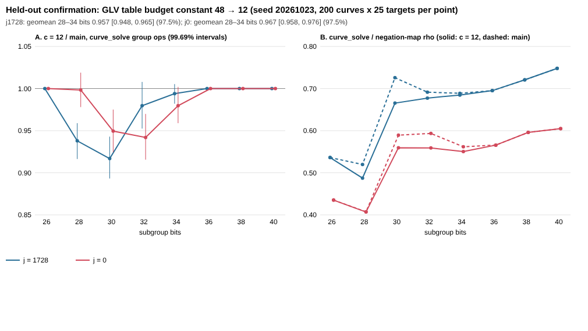

# Held-out confirmation: GLV table budget constant 48 → 12

`PROTOCOL.md` was frozen in commit f630cc3 together with the `src/curve.c`
change, before any data on seed 20261023 existed. `sha256sum -c
PROTOCOL.sha256` passes on the committed protocol, scripts and source.

## Run

- **Arms:** `main` (`7cb3dce`) and `c12` (`7cb3dce` + this PR's one-constant
  change).
- **Sample:** j = 1728 and j = 0, r at 26–40 bits, 200 curves × 25 targets
  per family and size.
- **Seed:** 20261023, held out.
- **Rho reference:** the negation-map rho on every target.
- **Total:** 160,000 `curve_solve` rows plus 80,000 rho rows. Four processes
  on one 4-core host took 31 minutes.
- **Raw rows:** `rows_main.jsonl.gz` and `rows_c12.jsonl.gz`.

## Invariants (all pass)

- **Correctness:** every answer is correct, in both arms and in the rho reference.
- **Grid:** the grids are identical, with no duplicate rows.
- **Identity control:** wherever c = 12 and c = 48 pick the same table, the
  counts are identical. That covers 45,700 rows, 0 differing, and includes all
  of 26 bits and 36–40 bits.

## Primary result: **confirmed for both families**

The statistic is the geometric mean of the c12 / main `curve_solve`
group-operation ratios at 28, 30, 32 and 34 bits. Intervals are 97.5% (2
families), bootstrapped over curves within each cell.

| family | held-out ratio | 97.5% interval | selection-round estimate (in-sample) |
|---|---|---|---|
| j = 1728 | **0.957** | [0.948, 0.965] | 0.959 |
| j = 0 | **0.967** | [0.958, 0.976] | 0.954 |



## Cells (descriptive; intervals 99.69%, Bonferroni over 16)

| family | bits | table main → c12 | c12 / main | interval | main / rho | c12 / rho |
|---|---|---|---|---|---|---|
| j1728 | 26 | 8 → 8 | 1.000 | identical | 0.536 | 0.536 |
| j1728 | 28 | 8 → 16 | 0.938 | [0.916, 0.959] | 0.520 | 0.487 |
| j1728 | 30 | 8 → 32 | 0.917 | [0.893, 0.943] | 0.726 | 0.665 |
| j1728 | 32 | 8/16 → 32 | 0.980 | [0.952, 1.008] | 0.691 | 0.677 |
| j1728 | 34 | 16/32 → 32 | 0.994 | [0.982, 1.005] | 0.689 | 0.685 |
| j1728 | 36–40 | 32 → 32 | 1.000 | identical | 0.695–0.748 | same |
| j0 | 26 | 8 → 8 | 1.000 | identical | 0.435 | 0.435 |
| j0 | 28 | 8 → 8/16 | 0.998 | [0.978, 1.019] | 0.407 | 0.407 |
| j0 | 30 | 8 → 16/32 | 0.949 | [0.924, 0.975] | 0.589 | 0.559 |
| j0 | 32 | 8/16 → 32 | 0.942 | [0.916, 0.970] | 0.593 | 0.559 |
| j0 | 34 | 16/32 → 32 | 0.980 | [0.959, 1.002] | 0.562 | 0.550 |
| j0 | 36–40 | 32 → 32 | 1.000 | identical | 0.566–0.605 | same |

Where the two rules choose different tables:

- **Resolved fewer:** j = 1728 at 28 and 30 bits (6–8%), and j = 0 at 30 and
  32 bits (5–6%), even at the per-cell Bonferroni level.
- **Not resolved alone:** j = 1728 at 32 and 34 bits, and j = 0 at 28 and
  34 bits. Their point estimates are 0.980–0.998.
- **Never resolved worse:** no cell.

Against the matched negation-map rho, `curve_solve` on j = 1728 at 30 bits goes
from 0.726 to 0.665, and j = 0 at 32 bits from 0.593 to 0.559.

## Decision (from the frozen rule)

Both families are confirmed. The PR proposes the change as an operation-count
improvement of about 4% (j = 1728) and 3% (j = 0) in geometric mean over
28–34-bit subgroups. Individual sizes gain up to 8%. There is no change at
26 bits or from 36 bits up, where both rules pick the same table.

## Limits

- **Measure:** operation counts, not wall time. Setup operations are counted,
  so a larger table's extra setup is included.
- **Sizes:** 26–40 bits only. Above 36 bits the rule is unchanged by
  construction.
- **Scope:** `glv_rho_solve` only. The covariant walk's own table rule is
  unchanged and still not dispatched on `main` (#1059, #1061).

## Reproduce

Build both arms as in `PROTOCOL.md`, then:

```sh
for fam in j1728 j0; do
  CRYPTANALYSIS_LIB=b-main/libcryptanalysis.so python3 run.py --arm main --families $fam --rho --out rows_main_$fam.jsonl &
  CRYPTANALYSIS_LIB=b-c12/libcryptanalysis.so  python3 run.py --arm c12  --families $fam --out rows_c12_$fam.jsonl &
done; wait
cat rows_main_j1728.jsonl rows_main_j0.jsonl | gzip -9 > rows_main.jsonl.gz
cat rows_c12_j1728.jsonl rows_c12_j0.jsonl | gzip -9 > rows_c12.jsonl.gz
python3 analyze.py && python3 chart.py
```
