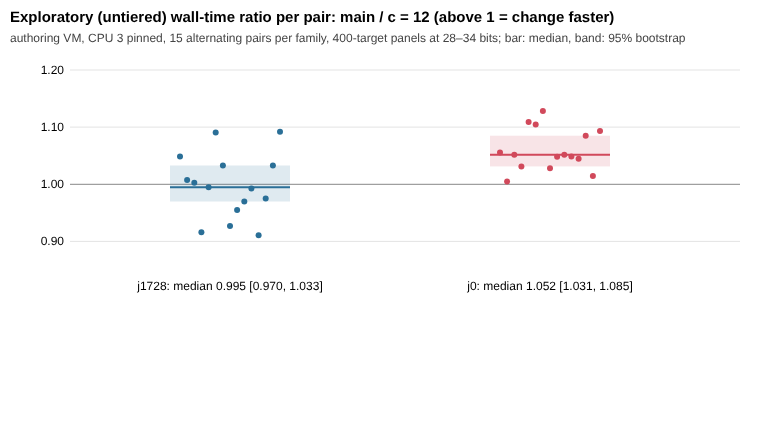

# Wall time of the GLV table rule c = 12: exploratory run; the Tier 1 run is pending

`PROTOCOL.md` was frozen in commit fa971ee (pushed to the `glv-table-rule-c12`
branch) before any timing. `sha256sum -c PROTOCOL.sha256` passes. The change
under test, #1065 (table budget constant 48 → 12), is merged in `main` as
cfc31eb.

## Status

| run | host | tier | status |
|---|---|---|---|
| Tier 1, 15 alternating pairs per family | Runpod CPU pod, rented for the run | Tier 1 | **not run.** Renting the pod needs the owner's approval; the payload and boot script are ready (`pod_boot.sh`). |
| exploratory, 15 alternating pairs per family | authoring VM: 4-vCPU KVM, Intel Xeon @ 2.10 GHz, cgroup v1 (`host_exploratory_local.json`, `lscpu_exploratory_local.txt`) | none: fails the Tier 1 preflight (no cgroup v2 counters) and saw nonzero steal time | done, below |

## Exploratory result (untiered, not a speedup claim)

- **Setup:** the protocol's binaries and panels (400 targets per family, 28–34
  bits, seed 20261024), reference and candidate alternating, `taskset` to
  CPU 3, run by `exploratory_local.py`.
- **Correctness:** every run printed `verified=1` with the frozen scalar hash.
- **Statistic:** the ratio is reference `online_ms` / candidate `online_ms`,
  so above 1 means the change is faster. The interval is a 95% bootstrap of
  the median over the 15 pairs. Steal ticks are summed over all 30 runs of the
  family.

| family | wall ratio (median) | 95% interval | CPU-time ratio | ops ratio on this panel | steal ticks |
|---|---|---|---|---|---|
| j = 1728 | 0.995 | [0.970, 1.033] | 1.002 [0.954, 1.025] | 1.018 | 122 |
| j = 0 | 1.052 | [1.031, 1.085] | 1.050 [1.040, 1.084] | 1.033 | 117 |

Raw rows are in `rows_exploratory_local.jsonl`, the summary in
`summary_exploratory_local.json`.

What the panel can show:

- **The panel is size-weighted.** It sums the operations of 100 targets at
  each size, so the largest (34-bit) curves dominate. There the change saves
  least (0.994 for j = 1728 and 0.980 for j = 0 in the held-out round). The
  panel's operation saving is therefore 1.8% for j = 1728, well below its
  per-size geometric mean of 4.3%. For j = 0 it is 3.3%, which happens to equal
  the geometric mean.
- **j = 1728:** a 1.8% operation saving is within this host's timing noise.
  No wall difference is resolved.
- **j = 0:** wall and CPU time fall by about 5%, a little more than operations.
  On this contended VM that is not a speedup claim.

## Running the Tier 1 run

Build the two static binaries as `PROTOCOL.md` states. Their hashes must
match the protocol's table. Then:

1. Pack them, with the panels, the frozen manifests, `bench_glv_panel.c`,
   `pod_manifest.py` and `scripts/isolated_bench.py`, into a payload.
2. Create a Runpod CPU pod with `POD_BOOT_B64=$(base64 pod_boot.sh)`,
   `PAYLOAD_SHA256` and port `8000/http`.
3. `PUT` the payload to `https://<pod>-8000.proxy.runpod.net/payload`.
4. Fetch `DONE`, `run_*.json` and `results.tgz` from the same URL, then delete
   the pod.

No SSH is used, and no API key enters the payload or the receipt.

