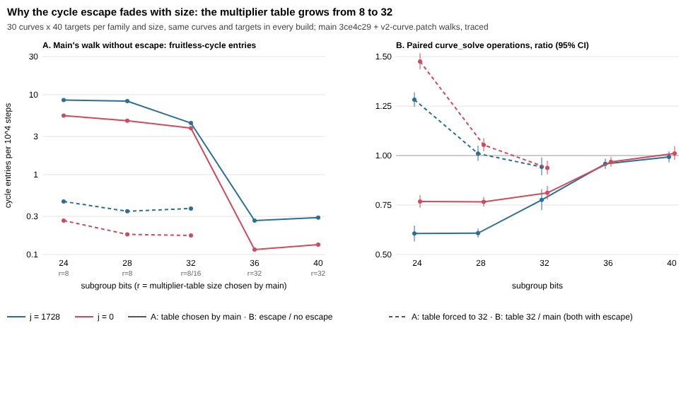

# Why the GLV cycle escape fades with size, and where j = 0's covariant walk went

**Status: exploratory.** No protocol was frozen before these runs. The numbers
below are measured, but they are not a preregistered speed claim. Part 3 names
the frozen experiment that a change to the walk would need.

## Questions

1. PR #953 (look-ahead fix and 2/4-cycle escape) was measured only at 24–32 bits.
   A rerun of the ml-cryptanalysis bulk data on the same builds
   (aburan28/ml-cryptanalysis#28, `experiments/bulk-patched-rerun/`) found the
   escape's gain shrinking with size. At 36–40 bits it disappeared:
   j = 1728 0.966, j = 0 0.993, with an interval including 1. **Why?**
2. The same rerun found j = 0 `curve_solve` about 8% more expensive on `main`
   `3ce4c29` than on the Oct 9 line (`e425d15`). Rho and j = 1728 were
   unchanged on identical targets. **Which change, and is it a regression?**

## 1. The fade is the multiplier table

`glv_rho_solve` sizes its r-adding table from the group:
`r = 8, doubled while r·2 ≤ sqrt(n/m) / (48·log2 n)`, capped at 32. On these
curves that gives r = 8 up to about 30 bits, 8 or 16 at 32 bits, and 32 from
36 bits up.

Each GLV walk was traced (`-DCA_GLV_TRACE`, trace runner
`experiments/glv-walk-trace-20261018/trace_run.py`):

- **Curves and targets:** 30 curves × 40 targets per family and size, the same
  curves, targets and seeds in every build.
- **Builds:**
  - `legacy`: main's walk before #953.
  - `escape`: main's walk today.
  - `r32legacy` and `r32escape`: the same two walks with the table forced to
    32 (`force-r.patch`).

Each row reports what fraction of `curve_solve`'s operations go to setup,
look-ahead retries and steps inside fruitless cycles. It also reports how often
a walk enters a cycle (`breakdown.json`).

| j = 1728 walk | bits | table r | curve_solve / rho | setup | retries | cycle waste | productive | cycle entries / 10⁴ steps |
|---|---|---|---|---|---|---|---|---|
| legacy | 28 | 8 | 0.858 | 0.130 | 0.173 | 0.223 | 0.474 | 8.30 |
| legacy | 40 | 32 | 0.762 | 0.089 | 0.031 | 0.020 | 0.860 | 0.29 |
| legacy, table forced to 32 | 28 | 32 | 0.526 | 0.272 | 0.024 | 0.009 | 0.694 | 0.35 |
| escape (main today) | 28 | 8 | 0.521 | 0.124 | 0.128 | 0.028 | 0.720 | 17.9 (escaped) |
| escape (main today) | 40 | 32 | 0.757 | 0.086 | 0.030 | 0.001 | 0.883 | 0.68 (escaped) |

j = 0 shows the same pattern: at 28 bits, legacy has 4.73 cycle entries per
10⁴ steps with r = 8 and 0.18 with r = 32. Every family and size is in
`breakdown.json`.

- **Observation.** Going from r = 8 to r = 32 cuts fruitless-cycle entries
  24 to 36-fold (8.30 → 0.35 and 4.73 → 0.18 forced at 28 bits; 8.30 → 0.29 and 4.73 → 0.13 at 40). It also cuts look-ahead retries from about 16% of
  operations to about 3%. This holds both when the table grows with size and
  when it is forced to 32 at 28 bits, so table size, not size itself, carries
  the effect.
- **Consequence.** The escape recovers cycle waste, and at r = 32 there is
  almost none left to recover. With the table forced to 32 the escape is close
  to a no-op: escape/no escape is 0.968 to 1.001 at 24–32 bits.
- **PR #953's result stands for what it measured.** It was measured at 24–32
  bits, where main uses r = 8 (16 on some 32-bit curves). Its gain does not carry to 36 bits and up,
  where main already uses r = 32. These ratios agree with the bulk rerun's bands.

Escape over legacy, paired on the same targets, 95% bootstrap over curves
(`paired.json`):

| escape / legacy | 24 | 28 | 32 | 36 | 40 |
|---|---|---|---|---|---|
| j = 1728 | 0.606 [0.566, 0.646] | 0.608 [0.585, 0.631] | 0.776 [0.725, 0.830] | 0.958 [0.933, 0.984] | 0.992 [0.965, 1.021] |
| j = 0 | 0.768 [0.737, 0.799] | 0.766 [0.743, 0.791] | 0.811 [0.777, 0.847] | 0.968 [0.944, 0.994] | 1.011 [0.978, 1.048] |

## 2. j = 0's covariant walk is no longer reached on `main`

`CA_J0_RHO_COVARIANT_WALK` is ON by default ("Use oriented quotient walk in
j=0 GLV rho"). On the Oct 9 line, `ca_curve_solve` sent j = 0 curves to
`glv_covariant_rho_solve` under that flag. #437 (b124cc1, "Add opt-in
unit-steered tau to one-target rho startup") moved dispatch into
`curve_solve_mode` without that branch. Since then every endomorphism curve,
j = 0 included, runs `glv_rho_solve`. `glv_covariant_rho_solve` still compiles
under the flag, but nothing calls it. This is still true on `main` `7cb3dce`.

Evidence (`raw/fingerprint_j0_*.json`, 40 j = 0 solves at 28 bits, `fingerprint.py`):

| build | sum of group_ops | equal to the Oct 9 line? |
|---|---|---|
| `curve.c` of dff08eb (= e425d15) on the 3ce4c29 tree | 489,181 | yes, all 40 solves |
| 3ce4c29 | 469,041 | no |
| 3ce4c29 + the restored dispatch (`dispatch-check.patch`) | 489,181 | **yes, all 40 solves** |

Restoring just that branch reproduces the old counts exactly. So the "8%
regression" is the dispatch change and nothing else.

**Whether it is a regression depends on size.** Since #953, main's generic walk
with the escape beats the covariant walk on j = 0 below 36 bits but loses at
36–40. These are ml-cryptanalysis bulk targets, paired, main's walk over
covariant (`raw/j0_cov_vs_main.json`):

| r bits | 20–25 | 26–30 | 31–35 | 36–40 | all |
|---|---|---|---|---|---|
| main / covariant | 0.863 [0.855, 0.870] | 0.804 [0.796, 0.811] | 0.891 [0.880, 0.901] | **1.028 [1.016, 1.040]** | 0.866 [0.861, 0.870] |

Restoring the dispatch as it was would make j = 0 slower at every size below
36 bits. Leaving it as it is keeps a default-ON option that does nothing. This
PR changes neither; the decision is the owner's.

## 3. What this suggests (interpretation, not measured claims)

- **The table rule may be too conservative near 32 bits.** At 32 bits a
  32-entry table beats main's walk, paired: j = 0 0.938 [0.905, 0.973] and
  j = 1728 0.943 [0.900, 0.990]. At 28 bits it ties: 1.053 and 1.010. At
  24 bits it loses, 1.475 and 1.282, because setup reaches half the
  operations. A rule that trades setup against retries and cycle waste might
  choose r = 32 earlier than main does. That needs a frozen protocol on new
  curves before any claim, over 28–40 bits with the rho reference.
- **The escape and a larger table overlap.** Both remove fruitless-cycle
  waste. Above about 34 bits the escape is close to a no-op on main.
- **For j = 0,** the measured choice is between restoring the covariant
  dispatch above some size, removing the dead option, or documenting it. Each
  is one PR with its own paired check.

## Limits

- **Measure.** Operation counts of one implementation, not wall time.
- **Sample.** 30 curves × 40 targets per cell, 24–40 bits. Part 2's size table
  comes from the 20–40-bit bulk rerun.
- **Builds.** The traced builds are `main` `3ce4c29` + ml-cryptanalysis's frozen
  `v2-curve.patch` (sha256 `a4193d28…`). That is the walk #953 merged.
  `main` `7cb3dce`'s `curve.c` built with its own CMake defaults gives the
  identical 80-solve fingerprint as the escape build, so the walk is unchanged
  on main.
- **Trace accounting.** The trace counters predate #953's trace accounting
  correction, which changed only `abandon_wasted` bookkeeping when an escape
  spans a distinguished point. Total operations, and every ratio in this
  report, are unaffected.
- **Not touched:** the plain rho, and the paired τ startup modes.

## Reproduce

```sh
# Traced builds: main 3ce4c29 + v2-curve.patch; add force-r.patch for the r = 32 arms.
cmake -S . -B b-legacy -DCMAKE_BUILD_TYPE=Release -DCA_CUPQC=OFF -DCA_GLV_LOOKAHEAD_LEGACY=ON -DCA_GLV_CYCLE_ESCAPE=OFF -DCMAKE_C_FLAGS=-DCA_GLV_TRACE
cmake -S . -B b-escape -DCMAKE_BUILD_TYPE=Release -DCA_CUPQC=OFF -DCMAKE_C_FLAGS=-DCA_GLV_TRACE
#   r = 32 arms: the same two, with -DCMAKE_C_FLAGS="-DCA_GLV_TRACE -DCA_GLV_FORCE_R=32"
for b in legacy escape; do
  CRYPTANALYSIS_LIB=b-$b/libcryptanalysis.so CA_GLV_TRACE_FILE=/tmp/t_$b \
    python3 experiments/glv-walk-trace-20261018/trace_run.py --sizes 24,28,32,36,40 \
      --curves 30 --targets 40 --out trace_$b.jsonl
done   # r = 32 arms: --sizes 24,28,32
cd experiments/glv-table-size-20261022
python3 breakdown.py legacy escape r32legacy r32escape   # breakdown.json
python3 paired.py                                         # paired.json
python3 chart.py                                          # fade.svg
```

`breakdown.py` and `paired.py` regenerate the committed JSON byte-for-byte from
`raw/*.jsonl.gz`. Every traced solve's components sum to its `group_ops`, and
every answer was checked against the known logarithm. `SHA256SUMS` lists every
file.


