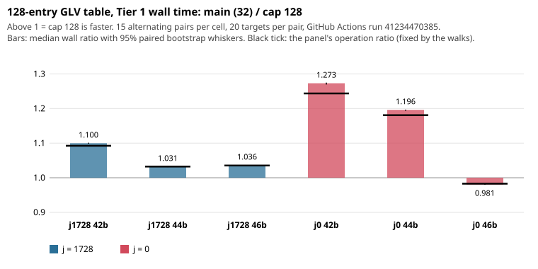

# 128-entry GLV table on the Tier 1 path: wall time follows operations at 42-46 bits

**Result.** On a GitHub Actions `ubuntu-24.04` runner under the Tier 1 gate
([run 41234470385](https://github.com/aburan28/cryptanalysis/actions/runs/41234470385)), the cap-128
build (`cand`, #1335) is **faster than main (32 entries) on five of the six frozen panels and resolved
slower on one (j = 0, 46 bits)**. In every cell the wall ratio equals the panel's operation ratio to
within 3%: the larger table changed the cost per group operation by 2.4% at most. The runner filled
`paired_speedup` in five cells; each is a statement about that 20-target panel, not about the
population (see Limits). Nothing here covers 34-41 bits, where #1335 also changes the table.

| cell | wall ratio main / cand | 95% paired bootstrap | resolved | valid pairs | CPU ratio | ops ratio (this panel) | ns per op, main -> cand | ns-per-op ratio main / cand | projection: 0.9802 x (cand / main ns per op) |
|---|---|---|---|---|---|---|---|---|---|
| j1728 42 | **1.100** | [1.098, 1.101] | faster | 15/15 | 1.100 | 1.092 | 117.7 -> 116.9 | 1.007 [1.005, 1.008] | 0.974 |
| j1728 44 | **1.031** | [1.031, 1.035] | faster | 15/15 | 1.032 | 1.032 | 118.5 -> 118.5 | 0.999 [0.999, 1.002] | 0.980 |
| j1728 46 | **1.036** | [1.034, 1.037] | faster | 15/15 | 1.035 | 1.036 | 119.5 -> 119.5 | 1.001 [0.999, 1.001] | 0.980 |
| j0 42 | **1.273** | [1.269, 1.275] | faster | 15/15 | 1.272 | 1.244 | 151.1 -> 147.7 | 1.024 [1.021, 1.025] | 0.958 |
| j0 44 | **1.196** | [1.194, 1.197] | faster | 15/15 | 1.196 | 1.181 | 153.4 -> 151.5 | 1.013 [1.011, 1.014] | 0.968 |
| j0 46 | **0.981** | [0.980, 0.982] | **slower** | 15/15 | 0.981 | 0.983 | 151.7 -> 152.0 | 0.998 [0.997, 0.999] | 0.982 |

Wall ratio above 1 means cand is faster. The ns-per-op ratio is the wall ratio divided by the ops ratio
(the operation counts are identical in every pair), with the interval scaled the same way. The
projection column is descriptive only: it multiplies #1332's pooled operation ratio (0.9802, other
curves) by this run's per-cell cost ratio, and is not a claim.

- **Provider and host:** GitHub Actions, standard `ubuntu-24.04` (image 20261026.354.1, kernel
  7.0.0-1017-azure, 4 CPUs visible, cgroup v2, no CPU quota), both arms pinned to CPU 0, 15 alternating
  pairs per cell, 15/15 valid in all six. The host CPU model is not in the probe; the previous runs on
  this runner type reported an AMD EPYC 7763.
- **Gate:** `binaries_stable`, `artifacts_stable`, `runner_stable` true in every cell;
  `host_exclusivity_proved` is false, as always for Tier 1. Every run printed `verified=1` and the
  frozen scalar hash.
- **Binaries:** the runner's builds are byte-identical to the authoring-VM builds hashed in the workflow
  (`4b5036ec…` main, `a8d681a5…` cand), compiler gcc 13.3.0.
- **Receipts:** `tier1-github-41234470385/` holds the run summaries, preflights, allocation, host probe,
  compiler and `binaries.sha256`; `results.json` holds every figure above. The raw `runs.jsonl`,
  `pairs.jsonl` and stdout/stderr stay in the workflow artifact `glv-walltime-tier1-41234470385-1`
  (30 days) and are not in Git (docs/artifacts.md; this session has no store credentials).

## Predictions, scored (written before the run)

| | prediction | outcome |
|---|---|---|
| P1 | ns per operation within +/-3% in every cell | **held** (ratios 0.998 to 1.024) |
| P2 | wall ratio within 3% of the panel's ops ratio; signs follow it; j0 46 slower | **held** (largest gap: j0 42, 1.273 against 1.244, 2.3%; j0 46 resolved slower) |
| P3 | no resolved cost-per-operation increase above 3% | **held** (cand costs the same or slightly less per operation; no cell has main/cand below 0.997) |

## Observations and interpretation

- **Observation:** a resolved per-operation saving for cand appears only in j = 0 at 42 and 44 bits
  (2.4% and 1.3%), plus 0.7% at j = 1728 42 bits. The other three cells are within 0.2% of 1.
- **Interpretation, not measured:** the 128-entry table makes fewer fruitless cycles and escapes (the
  escape doubling is an affine operation outside the batched inversion), which would lower the cost per
  counted operation; setup, 128 table points, is paid once per target and is small beside 10^6 walk
  steps. This round did not count escapes or cycles.
- **What the panel ratios mean:** the walks are seeded, so each panel's operation ratio is one
  realization of random walks. The panel ratios here (0.98 to 1.24) scatter widely around #1332's 0.98
  pooled population ratio, as the 10% per-arm noise of a 20-target cell predicts. The wall ratios
  inherit that scatter.
- **Hypothesis for what #1332 + this round suggest:** at 42-46 bits the population wall saving is about
  the 2% operation saving, perhaps up to 3-4% at j = 0, 42 bits (projection column). A wall-time claim
  at that size needs panels large enough to average the walk noise, which Tier 1 cannot afford in one
  90-minute job; a population claim would need several runs or a larger panel.

## Limits

- **Intervals** come from 15 pairs of the same frozen 20-target panel, so they describe timing noise on
  that panel, not variation across curves or walks. They are narrow for that reason and cannot confirm
  or refute a 2% effect on the population. The cost-per-operation ratio is the panel-independent
  quantity; it is for this runner type, these builds and this size range only.
- **Scope:** two families, 42-46 bits, single thread, one runner instance, one run. The change in #1335
  also alters the table at 32-41 bits and above 46 bits; those ranges are not measured.
- **Not measured:** memory use and cache behavior directly; escapes and cycles; multi-thread.
