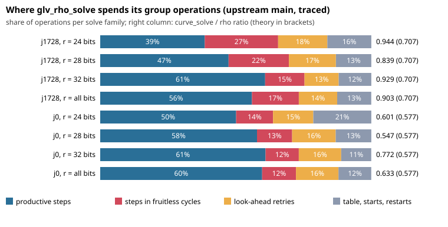

# Where `glv_rho_solve` spends its group operations

## Question

`curve_solve` on j = 1728 curves is slower than the order-4 automorphism
fold predicts. A controlled experiment in aburan28/ml-cryptanalysis#29 found:

- **Paired ratio:** 0.894 [0.860, 0.930] against the library's own negation-map rho, where theory says sqrt(2/4) = 0.707.
- **Design:** 120 curves at 24 to 32 bits, 200 targets each, and a protocol frozen before the run.
- **Revision measured:** that experiment used an older revision of this library.

This report books every group operation of the generic GLV walk to a part of
the walk, on current `main`, to see where the operations go.

## Revisions and environment

- **Library:** `main` at `3ce4c29ec497` plus this branch's `src/curve.c` change, which is diagnostic only and compiled in with `-DCA_GLV_TRACE`.
- **Builds:** Release, `CA_CUPQC=OFF`, default options. On `main`, `curve_solve` sends both j = 0 and j = 1728 to `glv_rho_solve`.
- **Host:** a 4-core cloud VM, no CPU isolation. Every figure here is a deterministic operation count, not a time, so isolation does not affect it.
- **Raw data:** `trace.jsonl.gz` (sha256 `ac4b12b72c604f9899f27f3f51248f282de16dd073a63f09ac44d3264c504f36`). It holds 6,000 rows, one per (curve, target), with both solvers' group_ops and every trace field.

## Commands

```sh
cmake -S . -B b-trace -DCMAKE_BUILD_TYPE=Release -DCA_CUPQC=OFF -DCMAKE_C_FLAGS=-DCA_GLV_TRACE
cmake --build b-trace -j --target cryptanalysis
CA_GLV_TRACE_FILE=/tmp/trace_raw.jsonl CRYPTANALYSIS_LIB=b-trace/libcryptanalysis.so \
  python3 experiments/glv-walk-trace-20261018/trace_run.py --out trace.jsonl   # 20 curves x 50 targets per family and size
python3 experiments/glv-walk-trace-20261018/summarise.py                       # summary.json, table below
python3 experiments/glv-walk-trace-20261018/chart.py                           # breakdown.svg
```

## Checks

- **Tracing does not change the walk.** A traced build and an untraced build of the same revision return identical group_ops on 80 solves, across both families at 28 bits.
- **The booking is complete.** For every one of the 6,000 traced solves, table + walk starts + restarts + steps equals group_ops. `trace_run.py` asserts this.
- **Every answer is correct.** Every recovered logarithm equals the planted one, for both rho and `curve_solve`.
- **Earlier revision.** On it, the same instrumentation reproduced the controlled experiment's 3,000 j = 1728 solves exactly.

## Result



| family | r bits | curve_solve / rho | theory | productive steps | steps in fruitless cycles | look-ahead retries | table, starts, restarts | abandoned walks per 10^4 steps |
|---|---|---|---|---|---|---|---|---|
| j1728 | 24 | 0.944 | 0.707 | 38.6% | 27.0% | 18.2% | 16.2% | 8.4 |
| j1728 | 28 | 0.839 | 0.707 | 47.4% | 22.2% | 17.3% | 13.1% | 8.3 |
| j1728 | 32 | 0.929 | 0.707 | 60.8% | 14.5% | 12.6% | 12.0% | 5.0 |
| j1728 | all | 0.903 | 0.707 | 56.0% | 17.3% | 14.1% | 12.6% | 6.0 |
| j0 | 24 | 0.601 | 0.577 | 50.1% | 13.6% | 14.8% | 21.4% | 5.5 |
| j0 | 28 | 0.547 | 0.577 | 57.8% | 13.0% | 16.1% | 13.1% | 4.8 |
| j0 | 32 | 0.772 | 0.577 | 61.0% | 12.3% | 15.6% | 11.1% | 4.3 |
| j0 | all | 0.633 | 0.577 | 59.7% | 12.5% | 15.7% | 12.1% | 4.5 |

Ratios are paired per curve, as the geometric mean over curves of
mean curve_solve ops / mean rho ops, on the same targets and seeds.
"Productive" means committed steps that did not end in an abandoned cycle.

**Exact counts on these runs:**

- **Every abandoned walk was stuck in a short cycle.** That holds for 100% of abandonments in both families. The most common lengths, for j = 1728 and j = 0 respectively: 4 (23,565 and 12,127), 2 (9,304 and 7,293), and 6 (2,298 and 850).
- **Every 2-cycle comes from the look-ahead itself.** Both steps of the cycle used one multiplier, and one of them came straight after a look-ahead retry. When the look-ahead rejects index j it advances to j + 1, which can be the multiplier the walk just used. With −1 in the automorphism class, that step returns to the previous point. These are the cycles the look-ahead exists to prevent.
- **No failed recoveries.**

**Comparative, on these runs at 24 to 32 bits:**

- **j = 1728 loses more than j = 0 on the same walk.**
  - Walks fall into fruitless cycles about a third more often: 6.0 against 4.5 per 10^4 steps.
  - Each cycle runs for up to 24 · 2^dp = 384 steps before the walk is abandoned and restarted.
  - Steps inside cycles are 17.3% of all operations, against 12.5%.
- **The generic walk's overheads are large for both families.** About 40% of operations are not productive steps. On this revision j = 0 is also above its theory ratio: 0.633 against 0.577.

## Proposed fixes (heuristic, untested, not in this PR)

1. **Never let the look-ahead reuse the previous step's multiplier.** That removes every observed 2-cycle.
2. **Detect short cycles within a few steps and escape them deterministically**, as Bos, Kleinjung and Lenstra (2010) do for the negation map, instead of abandoning after 24 · 2^dp steps.
3. **Use a larger multiplier table.** r is 8 to 32 here, and fruitless-cycle rates fall roughly as a power of 1/r.
4. **For j = 1728, decompose startup scalars with the order-4 endomorphism**, as j = 0 does with its order-6 one.

Each fix should be measured with the same paired protocol, as a new arm.

## Related finding (separate defect)

On the earlier revision, `ca_rho_solve` with the negation map did not
terminate on one target of the j = 0 curve p = 653997139, b = 610191285,
with the generator from `find_generator(2026)`. The target was index 4,
with seed 5. The curve's other seven targets solved in about 2 sqrt(r)
operations. The call returns only once `Options.max_ops` is set. This has
not been rechecked on current `main`.

## Limits

- **Scope.** Subgroups of 24 to 32 bits, one revision, generic walk only.
- **Cause vs. symptom.** The trace says where the operations go; it does not prove why fruitless cycles are more frequent for an order-4 class.
- **Untested fixes.** None of the proposed fixes is implemented or measured.
- **No security claim.** Nothing here concerns ECDLP hardness on these curves.
