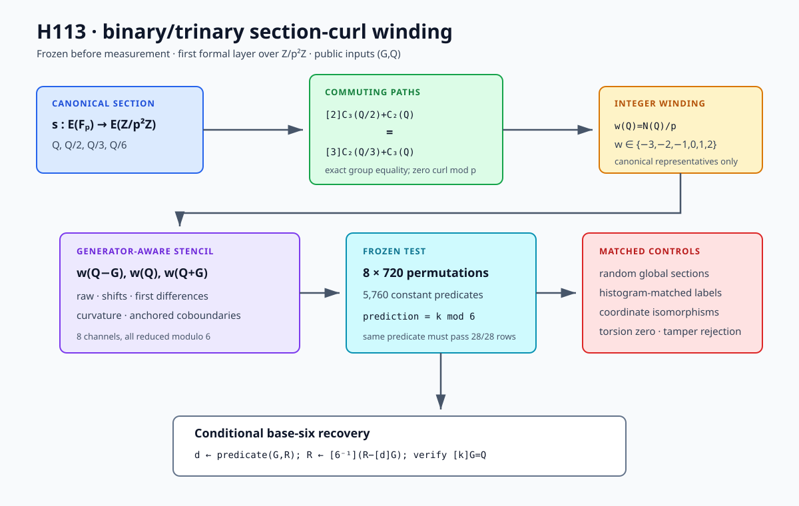

# H113 — binary/trinary section-curl winding

Freeze date: 2026-11-17.  No candidate data may be scored before this file,
`PROTOCOL.json`, `CURVES.json`, and the paired draft PRs are published.



## Question

Can the integer winding left after the two first-layer multiplication paths
`[2]∘[3]` and `[3]∘[2]` cancel modulo `p` supply the canonical base-six digit
of a scalar?  The proposed benefit is a public digit oracle using only
arithmetic over `Z/p²Z`; it does not add another `p`-adic digit.

This is a bounded experiment.  The mechanism is repository-distinct from
H110--H112.  External novelty is not established.

## Algebraic object and theorem obligation

Let `E/F_p` have prime order `r`, with `p != r` and `gcd(6,r)=1`.  Let
`s:E(F_p)->E(Z/p²Z)` be the coordinate-fixed Hensel section, with `s(O)=O`.
For `n in {2,3}` define

```text
h_n(Q)      = [n^(-1) mod r]Q,
C_n^s(Q)    = [n]s(h_n(Q)) - s(Q),
kappa_n^s(Q)= t(C_n^s(Q))/p mod p, represented in {0,...,p-1}.
```

For `h_2=Q/2`, `h_3=Q/3`, and `h_6=Q/6`, the two paths from `s(h_6)` to
`s(Q)` give the same group element:

```text
[2]C_3^s(h_2) + C_2^s(Q)
  = [6]s(h_6) - s(Q)
  = [3]C_2^s(h_3) + C_3^s(Q).
```

The first formal layer is additive, so the integer

```text
N_s(Q) = 2*kappa_3^s(h_2) + kappa_2^s(Q)
         - 3*kappa_2^s(h_3) - kappa_3^s(Q)
```

is divisible by `p`.  Since every represented `kappa` is in `[0,p-1]`, freeze

```text
w_s(Q) = N_s(Q)/p in {-3,-2,-1,0,1,2};   w_s(O)=0.
```

The run must check the lifted group equality, the formal-layer congruence,
exact divisibility, and the six-value bound independently on every evaluated
point.  Lean must formalize the commuting-path identity, the divisibility/range
lemma for canonical representatives, and the conditional base-six decoder.
Lean does not assume that a measured predicate is exact.

## Frozen generator-aware channels

For a public generator `G` and target `Q`, reduce each channel modulo six into
`{0,...,5}`:

```text
raw          = w(Q)
plus         = w(Q+G)
minus        = w(Q-G)
forward      = w(Q+G)-w(Q)
backward     = w(Q)-w(Q-G)
curvature    = w(Q+G)-2*w(Q)+w(Q-G)
anchor_plus  = w(Q+G)-w(Q)-w(G)
anchor_minus = w(Q-G)-w(Q)-w(-G)
```

The shifts are part of the candidate, not advice.  Defining `w(O)=0` includes
the two boundary targets without dropping observations.  The anchored channels
avoid H111's generator-blind formulation: the candidate may depend on both
public inputs `(G,Q)`.

## Frozen 5,760-predicate family

Enumerate all `6! = 720` permutations of `(0,1,2,3,4,5)` in lexicographic
order.  A permutation tuple `pi` maps channel value `z` to `pi[z]`.  Cross the
720 maps with the eight channels, yielding 5,760 public predicates with IDs

```text
channel:<channel-name>:perm:<pi[0]><pi[1]><pi[2]><pi[3]><pi[4]><pi[5]>.
```

The target label is `k mod 6` for `Q=[k]G`, `1 <= k < r`.  A six-entry
permutation is constant-size.  No curve-sized table, learned coefficient,
post-run feature, or scalar interpolation is allowed.  Report the complete
`6 x 6` contingency matrix and every tied best/exact predicate.  A uniform
candidate requires the same predicate ID to be exact on all 28 rows.

## Conditional recovery

If one public predicate returns `d=m mod 6` for every current point
`R=[m]G`, update

```text
R <- [6^(-1) mod r] (R - [d]G).
```

The canonical integer scalar becomes `(m-d)/6`.  Repeating for at most
`ceil(log_6 r)` digits reconstructs `m`; verify `[m]G=Q` independently.  Run
this decoder for every exact row and separately for every predicate in the
28-row exact-ID intersection.  No fallback search is permitted.

## Frozen cohort and controls

Use the seven exact prime-order ICV1 curves in `CURVES.json`.  They are not the
performance standard panel: exhaustive enumeration and direct H110--H112
comparability require the same small cohort.  Relabel each deterministic base
generator by multipliers `1,2,3,5`, giving 28 rows and 9,096 nonidentity
targets.

For every target:

1. check base-field group identities and all Hensel equations;
2. check every lifted double/triple and reduction;
3. check mixed kernel subtraction, projective equation, unit `Y`, formal
   divisibility by `p`, path equality, zero curl modulo `p`, and winding range;
4. score all 5,760 predicates from the complete contingency matrices.

Controls are frozen as follows:

- **Random sections:** on the first two ICV1 curves, eight replicates each.
  A replicate assigns one deterministic `u(P)` to every point and reuses it at
  every occurrence, preserving the section-cocycle identity.  The PRNG is
  SplitMix64 with seed construction and constants pinned in `PROTOCOL.json`.
- **Histogram-matched labels:** on the same two curves, eight deterministic
  Fisher--Yates permutations of the canonical `k mod 6` label vector.  This
  preserves the six class counts and receives the identical 5,760-way
  selection.
- **Coordinate isomorphisms:** repeat multiplier-one canonical rows on the
  first two curves after `(x,y)->(lambda²*x,lambda³*y)` with `lambda=2` and
  transformed coefficients `(lambda⁴*a,lambda⁶*b)`.
- **Prime-to-p torsion section:** solve the unique first-layer torsion lift for
  every point once.  Each binary/trinary carry and winding must be zero.
- **Path/curl positive control:** both composed paths and the formal congruence
  must agree exactly for canonical and random sections.  A deliberately
  perturbed coefficient in the independent verifier must be rejected.

Any arithmetic, identity, range, target-count, permutation-count, control,
decoder, or final EC mismatch invalidates the run.  Stopping is exhaustive.

## Determinism

The first base point is the lexicographically first affine `(x,y)` with
`x=0..p-1`, `y=1..p-1`.  Every nonidentity point generates these prime-order
groups.  SplitMix64 is exactly

```text
z = input + 0x9e3779b97f4a7c15
z = (z xor (z >> 30)) * 0xbf58476d1ce4e5b9
z = (z xor (z >> 27)) * 0x94d049bb133111eb
output = z xor (z >> 31)
```

with wrapping 64-bit multiplication.  Domain-separated seed packing is frozen
in `PROTOCOL.json`; the native producer and independent verifier must reproduce
the same section values and label shuffles.

## Accounting and artifacts

Implement the new path and its verifier in Rust.  Historical Python artifacts
may be read but are not extended.  Record:

- base-field additions, doublings, scalar multiplications, and inversions;
- `p²` Hensel lifts, lifted additions/doublings, kernel sums, formal
  extractions, and modular additions/multiplications/inversions;
- winding/channel/predicate evaluations, setup, stored elements, and advice;
- decoder digit queries, subtractions, divisions, and final EC checks;
- producer work separately from the hypothetical online cost (three winding
  evaluations per query plus the constant `w(G),w(-G)` setup).

Wall time is environmental metadata, not a speed claim.  The result PR must
contain compact raw evidence or an artifact-store manifest, a native
source-independent verifier with tamper tests, a readable report, an editable
SVG plus PNG, and an inspected PDF.  Every measured statement remains
`[pcc:unverified]` until the repository claim process supplies standing.

## Acceptance and falsification

Structural acceptance requires every check above.  The digit-oracle candidate
passes its bounded gate only if one identical predicate ID is exact on all 28
canonical rows, every opened decoder reconstructs every target, and every
scalar passes independent EC verification.  Its conditional cost would be
`O(log r)` queries with polynomial bit complexity.

No 28-row exact-ID intersection, any generator instability, overlap with
matched controls without exactness, or any decoder failure rejects this frozen
family.  That outcome does not reject other functions of section carries and
does not establish a general lower bound.

## Prior-art boundary

The checked lifting/formal-group literature covers anomalous attacks, partial
lifting, formal groups, and multiplication over finite local rings.  The
repository contains H110's full-order section defect, H111's binary halving
carry, and H112's second `p`-adic digit.  The bounded KB fallback,
cross-repository, and web searches did not locate this exact commuting-path
integer winding.  This search boundary supports only a repository-distinct
experiment, not an external novelty claim.
