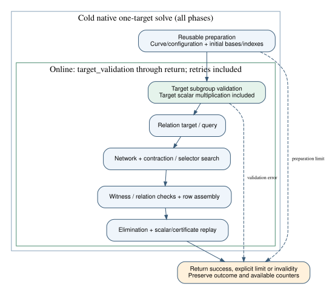

# Target-validation online boundary

This focused follow-up is paired with [crypto PR2984](https://github.com/isogeny-labs/crypto/pull/2984).
The original1325 is already merged and is not reopened. Native source/selector/
width reductions prepare initial target-independent bases/indexes before the
target subgroup check. Partial collection prepares its base policies before
the same boundary. The observer opens online at target_validation and records
the actual first phase, with later attempts/retries and replay remaining inside
online. Producer statement PCC-20261104-0f6851 stands unverified. [pcc:unverified]

Current producer commands report98 native tests, format, strict all-target
clippy and Rust1.78 all-target checks completing without failures. The shared
finite-extension file has12 controls, including a first-query-failure case that
requires the target scalar call outside reusable setup and inside online; it
also checks the exact cold/online partition. Full certificate/RNG/meter
observation-off/on controls remain. [pcc:unverified]

`original-ordering.log.gz` is the paired crypto original-source regression:
that identical boundary control fails on one scalar call left in setup.
This is a development regression, not an old/new timing comparison or an
independent signed verdict. The prior source is pinned in the crypto report;
this mirror's source and workspace manifests are in `source.sha256`.
Inherited source differences remain; only the shared correction is applied.
Preparation limits can now precede target invalidity because validation has
been deliberately deferred; a limit remains unknown. [pcc:unverified]

The inspected one-page report and editable sources are paired engineering
artifacts, with raw logs beside them. Original frozen reports/protocols and
prior receipts are unchanged. This mirror launches no scientific session and
creates no benchmark record or leaderboard result. The driver still requires
fresh source publication/S3 readback, current account/lane budget headroom
and exact native-image admission before the requested bounded study.

The first format attempt encountered missing sibling workspace manifests in
the sparse checkout. Materializing the unchanged Rust workspace fixed that
metadata failure; both attempts are retained. The original-ordering regression
failure is expected and retained. Old benchmark raw/report inputs are restored
from exact Git to run the existing gate, not modified to make it pass.
These are producer custody observations. [pcc:unverified]

Sources: pinned [Bochum reduction](https://github.com/bochum-crypto/subexponential-ecdl/tree/1ee44e562b1b9a50ea339f3b8f81112b5a24b96f),
native reduction/collector and observer code, crypto's exclusive online
measurement contract and [the review request](https://github.com/isogeny-labs/crypto/pull/2984#discussion_r4426683962).
