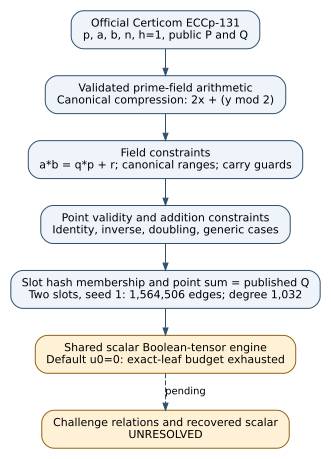

# ECCp-131 implementation and development validation — 2026-10-29

**Implemented reference; published challenge scalar unresolved.** The user's
prime-field request is the officially named Certicom ECCp-131 challenge.
The [official parameter list](https://www.certicom.com/en/curves-list) gives
131-bit p and n, cofactor one, and the public P and Q in [eccp131.json](../eccp131.json).
There is no ECCp-130 entry in that list. ECC2K-130 remains separately supported.

This is an engineering extension of the existing scalar reference, with no new
mathematical theorem, novelty claim, performance comparison or Lean proof. It
does not replace either repository's native Rust API. The original paper's
full implementation/audit requirements and both actual challenge solves remain
open in [PORT_STATUS.md](../PORT_STATUS.md).

## Construction

`eccp.py` adds canonical short-Weierstrass arithmetic, Tonelli-Shanks square
roots, compression `2*x + (y mod 2)`, inverse-hash enumeration through the
existing collector, and certificate replay through `Instance.from_dict`.
The challenge cardinality is checked by primality, nonidentity P, `[n]P=O`,
and the unique multiple of n in the Hasse interval. Small fixtures with
ambiguous Hasse multiples use exact counting, not a claimed large-field count.

`tensor_prime.py` adds the coordinate constraints:

- Field words and modular remainders satisfy `0 <= value < p`.
- Multiplication enforces the integer equality `a*b = q*p+r`, using the
  existing two-stage Fourier blocks and 2b+1-bit carry equations. The quotient
  is also canonical. Addition/subtraction use one-bit quotient equations.
- Point validity enforces `y^2=x^3+a*x+b` on finite points and canonical zero
  coordinates for infinity. Addition handles both identities, unequal-x
  addition, nonzero-y doubling, inverses and y=0 doubling separately.
- Cofactor-one membership requires a finite valid point. Other fixed,
  coprime cofactors use a constrained h-multiplication image witness, assuming
  the instance's cardinality and cofactor have been validated.
- Each factor-base slot enforces the affine hash threshold on the compressed
  point and the relation enforces the sum of its slots equals the target.

Witness hints compute assignments for tests only; compiled networks contain
arithmetic predicates and copy constraints. Tests do not prove all global
solutions are sound, establish the asymptotic degree/edge bound, or audit
every prerequisite of the external theorem. Those obligations remain open.



[Editable diagram](pipeline.dot) · [PDF report](report.pdf) · [PDF source](report.tex).
The native `docs/hashed-ecdl.svg` and its PDF describe a separate implementation
and are not changed by this companion. No isogeny, curve neighbor or graph route
is proposed; the candidate curve registry has no existing ECCp-131 match.

## Observed development checks

| Check | Observed result | Evidence |
| --- | --- | --- |
| Combined binary, scalar tensor and prime-field suite | 39 passed, no skips or failures | [raw test output](../prime-unit-tests.txt) |
| Published ECCp-131 arithmetic | 16 multiples of P/Q match independent OpenSSL, including 0, n-1, n | `test_eccp.PrimeArithmeticTests.test_openssl_published_point_multiples` |
| Prime modular constraints | All 289 input pairs over F17 pass; altered outputs and noncanonical input rejected | `test_eccp.PrimeEncodingTests` |
| Addition branches | All 361 pairs in the order-19 group; y=0 and cofactor-two controls; 131-bit P/Q cases pass | `test_eccp.PrimeEncodingTests` |
| Hash and relation constraints | Valid fixture assignment accepted; changed hash/target rejected; compiled edge count matches | `test_coordinate_relation_hash_and_wrong_target_rejection` |
| Indexed tensor fixture solve | Scalar 7 recovered for public F17 fixture; full certificate replay passes | [certificate](demo-tensor-indexed.json), [replay](verify.txt) |
| Published target graph, two slots, seed 1 | 1,564,506 edges; 654,523 variables; max degree 1,032; compiled statistics agree | [graph receipt](challenge-tensor.json) |
| Published target contraction | u_0=0, exact leaf exceeds 2,000,000-operation budget; no witness | same receipt, exit 2 |
| Published target factor-base collection | Preflight requires 157481772803551985380 candidates, exceeds 200000 limit | [failure receipt](challenge-hashed-preflight.json), exit 2 |

The fixture scalar is public target-generation input and is never supplied to
the relation finder. The producer and certificate verifier share curve
arithmetic; OpenSSL checks give an independent arithmetic comparison, not an
independent proof of the complete tensor implementation. Indexed fixtures use
explicit lists and exact leaves; they do not establish the compact coordinate
backend's claimed running time. A decomposition alone would not be a full
challenge solve: sufficiently many checked relations and scalar replay are
still required.

Reproduction from the parent directory:

```sh
python3 -m unittest -v test_ecc2k test_tensor_contraction test_tensor_encoding test_eccp
python3 eccp.py validate
python3 eccp.py demo --fixture-scalar 7 --backend tensor_indexed --output /tmp/eccp-demo.json
python3 eccp.py verify --certificate /tmp/eccp-demo.json
python3 tensor_cli.py challenge --instance eccp131 --slots 2 --max-operations 2000000 --seconds 60 --output /tmp/eccp-network.json
python3 eccp.py hashed --output /tmp/eccp-preflight.json
```

The final two commands return exit 2 under these bounds. They report work
exhaustion, not nonexistence. Raw commands, exit status, input/source hashes and
environment are recorded in [commands.json](commands.json). These receipts were
first published with the implementation, so they are retrospective development
diagnostics. Times in raw outputs are unisolated and are not performance
evidence. `CHECKPOINT_SKIP` identifies development correctness checks, not a
scientific experiment; no cloud compute, S3 experiment checkpoint, leaderboard
or speed comparison is claimed. Future experiments require the existing
checkpoint, execution, budget and validation protocols.

## Open requirements and next discriminating check

The native Rust integration, general ell>1, independent full encoding/complexity
audit and actual challenge relations/scalars remain unresolved. The concrete
observed contraction blocker is the default u_0=0 exact-leaf policy at this
graph size, not missing challenge parameters or a mathematical impossibility.
The next implementation check is to port/audit these field constraints in the
native owner, compare bounded-network counts/witnesses with independent exact
evaluation, and justify any alternate contraction policy against the pinned
theorem before claiming its bound. A budget exhaustion or faster isolated
stage would not close the solve or end-to-end performance requirements.

The initial CodeQL alert reported clear-text storage flowing from the public
demo fixture's parameter named `secret`. It is now named `fixture_scalar` to
state its actual purpose; CLI `--secret` remains a compatibility alias. Result
files additionally use unpredictable owner-only (0600) temporary files and
atomic replacement, tested under umask zero and over a pre-existing 0644 file.
This does not claim file encryption or suppress a scanner rule; hosted recheck
must determine the alert's status.

Sources: Certicom's curve list; pinned Bochum v0.2 manuscript and the external
October 25 contraction snapshots listed in [reference/SOURCES.json](../reference/SOURCES.json);
the existing native reduction in `docs/hashed-ecdl.md`; and
`crypto:problems/hashed-ecdl-tensor-backend.md`. Prior atlas review found no exact
hashed-tensor lead and the adjacent first-fall-degree entry establishes no
tensor result. This extension makes no new isogeny or solving-degree claim.
