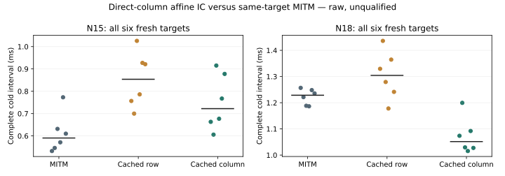
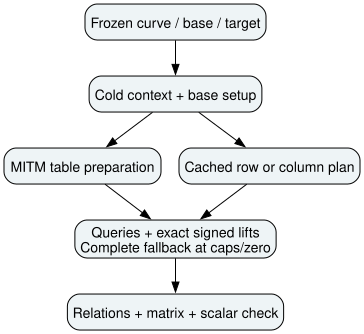

# Direct-column affine IC: fixed-input comparison, 2026-11-16

[pcc:unverified] This panel compares the exact same complete cold pipeline with MITM, cached row-affine and cached column-affine. Columns eliminate projected images with coefficient witnesses; prefix product projection uses a shift only when2d-2<n. All preparation and query costs remain in the total.

| Curve | Method | Median cold interval, ms | Median paired MITM/method |
|---|---|---:|---:|
| N15 | mitm | 0.590745 | 1.000000 |
| N15 | affine-cached | 0.853657 | 0.715281 |
| N15 | affine-columns | 0.722137 | 0.823498 |
| N18 | mitm | 1.228493 | 1.000000 |
| N18 | affine-cached | 1.304307 | 0.937103 |
| N18 | affine-columns | 1.051530 | 1.161257 |

[pcc:unverified] All twelve frozen triples and matched references completed. All36 IC and24 rho answers are checked by the existing independent Python arithmetic implementation. Cached row/column non-timing counters agree. Full registered-domain tests cover1177560 row/column and cache combinations. These are unsigned producer checks, with no signed standing.

[pcc:unverified] A/A failures retained in every summary: [(0, 129, 1.217411191167509)]. Ratios are medians of same-target paired ratios, which differ from ratios of independent medians. No sample is discarded. Qualified values remain null and the record is invalid for promotion because gVisor placement is unqualified.

[pcc:unverified] Cold wall includes fresh field/curve context, base and plan/cache setup, all successful and failed queries, signed lifts, collection, matrix operations and final verification. Counted-S and context-inclusive counted-S remain distinct from cold wall. Input materialization, calibration, process startup and replay are separate. The native timer subtracts group-add intervals that already receive operation pricing.

[pcc:unverified] Resources: one L4 allocation with CPU execution,4 requested CPUs,8GiB,900s hard allocation,780s controller,12s per process and one pinned allowed CPU. One default release binary, locked dependencies,-j2 unchanged profile, separate bounded preparation. Exact source/toolchain/binary hashes are bound in prepared-input.json and preparation receipt. All preceding negative/noisy panels remain preserved.

[pcc:unverified] The broad requested performance breakthrough remains open. Cached column-affine has raw paired cold MITM/column ratios0.823498 at N15 and1.161257 at N18; context-inclusive counted-S ratios0.668039 and1.066163. The separate opt-in batch-inversion MITM implementation passes correctness/accounting checks and awaits its own frozen complete-cost comparison. GPU throughput remains unmeasured.

Raw evidence: timing-001/{arms.jsonl,triples.json,references.json,host.json,summary.json}; analysis.json; independent-arithmetic-timing001.json; native-001/.artifacts.json. Claim trace: PCC-20261116-cf67bb (result), PCC-20261116-efccd1 (source). The existing PCC chain fork remains an integration issue; no trust chain is rewritten.
