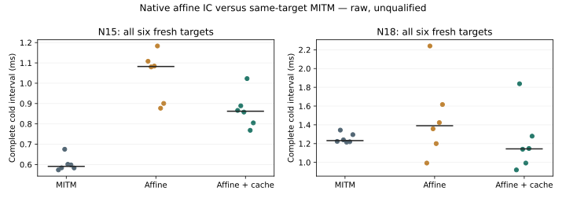
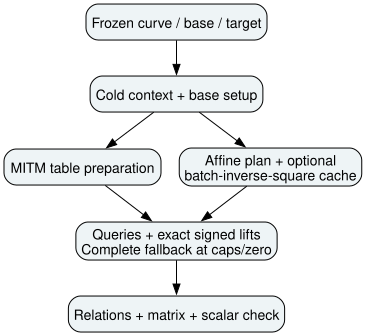

# Native affine IC: fixed-input comparison, 2026-11-16

[pcc:unverified] The complete native affine adapter and bounded inverse-square cache are implemented. Exhaustive registered-domain checks cover 588780 targets across two cache modes. Existing independent Python arithmetic replays all36 IC answers and24 same-target rho answers. This is an unsigned producer invocation; timing qualification remains absent.

[pcc:unverified] The frozen twelve triples completed without process caps. Every scalar and target matches its immutable workload. Cached and uncached affine runs preserve target, relation and rank counts. One N18 fixture117 A/A ratio is1.2339379032393336, outside0.85..1.15; it remains in every summary.

| Curve | Method | Median cold interval, ms | Median paired MITM/method |
|---|---|---:|---:|
| N15 | mitm | 0.590931 | 1.000000 |
| N15 | affine | 1.082297 | 0.581508 |
| N15 | affine-cached | 0.862128 | 0.693347 |
| N18 | mitm | 1.231793 | 1.000000 |
| N18 | affine | 1.390795 | 0.885034 |
| N18 | affine-cached | 1.143987 | 1.075203 |

[pcc:unverified] Ratios use each same-target pair before taking the median; they differ from a ratio of independent medians. The cache improves the affine path, but the full comparison remains mixed: N15 is slower than MITM; N18 has a modest raw wall gain while its context-inclusive counted-S ratio is0.986258. The requested breakthrough remains an open objective.

[pcc:unverified] Complete cold wall includes field/curve construction, base and oracle preparation, all successful and failed queries, signed lifting, collection, matrix work and verification. The counted-S model includes native query time after subtracting already-counted group-add intervals; it is a model distinct from cold wall. Input materialization, calibration and process startup remain separately recorded.

[pcc:unverified] Resources: one L4 allocation, CPU execution,4 requested CPUs,8GiB,900-second hard limit,780-second controller and12-second process caps, one pinned allowed CPU. The single release binary was prepared separately with locked dependencies, unchanged profile and-j2; source74f35317003ff99799f64b542b93a715434c5621 and hashes are bound in prepared-input.json. gVisor placement remains unqualified. Qualified values are null; the benchmark record is invalid for promotion.

The next implementation lead is to eliminate per-query row transposition and allocation in projected linear constraints, while preserving the current core as an equivalence oracle. It requires new frozen inputs and a new binary receipt before another performance comparison. GPU throughput remains a separate unmeasured path.

Claim trace: PCC-20261116-2c490e. Raw evidence: timing-001/{arms.jsonl,triples.json,references.json,host.json,summary.json}; analysis.json; independent-arithmetic-timing001.json; native-001/full-domains-001.log. The PCC ledger fork remains an integration issue; neither chain was rewritten.
