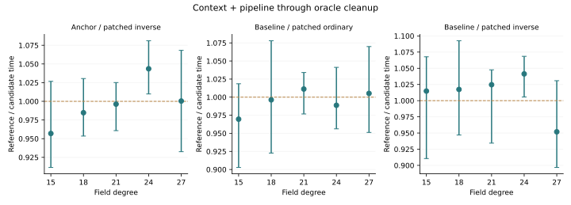
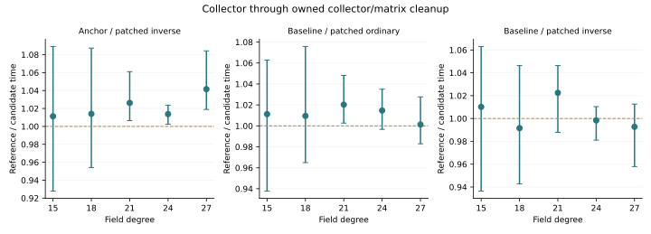

# Canonical coefficient arithmetic comparison

Specializing canonical walk coefficient addition

PCC-20261117-f39ffd; unsigned exploratory producer data, qualificationnull. Job20261117-034804-2e99. 150 same-target blocks across five registered fields,30points per field, five methods and three immutable binaries. [pcc:unverified]

Existing Python arithmetic checks 750 IC answers, 300 matched-rho answers and 300 A/A answers. It also checks 7680 exported preflight states. All 30 failed A/A controls and 0 capped IC arms are retained. [pcc:unverified]

The hot wide-remainder calls are absent in both development profiles. Thirty A/A controls fail in this native panel, so timing remains noisy and no general pipeline improvement is established. All rows and intervals are retained, including regressions and intervals containing parity. [pcc:unverified]

Primary ratios include context construction and pipeline execution through explicit oracle cleanup. Ratios above1 mean lower denominator cost. Fieldwise paired medians and10000-resample95% intervals use frozen seed20261116 and linear quantiles. An interval containing1 remains inconclusive. No cross-panel ratios are multiplied. [pcc:unverified]

The private helper replaces only the two already-reduced coefficient updates in BatchedWalker::next. For gap=m-b, a>=gap returns a-gap; otherwise a+b<m and fits u64. General addmod and initialization remain unchanged. RNG, guards/restarts, caps, operation counts, point formulas and matrix work are preserved. [pcc:unverified]

Collector effect and matched references

The millisecond columns are arithmetic means at the primary boundary; rho/IC columns are medians of paired context-plus-reference compute / patched-inverse primary time. Both rho variants use the frozen current binary, exact same Q/G/r/seed and fresh processes. Setup-reused precomputation-rho remains open. These intervals exclude process startup and later context/report destruction and do not establish a complete-process cold comparison. [pcc:unverified]

All remaining contrasts and setup cost

patched_kernel = patched ordinary / patched inverse; old_kernel = old ordinary / old inverse; patched_ordinary_vs_anchor = anchor / patched ordinary; old_ordinary_vs_anchor = anchor / old ordinary. All paired intervals and every field are retained. [pcc:unverified]

Primary interval

Collector interval

Bottom table: mean pair-table preparation milliseconds. No setup subtraction is used to create an online result. Primary includes reusable base/table work, target-dependent collection, matrix/scalar check and owned cleanup; prior input/fixture/calibration/spec/empty-oracle allocation, startup/JSON and later context/report destruction are excluded. Collector has its own owned-cleanup boundary. [pcc:unverified]

All failed A/A controls are listed on the following page and retained in analysis-fresh.json. No rows are removed from the paired intervals. [pcc:unverified]

Retained failed A/A controls

Frozen acceptance band0.85..1.15. These controls bracket each same-target block; their failures prevent qualified promotion. The underlying answers were retained and replayed. [pcc:unverified]

Instruction attribution and the focused fix

Post-timing development profiles check that BatchedWalker::next no longer calls __umodti3 for coefficient updates; other callers may retain it. The fixed-m2 general dispatcher must remain absent. These are whole-guest instruction observations, separate from native clocks. [pcc:unverified]

The candidate is compiled from the full frozen baseline source archive plus only batched_walk.rs. The16-source manifest must differ only there, and compiler/environment must match the baseline. Main added an unrelated path dependency while its suite lock was unchanged; a local locked-build refusal and two incomplete-tree layout failures are retained. No dependency/lock changes are used to fit the experiment. Controlled-source provenance is recorded separately from controller and overlay revisions. [pcc:unverified]

Preparation001 was interrupted by the producer after an incorrect CFLAGS suspicion; its partial receipt actually passed environment matching. Recovery002 retains a transcribed source-label error with an explicit erratum. Admission pins the full actual job snapshot and checks patched-file/controller bytes against its Git revision and compiled source manifest. Both raw attempts remain evidence. No raw receipt is rewritten. [pcc:unverified]

Local correctness claim PCC-20261117-2f1f1a: six batched-walk-filter tests and strict targeted Clippy, including exhaustive small-modulus/full-width/randomized reference additions and existing state/restart/cap controls. Native preparation retains175map comparisons,15loader cases, overlapping6walker2full1constant27framework3inverse tests, actual SIMD execution and2560existing-Python walk states. All invocations are unsigned; no signed performance verdict. [pcc:unverified]

Reproduction, scope and limitations

Thirty fixtures510..539 per field, ten frozen orders repeated three times. Every method occupies every position six times per field, and every ordered adjacent method pair appears six times. Patched-ordinary fixture0 brackets each block with the unchanged0.85..1.15 A/A threshold. All failures remain in analysis. No target or host selection, filtering, cap extension or resampling. [pcc:unverified]

anchor-input.json: binary 1026bf749fbf8e4a1a266d9833b89a78bf3468956aa9e91eec1af9ffb84d0027; source 25be1116c0cc56f4d7be8a0932de7c6531cdf947; preparation 20261116-152859-d0d3. [pcc:unverified]

prepared-input.json: binary 9f3228e66f36a4c20fff834ddcf98c81086dcb4c8e0e01e3c9e48b250f2b9f38; source a87e6243562955e3521923c95b4e9fe6afc6f075; preparation 20261117-020802-ae70. [pcc:unverified]

optimized-input.json: binary a3caf1b3a3cb5827ec0471b92b862fb428145d2a8ebccfaaf90c2a401ea747cb; source 330d26b987ae018f5b6e4b174ac4a1ef7ef0c355; preparation 20261117-033328-8366. [pcc:unverified]

EC1N15Crbhe4e02575ec1c; r=16319; base dimension6, columns29, base SHA256 b508c882d85c0185599a40d201413314f6a2acae7ca1c60ef4761dc8acb23922. [pcc:unverified]

EC1N18Crbhe731503070c0; r=32719; base dimension7, columns67, base SHA256 44948c2d6481dcf077b0e88777be615e1691d8c7e8f9abcf864fd3c74f76570c. [pcc:unverified]

EC1N21Crbh30df0435638d; r=1047281; base dimension8, columns127, base SHA256 6fadae0420fd81b13709f3ade6537d5386c39a19b64a072878b970f8c84c9d95. [pcc:unverified]

EC1N24Crbh1d71c3dc9cbc; r=2097533; base dimension9, columns257, base SHA256 ecb8d5f2793a2719839483c11156efb8bd9b7b952c1d19e1d5813a0a3d8dff44. [pcc:unverified]

EC1N27Crbh9ce93808c7a5; r=22367531; base dimension10, columns531, base SHA256 11506ae2cdf00b61ce8c55869410741d7bdf458cd17d02160d6ad58bd06c0d19. [pcc:unverified]

One L4CPU4/8GiB900second allocation, CPU arithmetic pinned to one allowed CPU, controller780seconds, target children12seconds, preflight30seconds, native virtual cap8GiB. Host/cgroup/affinity/GNUtime/RSS/fault receipts are retained. Physical placement and memory technology/speed/channels remain unknown. Post-timing profiling has a separate bounded interval. All raw captures and a lossless per-file SHA/URI bundle are archived before closure. [pcc:unverified]

All measurements remain exploratory/unsigned and invalid for promotion. No mathematical novelty, broader-field, GPU-throughput or asymptotic conclusion. The fields have distinct subgroup orders and bases; the plot is not an asymptotic scaling argument. Broad performance and independent-verification obligations remain open. Sources: FRESH_PROTOCOL.md, fresh_common.py, execution/analysis/replay scripts, native receipts, the original profile and the owning query implementation. [pcc:unverified]

