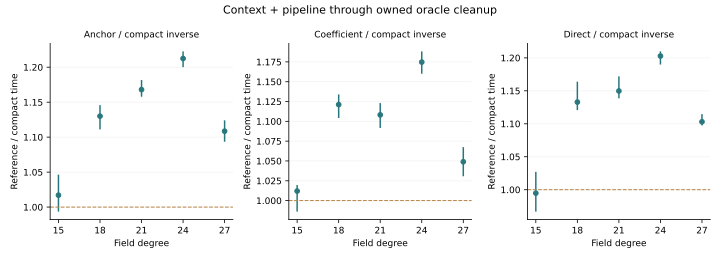
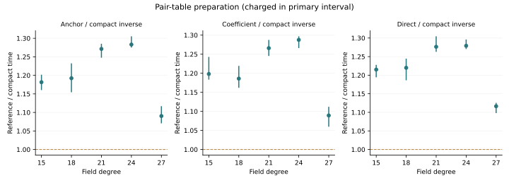
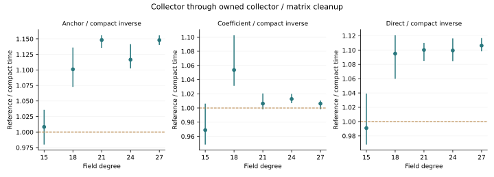

# Compact exact pair-table witnesses

Compact exact pair-table witnesses

PCC-20261117-a0a741; unsigned producer data, qualificationnull. Job20261117-045933-f4fd;210same-target blocks,42points perfield, seven methods/four immutable binaries. [pcc:unverified]

Compact storage improves table setup across all five fields. Primary storage-only gains are resolved in four fields, while N15 is inconclusive. At N27 the primary coefficient-inverse/compact-inverse ratio is 1.0490 [1.0307,1.0675] and anchor/compact-inverse is 1.1085 [1.0934,1.1240]. Fourteen failed A/A controls remain; this panel is exploratory and unqualified. [pcc:unverified]

Existing Python arithmetic replays 1470 IC, 420 same-point rho and 420 A/A answers; 10240 preflight states. All 14 failed A/A controls and 0 capped IC arms remain in the data. [pcc:unverified]

Primary ratios include context plus execution through owned oracle cleanup. Values above1 favor the denominator. Paired medians/10000-resample pointwise95% intervals use seed20261116 and linear quantiles; intervals containing1 remain inconclusive. Full-process cold and setup-reused rho costs remain open. No cross-panel ratios are multiplied. [pcc:unverified]

Legend: A=anchor ordinary; DO/DI=direct ordinary/inverse; CO/CI=coefficient ordinary/inverse; PO/PI=compact ordinary/inverse. CI/PI isolates the storage change against the coefficient source. DI/PI measures its combined effect against the direct control. All thirteen contrasts are retained in the appendices. [pcc:unverified]

Table preparation and observed process memory

Setup table shows arithmetic means in milliseconds; RSS table shows means of complete-child GNUtime peak RSS in MiB, including startup/reporting. This is not heap-allocation telemetry. Entry payload is8bytes versus16bytes, excluding control metadata, allocation rounding and other pipeline memory. No setup subtraction or amortization changes the primary interval. [pcc:unverified]

Collector and matched same-point references

Millisecond table: primary arithmetic means. Reference table: medians of paired context-plus-reference compute / compact-inverse primary cost. Rho uses direct9f, original arithmetic, exact same Q/G/r/seed and fresh processes. Setup-reused precomputation rho remains open. Ratios describe only these declared intervals and points. [pcc:unverified]

Exact representation, controls and instruction evidence

Selection checks degree1..31, at most65536points and canonical finite coordinates. Exact u32 keys and packed u16 indices preserve ordered first witnesses; wider shapes retain the original map. Out-of-range lookup keys cannot alias. Hash primitive dispatch follows the same mixing rule. Width selection is outside the per-pair flush loop; calibration probes real buckets. [pcc:unverified]

All failed controls are retained individually in analysis-fresh.json and the raw triples.json; none are filtered from these intervals. Frozen A/A band0.85..1.15; all source/routing/semantic setup/query/group/rank/row/work checks must pass. Only the two explicit physical storage counters and existing inverse-vector physical counters are excluded from count equality, with positive-use checks instead. [pcc:unverified]

Post-timing fixed-development captures preserve the original point/calibration/tool hashes and check actual compact use. Generic m2 dispatcher and hot coefficient wide-remainder calls remain absent. Whole-guest instruction totals include startup/reporting and are separate from native clocks or hardware retirement; they do not measure cache misses. [pcc:unverified]

Reproduction and claim boundaries

Fresh fixtures540..581; fourteen balanced seven-method orders repeated3. Each method position and ordered adjacent pair occurs6times perfield. One CUDA-host allocation: L4/4CPU/8GiB/900s, CPU arithmetic pinned to one allowed CPU, controller780s, child12s, preflight30s and8GiB native virtual cap. No observer subprocess runs during timing. Physical placement and memory technology/speed/channels remain unknown. No GPU arithmetic throughput is measured. [pcc:unverified]

anchor-input.json: binary 1026bf749fbf8e4a1a266d9833b89a78bf3468956aa9e91eec1af9ffb84d0027; source 25be1116c0cc56f4d7be8a0932de7c6531cdf947; preparation 20261116-152859-d0d3. [pcc:unverified]

prepared-input.json: binary 9f3228e66f36a4c20fff834ddcf98c81086dcb4c8e0e01e3c9e48b250f2b9f38; source a87e6243562955e3521923c95b4e9fe6afc6f075; preparation 20261117-020802-ae70. [pcc:unverified]

coefficient-input.json: binary a3caf1b3a3cb5827ec0471b92b862fb428145d2a8ebccfaaf90c2a401ea747cb; source 330d26b987ae018f5b6e4b174ac4a1ef7ef0c355; preparation 20261117-033328-8366. [pcc:unverified]

optimized-input.json: binary a44e5e80d1ad745d3bf373acc6c497be2c207f9d45ba02b7bd53ddbe48165103; source 2221a26dae90dbcdd703a4a5e3b155c784b908cd; preparation 20261117-043656-db46. [pcc:unverified]

EC1N15Crbhe4e02575ec1c; r=16319; base dimension6, columns29; base SHA256b508c882d85c0185599a40d201413314f6a2acae7ca1c60ef4761dc8acb23922. [pcc:unverified]

EC1N18Crbhe731503070c0; r=32719; base dimension7, columns67; base SHA25644948c2d6481dcf077b0e88777be615e1691d8c7e8f9abcf864fd3c74f76570c. [pcc:unverified]

EC1N21Crbh30df0435638d; r=1047281; base dimension8, columns127; base SHA2566fadae0420fd81b13709f3ade6537d5386c39a19b64a072878b970f8c84c9d95. [pcc:unverified]

EC1N24Crbh1d71c3dc9cbc; r=2097533; base dimension9, columns257; base SHA256ecb8d5f2793a2719839483c11156efb8bd9b7b952c1d19e1d5813a0a3d8dff44. [pcc:unverified]

EC1N27Crbh9ce93808c7a5; r=22367531; base dimension10, columns531; base SHA25611506ae2cdf00b61ce8c55869410741d7bdf458cd17d02160d6ad58bd06c0d19. [pcc:unverified]

The compact binary reconstructs the exact admitted coefficient tree, overlaying only ic_boundary.rs, batch_mitm.rs and the probe example. Compiler, environment, source root and build arguments are matched. Full source snapshot and overlay/controller bytes are admitted against the actual job Git revision. The coefficient control retains its explicit historical source-label erratum; no old receipt is rewritten. Local tests/Clippy claim022145 and native175maps/25compact/15loader/6walker2full1const27framework3inverse3compact/2560states claimf8ca33 are unsigned. [pcc:unverified]

All raw captures, per-file SHA/URI bundles, independent arithmetic outputs and failed controls are archived using the scoped crypto-autoresearcher/us-west-2/default route before record closure. Root legacy configuration and CI credential/proof checksum issues remain separate. No qualified promotion, broad-field, asymptotic or mathematical-novelty assertion. The plots describe distinct registered fields, not an asymptotic scaling result. [pcc:unverified]

All primary paired contrasts

Ratios are reference / candidate, median[95% pointwise interval]. A anchor; D direct; C coefficient; P compact; O ordinary and I SIMD inverse. All42rows perfield remain in each comparison. [pcc:unverified]

A/PI: vs_anchor; anchor-vector16-const / compact-vector16-inverse. [pcc:unverified]

CO/PO: storage_ordinary; coefficient-vector16-const / compact-vector16-const. [pcc:unverified]

CI/PI: storage_inverse; coefficient-vector16-inverse / compact-vector16-inverse. [pcc:unverified]

DO/PO: combined_ordinary; direct-vector16-const / compact-vector16-const. [pcc:unverified]

DI/PI: combined_inverse; direct-vector16-inverse / compact-vector16-inverse. [pcc:unverified]

PO/PI: compact_kernel; compact-vector16-const / compact-vector16-inverse. [pcc:unverified]

CO/CI: coefficient_kernel; coefficient-vector16-const / coefficient-vector16-inverse. [pcc:unverified]

DO/DI: direct_kernel; direct-vector16-const / direct-vector16-inverse. [pcc:unverified]

DO/CO: coefficient_vs_direct_ordinary; direct-vector16-const / coefficient-vector16-const. [pcc:unverified]

DI/CI: coefficient_vs_direct_inverse; direct-vector16-inverse / coefficient-vector16-inverse. [pcc:unverified]

A/PO: compact_ordinary_vs_anchor; anchor-vector16-const / compact-vector16-const. [pcc:unverified]

A/CO: coefficient_ordinary_vs_anchor; anchor-vector16-const / coefficient-vector16-const. [pcc:unverified]

A/DO: direct_ordinary_vs_anchor; anchor-vector16-const / direct-vector16-const. [pcc:unverified]

All collector paired contrasts

Ratios are reference / candidate, median[95% pointwise interval]. A anchor; D direct; C coefficient; P compact; O ordinary and I SIMD inverse. All42rows perfield remain in each comparison. [pcc:unverified]

A/PI: vs_anchor; anchor-vector16-const / compact-vector16-inverse. [pcc:unverified]

CO/PO: storage_ordinary; coefficient-vector16-const / compact-vector16-const. [pcc:unverified]

CI/PI: storage_inverse; coefficient-vector16-inverse / compact-vector16-inverse. [pcc:unverified]

DO/PO: combined_ordinary; direct-vector16-const / compact-vector16-const. [pcc:unverified]

DI/PI: combined_inverse; direct-vector16-inverse / compact-vector16-inverse. [pcc:unverified]

PO/PI: compact_kernel; compact-vector16-const / compact-vector16-inverse. [pcc:unverified]

CO/CI: coefficient_kernel; coefficient-vector16-const / coefficient-vector16-inverse. [pcc:unverified]

DO/DI: direct_kernel; direct-vector16-const / direct-vector16-inverse. [pcc:unverified]

DO/CO: coefficient_vs_direct_ordinary; direct-vector16-const / coefficient-vector16-const. [pcc:unverified]

DI/CI: coefficient_vs_direct_inverse; direct-vector16-inverse / coefficient-vector16-inverse. [pcc:unverified]

A/PO: compact_ordinary_vs_anchor; anchor-vector16-const / compact-vector16-const. [pcc:unverified]

A/CO: coefficient_ordinary_vs_anchor; anchor-vector16-const / coefficient-vector16-const. [pcc:unverified]

A/DO: direct_ordinary_vs_anchor; anchor-vector16-const / direct-vector16-const. [pcc:unverified]

All table-setup paired contrasts

Ratios are reference / candidate, median[95% pointwise interval]. A anchor; D direct; C coefficient; P compact; O ordinary and I SIMD inverse. All42rows perfield remain in each comparison. [pcc:unverified]

A/PI: vs_anchor; anchor-vector16-const / compact-vector16-inverse. [pcc:unverified]

CO/PO: storage_ordinary; coefficient-vector16-const / compact-vector16-const. [pcc:unverified]

CI/PI: storage_inverse; coefficient-vector16-inverse / compact-vector16-inverse. [pcc:unverified]

DO/PO: combined_ordinary; direct-vector16-const / compact-vector16-const. [pcc:unverified]

DI/PI: combined_inverse; direct-vector16-inverse / compact-vector16-inverse. [pcc:unverified]

PO/PI: compact_kernel; compact-vector16-const / compact-vector16-inverse. [pcc:unverified]

CO/CI: coefficient_kernel; coefficient-vector16-const / coefficient-vector16-inverse. [pcc:unverified]

DO/DI: direct_kernel; direct-vector16-const / direct-vector16-inverse. [pcc:unverified]

DO/CO: coefficient_vs_direct_ordinary; direct-vector16-const / coefficient-vector16-const. [pcc:unverified]

DI/CI: coefficient_vs_direct_inverse; direct-vector16-inverse / coefficient-vector16-inverse. [pcc:unverified]

A/PO: compact_ordinary_vs_anchor; anchor-vector16-const / compact-vector16-const. [pcc:unverified]

A/CO: coefficient_ordinary_vs_anchor; anchor-vector16-const / coefficient-vector16-const. [pcc:unverified]

A/DO: direct_ordinary_vs_anchor; anchor-vector16-const / direct-vector16-const. [pcc:unverified]

