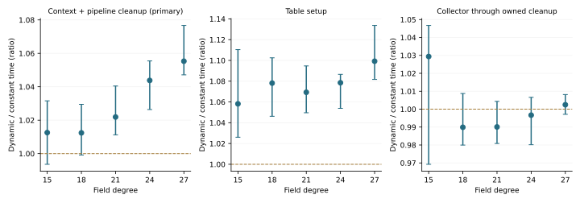
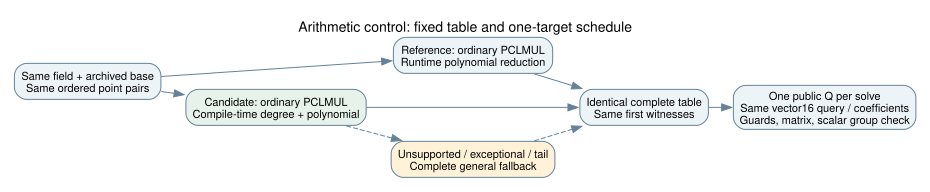

# Constant-polynomial SIMD reduction in index calculus

[pcc:unverified] PCC-20261116-f2254c; unsigned exploratory controls and analysis, qualificationnull.

Job 20261116-154152-55b7; 120 paired targets, 240 IC and 240 rho producer invocations of existing independent Python scalar arithmetic. Analysis status pass. Native binary 1026bf749fbf8e4a1a266d9833b89a78bf3468956aa9e91eec1af9ffb84d0027, prepared source 25be1116c0cc56f4d7be8a0932de7c6531cdf947. [pcc:unverified]

Exact same archived base, table first witnesses, ordinary-PCLMUL table backend and vector16 query law. The candidate specializes degree and polynomial at compile time; the control retains runtime reduction. Ratio above1 means lower candidate time. Per-field medians and paired10000-resample95% intervals, seed20261116 and linear quantiles. All attempted rows and failed controls remain. [pcc:unverified]

What the comparison includes [pcc:unverified]

Primary: context construction plus run_pipeline through explicit oracle destruction, including reusable base/table preparation, target-dependent collector/matrix/scalar group check and owned cleanup. Prior spec/empty-oracle allocation, inputs/fixture, calibration, startup, JSON and later context/report destruction are excluded. This is not complete-process cold time. Collector and table setup diagnostics are separate; no subtractive repricing or cross-study ratio multiplication. [pcc:unverified]

The millisecond table reports arithmetic means; ratio rows are paired medians. Native [d]G=Q is inside compute; fixture scalar equality is outside as a harness input control. Existing Python replay is outside native intervals with its own elapsed and CPU receipt. Plain and negation rho use the same Q/G/subgroup/seed in separate fresh processes; context-plus-reference compute is compared with the primary setup-included interval. These are supplementary scoped ratios, not a complete cold or reused-precomputation-rho conclusion. [pcc:unverified]

Controls, reproducibility and remaining work [pcc:unverified]

Failed A/A controls 8; capped IC arms 0. A/A brackets ordinary-narrow fixture0, threshold0.85..1.15. No filtering, host selection, cap extension or target tuning. Both arms retain exact query/row/rank/work/semantic-operation checks and actual vector/preparation counters. [pcc:unverified]

Source/protocol25be1116c published before fixtures432..455. Exact candidates/workloads live in identities.json and ic-bench manifests. Prepared bindings and exact source-job metadata precede timing. First kernel preparation150833-4f87 and its binary51a949de are retained separately; the comparison-interface amendment has its own build002/bindings. Earlier2pass1stale validation-test failure remains; its corrected supported3/4 and rejected5 tests are recorded with the source. [pcc:unverified]

One L4CPU4/8GiB900s allocation; CPU arithmetic, one allowed CPU pinned, controller780s, child12s/preflight30s,8GiB virtual cap. Host/cgroup/affinity/GNU wall/CPU/RSS/fault receipts remain distinct from unknown physical placement, memory technology/speed/channels and unavailable hardware counters. No observer subprocess during target timing. [pcc:unverified]

Evidence: PROTOCOL.md, NATIVE_AMENDMENT.md, run_prepared.py, analyze.py, scalar and preflight-state replays, immutable raw outputs and lossless SHA/URI bundle. Raw upload completes before benchmark-record closure. All numbers remain unsigned and invalid for promotion; PCC custody fork is retained without rewrite or waiver. No default, mathematical, GPU-throughput or larger-field conclusion. Broad optimization remains active. [pcc:unverified]

Next: inspect measured setup-inclusive and collector intervals separately, retain null/negative fields, then use instruction attribution to select the next isolated kernel. Batch-inverse products are a separately scoped followup. Sources: owning koblitz_fast.rs, ic_boundary.rs and ic_framework/batch_mitm.rs; preceding vector-query instruction report; KB/atlas receipts in DEVELOPMENT.md. Canonical curve catalog and volcano/isogeny-route graph sources have no changed mathematical facts. [pcc:unverified]

| Field | Primary dynamic / constant | Table setup | Collector | A/A failures |
|---|---:|---:|---:|---:|
| N15 | 1.0126 [0.9936, 1.0316] | 1.0582 [1.0261, 1.1104] | 1.0294 [0.9692, 1.0467] | 5 |
| N18 | 1.0124 [0.9992, 1.0295] | 1.0781 [1.0462, 1.1025] | 0.9899 [0.9799, 1.0088] | 2 |
| N21 | 1.0219 [1.0112, 1.0405] | 1.0693 [1.0496, 1.0947] | 0.9901 [0.9809, 1.0043] | 0 |
| N24 | 1.0438 [1.0264, 1.0555] | 1.0785 [1.0538, 1.0866] | 0.9967 [0.9802, 1.0066] | 0 |
| N27 | 1.0553 [1.0471, 1.0767] | 1.0992 [1.0817, 1.1337] | 1.0025 [0.9971, 1.0082] | 1 |

## Exact curve and base scope

EC1N15Crbhe4e02575ec1c; r=16319; dimension=6; columns=29; base SHA256=b508c882d85c0185599a40d201413314f6a2acae7ca1c60ef4761dc8acb23922 [pcc:unverified]

EC1N18Crbhe731503070c0; r=32719; dimension=7; columns=67; base SHA256=44948c2d6481dcf077b0e88777be615e1691d8c7e8f9abcf864fd3c74f76570c [pcc:unverified]

EC1N21Crbh30df0435638d; r=1047281; dimension=8; columns=127; base SHA256=6fadae0420fd81b13709f3ade6537d5386c39a19b64a072878b970f8c84c9d95 [pcc:unverified]

EC1N24Crbh1d71c3dc9cbc; r=2097533; dimension=9; columns=257; base SHA256=ecb8d5f2793a2719839483c11156efb8bd9b7b952c1d19e1d5813a0a3d8dff44 [pcc:unverified]

EC1N27Crbh9ce93808c7a5; r=22367531; dimension=10; columns=531; base SHA256=11506ae2cdf00b61ce8c55869410741d7bdf458cd17d02160d6ad58bd06c0d19 [pcc:unverified]

