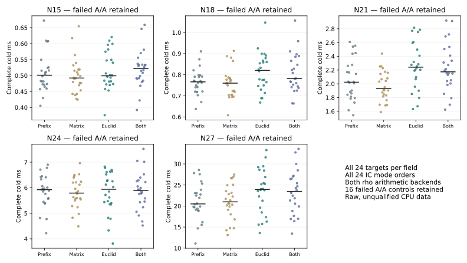
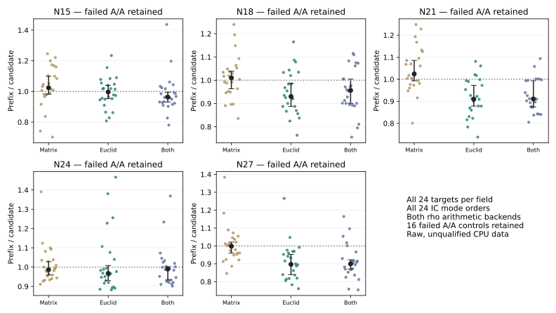

# Inverse and matrix arithmetic: 2026-11-16

[pcc:unverified] All 120 frozen four-way comparisons completed. Existing independent Python arithmetic replays 480 IC answers and 480 fresh-process rho answers. Exact input/candidate manifests, inverse/matrix routing, positive shared calibration, scalar answers and query/matrix counts pass unsigned producer checks.

| Field | Prefix median ms | Matrix paired ratio | Euclid paired ratio | Both paired ratio |
|---|---:|---:|---:|---:|
| N15 | 0.501017 | 1.023775 | 0.996063 | 0.963321 |
| N18 | 0.766064 | 1.009969 | 0.930056 | 0.956377 |
| N21 | 2.023310 | 1.023896 | 0.909980 | 0.910585 |
| N24 | 5.924100 | 0.986767 | 0.967458 | 0.989959 |
| N27 | 20.503788 | 0.998481 | 0.897440 | 0.899869 |

[pcc:unverified] N15 prefix/combined paired median 0.963321; frozen exploratory 95% bootstrap interval [0.931227, 0.994403].
[pcc:unverified] N18 prefix/combined paired median 0.956377; frozen exploratory 95% bootstrap interval [0.900667, 1.004703].
[pcc:unverified] N21 prefix/combined paired median 0.910585; frozen exploratory 95% bootstrap interval [0.874876, 0.993508].
[pcc:unverified] N24 prefix/combined paired median 0.989959; frozen exploratory 95% bootstrap interval [0.933328, 1.002631].
[pcc:unverified] N27 prefix/combined paired median 0.899869; frozen exploratory 95% bootstrap interval [0.870317, 0.922263].

[pcc:unverified] 104 of 120 pre/post A/A controls pass the frozen 0.85–1.15 bound with correct answers and unchanged calibration. Failed controls: [{"field": 27, "fixture": 258, "ratio": 1.1626834592477169}, {"field": 18, "fixture": 263, "ratio": 1.172167821202622}, {"field": 15, "fixture": 265, "ratio": 0.6927367977358945}, {"field": 18, "fixture": 265, "ratio": 1.2393484049253332}, {"field": 15, "fixture": 266, "ratio": 1.1536808425909397}, {"field": 15, "fixture": 269, "ratio": 0.7983242713521835}, {"field": 21, "fixture": 269, "ratio": 0.8484673571394362}, {"field": 24, "fixture": 269, "ratio": 0.7109167908184857}, {"field": 18, "fixture": 271, "ratio": 1.1923452067205285}, {"field": 15, "fixture": 273, "ratio": 1.2226759819083293}, {"field": 18, "fixture": 273, "ratio": 0.721370639324671}, {"field": 27, "fixture": 273, "ratio": 1.174016166760837}, {"field": 15, "fixture": 275, "ratio": 1.4367817487434396}, {"field": 15, "fixture": 278, "ratio": 1.3091319911090358}, {"field": 18, "fixture": 278, "ratio": 0.6626982518984366}, {"field": 24, "fixture": 278, "ratio": 1.4066498908894511}]. No rows, outliers or controls are removed; zero process caps. Ratios are paired before taking medians. Every raw comparison is exploratory and qualified null; none is promoted.

[pcc:unverified] Requested one L4, 4 CPUs, 8 GiB, 900 seconds; CPU execution only, one pinned exposed CPU, controller 780 seconds, child cap 12 seconds. Exposed cgroup CPU quota/period: 2000000/100000; memory limit: 351119147008 bytes. Requested allocation and physical placement remain unqualified; unavailable throttle/OOM counters and physical memory technology/speed/channels remain unknown. Child RLIMIT_AS is 8 GiB; GNU-time RSS/CPU/fault receipts retained. Record invalid for promotion.

[pcc:unverified] Every IC arm uses the same prefix-cached table strategy. Cold wall includes context, base/table/cache construction and cleanup, all queries, matrix work and final scalar verification. Public materialization, calibration/unit loading, process startup and independent replay remain separate. Original shared positive units are reused across both arithmetic backends; no candidate-specific repricing. The remaining phase model is primitive pricing, not instruction counts; unchanged operation counts do not price a faster arithmetic implementation by themselves.

[pcc:unverified] Plain and negation rho execute in four separate fresh processes per target, with both original and Euclidean arithmetic. Their order and placement alternate by fixture parity. Each IC arm is compared with its own inverse backend, and all reference outputs remain visible. Wall gaps below are median per-target IC/matched-negation-rho ratios.

| Field | Prefix/original rho | Both/Euclidean rho |
|---|---:|---:|
| N15 | 2.8756 | 2.9207 |
| N18 | 3.8684 | 4.0496 |
| N21 | 5.7810 | 5.2590 |
| N24 | 13.4328 | 10.9313 |
| N27 | 20.8016 | 20.0844 |

[pcc:unverified] Exact source 087951940e20f98e14ecfdba353d90b72d733e43; default release, locked-j2; binary 65d226f6470deec68667ab0440fa6af3901982e18f4f8b934292a5678b3d7399. Native preparation passes 90 complete first-witness-map comparisons, five direct cross-backend full-map comparisons and 15 unit-loader controls. Euclidean inversion is opt-in for canonical fields up to 32 bits; original defaults and larger-field fallback remain. Reciprocal matrix arithmetic is separately controlled.

[pcc:unverified] These are engineering measurements on fixed registered N15/18/21/24/27 curves, with 29/67/127/257/531 sign columns. They do not establish cryptographic-size performance, GPU throughput, asymptotic novelty, Tier1 admission or completion of the broad goal. Known unsigned status and ledger custody fork remain unchanged. Earlier negative/noisy results and model limitations are preserved.

Evidence: analysis.json, independent-arithmetic-timing001.json and lossless raw-timing-001.tar.gz with per-file SHA/URI inventory. Split raw outputs are also archived individually. Source claim aa38d3 and native preparation claim a6175d are unsigned statements.

