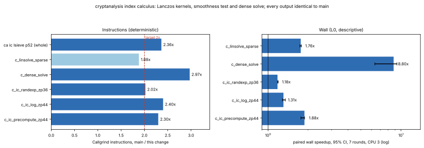

# Index calculus in (Z/pZ)^*: half the instructions

**Date.** 2026-11-03. **Status.** Measured. Instruction counts are
Callgrind's (deterministic). Wall time is descriptive: a shared 4-vCPU
cloud VM (Intel Xeon @ 2.10 GHz, no hardware counters), CPU 3 pinned;
**L0 / "shared host" in this repository's tiers, not Tier 0 or Tier 1.**
**Class.** Engineering: every computation is exact and returns the values
`main` returns (identical perfindex fingerprints on all six index-calculus
kernels, identical `ca ic` output). Relation counts, Lanczos iteration
counts and logarithms are unchanged.
**Target.** Halve the Callgrind instructions of the index-calculus code
(`src/indexcalc.c`, `src/linalg.c`).



## Where the instructions went

Callgrind on `main` fbabd9df6:

- **The precompute kernel (`c_ic_precompute_zp44`).** 97% of it is the
  linear solve.
  - `spmv` and `spmtv` take 68% between them. Every nonzero costs a signed
    128-bit multiply-add, `spmtv` scatters into 128-bit column accumulators
    after a `memset`, and every row and column ends in a `__umodti3` call.
  - The rest is `vdot`, which also calls `__umodti3` every four terms,
    and the vector updates.
- **The log and random-exponent kernels.** 70–85% of them is
  `trial_factor`. That is about 12 instructions for each factor-base prime
  that does not divide, half of them the `q*q > v` stop test.

## What changed

`src/linalg.c`, the Lanczos kernels (`lz_*`):

- **A^T in CSR, built once per Lanczos call.** `A^T w` becomes a row
  gather like `A v`, with no scatter and no `memset`.
- **64-bit gathers when they cannot overflow.** The condition is checked
  once per matrix: `K (2q − 1) < 2^64`, where `K` is the largest row or
  column sum of `|val|`.
  - Each term is one 64-bit multiply-add.
  - Adding `K q` makes a row sum nonnegative and keeps it below 2^64.
  - One Shoup product then reduces the sum and applies the diagonal `D_i`.
    Without `D` it is a product by 1, a remainder with no division.
- **128-bit gathers for larger moduli.** These need rows shorter than
  2^31.
  - Each term is a single signed 64×64→128 `imul` (every `v < q < 2^63`).
  - Loops are unrolled by four, with a straight-line remainder.
  - The biased sum gets one Montgomery reduction (`u·2^-64 mod q`). The
    following Shoup product by `2^64 D_i mod q` (or `2^64 mod q`) puts back
    the `2^64`.
- **The three dot products of a step in one pass (`vdot3`).** Each is
  summed in 128 bits for as many terms as cannot overflow (all of them
  below 2^48), with division-free reductions.
- **`x` and `w_{next}` updated in one pass.**
- **Moduli of 2^63 and above** keep the previous kernels.

`src/linalg.c`, `ca_dense_solve_mod_prime`:

- **Crout's order of the same elimination** (below 2^63).
  - Each echelon entry is `a(i,c) − Σ_{k<c} l(i,k) u(k,c)`: one 128-bit
    dot product and one reduction, instead of `c` Shoup
    multiply-subtracts.
  - The pivot is the first nonzero row of the formed column, the row the
    row-operation form picks, so the same pivots and the same singularity
    decisions.
  - `U` is mirrored transposed so that every dot product reads contiguous
    words.
  - Back substitution is a dot product too.
- **Moduli of 2^63 and above** use forward elimination with back
  substitution, two thirds of the Gauss–Jordan products.
- Only `x` is part of the contract; `M` and `rhs` are overwritten.

`src/indexcalc.c`, `trial_factor`:

- **The stop bound as an index.** `stop` is the first prime with
  `q^2 > v`. It is found by binary search, and searched again only when a
  division shrinks `v`; it usually does not move, which one comparison
  shows.
- **The scan four primes at a time,** with one branch for the four
  exact-division tests. The scalar loop then locates a hit.
- **The output is the same:** the same exponent columns in the same order,
  the same prime-remainder lookup, the same return value.

## Identical outputs

- **perfindex fingerprints:** identical on every kernel, including all six
  index-calculus kernels. Those are linear-sieve precompute at 44 and
  52 bits, random-exponent precompute at 36 bits, 48 individual logs, the
  61-bit sparse solve and the dense solve. Gate valid.
- **`ca ic --method lsieve`:** identical output against `main`'s binary on
  `p = 4503599627372423` (52-bit safe prime, `g = 5`) for `x =
  1234567890123, 99999999999, 2222222222222, 7`. The fields compared are
  `status`, `x`, `check`, `factor_base` 510, `unknowns` 4611, `relations`
  4921, `verified_logs` 510 and `lanczos_iterations` 1882.
- **`ca ic --method rexp`** has no seed option and varies between runs of
  `main` itself, so its identity check is the seeded perfbench kernel.
- **Tests:** `ctest` 19/19. Existing tests in `tests/test_linalg.c` cover
  every new path:
  - the dense solve below 2^63 (Crout) and at the largest primes below
    2^63 and 2^64;
  - sparse systems at `q ≈ 2^32` (64-bit gather), `q ≈ 2^60` (128-bit
    gather) and `q ≈ 2^64` (previous kernels).
- **Sanitizers and analyzers:** ASan+UBSan 19/19, TSan on the IC and
  linear-algebra tests, clang-tidy, gcc `-fanalyzer`, clang-format.

## Instructions (Callgrind Ir, perfindex `instr`)

| kernel | `main` fbabd9df6 | this change | ratio |
|:--|--:|--:|--:|
| `relation/c_ic_precompute_zp44` | 428,257,845 | 186,517,609 | **2.30×** |
| `relation/c_ic_log_zp44` | 52,139,182 | 21,721,434 | **2.40×** |
| `relation/c_ic_randexp_zp36` | 53,065,586 | 26,271,981 | **2.02×** |
| `relation/c_dense_solve` | 40,035,301 | 13,477,809 | **2.97×** |
| `relation/c_linsolve_sparse` (61-bit q) | 205,043,666 | 109,008,366 | 1.88× |
| `relation/c_ic_precompute_zp52` (`--full`, whole run) | 4,944,223,933 | 2,094,670,815 | **2.36×** |
| `ca ic --method lsieve`, 52-bit `p`, whole process | 3,041,121,260 | 1,286,816,943 | **2.36×** |
| every `dlp` and `field_ec` kernel | — | — | 1.000 |

`c_linsolve_sparse` falls short of 2×. Its modulus is 61 bits, so it takes
the 128-bit gather. That gather is now five instructions a term (load
column, load value, `imul`, `add`, `adc`), and the multiply-adds are about
half of what is left. Index calculus as `ca ic` runs it uses the large
prime of `p − 1`, so below 64-bit `p` it takes the 64-bit gather. This is
the 2.30× and 2.36× above.

## Wall time (descriptive, L0)

`perfindex.py compare --filter relation --rounds 7 --threads 1 --taskset 3`
([`data/perfindex-compare-relation.md`](data/perfindex-compare-relation.md)):

| kernel | `main` | this change | speedup (95% CI) |
|:--|--:|--:|--:|
| `c_ic_precompute_zp44` | 32.61 ms | 17.41 ms | 1.878× (1.766–1.883) |
| `c_ic_log_zp44` | 2.77 ms | 2.14 ms | 1.306× (1.282–1.349) |
| `c_ic_randexp_zp36` | 3.38 ms | 2.86 ms | 1.178× (1.177–1.193) |
| `c_dense_solve` | 11.01 ms | 1.25 ms | 8.800× (6.355–9.314) |
| `c_linsolve_sparse` | 16.92 ms | 9.62 ms | 1.761× (1.736–1.781) |

Area index 2.139×, gate valid.

- **Dense solve:** the Gauss–Jordan inner loop was a chain of dependent
  Shoup products. The Crout dot products are independent multiply-adds.
- **Smoothness kernels:** they gain less in wall time than in
  instructions. The exact-division tests were already cheap, and their
  branches are what remains.

A division-free reduction costs about five instructions where a hardware
`div` costs one. On this Xeon it was nevertheless 1.46× faster in wall
time on the sparse solve (a measured intermediate, `c6` against `c7`), so
the kernels reduce without dividing, and the instruction cost of doing so
is in the counts above.

## Reproduce

```sh
cmake --build build -j4 && ctest --test-dir build
python3 scripts/perf/perfindex.py build --c --ref origin/main --out /tmp/ci-base
python3 scripts/perf/perfindex.py build --c --current --out /tmp/ci-cand
python3 scripts/perf/perfindex.py instr --base /tmp/ci-base/ca_perfbench --cand /tmp/ci-cand/ca_perfbench --out /tmp/ci-ir
python3 scripts/perf/perfindex.py compare --base /tmp/ci-base/ca_perfbench --cand /tmp/ci-cand/ca_perfbench --out /tmp/ci-cmp --filter relation --rounds 7 --threads 1 --taskset 3
valgrind --tool=callgrind --callgrind-out-file=/dev/null build/ca ic --p 4503599627372423 --g 5 --h 3905665969129385 --threads 1
/tmp/report-venv/bin/python experiments/ic-halve-20261103/plot.py
```

## Next

The sparse solve's per-term cost is at its floor for scalar x86-64, so the
next gain there is algorithmic. A filtering stage before Lanczos would
merge doubleton columns and drop excess rows. That changes the matrix,
the random diagonal and the iteration count, so it needs its own protocol.
