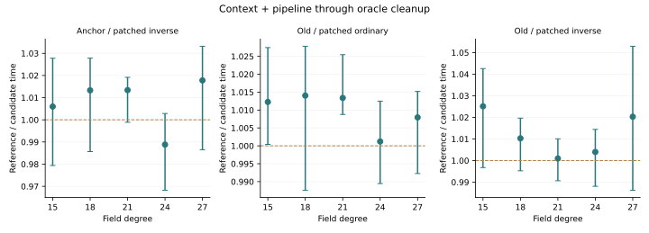
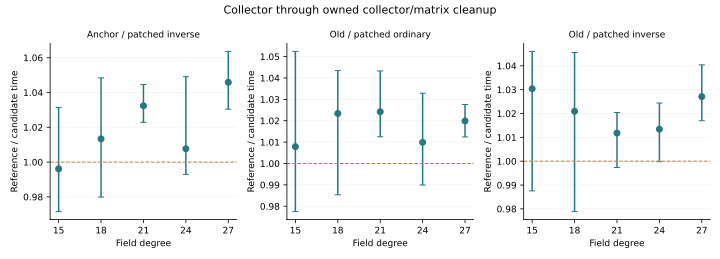

# Fixed-two-summand direct-probe comparison

Restoring the fixed-two-summand query path

PCC-20261117-2f6f5a; unsigned exploratory producer data, qualificationnull. Job20261117-023925-950e. 150 same-target blocks across five registered fields,30points per field, five methods and three immutable binaries. [pcc:unverified]

Existing Python arithmetic checks 750 IC answers, 300 matched-rho answers and 300 A/A answers. It also checks 7680 exported preflight states. All 3 failed A/A controls and 0 capped IC arms are retained. [pcc:unverified]

Primary ratios include context construction and pipeline execution through explicit oracle cleanup. Ratios above1 mean lower denominator cost. Fieldwise paired medians and10000-resample95% intervals use frozen seed20261116 and linear quantiles. An interval containing1 remains inconclusive. No cross-panel ratios are multiplied. [pcc:unverified]

The source change replaces the fixed-two-summand oracle call through the general m=2/m=3 dispatcher with the same PairTable.probe and two-index witness allocation. Table preparation, arithmetic, state schedule, guards, caps, counters, matrix work and scalar group check are preserved. [pcc:unverified]

Collector effect and matched references

The millisecond columns are arithmetic means at the primary boundary; rho/IC columns are medians of paired context-plus-reference compute / patched-inverse primary time. Both rho variants use the frozen current binary, exact same Q/G/r/seed and fresh processes. Setup-reused precomputation-rho remains open. These intervals exclude process startup and later context/report destruction and do not establish a complete-process cold comparison. [pcc:unverified]

All remaining contrasts and setup cost

patched_kernel = patched ordinary / patched inverse; old_kernel = old ordinary / old inverse; patched_ordinary_vs_anchor = anchor / patched ordinary; old_ordinary_vs_anchor = anchor / old ordinary. All paired intervals and every field are retained. [pcc:unverified]

Primary interval

Collector interval

Bottom table: mean pair-table preparation milliseconds. No setup subtraction is used to create an online result. Primary includes reusable base/table work, target-dependent collection, matrix/scalar check and owned cleanup; prior input/fixture/calibration/spec/empty-oracle allocation, startup/JSON and later context/report destruction are excluded. Collector has its own owned-cleanup boundary. [pcc:unverified]

A/A failures: [{"index":1,"fixture":487,"ratio":0.46766886554967263},{"index":1,"fixture":497,"ratio":1.1589405214035844},{"index":0,"fixture":499,"ratio":0.8400519533377625}] [pcc:unverified]

Instruction attribution and the focused fix

The earlier frozen profile showed55,163 additional generic-dispatch calls in current/inverse paths,1,933,760 exclusive Ir absent from the anchor, while probe work was unchanged. The patched development captures test removal of that call layer. This is supplementary whole-guest instruction attribution, not native wall time, hardware retirement or the collector-only clock. [pcc:unverified]

Post-timing profiles run only after every native row and A/A control finishes, on the original development point and fixed calibration. Compiler/environment match the frozen current receipt. The16-source manifest differs in exactly batch_mitm.rs. Binary/receipt/job/source hashes, actual CLI routing, public input identity and semantic query/rank/row/work counts are audited across all methods; only physical inverse-vector counters are excluded from count equality and are checked separately. [pcc:unverified]

Original attribution claimPCC-20261117-1bc12f; local27framework tests/strict Clippy claim86dbb3; native175maps/15loader/overlapping5walker2full1constant27framework3inverse filters and2560Python states claima1d56d. These are unsigned producer invocations, without a trusted signed execution/performance verdict. [pcc:unverified]

Reproduction, scope and limitations

Thirty fixtures480..509 per field, ten frozen orders repeated three times. Every method occupies every position six times per field, and every ordered adjacent method pair appears six times. Patched-ordinary fixture0 brackets each block with the unchanged0.85..1.15 A/A threshold. All failures remain in analysis. No target or host selection, filtering, cap extension or resampling. [pcc:unverified]

anchor-input.json: binary 1026bf749fbf8e4a1a266d9833b89a78bf3468956aa9e91eec1af9ffb84d0027; source 25be1116c0cc56f4d7be8a0932de7c6531cdf947; preparation 20261116-152859-d0d3. [pcc:unverified]

prepared-input.json: binary c808153b43186cf6012eee823b1784150105c6c95db6cfbaa54c66b3058f65a8; source cff665a3ed3206b991963a01df1efb2f5d17b5ee; preparation 20261116-162931-e755. [pcc:unverified]

optimized-input.json: binary 9f3228e66f36a4c20fff834ddcf98c81086dcb4c8e0e01e3c9e48b250f2b9f38; source a87e6243562955e3521923c95b4e9fe6afc6f075; preparation 20261117-020802-ae70. [pcc:unverified]

EC1N15Crbhe4e02575ec1c; r=16319; base dimension6, columns29, base SHA256 b508c882d85c0185599a40d201413314f6a2acae7ca1c60ef4761dc8acb23922. [pcc:unverified]

EC1N18Crbhe731503070c0; r=32719; base dimension7, columns67, base SHA256 44948c2d6481dcf077b0e88777be615e1691d8c7e8f9abcf864fd3c74f76570c. [pcc:unverified]

EC1N21Crbh30df0435638d; r=1047281; base dimension8, columns127, base SHA256 6fadae0420fd81b13709f3ade6537d5386c39a19b64a072878b970f8c84c9d95. [pcc:unverified]

EC1N24Crbh1d71c3dc9cbc; r=2097533; base dimension9, columns257, base SHA256 ecb8d5f2793a2719839483c11156efb8bd9b7b952c1d19e1d5813a0a3d8dff44. [pcc:unverified]

EC1N27Crbh9ce93808c7a5; r=22367531; base dimension10, columns531, base SHA256 11506ae2cdf00b61ce8c55869410741d7bdf458cd17d02160d6ad58bd06c0d19. [pcc:unverified]

One L4CPU4/8GiB900second allocation, CPU arithmetic pinned to one allowed CPU, controller780seconds, target children12seconds, preflight30seconds, native virtual cap8GiB. Host/cgroup/affinity/GNUtime/RSS/fault receipts are retained. Physical placement and memory technology/speed/channels remain unknown. Post-timing profiling has a separate bounded interval. All raw captures and a lossless per-file SHA/URI bundle are archived before closure. [pcc:unverified]

All measurements remain exploratory/unsigned and invalid for promotion. No mathematical novelty, broader-field, GPU-throughput or asymptotic conclusion. The fields have distinct subgroup orders and bases; the plot is not an asymptotic scaling argument. Broad performance and independent-verification obligations remain open. Sources: FRESH_PROTOCOL.md, fresh_common.py, execution/analysis/replay scripts, native receipts, the original profile and the owning query implementation. [pcc:unverified]

