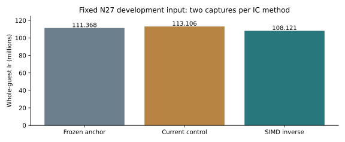
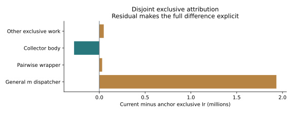
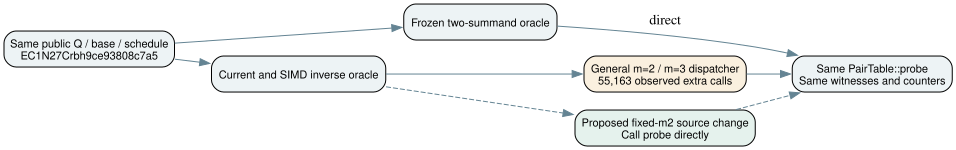

# Three-path collector regression attribution

Where the collector regression landed

PCC-20261117-1bc12f: unsigned exploratory producer data. Job20261117-013021-5b0f, exact frozen binaries and fixed N27 development fixture0. The native timing panel remains sealed. [pcc:unverified]

The current binary executes more whole-guest instructions than the frozen anchor. The dominant extra call layer is the fixed-two-summand oracle routing through the general m=2/m=3 dispatcher. The arithmetic kernel itself saves instructions, but it also inherits that extra query-dispatch work. The exact effect on native wall time requires a focused source change and a separate paired panel. [pcc:unverified]

Supplementary whole-guest rho captures: plain 10,358,485 Ir; negation 11,343,351 Ir, one each. All eight scalar answers and 1024 exported states were checked using the existing Python arithmetic. Repeated instruction counts do not estimate native clock uncertainty. [pcc:unverified]

A fixed-two-summand path lost specialization

Anchor oracle:55,163 direct PairTable::probe calls. Current and inverse oracle:55,163 additional general-dispatch calls. The general dispatcher contributes1,933,760 exclusive Ir in the current capture; the common probe callee remains3,597,613 inclusive Ir. Exclusive categories in the chart are disjoint. The probe inclusive count is a separate call-edge measurement and is never added to caller-inclusive cost. [pcc:unverified]

The ordinary pairwise call edge grows from19,892,502 to19,927,013 inclusive Ir. Its scalar inverse and full-point formula callee work are identical. Thus the runtime inverse selector is a smaller contributor here. Source inspection confirms BinaryBatchMitmOracle accepts exactly two summands, while calling a general dispatcher with the constant2. [pcc:unverified]

Source change and validation obligations

The focused patch replaces that general dispatch call with the same PairTable::probe followed by the same two-index witness allocation. Table preparation, group arithmetic, lookup counters, guards, caps, state schedule, rows/rank and verification remain as before. Generic three-summand handling elsewhere is untouched. Native cost remains pending. [pcc:unverified]

Local validation:27framework tests and strict library/probe Clippy passed; claimPCC-20261117-86dbb3 is unsigned and covers local checks only. Native preparation must match the frozen compiler/environment and repeat175complete maps,15loader cases, five512state traces and the existing overlapping framework/vector/inverse controls. A fresh native panel and post-timing instruction captures must test the optimization. [pcc:unverified]

Accounting: Callgrind Ir covers whole-process guest execution including input/calibration loading, setup, collection, matrix work, scalar group check, JSON and cleanup. It is not hardware-retired instructions, native wall time or the prior collector-only clock. Host placement and memory technology remain unknown; qualification is null. No source-default promotion or mathematical novelty conclusion. [pcc:unverified]

anchor: source 25be1116c0cc56f4d7be8a0932de7c6531cdf947; binary SHA256 1026bf749fbf8e4a1a266d9833b89a78bf3468956aa9e91eec1af9ffb84d0027; preparation 20261116-152859-d0d3. Receipt and exact job metadata hashes are pinned in profile-input.json. [pcc:unverified]

prepared: source cff665a3ed3206b991963a01df1efb2f5d17b5ee; binary SHA256 c808153b43186cf6012eee823b1784150105c6c95db6cfbaa54c66b3058f65a8; preparation 20261116-162931-e755. Receipt and exact job metadata hashes are pinned in profile-input.json. [pcc:unverified]

One L4 allocation,4CPU/8GiB/900seconds; arithmetic pinned to one allowed CPU; controller780seconds, IC120seconds, rho60seconds, instrumented preflights90seconds,32GiB virtual cap. Eight raw totals agree with header/footer, exclusive sums and annotation totals. The existing dimension10/531-column base and curve identity are unchanged. No new curve/isogeny fact; canonical curve and isogeny-route sources are unaffected. [pcc:unverified]

Sources and reproduction: PROTOCOL.md, profile-input.json, run_profile.py, analyze_profiles.py, replay_profiles.py, profile-findings.json, PairTable::probe, decompose_mitm and BinaryBatchMitmOracle::decompose. Raw capture hashes and archive receipts bind the evidence. [pcc:unverified]

